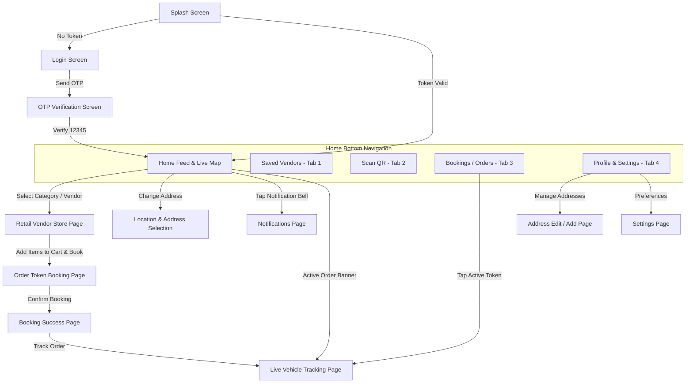

# OnWay User (Buyer) App — Page-by-Page Feature & Functionality Specification

This document provides a comprehensive, screen-by-screen breakdown of all features, functionalities, user actions, and backend API interactions implemented in the **OnWay Buyer Mobile Application** (`onway_flutter_app`).

---

## 📱 Application Overview & Architecture

* **Target Platform**: Android & iOS (Flutter 3.x, Material 3, Dark/Light Theme support)
* **Architecture Pattern**: Clean Architecture + Feature-First BLoC State Management (`flutter_bloc`)
* **Routing**: Declarative Routing with `go_router`
* **Maps & Geo**: OpenStreetMap (OSM) via `flutter_map` + `latlong2`
* **Realtime**: WebSockets / Socket.IO for live vehicle GPS tracking and proximity alerts
* **Backend Connection**: Centralized in `BuyerApiService` targeting `https://onway-backend-api.onrender.com/api/v1`

---

## 🗺 User Journey & Navigation Flow



---

## 📄 Page-by-Page Specifications

---

### 1. Splash Screen
* **File**: `lib/features/splash/presentation/pages/splash_page.dart`
* **Route**: `/` (`splash`)
* **BLoC**: `SplashBloc`, `SplashEvent`, `SplashState`

#### Key Functionalities:
1. **Brand Identity**: Animated OnWay logo display with fade and scale transition.
2. **Session Verification**: 
   * Reads JWT auth token from device `SharedPreferences`.
   * Pings `BuyerApiService.init()` to restore authorization headers.
3. **Smart Navigation Routing**:
   * If a valid JWT token exists → routes directly to `/home`.
   * If no token or token expired → routes to `/login`.

---

### 2. Login Screen
* **File**: `lib/features/auth/presentation/pages/login_page.dart`
* **Route**: `/login` (`login`)
* **BLoC**: `LoginBloc`, `LoginEvent`, `LoginState`

#### Key Functionalities:
1. **Phone Number Input**: Formatted text field with default `+91` (India) country code prefix.
2. **Input Validation**: Ensures valid 10-digit mobile number before enabling the action button.
3. **Developer Cost-Saver Notice**: Displays a subtle hint banner informing testers that SMS verification is in development bypass mode.
4. **Trigger OTP**:
   * Dispatches `SendOtpRequested` to `LoginBloc`.
   * Calls API: `POST /api/v1/auth/send-otp` with `{"phone": "+91XXXXXXXXXX", "role": "BUYER"}`.
   * On success, navigates to `/otp` with the phone number passed as route extra.

---

### 3. OTP Verification Screen
* **File**: `lib/features/auth/presentation/pages/otp_page.dart`
* **Route**: `/otp` (`otp`)
* **BLoC**: `OtpBloc`, `OtpEvent`, `OtpState`

#### Key Functionalities:
1. **PIN Code Entry**: 5-digit individual pin input boxes with auto-focus progression.
2. **Bypass OTP Support**: Accepts `12345` (or `123456`) in development mode without requiring cellular SMS.
3. **Resend Timer**: Countdown timer (30s) before enabling "Resend Code".
4. **Authentication & Token Persistence**:
   * Calls API: `POST /api/v1/auth/verify-otp`.
   * Saves JWT auth token to `SharedPreferences` via `BuyerApiService.setAuthToken()`.
   * Automatically creates user and buyer profile records in PostgreSQL on first login.
5. **Redirection**: On successful authentication, clears auth stack and navigates to `/home`.

---

### 4. Home Page & Live Map Feed (Bottom Nav Tab 0)
* **File**: `lib/features/home/presentation/pages/home_page.dart`
* **Route**: `/home` (`home`)
* **BLoC**: `HomeBloc`, `HomeEvent`, `HomeState`

```
┌──────────────────────────────────────────────────┐
│  📍 Perumbilavu Junction, Thrissur...  ▼   🔔 (2)│  <- HomeAppBar
├──────────────────────────────────────────────────┤
│                                                  │
│             [ INTERACTIVE LIVE MAP ]             │  <- MapSection
│       (Moving vendor delivery vans, user pin)    │
│                                                  │
├──────────────────────────────────────────────────┤
│  ⚡ Active Token #TK-108 | Arriving in 8 mins >  │  <- ActiveOrderCard
├──────────────────────────────────────────────────┤
│  [All]  [Vegetables]  [Dairy]  [Fruits]  [Fish]  │  <- CategoryChips
├──────────────────────────────────────────────────┤
│  NEARBY MOVING VENDORS                           │
│  ┌─────────────────────────────────────────────┐ │
│  │ 🚚 Perumbilavu Organic Veggies   ★ 4.9 (1.2km)│ <- VendorCard
│  │    Route: Highway Road | Closes in 45m      │ │
│  │    [ View Store & Book ]                    │ │
│  └─────────────────────────────────────────────┘ │
└──────────────────────────────────────────────────┘
```

#### Key Components & Functionalities:
1. **Home App Bar (`home_app_bar.dart`)**:
   * Displays the current active delivery location address.
   * Tapping the address opens the **Location Selection Sheet** (`location_selection_page.dart`).
   * Notification bell icon with dynamic unread count badge; opens `notifications_page.dart`.
2. **Interactive Live Map Section (`map_section.dart`)**:
   * OpenStreetMap rendered using `flutter_map`.
   * User's current location pin (GPS or chosen saved address).
   * Live vendor markers with vehicle icons and category color badges.
   * Tapping any vendor vehicle marker on the map opens a preview bottom sheet with distance and ETA.
3. **Active Token / Order Banner (`active_order_card.dart`)**:
   * Visible only when the buyer has an active order token (`EN_ROUTE` or `SELLER_NEARBY`).
   * Displays Token ID (`#TK-108`), Vendor Name, Item count, and Live ETA countdown.
   * Tapping the banner opens the full-screen **Live Tracking Page** (`live_tracking_page.dart`).
4. **Dynamic Category Chips (`category_chips.dart`)**:
   * Filter horizontal scroll: *All, Organic Vegetables, Dairy & Milk, Fresh Fruits, Seafood, Bakery*.
   * Tapping a category dynamically filters both the map markers and the vendor list below.
5. **Moving Vendors Feed (`vendor_card.dart`)**:
   * Pull-to-refresh list of nearby moving sellers fetched from `GET /api/v1/buyer/nearby?lat=...&lng=...`.
   * Displays seller name, category badge, distance (in km), ETA, rating, and vehicle registration number.
   * Bookmark heart icon to toggle favorite status (`POST /api/v1/buyer/favorites/:id`).
   * Direct action button: "View Store" (navigates to `retail_vendor_page.dart`).
6. **Floating Bottom Navigation Bar (`bottom_nav_bar.dart`)**:
   * 5 navigation tabs: **Home**, **Saved**, **QR Scan**, **Bookings**, **Profile**.

---

### 5. Retail Vendor Store & Inventory Page
* **File**: `lib/features/vendor_details/presentation/pages/retail_vendor_page.dart`
* **Route**: `/retail-vendor` (pushed with `VendorInfo` argument)
* **BLoC**: `VendorDetailsBloc`, `VendorDetailsEvent`, `VendorDetailsState`

#### Key Functionalities:
1. **Vendor Profile Header**:
   * Business banner, rating, category, verified badge, and vehicle number (e.g. `KL-46-BW-1008`).
   * Live status indicator: "Broadcasting Live GPS" vs "Offline".
   * Operating hours and active delivery route summary.
2. **Catalog & Product Filtering**:
   * Fetches live product inventory from `GET /api/v1/buyer/vendors/:id/products`.
   * Shows item name, description, unit pricing (e.g. `₹40 / kg`), and in-stock badges.
3. **Cart & Quantity Selector**:
   * Interactive `+` / `-` buttons to increment/decrement items.
   * Floating bottom checkout bar updating total quantity and estimated amount in real-time.
4. **Proceed Action**:
   * "Book Order Token" button pushes to `booking_page.dart` with selected cart items.

---

### 6. Order Token Booking Page
* **File**: `lib/features/vendor_details/presentation/pages/booking_page.dart`

#### Key Functionalities:
1. **Hyperlocal Token Concept**:
   * OnWay uses **zero-advance-payment tokens**. Buyers reserve items from moving vendors on their route and pay on arrival.
2. **Delivery Stop Selector**:
   * Choose between saved addresses (Home, Office) or drop a custom pin along the vendor's route.
3. **Arrival Time Window**:
   * Displays vendor's estimated arrival at the buyer's stop based on current vehicle velocity and waypoints.
4. **Order Summary**:
   * Itemized breakdown with subtotal, applicable delivery charges (if any), and total payable amount.
5. **Confirm Token**:
   * Calls API: `POST /api/v1/bookings` with selected address, items, and coordinates.
   * On success, routes to `booking_success_page.dart`.

---

### 7. Booking Success Screen
* **File**: `lib/features/vendor_details/presentation/pages/booking_success_page.dart`

#### Key Functionalities:
1. **Token Confirmation Display**:
   * Displays large prominent Token ID (e.g., `#TK-204`).
   * Animated success checkmark with celebratory feedback.
2. **Instructions for Buyer**:
   * "Vendor will reach your delivery stop in ~15 mins. Keep cash or UPI ready."
3. **Direct Actions**:
   * "Track Live on Map" → Opens `live_tracking_page.dart`.
   * "Back to Home" → Returns to main dashboard.

---

### 8. Live Vehicle Tracking Page
* **File**: `lib/features/vendor_details/presentation/pages/live_tracking_page.dart`
* **Route**: `/live-tracking` (pushed with `ActiveOrderInfo`)

#### Key Functionalities:
1. **Real-time Map Tracking**:
   * Displays full-screen OpenStreetMap with:
     * Vendor's vehicle moving marker in real-time.
     * Buyer's delivery address marker.
     * Route polyline path with upcoming waypoints.
2. **Socket.IO Real-time Updates**:
   * Listens to `vendor:location:update` WebSocket events for live GPS lat/long stream.
   * Automatically updates distance remaining and ETA without reloading.
3. **Status Progression Bar**:
   * Visual progress steps: `Order Confirmed` → `En Route` → `Nearby (Within 500m)` → `Arrived`.
4. **Proximity Alerts**:
   * When vendor crosses the 500m geofence radius, triggers a prominent banner and sound alert: *"Seller is nearby! Please be ready at your stop."*
5. **Contact Vendor**:
   * Direct dialer button to call vendor's phone number.
   * "Cancel Token" button with confirmation prompt.

---

### 9. Bookings & Order History (Bottom Nav Tab 3)
* **File**: `lib/features/orders/presentation/pages/bookings_page.dart`

#### Key Functionalities:
1. **Segmented Tabs**:
   * **Active Tokens**: Live tokens currently en route or scheduled for today.
   * **History**: Completed, cancelled, or expired past orders.
2. **Order Card Details**:
   * Vendor name, date/time, total item count, token badge.
   * Status indicators: `EN_ROUTE` (Green), `COMPLETED` (Blue), `CANCELLED` (Grey).
3. **Action Triggers**:
   * Tapping an active booking opens the **Live Tracking Page**.
   * "Re-order Token" button for quickly repeating past favorite orders.

---

### 10. Saved / Favorite Vendors (Bottom Nav Tab 1)
* **File**: `lib/features/home/presentation/pages/saved_vendors_page.dart`

#### Key Functionalities:
1. **Bookmarked Sellers List**:
   * Displays all vendors bookmarked by the user (`isFavorite = true`).
2. **Route Schedule Indicator**:
   * Shows whether the favorite seller is currently active on route today or offline.
3. **Notify On Arrival Toggle**:
   * Allows buyers to subscribe to push alerts when a specific favorite seller enters their village/neighborhood.

---

### 11. QR Scan Vendor Page (Bottom Nav Tab 2)
* **File**: `lib/features/vendor_details/presentation/pages/scan_vendor_page.dart`

#### Key Functionalities:
1. **Camera Scanner**:
   * Opens integrated camera viewfinder with a scanning reticle.
2. **QR Code Resolution**:
   * Scans the physical QR code displayed on the moving vendor's vehicle.
   * Decodes Vendor ID or vehicle registration number.
3. **Instant Store Open**:
   * Immediately navigates to `retail_vendor_page.dart` for that vendor so the buyer can browse and pick items right in front of the vehicle.

---

### 12. Location & Address Selection Sheet
* **File**: `lib/features/home/presentation/pages/location_selection_page.dart`

#### Key Functionalities:
1. **GPS Auto-Detect**:
   * "Use Current GPS Location" button queries device geolocator.
2. **Saved Addresses List**:
   * Lists user's saved addresses fetched from `GET /api/v1/user/addresses` (e.g., Home, Office).
   * Selecting an address updates the Home feed and recalculates all vendor distances and ETAs.
3. **Add New Address**:
   * Button opens `address_edit_page.dart` to save a new recurring delivery stop.

---

### 13. Address Edit / Add Page
* **File**: `lib/features/home/presentation/pages/address_edit_page.dart`

#### Key Functionalities:
1. **Map Pin Drop**:
   * Draggable map marker allowing precise pin placement for rural/highway stops.
2. **Form Details**:
   * Label (Home, Office, Other), full address line, landmark, contact phone.
   * "Set as Default Address" toggle switch.
3. **API Persistence**:
   * Calls `POST /api/v1/user/addresses` or `PUT /api/v1/user/addresses/:id`.

---

### 14. Notifications Center
* **File**: `lib/features/home/presentation/pages/notifications_page.dart`

#### Key Functionalities:
1. **Chronological Notification List**:
   * Proximity alerts: *"Perumbilavu Organic Veggies is within 500m of your stop."*
   * Route announcements: *"Malabar Dairy started their morning route."*
   * Booking status updates: *"Token #TK-108 has been fulfilled."*
2. **Read / Unread Badges**:
   * Visual unread indicator; "Mark All as Read" action calls `PUT /api/v1/user/notifications/mark-read`.
3. **Deep-linking**:
   * Tapping a proximity notification opens the **Live Tracking Page** directly.

---

### 15. Profile & Settings (Bottom Nav Tab 4)
* **File**: `lib/features/home/presentation/pages/profile_page.dart` and `settings_page.dart`

#### Key Functionalities:
1. **User Profile View**:
   * Full name, phone number, member since date, avatar thumbnail.
   * "Edit Profile" action to update name, email, or language preference.
2. **Manage Addresses**:
   * Shortcut to view, edit, or delete saved delivery addresses.
3. **Preferences & Settings (`settings_page.dart`)**:
   * **Push Notifications**: Toggle sound/vibration alerts for vendor proximity.
   * **Dark Mode**: Switch between Light theme and high-contrast Dark theme.
   * **Language**: Switch between English and regional languages (Malayalam, etc.).
4. **Logout**:
   * Dialog confirmation; calls `POST /api/v1/auth/logout`, clears stored JWT tokens, and redirects to `/login`.

---

## 🔗 Backend API Endpoints Mapped to Pages

| Page / Feature | HTTP Method | Endpoint | Description |
| :--- | :--- | :--- | :--- |
| **Login** | `POST` | `/api/v1/auth/send-otp` | Triggers OTP (dev bypass: `12345`) |
| **OTP Verification** | `POST` | `/api/v1/auth/verify-otp` | Validates code, issues JWT token |
| **Home Feed** | `GET` | `/api/v1/buyer/nearby` | Fetches moving vendors sorted by distance |
| **Home Categories** | `GET` | `/api/v1/buyer/categories` | Lists active categories |
| **Vendor Details** | `GET` | `/api/v1/buyer/vendors/:id` | Full business info & route schedule |
| **Vendor Products** | `GET` | `/api/v1/buyer/vendors/:id/products`| Live inventory catalog |
| **Create Booking** | `POST` | `/api/v1/bookings` | Reserves order token with items |
| **Bookings List** | `GET` | `/api/v1/bookings` | Fetches active and past order tokens |
| **Live Tracking** | `GET` | `/api/v1/bookings/:id` | Fetches live order status & vehicle coords |
| **Saved Vendors** | `GET` | `/api/v1/buyer/favorites` | Fetches bookmarked sellers |
| **Toggle Favorite** | `POST` | `/api/v1/buyer/favorites/:id` | Adds/removes vendor from favorites |
| **User Addresses** | `GET`, `POST` | `/api/v1/user/addresses` | Lists and creates saved delivery stops |
| **Notifications** | `GET` | `/api/v1/user/notifications` | Fetches proximity & order notifications |
| **User Profile** | `GET`, `PUT` | `/api/v1/user/profile` | Fetches and updates user profile data |
| **Live Socket** | `WSS` | `wss://.../socket.io` | Real-time vehicle GPS & proximity alerts |
