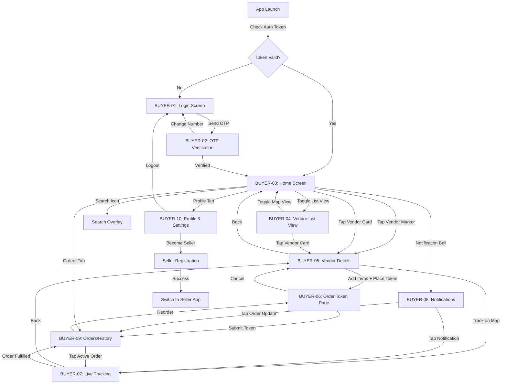
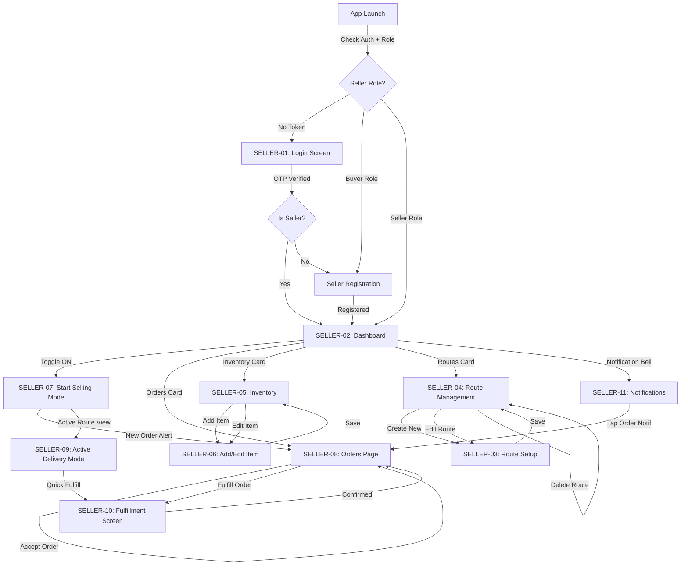

# 🧭 OnWay Market — Master UI Navigation Map

> How every screen connects to every other screen — for both Buyer and Seller apps.

---

## 1. Buyer App — Complete Navigation Flow



---

## 2. Seller App — Complete Navigation Flow



---

## 3. Cross-App Connections

```
┌─────────────────────────────────────────────────────────────┐
│                    SHARED BACKEND                            │
│                                                              │
│   ┌──────────────┐          ┌──────────────────┐            │
│   │  BUYER APP   │◄────────►│   SELLER APP     │            │
│   │              │  REST    │                  │            │
│   │ • Discovery  │  API     │ • Management     │            │
│   │ • Ordering   │  +       │ • Fulfillment    │            │
│   │ • Tracking   │ Socket   │ • GPS Tracking   │            │
│   └──────────────┘  .IO     └──────────────────┘            │
│          │                          │                        │
│          └────────┬─────────────────┘                        │
│                   │                                          │
│          ┌────────▼────────┐                                 │
│          │   OnWay API     │                                 │
│          │   (Express)     │                                 │
│          ├─────────────────┤                                 │
│          │ MySQL + Redis   │                                 │
│          │ Socket.IO       │                                 │
│          │ Firebase FCM    │                                 │
│          └─────────────────┘                                 │
└─────────────────────────────────────────────────────────────┘
```

---

## 4. Real-Time Data Flow Map

```
SELLER APP                    SERVER                    BUYER APP
─────────                    ──────                    ─────────

POST /vendors/location  ──►  Update DB + Redis
                              │
                              ├── Socket: 'vendor_location_update'  ──►  Move marker on map
                              │
                              ├── Proximity check
                              │   │
                              │   ├── < 100m? ──► Socket: 'vendor_nearby'  ──►  Alert banner
                              │   │              FCM: "📍 Nearby!"          ──►  Push notification
                              │   │
                              │   └── > 120m (after enter)?
                              │       ├── Set order.status = 'expired'
                              │       ├── Socket: 'order_expired'     ──►  "Vendor passed" UI
                              │       └── FCM: "⏰ Expired"           ──►  Push notification
                              │

POST /orders (buyer)    ◄──   Create order + transaction
                              │
                              ├── Socket: 'new_order'          ──►  New order card appears
                              └── FCM: "🛒 New Order!"         ──►  Push notification

POST /orders/:id/accept ──►  Status: requested → accepted
                              │
                              ├── Socket: 'order_update'       ──►  Status badge update
                              └── FCM: "✅ Accepted!"          ──►  Push notification

POST /orders/:id/fulfill ──► Status: accepted → fulfilled
                              │
                              ├── Socket: 'order_update'       ──►  Celebration animation
                              └── FCM: "🎉 Complete!"          ──►  Push notification
```

---

## 5. Bottom Navigation Structure

### Buyer App
```
┌─────────┬─────────┬─────────┬─────────┐
│  🗺️     │  📋     │  📦     │  👤     │
│  Home   │  List   │ Orders  │ Profile │
│ (B03)   │ (B04)   │ (B09)   │ (B10)   │
└─────────┴─────────┴─────────┴─────────┘
```

### Seller App
```
┌─────────┬─────────┬─────────┬─────────┐
│  📊     │  📦     │  📋     │  🗺️     │
│ Dash    │ Orders  │ Items   │ Routes  │
│ (S02)   │ (S08)   │ (S05)   │ (S04)   │
└─────────┴─────────┴─────────┴─────────┘
```

---

## 6. Complete Page Index

### Buyer App (10 Screens)

| ID | Screen | File | Priority |
|----|--------|------|----------|
| BUYER-01 | Login Screen | [01_login_screen.md](./buyer_app/01_login_screen.md) | P0 |
| BUYER-02 | OTP Verification | [02_otp_verification_screen.md](./buyer_app/02_otp_verification_screen.md) | P0 |
| BUYER-03 | Home Screen (Live Map) | [03_home_screen.md](./buyer_app/03_home_screen.md) | P0 |
| BUYER-04 | Vendor List View | [04_vendor_list_view.md](./buyer_app/04_vendor_list_view.md) | P1 |
| BUYER-05 | Vendor Details Page | [05_vendor_details_page.md](./buyer_app/05_vendor_details_page.md) | P0 |
| BUYER-06 | Order Token Page | [06_order_token_page.md](./buyer_app/06_order_token_page.md) | P0 |
| BUYER-07 | Live Tracking Page | [07_live_tracking_page.md](./buyer_app/07_live_tracking_page.md) | P0 |
| BUYER-08 | Notifications | [08_notifications.md](./buyer_app/08_notifications.md) | P1 |
| BUYER-09 | Orders / History | [09_orders_history_page.md](./buyer_app/09_orders_history_page.md) | P0 |
| BUYER-10 | Profile & Settings | [10_profile_settings.md](./buyer_app/10_profile_settings.md) | P2 |

### Seller App (11 Screens)

| ID | Screen | File | Priority |
|----|--------|------|----------|
| SELLER-01 | Login Screen | [01_login_screen.md](./seller_app/01_login_screen.md) | P0 |
| SELLER-02 | Dashboard | [02_dashboard.md](./seller_app/02_dashboard.md) | P0 |
| SELLER-03 | Route Setup | [03_route_setup.md](./seller_app/03_route_setup.md) | P0 |
| SELLER-04 | Route Management | [04_route_management.md](./seller_app/04_route_management.md) | P1 |
| SELLER-05 | Inventory Page | [05_inventory.md](./seller_app/05_inventory.md) | P0 |
| SELLER-06 | Add/Edit Item | [06_add_edit_item.md](./seller_app/06_add_edit_item.md) | P1 |
| SELLER-07 | Start Selling Mode | [07_start_selling_mode.md](./seller_app/07_start_selling_mode.md) | P0 |
| SELLER-08 | Orders Page | [08_orders_page.md](./seller_app/08_orders_page.md) | P0 |
| SELLER-09 | Active Delivery Mode | [09_active_delivery_mode.md](./seller_app/09_active_delivery_mode.md) | P1 |
| SELLER-10 | Fulfillment Screen | [10_fulfillment_screen.md](./seller_app/10_fulfillment_screen.md) | P1 |
| SELLER-11 | Notifications | [11_notifications.md](./seller_app/11_notifications.md) | P1 |

---

## 7. Complete API → Screen Mapping

### Authentication APIs
| API | Used By Screens |
|-----|----------------|
| `POST /auth/send-otp` | BUYER-01, SELLER-01 |
| `POST /auth/verify-otp` | BUYER-02, SELLER-01 |
| `POST /auth/logout` | BUYER-10 |

### User APIs
| API | Used By Screens |
|-----|----------------|
| `GET /me` | BUYER-10, SELLER-01 (role check) |
| `POST /users/fcm-token` | BUYER-02 (post-login), SELLER-01 (post-login) |
| `PUT /me/location` | BUYER-10 |

### Vendor Discovery APIs (Buyer-Side)
| API | Used By Screens |
|-----|----------------|
| `GET /vendors/nearby` | BUYER-03, BUYER-04 |
| `GET /vendors/:id` | BUYER-05 |
| `GET /vendors/:id/items` | BUYER-05 |
| `GET /vendors/:id/route` | BUYER-05, BUYER-07 |
| `GET /vendors/:id/eta` | BUYER-03, BUYER-04, BUYER-05 |
| `POST /vendors/:id/favorite` | BUYER-03, BUYER-04, BUYER-05 |
| `GET /vendors/favorites` | BUYER-04, BUYER-10 |

### Seller Management APIs
| API | Used By Screens |
|-----|----------------|
| `POST /seller/register` | BUYER-10, SELLER-01 |
| `GET /seller/dashboard` | SELLER-02 |
| `POST /vendors/status` | SELLER-02, SELLER-07 |
| `POST /vendors/location` | SELLER-07, SELLER-09 |

### Inventory APIs
| API | Used By Screens |
|-----|----------------|
| `GET /seller/items` | SELLER-05 |
| `POST /seller/items` | SELLER-06 |
| `PUT /seller/items/:id` | SELLER-05, SELLER-06 |
| `DELETE /seller/items/:id` | SELLER-05, SELLER-06 |

### Order APIs
| API | Used By Screens |
|-----|----------------|
| `POST /orders` | BUYER-06 |
| `GET /orders` | BUYER-09 |
| `GET /orders/:id` | BUYER-09 (detail view) |
| `GET /seller/orders` | SELLER-08 |
| `POST /orders/:id/accept` | SELLER-08 |
| `POST /orders/:id/reject` | SELLER-08 |
| `POST /orders/:id/fulfill` | SELLER-08, SELLER-10 |

### Route APIs
| API | Used By Screens |
|-----|----------------|
| `POST /seller/routes` | SELLER-03 |
| `GET /seller/routes` | SELLER-04 |
| `PUT /seller/routes/:id` | SELLER-03 (edit mode) |
| `DELETE /seller/routes/:id` | SELLER-04 |
| `POST /seller/routes/:id/activate` | SELLER-04 |
| `GET /seller/routes/active` | SELLER-02, SELLER-07, SELLER-09 |

### Socket.IO Events
| Event | Direction | Used By Screens |
|-------|-----------|----------------|
| `vendor_location_update` | Server → Buyer | BUYER-03, BUYER-04, BUYER-07 |
| `vendor_nearby` | Server → Buyer | BUYER-03, BUYER-07, BUYER-08 |
| `order_expired` | Server → Buyer | BUYER-07, BUYER-08, BUYER-09 |
| `new_order` | Server → Seller | SELLER-02, SELLER-07, SELLER-08, SELLER-11 |
| `order_update` | Server → Buyer | BUYER-07, BUYER-08, BUYER-09 |
| `route_progress_update` | Server → All | BUYER-07, SELLER-09 |

---

## 8. Shared Components

These UI components should be built once and reused across screens:

| Component | Used In |
|-----------|---------|
| **MapView** | BUYER-03, BUYER-05, BUYER-07, SELLER-03, SELLER-04, SELLER-07, SELLER-09 |
| **VendorCard** | BUYER-03, BUYER-04 |
| **OrderCard** | BUYER-09, SELLER-08 |
| **StatusBadge** | BUYER-09, SELLER-08 |
| **OTPInput** | BUYER-02, SELLER-01 |
| **CategoryFilter** | BUYER-03, BUYER-04 |
| **BottomSheet** | BUYER-03, BUYER-05, SELLER-07, SELLER-09 |
| **EmptyState** | All list screens |
| **LoadingSkeleton** | All data screens |
| **NotificationCard** | BUYER-08, SELLER-11 |
| **QuantityStepper** | BUYER-05, BUYER-06 |

---

*This document is the master reference for UI navigation architecture. Every screen spec document is linked above with its complete API integration details.*
