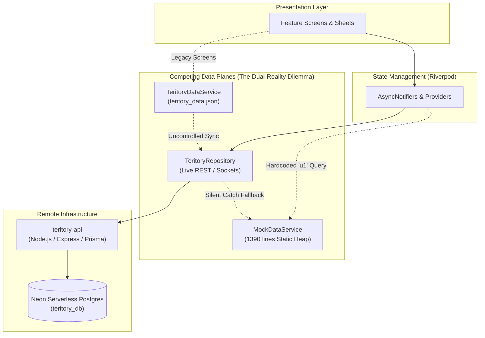
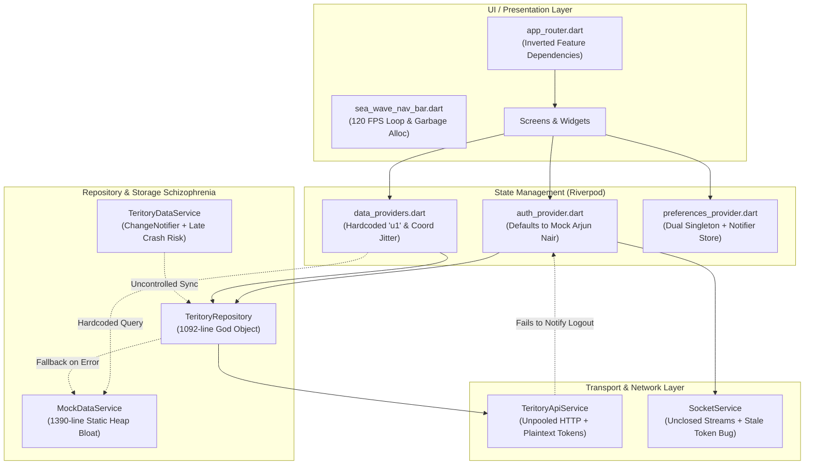

# Teritory Platform — Master Architectural Audit & Full-Stack System Deep Analysis

> **Document Type**: Master Full-Stack Engineering Audit & Architectural Synthesis  
> **Platform Scope**: Flutter Mobile Client (`/home/akhilva/onway-api/teritory/`) & Node.js/Express Backend (`/home/akhilva/onway-api/teritory-api/`)  
> **Target Production System**: Teritory Geospatial Travel, Clan, Expedition & Rally Platform  
> **Review Scope**: Full-Stack Architecture, Database Schema, REST APIs, Socket.IO Real-Time Engine, State Management, UI/UX Presentation Layer, Security & DevOps  
> **Synthesis Basis**: Consolidated Technical Audits from Senior Principal Backend Architect, Senior Flutter/Dart Architect, UI/UX Systems Specialist, and Distributed Systems Security Specialist  
> **Date**: November 2026 · Master Architecture Reference  

---

## Master Table of Contents

1. [Executive Synthesis & Cross-Platform System Health](#1-executive-synthesis--cross-platform-system-health)
   - [1.1 Platform Overview & Engineering Context](#11-platform-overview--engineering-context)
   - [1.2 Master Cross-Platform System Health Matrix](#12-master-cross-platform-system-health-matrix)
   - [1.3 Top 10 Critical Architectural Vulnerabilities & Systemic Hazards](#13-top-10-critical-architectural-vulnerabilities--systemic-hazards)
   - [1.4 The "Dual-Reality" Architectural Dilemma & Transition Debt](#14-the-dual-reality-architectural-dilemma--transition-debt)
2. [Backend Infrastructure & Core Framework Audit (`teritory-api`)](#2-backend-infrastructure--core-framework-audit-teritory-api)
   - [2.1 Database Schema & Data Integrity (`prisma/schema.prisma`)](#21-database-schema--data-integrity-prismaschemaprisma)
   - [2.2 Server Initialization & Process Lifecycle (`src/server.js`)](#22-server-initialization--process-lifecycle-srcserverjs)
   - [2.3 Application Bootstrap & HTTP Middleware Stack (`src/app.js`)](#23-application-bootstrap--http-middleware-stack-srcappjs)
   - [2.4 Authentication & Session Security (`src/middleware/authenticate.js`)](#24-authentication--session-security-srcmiddlewareauthenticatejs)
   - [2.5 Central Error Handling Pipeline (`src/middleware/errorHandler.js`)](#25-central-error-handling-pipeline-srcmiddlewareerrorhandlerjs)
   - [2.6 Input Validation Architecture (`src/middleware/validate.js`)](#26-input-validation-architecture-srcmiddlewarevalidatejs)
   - [2.7 Database & Cache Configuration (`src/config/prisma.js` & `src/config/redis.js`)](#27-database--cache-configuration-srcconfigprismajs--srcconfigredisjs)
   - [2.8 Mathematical & Geospatial Utilities (`src/utils/`)](#28-mathematical--geospatial-utilities-srcutils)
   - [2.9 Background Automation & Distributed Locking (`src/jobs/tripExpiry.cron.js`)](#29-background-automation--distributed-locking-srcjobstripexpirycronjs)
   - [2.10 Real-Time Communication Layer (`src/sockets/index.js`)](#210-real-time-communication-layer-srcsocketsindexjs)
   - [2.11 Dependency Manifest & Engineering Governance (`package.json`)](#211-dependency-manifest--engineering-governance-packagejson)
   - [2.12 Backend Core Implementation Priority Matrix](#212-backend-core-implementation-priority-matrix)
3. [Backend Domain Controllers & Route Modules Deep Audit](#3-backend-domain-controllers--route-modules-deep-audit)
   - [3.1 Systemic Controller Architecture Issues](#31-systemic-controller-architecture-issues)
   - [3.2 Module 1: Auth Module (`src/modules/auth/`)](#32-module-1-auth-module-srcmodulesauth)
   - [3.3 Module 2: Users Module (`src/modules/users/`)](#33-module-2-users-module-srcmodulesusers)
   - [3.4 Module 3: Flags Module (`src/modules/flags/`)](#34-module-3-flags-module-srcmodulesflags)
   - [3.5 Module 4: Clans Module (`src/modules/clans/`)](#35-module-4-clans-module-srcmodulesclans)
   - [3.6 Module 5: Communities Module (`src/modules/communities/`)](#36-module-5-communities-module-srcmodulescommunities)
   - [3.7 Module 6: Trips Module (`src/modules/trips/`)](#37-module-6-trips-module-srcmodulestrips)
   - [3.8 Module 7: Rallies Module (`src/modules/rallies/`)](#38-module-7-rallies-module-srcmodulesrallies)
   - [3.9 Module 8: Rankings Module (`src/modules/rankings/`)](#39-module-8-rankings-module-srcmodulesrankings)
   - [3.10 Module 9: Services Module (`src/modules/services/`)](#310-module-9-services-module-srcmodulesservices)
   - [3.11 Module 10: Notifications Module (`src/modules/notifications/`)](#311-module-10-notifications-module-srcmodulesnotifications)
   - [3.12 Actionable Backend Modules Remediation Matrix](#312-actionable-backend-modules-remediation-matrix)
4. [Flutter Core Architecture & State Management (`teritory/lib/core/`)](#4-flutter-core-architecture--state-management-teritorylibcore)
   - [4.1 Core Architecture & Health Matrix](#41-core-architecture--health-matrix)
   - [4.2 Dependency Audit (`pubspec.yaml`)](#42-dependency-audit-pubspecyaml)
   - [4.3 App Configuration & Environment Setup (`config/app_config.dart`)](#43-app-configuration--environment-setup-configapp_configdart)
   - [4.4 Design System & Theming Engine (`theme/teritory_theme.dart`)](#44-design-system--theming-engine-themeteritory_themedart)
   - [4.5 Navigation & Routing Subsystem (`router/app_router.dart`)](#45-navigation--routing-subsystem-routerapp_routerdart)
   - [4.6 Networking & Transport Layer (`services/api_service.dart`)](#46-networking--transport-layer-servicesapi_servicedart)
   - [4.7 Real-Time Socket Service (`services/socket_service.dart`)](#47-real-time-socket-service-servicessocket_servicedart)
   - [4.8 Teritory Repository God Object (`services/teritory_repository.dart`)](#48-teritory-repository-god-object-servicesteritory_repositorydart)
   - [4.9 Mock Data Service & Binary Bloat (`services/mock_data_service.dart`)](#49-mock-data-service--binary-bloat-servicesmock_data_servicedart)
   - [4.10 Teritory Data Service & Uncontrolled Sync (`services/teritory_data_service.dart`)](#410-teritory-data-service--uncontrolled-sync-servicesteritory_data_servicedart)
   - [4.11 Data Models Architecture Deep Audit (`models/`)](#411-data-models-architecture-deep-audit-models)
   - [4.12 Authentication Provider (`providers/auth_provider.dart`)](#412-authentication-provider-providersauth_providerdart)
   - [4.13 Data Providers & Coordinate Jitter (`providers/data_providers.dart`)](#413-data-providers--coordinate-jitter-providersdata_providersdart)
   - [4.14 Preferences Provider & Dual Store Anti-Pattern (`providers/preferences_provider.dart`)](#414-preferences-provider--dual-store-anti-pattern-providerspreferences_providerdart)
   - [4.15 Sea Wave Navigation Bar & 120 FPS Loop (`widgets/sea_wave_nav_bar.dart`)](#415-sea-wave-navigation-bar--120-fps-loop-widgetssea_wave_nav_bardart)
   - [4.16 Teritory Logo & Image Decoding Memory (`widgets/teritory_logo.dart`)](#416-teritory-logo--image-decoding-memory-widgetsteritory_logodart)
   - [4.17 Systemic Architectural Hazards & Cross-Cutting Risks](#417-systemic-architectural-hazards--cross-cutting-risks)
   - [4.18 Flutter Core Layer Prioritized Remediation Roadmap](#418-flutter-core-layer-prioritized-remediation-roadmap)
5. [Flutter Feature Screens & UI/UX Audit (`teritory/lib/features/`)](#5-flutter-feature-screens--uiux-audit-teritorylibfeatures)
   - [5.1 Executive Summary & Transversal Feature Gaps](#51-executive-summary--transversal-feature-gaps)
   - [5.2 Screen-by-Screen Deep Architectural & UX Review (36 Surfaces)](#52-screen-by-screen-deep-architectural--ux-review-36-surfaces)
   - [5.3 Cross-Feature Integration Gaps Table](#53-cross-feature-integration-gaps-table)
   - [5.4 Unused, Orphaned & Duplicate Code Inventory](#54-unused-orphaned--duplicate-code-inventory)
   - [5.5 Features Shown in UI But Non-Functional or Stubbed (11 Stubs)](#55-features-shown-in-ui-but-non-functional-or-stubbed-11-stubs)
6. [Cross-Cutting Architectural Synthesis & End-to-End System Integration](#6-cross-cutting-architectural-synthesis--end-to-end-system-integration)
   - [6.1 Master End-to-End API Integration Matrix (All 68 Routes Mapped)](#61-master-end-to-end-api-integration-matrix-all-68-routes-mapped)
   - [6.2 End-to-End Data Flow & Broken Chains](#62-end-to-end-data-flow--broken-chains)
   - [6.3 Comprehensive Test Coverage Audit (Backend 0.0%, Flutter Test Suite Breakdown)](#63-comprehensive-test-coverage-audit-backend-00-flutter-test-suite-breakdown)
   - [6.4 End-to-End Security Vulnerability Assessment & Threat Model](#64-end-to-end-security-vulnerability-assessment--threat-model)
   - [6.5 Real-Time Socket Architecture & Event Matrix](#65-real-time-socket-architecture--event-matrix)
   - [6.6 End-to-End Error Handling Pipeline](#66-end-to-end-error-handling-pipeline)
   - [6.7 Offline Resilience & Data Persistence Architecture](#67-offline-resilience--data-persistence-architecture)
   - [6.8 Performance & Resource Consumption Bottlenecks](#68-performance--resource-consumption-bottlenecks)
   - [6.9 DevOps, Infrastructure & Observability](#69-devops-infrastructure--observability)
7. [Consolidated Master Remediation & Implementation Roadmap](#7-consolidated-master-remediation--implementation-roadmap)
   - [7.1 Unified 5-Phase Master Plan](#71-unified-5-phase-master-plan)
   - [7.2 Component Ownership & Effort Estimation Matrix](#72-component-ownership--effort-estimation-matrix)


---

## 1. Executive Synthesis & Cross-Platform System Health

### 1.1 Platform Overview & Engineering Context

The **Teritory** platform is an ambitious geospatial social network, overland exploration system, and expedition coordination engine. Its primary capabilities encompass:
- **Territory Exploration & Footprints**: Dropping spatial flags (`Flag`), categorizing hidden spots, exploring sub-territories, commenting, and awarding prestige kudos.
- **Clans & Communities**: Organizing travelers into interest-based regional clans (e.g., Overland, Bikers, Trekkers) led by Chieftains, subdividing into focused communities with real-time chat feeds.
- **Expeditions & Trips**: Proposing multi-waypoint routes (`TripPlan`), voting on routes, launching live active expeditions (`Trip`), and validating GPS arrivals within a 15km threshold.
- **Legendary Rallies**: Time-limited collective traveler gatherings (`LegendaryRally`) requiring group arrival verification (within 500m) to unlock collective major flags and passport stamps.
- **Prestige Rankings & Passport**: Multi-dimensional global, regional, clan, and friend leaderboards powered by a composite scoring algorithm tracking visited countries, continents, travel days, completed trips, rallies, and passport stamps.

The platform architecture is divided into two primary repositories:
1. **Frontend Mobile Client** (`/home/akhilva/onway-api/teritory/`): Flutter 3.x, Dart 3.11, Riverpod 2.6, GoRouter 15.1, `http`, and `socket_io_client`.
2. **Backend API Server** (`/home/akhilva/onway-api/teritory-api/`): Node.js 22, Express 4.21, Prisma ORM 5.22, Neon Serverless PostgreSQL, Socket.IO 4.8, and Redis / In-Memory cache.

The platform has recently undergone a rapid migration from an asset-seeded prototype (`assets/data/teritory_data.json` + `MockDataService`) toward live REST and WebSocket endpoints. While ~58 of 68 backend routes have been wired into the Flutter client, the system currently resides in an unstable hybrid state fraught with critical security vulnerabilities, catastrophic in-memory query bottlenecks, and architectural debt.

---

### 1.2 Master Cross-Platform System Health Matrix

| Subsystem / Layer | Target Codebase | Primary Technology | Architecture | Security | Scalability | Reliability | Overall Grade | Primary Architectural Risk |
| :--- | :--- | :--- | :---: | :---: | :---: | :---: | :---: | :--- |
| **Backend Core Server** | `teritory-api/src/` | Node.js, Express, Prisma | **C-** | **F (Critical)** | **D** | **C-** | **D+** | Hardcoded secrets, wildcard CORS, single-node Socket.IO, hanging shutdown. |
| **Backend Domain Modules** | `teritory-api/src/modules/` | Express, Prisma, Joi | **C-** | **F (Critical)** | **F (OOM Risk)**| **D** | **D** | In-memory Haversine distance scans across entire DB tables; Chat & Trip IDORs. |
| **Flutter Core Infrastructure**| `teritory/lib/core/` | Dart, Riverpod, GoRouter | **C-** | **D (Insecure)**| **C** | **D+** | **C-** | Plaintext JWT token storage in SharedPreferences; God Object repository. |
| **Flutter Feature Screens** | `teritory/lib/features/` | Flutter UI, Material | **C+** | **B** | **C-** | **C** | **C+** | Lack of device GPS (hardcoded Kochi coordinates); URL-only image inputs. |
| **Real-Time & WebSockets** | Sockets (Node + Flutter) | Socket.IO | **D+** | **F (Critical)** | **D** | **D** | **D** | Zero room authorization (IDOR); GPS coordinate spoofing; no Redis adapter. |
| **Testing & Quality Assurance**| Tests & CI/CD | Jest, Flutter Test | **F** | N/A | N/A | **F** | **F** | 0.0% backend test coverage; Flutter tests fragile and mock-dependent. |
| **DevOps & Infrastructure** | Docker, CI/CD, Deployment | Neon Postgres, PM2 | **F** | **D** | **D** | **D** | **F** | No CI/CD pipeline; legacy onway-api Dockerfile; DB secrets on disk. |

---

### 1.3 Top 10 Critical Architectural Vulnerabilities & Systemic Hazards

The following table summarizes the ten most dangerous defects across the entire Teritory stack that will cause security breaches, data corruption, or immediate production collapse under load:

| # | Domain | Severity | Component & Location | Vulnerability / Defect Description | Immediate Real-World Consequence | Required Remediation |
|---|:---|:---:|:---|:---|:---|:---|
| **1** | **Auth / Security** | **CRITICAL** | `authenticate.js:5`, `sockets/index.js:14` | Hardcoded JWT fallback secret `'teritory_secret'` used if `JWT_SECRET` is unset. | Any attacker can forge valid administrative or user JWT tokens and hijack any account. | Throw a fatal error on boot if `JWT_SECRET` is missing. Enforce strict `HS256` verification. |
| **2** | **Auth / Security** | **CRITICAL** | `auth.service.js:48` | Active hardcoded OTP development bypass (`12345` / `123456`) in production auth logic. | Attacker can take over any traveler's account simply by submitting their phone number and `12345`. | Restrict bypass strictly to `process.env.NODE_ENV !== 'production'`. Strip OTP from responses. |
| **3** | **Real-Time / IDOR** | **CRITICAL** | `sockets/index.js:42-78` | Zero room authorization on `join_community`, `join_trip`, `join_rally`; unverified GPS broadcasts. | Any guest can eavesdrop on private community chats and broadcast spoofed GPS coordinates for any trip. | Enforce database membership checks before permitting socket room joins and location broadcasts. |
| **4** | **Backend Performance** | **CRITICAL** | `flags.controller.js:22`, `rallies.controller.js:65` | $O(N)$ full-table database queries followed by in-memory Haversine distance calculations in Node.js heap. | Event-loop starvation and instant Out-Of-Memory (OOM) server crashes as flag records grow. | Replace in-memory loops with SQL bounding-box queries (`latitude BETWEEN ...`) or PostGIS GiST indexes. |
| **5** | **Automation / Concurrency** | **CRITICAL** | `jobs/tripExpiry.cron.js:12` | 15-minute cron executes 3,000+ sequential N+1 queries with zero distributed locking or transactions. | Multi-instance race conditions; duplicate completion increments; database connection pool exhaustion. | Implement PostgreSQL advisory locks (`pg_try_advisory_lock`) and atomic batch `$transaction` updates. |
| **6** | **Authorization / IDOR** | **CRITICAL** | `trips.controller.js:378`, `communities.controller.js:185` | Missing ownership checks on `completeTrip` and community message endpoints. | Any authenticated user can complete any other user's expedition; non-members can post/read private chats. | Verify `trip.createdById === req.user.id`; verify community membership before read/write operations. |
| **7** | **Client Security** | **HIGH** | `api_service.dart:18` | Plaintext storage of JWT access and refresh tokens in `SharedPreferences`. | Tokens are readable via root access, ADB backups, or malicious on-device software. | Migrate token storage to hardware-backed encrypted storage (`flutter_secure_storage`). |
| **8** | **DoS Protection** | **HIGH** | `app.js:18`, `package.json:28` | Total absence of rate limiting across all endpoints; excessive 10MB JSON body limit. | SMS toll fraud on auth endpoints; memory exhaustion and CPU denial-of-service via nested JSON. | Mount `express-rate-limit` on `/v1/`; restrict JSON payloads to 1MB; apply strict CORS allowlist. |
| **9** | **Client Battery & CPU** | **HIGH** | `sea_wave_nav_bar.dart:320-462` | Continuous 120 FPS animation loop allocating shaders, dynamic paths, and blurs every single frame. | Rapid mobile battery depletion, excessive CPU utilization, garbage collection stutter on mid-tier phones. | Cache `Paint` and `Shader` objects outside `paint()`; pause loop when screen is static; add semantics. |
| **10** | **Data Consistency** | **HIGH** | `teritory_repository.dart:32`, `mock_data_service.dart` | "Dual-Reality" data architecture: live REST, mock singleton, and asset JSON competing with silent fallbacks. | Network errors silently load fake mock data, desynchronizing local client state from the server. | Purge mock fallbacks from repository methods; enforce honest error/retry states in UI. |

---

### 1.4 The "Dual-Reality" Architectural Dilemma & Transition Debt

A defining characteristic of the current codebase is its state of partial migration. The application currently houses **three distinct data planes**:
1. **Live REST / WebSocket Layer**: `TeritoryRepository` communicating with `teritory-api` via `TeritoryApiService` and `SocketService`.
2. **In-Memory Mock Repository**: `MockDataService` (1,390 lines of compiled static models, mock users, clans, and trips).
3. **Bundled Asset JSON Layer**: `TeritoryDataService` reading from `assets/data/teritory_data.json`.



#### Consequences of the Dual-Reality Architecture:
- **Silent Fallbacks Mask Failures**: Many repository methods (e.g. `fetchMyProfile()`, `fetchClans()`, `fetchCommunities()`) catch `ApiException` and silently return data from `MockDataService`. If the backend goes down or returns a 500 error, the user is silently served fake data from weeks ago, making network debugging virtually impossible.
- **Identity Leakage**: `CurrentUserNotifier` in `auth_provider.dart` defaults to mock user "Arjun Nair" (`u1`) on boot. Real travelers temporarily see Arjun Nair's profile and friends until session restoration finishes.
- **ID Collisions & 404s**: `TeritoryDataService` creates flags with timestamp-based IDs (`f_user_171000...`), whereas the backend expects UUIDs. Subsequent interactions (comments, reactions) fail with 404 Not Found because the server does not recognize the client-generated ID.


---

## 2. Backend Infrastructure & Core Framework Audit (`teritory-api`)

**Repository Path**: `/home/akhilva/onway-api/teritory-api/`  
**Core Technologies**: Node.js 22, Express 4.21, Prisma ORM 5.22, PostgreSQL (Neon Serverless), Socket.IO 4.8, ioredis 5.4.


### 2.1 Database Schema & Data Integrity (`prisma/schema.prisma`)


#### Code Quality Issues
- **Unbounded String Types:** Text fields such as `User.bio`, `Flag.notes`, `Clan.description`, `Community.description`, and `CommunityMessage.text` are typed as `String` without explicit database storage mapping (e.g., `@db.VarChar(n)` or `@db.Text`).
- **Enum Sprawl & Redundancy:** Disparate status enums (`TripPlanStatus`, `TripLiveStatus`, `ParticipantStatus`, `RallyStatus`) have overlapping conceptual states (`ACTIVE`, `COMPLETED`) without unified domain state machines.
- **Inconsistent Timestamp Auditing:** `WaypointValidation` has `validatedAt` but lacks `createdAt`/`updatedAt`; `TripParticipant` has `joinedAt` but lacks `updatedAt`; `PassportStamp` stores `date` as a loose `String` (`date String`) rather than a validated `DateTime`.

#### Security Vulnerabilities & Data Integrity
- **Missing Cascading Delete & Restrict Rules:**
  - `Clan`: `chieftain User @relation("ClanChieftain", fields: [chieftainId], references: [id])` has no `onDelete` policy (defaults to `Restrict`). If a chieftain attempts to delete their account, the foreign key constraint blocks deletion or crashes the server with an unhandled Prisma exception.
  - `Trip.leader` and `LegendaryRally.host` suffer from the exact same unhandled foreign key restriction.
- **Duplicate Kudos Exploit:** `Flag.kudos` is an integer counter (`kudos Int @default(0)`), but there is **no `FlagKudo` relational model** tracking which user liked which flag. Any user or script can invoke the kudos endpoint repeatedly to artificially inflate counts infinitely.
- **Asymmetric Friend Graph Vulnerability:** `FriendRelationship` uses `@@unique([senderId, receiverId])`. If User A sends a request to User B, and User B simultaneously sends a request to User A, two separate conflicting rows can exist. Querying friendship status requires slow, expensive `OR: [{ senderId }, { receiverId }]` queries.
- **Missing User Security & Governance Columns:** No role/permission enum (`Role: USER, MODERATOR, ADMIN`), no `deletedAt` for soft-deletion compliance (GDPR/privacy vs trip history), and no tracking for failed login attempts or lockout periods.

#### Performance Concerns & Missing Indexes
- **Missing Index on `Trip.expiresAt` / `[status, expiresAt]`:**
  The background cron job executes `SELECT ... WHERE status = 'ACTIVE' AND expiresAt < NOW()`. The `Trip` model only indexes `[tripPlanId]` and `[createdById, status]`. Without `@@index([status, expiresAt])`, the cron job executes a sequential table scan on every run.
- **Missing Index on `LegendaryRally.status` & `expiresAt`:** Filtering active rallies requires scanning all rows.
- **Ineffective Geospatial Indexing (B-Tree on Floats):**
  `Flag`, `TripWaypoint`, `LegendaryRally`, `ServiceProvider`, and `User` use `latitude Float`, `longitude Float` with composite B-Tree indexes: `@@index([latitude, longitude])`.
  > [!IMPORTANT]
  > Standard B-Tree indexes are one-dimensional. In PostgreSQL, a B-Tree index on `(latitude, longitude)` can only filter by a latitude range; for each matching latitude, it must scan longitudes individually. Radial / Haversine distance queries cannot use this index effectively. PostGIS `GEOGRAPHY(Point, 4326)` with GiST/SP-GiST indexing or Geohash spatial bucketing is required.
- **Missing Foreign Key Indexes:**
  - In `WaypointValidation`, `@@unique([tripId, waypointId, userId])` only indexes the composite key starting with `tripId`. Queries filtering by `userId` (e.g., retrieving all validations by a user) result in full table scans. Needs `@@index([userId])`.
  - In `TripParticipant`, `@@unique([tripId, userId])` does not provide an efficient index for querying all trips joined by a user. Needs `@@index([userId, status])`.
  - In `RefreshToken`, queries cleaning up expired tokens (`expiresAt < NOW()`) or finding active tokens require `@@index([expiresAt])` and `@@index([userId, isRevoked])`.

#### Missing Features & Incomplete Implementations
- **Missing Leaderboard / Ranking Models:** Enums `LeaderboardScope` and `LeaderboardPeriod` are declared, but there is no `Leaderboard`, `RankingSnapshot`, or `UserScore` table. Rankings are computed on-the-fly in Node.js memory.
- **Denormalization Inconsistency:** `User` has `completedTripsCount`, `totalFlags`, and `majorFlags`, but lacks `passportStampsCount`. `scoring.js` relies on `user.passportStamps?.length`, forcing callers to eager-load the entire relation or fail silently with a score of 0.
- **TripWaypoint Sequence Constraint:** Lacks `@@unique([tripPlanId, orderIndex])`, allowing duplicate order indices that scramble route ordering.

#### Fix Recommendations
```prisma
// Recommended schema improvements for prisma/schema.prisma

model User {
  id                    String    @id @default(uuid())
  phone                 String?   @unique @db.VarChar(20)
  email                 String?   @unique @db.VarChar(255)
  displayName           String    @db.VarChar(50)
  handle                String    @unique @db.VarChar(30)
  avatarUrl             String?   @db.VarChar(500)
  coverImageUrl         String?   @db.VarChar(500)
  bio                   String    @default("") @db.VarChar(250)
  authProvider          AuthProvider @default(PHONE)
  fcmToken              String?   @db.VarChar(500)
  isActive              Boolean   @default(true)
  isVerified            Boolean   @default(false)
  role                  String    @default("USER") @db.VarChar(20)

  // Aggregated Counters
  totalFlags            Int       @default(0)
  majorFlags            Int       @default(0)
  countriesVisited      Int       @default(0)
  continentsVisited     Int       @default(0)
  totalTravelDays       Int       @default(0)
  completedTripsCount   Int       @default(0)
  legendaryRalliesCount Int       @default(0)
  passportStampsCount   Int       @default(0) // Added to prevent N+1 relation loading

  // Location
  country               String?   @db.VarChar(100)
  countryCode           String?   @db.VarChar(10)
  state                 String?   @db.VarChar(100)
  district              String?   @db.VarChar(100)
  lastLatitude          Float?
  lastLongitude         Float?
  lastActiveAt          DateTime?

  mapStyle              String    @default("midnight_oceanic") @db.VarChar(50)
  isPrivate             Boolean   @default(false)
  isTripMode            Boolean   @default(false)
  deletedAt             DateTime?

  createdAt             DateTime  @default(now())
  updatedAt             DateTime  @updatedAt

  flagKudos             FlagKudo[]
  // ... remaining relations with explicit onDelete behavior
  @@index([country, state, district])
  @@index([lastActiveAt])
  @@map("users")
}

model FlagKudo {
  id        String   @id @default(uuid())
  flagId    String
  userId    String
  createdAt DateTime @default(now())

  flag Flag @relation(fields: [flagId], references: [id], onDelete: Cascade)
  user User @relation(fields: [userId], references: [id], onDelete: Cascade)

  @@unique([flagId, userId])
  @@map("flag_kudos")
}

model Trip {
  id          String         @id @default(uuid())
  tripPlanId  String
  createdById String
  status      TripLiveStatus @default(ACTIVE)
  startedAt   DateTime       @default(now())
  completedAt DateTime?
  expiresAt   DateTime

  tripPlan     TripPlan             @relation(fields: [tripPlanId], references: [id], onDelete: Cascade)
  leader       User                 @relation("TripLeader", fields: [createdById], references: [id], onDelete: Restrict)
  participants TripParticipant[]
  validations  WaypointValidation[]

  @@index([tripPlanId])
  @@index([createdById, status])
  @@index([status, expiresAt]) // CRITICAL for cron performance
  @@map("trips")
}

model TripWaypoint {
  id         String   @id @default(uuid())
  tripPlanId String
  orderIndex Int
  // ...
  @@unique([tripPlanId, orderIndex]) // Enforces route sequence integrity
  @@map("trip_waypoints")
}

model WaypointValidation {
  // ...
  @@unique([tripId, waypointId, userId])
  @@index([userId]) // Required for user profile & validation queries
  @@index([waypointId])
  @@map("waypoint_validations")
}

model TripParticipant {
  // ...
  @@unique([tripId, userId])
  @@index([userId, status]) // Required for participant lookup
  @@map("trip_participants")
}

model RefreshToken {
  // ...
  @@index([userId, isRevoked])
  @@index([expiresAt])
  @@map("refresh_tokens")
}
```

---


### 2.2 Server Initialization & Process Lifecycle (`src/server.js`)


#### Code Quality Issues
- **Unchecked Callback Errors:** In `server.close(async () => ...)`, the callback receives an optional error argument (`err`) which is completely discarded. If port unbinding or socket closing fails, the error is silenced.
- **Coupled Responsibilities:** Server instantiation, socket configuration, cron scheduling, and termination signals are tangled in a single file without separation of concerns.

#### Security Vulnerabilities
- **Wildcard Socket.IO CORS (`origin: '*'`):**
  ```javascript
  const io = new Server(server, {
    cors: {
      origin: '*',
      methods: ['GET', 'POST'],
    },
  });
  ```
  Permitting `origin: '*'` on WebSockets allows any malicious domain visited by an authenticated user in a browser to initiate a WebSocket connection to the backend, enabling **Cross-Site WebSocket Hijacking (CSWSH)**. CORS origins must be strictly checked against an approved allowlist.

#### Performance & Scalability Concerns
- **Single-Node In-Memory Socket.IO (No Redis Adapter):**
  Sockets are managed strictly in the Node.js process memory. If the backend is scaled horizontally across multiple containers (Kubernetes, AWS ECS, PM2 cluster), WebSocket events broadcast from Instance A (e.g., location updates or chat messages) will **never reach clients connected to Instance B**. `@socket.io/redis-adapter` is mandatory.
- **Unoptimized Heartbeat Parameters:** `pingInterval: 25000` and `pingTimeout: 20000` mean disconnected mobile clients linger in memory for 45 seconds before detection, exhausting socket descriptors under intermittent cellular connections.

#### Missing Features & Graceful Shutdown Deficits
1. **Dangling WebSocket Connections:** `io.close()` is never called in `shutdown()`. Active WebSocket connections remain open and keep the Node.js event loop active.
2. **Dangling Redis Connections:** `redisClient.quit()` is never called, leaving open TCP sockets to Redis.
3. **No Cron Job Cancellation:** Background cron jobs are never stopped.
4. **No Force-Kill Timeout Deadline:** If an active HTTP request or long database query hangs, `server.close` will hang indefinitely, preventing the container from shutting down until forcibly killed with `SIGKILL`.
5. **Missing Global Process Exception Traps:** No handlers for `unhandledRejection` and `uncaughtException`. Uncaught rejections will crash the process or leave state corrupted without logging.

#### Specific Fix Recommendations
```javascript
// src/server.js - Production Hardened
const dns = require('dns');
dns.setDefaultResultOrder('ipv4first');
require('dotenv').config();

const http = require('http');
const { Server } = require('socket.io');
const { createAdapter } = require('@socket.io/redis-adapter');
const app = require('./app');
const { initSocket } = require('./sockets');
const { startCronJobs, stopCronJobs } = require('./jobs/tripExpiry.cron');
const prisma = require('./config/prisma');
const redisClient = require('./config/redis');

const PORT = process.env.PORT || 4000;
const server = http.createServer(app);

// Allowed origins
const allowedOrigins = process.env.CORS_ALLOWED_ORIGINS
  ? process.env.CORS_ALLOWED_ORIGINS.split(',').map((o) => o.trim())
  : ['http://localhost:3000', 'http://localhost:4000'];

const io = new Server(server, {
  cors: {
    origin: (origin, callback) => {
      if (!origin || allowedOrigins.includes(origin) || process.env.NODE_ENV !== 'production') {
        return callback(null, true);
      }
      return callback(new Error('CORS origin not allowed on WebSocket'));
    },
    methods: ['GET', 'POST'],
    credentials: true,
  },
  pingInterval: 10000,
  pingTimeout: 5000,
});

// Configure Redis adapter if Redis client supports pub/sub
if (process.env.REDIS_URL && redisClient.duplicate) {
  const pubClient = redisClient.duplicate();
  const subClient = redisClient.duplicate();
  io.adapter(createAdapter(pubClient, subClient));
}

app.set('io', io);
initSocket(io);

const cronTasks = startCronJobs();

server.listen(PORT, () => {
  console.log(`🚀 Teritory Standalone Backend running on port ${PORT} [${process.env.NODE_ENV || 'development'}]`);
});

// Resilient Graceful Shutdown
let isShuttingDown = false;
const shutdown = async (signal) => {
  if (isShuttingDown) return;
  isShuttingDown = true;
  console.log(`\n🛑 Received ${signal}. Starting graceful shutdown...`);

  const forceTimeout = setTimeout(() => {
    console.error('⚠️ Shutdown timeout expired (10s). Forcing termination.');
    process.exit(1);
  }, 10000);
  forceTimeout.unref();

  try {
    stopCronJobs(cronTasks);
    await new Promise((resolve) => io.close(resolve));
    await new Promise((resolve, reject) => {
      server.close((err) => (err ? reject(err) : resolve()));
    });
    await prisma.$disconnect();
    if (typeof redisClient.quit === 'function') {
      await redisClient.quit();
    }
    console.log('✅ Graceful shutdown completed cleanly.');
    process.exit(0);
  } catch (err) {
    console.error('❌ Error during shutdown:', err);
    process.exit(1);
  }
};

process.on('SIGTERM', () => shutdown('SIGTERM'));
process.on('SIGINT', () => shutdown('SIGINT'));
process.on('uncaughtException', (err) => {
  console.error('💥 Uncaught Exception:', err);
  shutdown('uncaughtException');
});
process.on('unhandledRejection', (reason) => {
  console.error('💥 Unhandled Rejection:', reason);
  shutdown('unhandledRejection');
});
```

---


### 2.3 Application Bootstrap & HTTP Middleware Stack (`src/app.js`)


#### Code Quality Issues
- **404 Route Handler Bypasses Central Error Handling:**
  ```javascript
  app.use((req, res) => {
    res.status(404).json({ success: false, message: `Route ${req.method} ${req.originalUrl} not found`, code: 'ROUTE_NOT_FOUND' });
  });
  ```
  Constructing custom responses directly in the 404 handler bypasses `errorHandler.js`, missing error formatting, trace IDs, and centralized logging. It should call `next(ApiError.notFound(...))`.
- **Missing Correlation / Request IDs:** No tracking IDs (`X-Request-Id`) attached to requests for tracing errors across logs and clients.

#### Security Vulnerabilities
- **Absence of Rate Limiting:**
  `express-rate-limit` is in `package.json`, but **not a single route or global middleware applies it**. Auth endpoints (`/v1/auth/send-otp`, `/v1/auth/verify-otp`) can be brute-forced or spammed for SMS toll fraud.
- **Wildcard CORS (`origin: '*'`):** Allows any origin to interact with the API, disabling browser origin isolation.
- **Excessive JSON Body Limit (`10mb`):**
  `app.use(express.json({ limit: '10mb' }))` enables memory exhaustion and CPU denial-of-service via large nested JSON payloads. Standard APIs should restrict JSON payloads to `500kb` or `1mb`. File uploads must use streaming `multipart/form-data`.
- **Missing `trust proxy` Configuration:** Behind a reverse proxy (Nginx, AWS ALB, Cloudflare), `req.ip` returns the proxy's private IP address rather than the client IP.
- **Missing Security Middleware:** Missing HTTP Parameter Pollution (`hpp`) protection and response header tuning.

#### Performance Concerns
- **Missing HTTP Compression:** Responses returning large arrays of flags, communities, or routes are not compressed with `compression` (gzip/brotli).
- **Shallow Health Check:** `/health` returns static `{ status: 'ok' }` without validating connectivity to PostgreSQL or Redis.

#### Specific Fix Recommendations
```javascript
// src/app.js - Hardened Express Setup
const express = require('express');
const cors = require('cors');
const helmet = require('helmet');
const morgan = require('morgan');
const compression = require('compression');
const rateLimit = require('express-rate-limit');

const errorHandler = require('./middleware/errorHandler');
const ApiError = require('./utils/ApiError');
const prisma = require('./config/prisma');
const redisClient = require('./config/redis');

// Route modules
const authRoutes = require('./modules/auth/auth.routes');
const usersRoutes = require('./modules/users/users.routes');
const flagsRoutes = require('./modules/flags/flags.routes');
const clansRoutes = require('./modules/clans/clans.routes');
const communitiesRoutes = require('./modules/communities/communities.routes');
const tripsRoutes = require('./modules/trips/trips.routes');
const ralliesRoutes = require('./modules/rallies/rallies.routes');
const rankingsRoutes = require('./modules/rankings/rankings.routes');
const servicesRoutes = require('./modules/services/services.routes');
const notificationsRoutes = require('./modules/notifications/notifications.routes');

const app = express();

app.set('trust proxy', 1);

// Security Headers
app.use(helmet({
  crossOriginResourcePolicy: { policy: 'cross-origin' },
}));

// Compression
app.use(compression());

// Strict CORS
const allowedOrigins = process.env.CORS_ALLOWED_ORIGINS
  ? process.env.CORS_ALLOWED_ORIGINS.split(',').map((o) => o.trim())
  : ['http://localhost:3000', 'http://localhost:4000'];

app.use(cors({
  origin: (origin, callback) => {
    if (!origin || allowedOrigins.includes(origin) || process.env.NODE_ENV !== 'production') {
      return callback(null, true);
    }
    return callback(new Error('Not allowed by CORS'));
  },
  credentials: true,
  methods: ['GET', 'POST', 'PUT', 'PATCH', 'DELETE'],
}));

// Strict Body Parsing Limits
app.use(express.json({ limit: '1mb' }));
app.use(express.urlencoded({ extended: true, limit: '1mb' }));

if (process.env.NODE_ENV !== 'test') {
  app.use(morgan('combined'));
}

// Global API Rate Limiter
const globalLimiter = rateLimit({
  windowMs: 15 * 60 * 1000,
  max: 1000,
  standardHeaders: true,
  legacyHeaders: false,
  message: { success: false, message: 'Too many requests, please try again later.', code: 'RATE_LIMIT_EXCEEDED' },
});
app.use('/v1/', globalLimiter);

// Deep Health Check
app.get(['/', '/health'], async (req, res) => {
  let dbStatus = 'healthy';
  let redisStatus = 'healthy';

  try {
    await prisma.$queryRaw`SELECT 1`;
  } catch (err) {
    dbStatus = `unhealthy: ${err.message}`;
  }

  try {
    if (typeof redisClient.get === 'function') {
      await redisClient.get('health_ping');
    }
  } catch (err) {
    redisStatus = `unhealthy: ${err.message}`;
  }

  const isHealthy = dbStatus === 'healthy';
  return res.status(isHealthy ? 200 : 503).json({
    status: isHealthy ? 'ok' : 'degraded',
    service: 'Teritory Standalone API',
    version: '1.0.0',
    timestamp: new Date().toISOString(),
    dependencies: { database: dbStatus, cache: redisStatus },
  });
});

// Mount Routes
app.use('/v1/auth', authRoutes);
app.use('/v1/users', usersRoutes);
app.use('/v1/flags', flagsRoutes);
app.use('/v1/clans', clansRoutes);
app.use('/v1/communities', communitiesRoutes);
app.use('/v1/trips', tripsRoutes);
app.use('/v1/rallies', ralliesRoutes);
app.use('/v1/rankings', rankingsRoutes);
app.use('/v1/services', servicesRoutes);
app.use('/v1/notifications', notificationsRoutes);

// Centralized 404
app.use((req, res, next) => {
  next(ApiError.notFound(`Route ${req.method} ${req.originalUrl} not found`, 'ROUTE_NOT_FOUND'));
});

// Central Error Handler
app.use(errorHandler);

module.exports = app;
```

---


### 2.4 Authentication & Session Security (`src/middleware/authenticate.js`)


#### Security Vulnerabilities
- **Critical Static Secret Fallback:**
  ```javascript
  const secret = process.env.JWT_SECRET || 'teritory_secret';
  ```
  If `process.env.JWT_SECRET` is unset or accidentally omitted in production, it silently defaults to the well-known string `'teritory_secret'`. Any attacker can forge valid access tokens for arbitrary accounts.
- **Missing JWT Algorithm Verification:**
  `jwt.verify(token, secret)` does not specify `algorithms: ['HS256']`. Omitting explicit algorithms exposes the server to algorithm confusion attacks.
- **No Token Revocation / Blacklist Check:**
  Access tokens have a 7-day lifetime. When a user logs out (`/v1/auth/logout`), the token remains valid until expiration because there is no Redis blacklist check.
- **Silent Exception Swallowing in `optionalAuthenticate`:**
  ```javascript
  try {
    // ...
    const user = await prisma.user.findUnique({ where: { id: decoded.sub || decoded.id } });
    if (user && user.isActive) req.user = user;
  } catch (err) {
    // Silently continue for optional authentication
  }
  ```
  If a database network failure occurs during `findUnique`, the error is swallowed and the authenticated user is silently downgraded to a guest.

#### Performance Concerns
- **Database Query on Every Single Request:**
  `authenticate` executes `prisma.user.findUnique` on every request.
  1. It performs `SELECT *`, pulling all profile, preferences, and counter data into memory.
  2. It has zero Redis/memory session caching. At 2,000 req/s, this submits 2,000 identical `SELECT` queries directly to PostgreSQL.

#### Code Quality Issues
- Inconsistent subject resolution: `decoded.sub || decoded.id`.
- Lacks Role-Based Access Control (RBAC) middleware helpers (e.g., `authorize('ADMIN')`).

#### Specific Fix Recommendations
```javascript
// src/middleware/authenticate.js - Hardened
const jwt = require('jsonwebtoken');
const prisma = require('../config/prisma');
const redisClient = require('../config/redis');
const ApiError = require('../utils/ApiError');

const getJwtSecret = () => {
  const secret = process.env.JWT_SECRET;
  if (!secret && process.env.NODE_ENV === 'production') {
    throw new Error('FATAL: JWT_SECRET environment variable is missing in production!');
  }
  return secret || 'teritory_dev_secret_only';
};

const getUserFromToken = async (token) => {
  const decoded = jwt.verify(token, getJwtSecret(), { algorithms: ['HS256'] });
  const userId = decoded.sub || decoded.id;
  if (!userId) throw ApiError.unauthorized('Invalid token payload claims');

  // Check token blacklist
  const isBlacklisted = await redisClient.get(`bl:${token}`);
  if (isBlacklisted) throw ApiError.unauthorized('Token has been revoked');

  // Check Redis user cache (TTL: 60s)
  const cacheKey = `user:session:${userId}`;
  const cached = await redisClient.get(cacheKey);
  if (cached) {
    const user = JSON.parse(cached);
    if (!user.isActive) throw ApiError.unauthorized('Account suspended');
    return user;
  }

  // Fallback to DB with projection
  const user = await prisma.user.findUnique({
    where: { id: userId },
    select: {
      id: true,
      handle: true,
      displayName: true,
      role: true,
      isActive: true,
      isVerified: true,
    },
  });

  if (!user || !user.isActive) {
    throw ApiError.unauthorized('User account not found or suspended');
  }

  await redisClient.set(cacheKey, JSON.stringify(user), 'EX', 60);
  return user;
};

const authenticate = async (req, res, next) => {
  try {
    const authHeader = req.headers.authorization;
    if (!authHeader?.startsWith('Bearer ')) {
      throw ApiError.unauthorized('Authentication token is required');
    }
    const token = authHeader.split(' ')[1];
    req.user = await getUserFromToken(token);
    next();
  } catch (error) {
    if (error.name === 'JsonWebTokenError' || error.name === 'TokenExpiredError') {
      return next(ApiError.unauthorized(error.message));
    }
    next(error);
  }
};

const optionalAuthenticate = async (req, res, next) => {
  try {
    const authHeader = req.headers.authorization;
    if (authHeader?.startsWith('Bearer ')) {
      const token = authHeader.split(' ')[1];
      req.user = await getUserFromToken(token);
    }
    next();
  } catch (err) {
    // Only swallow token expiration/validation errors; bubble DB errors
    if (err.name === 'JsonWebTokenError' || err.name === 'TokenExpiredError' || err.statusCode === 401) {
      return next();
    }
    next(err);
  }
};

const authorize = (...roles) => (req, res, next) => {
  if (!req.user) return next(ApiError.unauthorized());
  if (roles.length && !roles.includes(req.user.role)) {
    return next(ApiError.forbidden('You do not have permission to perform this action'));
  }
  next();
};

module.exports = { authenticate, optionalAuthenticate, authorize };
```

---


### 2.5 Central Error Handling Pipeline (`src/middleware/errorHandler.js`)


#### Code Quality Issues
- **Unsafe Property Access Crashes Error Handler:**
  ```javascript
  const target = err.meta?.target ? ` (${err.meta.target.join(', ')})` : '';
  ```
  If `err.meta.target` is a single string or non-array object, invoking `.join()` throws an uncaught `TypeError`, crashing Express inside the error handler.
- **Race Condition on Sent Headers:** Missing `if (res.headersSent) return next(err);`. Calling `res.status().json()` after headers have flushed throws `ERR_HTTP_HEADERS_SENT`.
- **Unhandled Body-Parser Syntax Errors:** Malformed JSON bodies result in an Express `SyntaxError: Unexpected token ...`. Because it is not caught, it falls through to a `500 Internal Server Error` instead of a clean `400 Bad Request`.
- **Incomplete Prisma Error Mapping:**
  - `P2003` (Foreign key violation): Ignored, returning 500.
  - `P2024` (Connection pool timeout): Ignored, returning 500 instead of 503.
  - `PrismaClientValidationError`: Ignored, returning 500 instead of 400.
- **JWT Errors Handled as 500s:** Unhandled `JsonWebTokenError` and `TokenExpiredError` instances return 500.

#### Specific Fix Recommendations
```javascript
// src/middleware/errorHandler.js - Production Grade
const ApiError = require('../utils/ApiError');

const errorHandler = (err, req, res, next) => {
  if (res.headersSent) {
    return next(err);
  }

  let statusCode = err.statusCode || 500;
  let message = err.message || 'Internal Server Error';
  let errors = err.errors || [];
  let code = err.code || 'INTERNAL_ERROR';

  // Body-parser invalid JSON syntax
  if (err instanceof SyntaxError && err.status === 400 && 'body' in err) {
    statusCode = 400;
    message = 'Malformed JSON in request body';
    code = 'INVALID_JSON';
  }
  // Custom ApiError
  else if (err instanceof ApiError) {
    statusCode = err.statusCode;
    message = err.message;
    errors = err.errors;
    code = err.code;
  }
  // JWT Errors
  else if (err.name === 'JsonWebTokenError') {
    statusCode = 401;
    message = 'Invalid authentication token';
    code = 'INVALID_TOKEN';
  } else if (err.name === 'TokenExpiredError') {
    statusCode = 401;
    message = 'Authentication token expired';
    code = 'TOKEN_EXPIRED';
  }
  // Prisma Known Request Errors
  else if (err.code === 'P2002') {
    statusCode = 409;
    const targetFields = Array.isArray(err.meta?.target) ? err.meta.target.join(', ') : err.meta?.target || 'field';
    message = `Unique constraint violated on: ${targetFields}`;
    code = 'DUPLICATE_ENTRY';
  } else if (err.code === 'P2025') {
    statusCode = 404;
    message = err.meta?.cause || 'Requested record not found';
    code = 'NOT_FOUND';
  } else if (err.code === 'P2003') {
    statusCode = 400;
    message = `Foreign key constraint failed on field: ${err.meta?.field_name || 'relation'}`;
    code = 'INVALID_RELATION';
  } else if (err.code === 'P2024') {
    statusCode = 503;
    message = 'Database connection timed out. Please retry shortly.';
    code = 'DATABASE_TIMEOUT';
  } else if (err.name === 'PrismaClientValidationError') {
    statusCode = 400;
    message = 'Database schema validation failed for query parameters';
    code = 'DB_VALIDATION_ERROR';
  } else {
    console.error(`💥 [ERROR] ${req.method} ${req.originalUrl}:`, err);
  }

  res.status(statusCode).json({
    success: false,
    message,
    code,
    errors: errors.length > 0 ? errors : undefined,
    stack: process.env.NODE_ENV === 'development' ? err.stack : undefined,
  });
};

module.exports = errorHandler;
```

---


### 2.6 Input Validation Architecture (`src/middleware/validate.js`)


#### Code Quality & Performance Issues
- **Compiling Schema on Every Request:**
  ```javascript
  const validate = (schema) => (req, res, next) => {
    const validSchema = Joi.object(schema);
    // ...
  ```
  `Joi.object(schema)` executes inside the request closure. Every single HTTP request re-compiles the Joi schema into memory, burning CPU cycles. Schemas must be compiled **once** at router initialization.
- **Direct Express Request Mutation:**
  Reassigning `req.params = value.params` or `req.query = value.query` causes property descriptor conflicts in modern Express versions. It is safer to assign sanitized values to `req.validated = value`.
- **Indiscriminate Error Quote Stripping:**
  `detail.message.replace(/['"]/g, '')` alters legitimate quoted string values in error messages.

#### Critical System-Wide Omission
- **Used on only 2 routes in the entire application:**
  `validate.js` is only applied to `/v1/auth/send-otp` and `/v1/auth/verify-otp`. Over 40 other endpoints in `users`, `flags`, `trips`, `rallies`, `clans`, `communities`, `services`, and `rankings` accept completely unvalidated parameters, numbers, strings, and object inputs, leaving the backend vulnerable to crashes, bad data injection, and type confusion.

#### Specific Fix Recommendations
```javascript
// src/middleware/validate.js - Optimized Pre-compiled Validator
const Joi = require('joi');
const ApiError = require('../utils/ApiError');

const validate = (schema) => {
  // Pre-compile Joi schema once during route registration
  const compiledSchema = Joi.isSchema(schema) ? schema : Joi.object(schema);

  return (req, res, next) => {
    const objectToValidate = {};
    if (schema.params) objectToValidate.params = req.params;
    if (schema.query) objectToValidate.query = req.query;
    if (schema.body) objectToValidate.body = req.body;

    const { error, value } = compiledSchema.validate(objectToValidate, {
      abortEarly: false,
      allowUnknown: false, // Strict checking prevents unexpected property injection
      stripUnknown: true,
    });

    if (error) {
      const errorDetails = error.details.map((detail) => ({
        field: detail.path.join('.').replace(/^(params|query|body)\./, ''),
        message: detail.message,
      }));
      return next(ApiError.badRequest('Validation error', errorDetails));
    }

    // Safely assign validated values
    if (value.params) Object.assign(req.params, value.params);
    if (value.query) Object.assign(req.query, value.query);
    if (value.body) req.body = value.body;

    next();
  };
};

module.exports = validate;
```

---


### 2.7 Database & Cache Configuration (`src/config/prisma.js` & `src/config/redis.js`)


#### `src/config/prisma.js`
##### Deficits
- **No Neon Postgres Connection Pooling Optimization:** Neon Serverless PostgreSQL requires pooled connections (`pgBouncer`) for API instances and direct connections for migrations. `prisma.js` configures no pool timeouts, statement timeouts, or retry limits.
- **Zero Observability:** Production instantiation enables zero logging (`log: []`), masking query latency anomalies.

##### Recommended Implementation
```javascript
// src/config/prisma.js - Production Configured
const { PrismaClient } = require('@prisma/client');

const prisma = new PrismaClient({
  log: process.env.NODE_ENV === 'development' 
    ? ['query', 'warn', 'error'] 
    : ['warn', 'error'],
  errorFormat: process.env.NODE_ENV === 'production' ? 'minimal' : 'pretty',
});

module.exports = prisma;
```

---

#### `src/config/redis.js`
##### Deficits
- **Broken Connection Fallback:**
  ```javascript
  if (process.env.REDIS_URL) {
    try {
      redisClient = new Redis(process.env.REDIS_URL, { maxRetriesPerRequest: 1, lazyConnect: true });
    } catch (err) {
      redisClient = new InMemoryRedis();
    }
  }
  ```
  `new Redis()` does not throw synchronously on network failure. With `lazyConnect: true`, errors occur asynchronously upon command execution. The `try/catch` never executes the `catch` block; when Redis is offline, calls reject and crash instead of falling back to `InMemoryRedis`.
- **Memory Leak in `InMemoryRedis`:**
  `setTimeout(() => this.store.delete(key), duration * 1000)` does not clear previous timeouts when the same key is overwritten. Overwritten keys are prematurely deleted by lingering timers, and unreferenced timers leak memory.
- **Broken `del` Method in `InMemoryRedis`:**
  `del(key)` deletes from `this.store` but **never deletes from `this.sortedSets`**, leaking leaderboard sorted sets in memory indefinitely.
- **Broken `zrevrange` Slice Logic:**
  `stop === -1 ? undefined : stop + 1` fails for other negative indices (e.g., `-2`, `-5`).

##### Recommended Implementation
```javascript
// src/config/redis.js - Robust Client with True Fallback
const Redis = require('ioredis');

class InMemoryRedis {
  constructor() {
    this.store = new Map();
    this.timers = new Map();
    this.sortedSets = new Map();
    console.log('⚡ Using In-Memory Cache (Standalone / Fallback Mode)');
  }

  async get(key) {
    return this.store.get(key) || null;
  }

  async set(key, value, mode, duration) {
    if (this.timers.has(key)) {
      clearTimeout(this.timers.get(key));
      this.timers.delete(key);
    }
    this.store.set(key, value);
    if (mode === 'EX' && duration) {
      const timer = setTimeout(() => {
        this.store.delete(key);
        this.timers.delete(key);
      }, duration * 1000);
      timer.unref();
      this.timers.set(key, timer);
    }
    return 'OK';
  }

  async del(key) {
    if (this.timers.has(key)) {
      clearTimeout(this.timers.get(key));
      this.timers.delete(key);
    }
    const d1 = this.store.delete(key);
    const d2 = this.sortedSets.delete(key);
    return d1 || d2 ? 1 : 0;
  }

  async zadd(key, score, member) {
    if (!this.sortedSets.has(key)) {
      this.sortedSets.set(key, new Map());
    }
    this.sortedSets.get(key).set(String(member), parseFloat(score));
    return 1;
  }

  async zrevrange(key, start, stop, withScores) {
    if (!this.sortedSets.has(key)) return [];
    const entries = Array.from(this.sortedSets.get(key).entries())
      .sort((a, b) => b[1] - a[1]);
    const end = stop < 0 ? entries.length + stop + 1 : stop + 1;
    const sliced = entries.slice(start, end);

    if (withScores === 'WITHSCORES') {
      const res = [];
      for (const [m, s] of sliced) res.push(m, s.toString());
      return res;
    }
    return sliced.map((e) => e[0]);
  }

  async zrevrank(key, member) {
    if (!this.sortedSets.has(key)) return null;
    const entries = Array.from(this.sortedSets.get(key).entries())
      .sort((a, b) => b[1] - a[1]);
    const idx = entries.findIndex((e) => e[0] === String(member));
    return idx === -1 ? null : idx;
  }

  async zscore(key, member) {
    if (!this.sortedSets.has(key)) return null;
    const score = this.sortedSets.get(key).get(String(member));
    return score !== undefined ? score.toString() : null;
  }
}

let redisClient;
if (process.env.REDIS_URL) {
  redisClient = new Redis(process.env.REDIS_URL, {
    maxRetriesPerRequest: 2,
    enableReadyCheck: true,
    connectTimeout: 5000,
    retryStrategy(times) {
      if (times > 3) return null; // Stop retrying and fail over
      return Math.min(times * 200, 1000);
    },
  });

  redisClient.on('connect', () => console.log('✅ Connected to Redis cluster'));
  redisClient.on('error', (err) => console.warn('⚠️ Redis error:', err.message));
} else {
  redisClient = new InMemoryRedis();
}

module.exports = redisClient;
```

---


### 2.8 Mathematical & Geospatial Utilities (`src/utils/`)


#### `ApiError.js`
- **Prototype Bug:** Missing `this.name = this.constructor.name;`. Logs display `Error:` instead of `ApiError:`.
- **Missing Operational Flag:** Lacks `this.isOperational = true` to distinguish operational domain errors from unhandled programmer exceptions.
- **Missing HTTP Factory Helpers:** Lacks `tooManyRequests` (429), `unprocessableEntity` (422), and `serviceUnavailable` (503).

#### `ApiResponse.js`
- **Divide-by-Zero Edge Case:** `totalPages: Math.ceil(total / limit)`. If `limit <= 0` or NaN, it returns `Infinity` or `NaN`.
- **Type Coercion Inconsistency:** `page * limit < total` coerces strings at runtime; if query parameters are missing or non-numeric, it fails unpredictably.
- **Missing Pagination Metadata:** Lacks `hasNextPage`, `hasPrevPage`.

#### `scoring.js`
- **Catastrophic Overfetching / Silent 0 Bug:**
  ```javascript
  const stamps = (user.passportStamps?.length || 0) * 30;
  ```
  `passportStamps` is a Prisma relation. If queried without `include: { passportStamps: true }`, `user.passportStamps` is undefined, causing stamps score to silently evaluate to 0. If included, it loads hundreds of stamp objects into memory just to read `.length`.
- **Null Safety:** Calling `calculateUserScore(null)` throws an uncaught `TypeError`.
- **Duplication:** Scoring weights are duplicated across `scoring.js` and `rankings.controller.js`.

#### `geo.js`
- **Missing Boundary Validation:** `haversineDistanceMeters` does not validate if latitudes are between $[-90, 90]$ or longitudes between $[-180, 180]$.
- **Architectural Omission:** Lacks bounding-box calculation (`getBoundingBox(lat, lon, radiusKm)`). Because bounding boxes are missing, controllers query the entire flags table into memory to compute distances in JS.

#### Specific Fix Recommendations
```javascript
// src/utils/ApiError.js
class ApiError extends Error {
  constructor(statusCode, message, errors = [], code = 'ERROR') {
    super(message);
    this.name = this.constructor.name;
    this.statusCode = statusCode;
    this.errors = errors;
    this.code = code;
    this.isOperational = true;
    Error.captureStackTrace(this, this.constructor);
  }

  static badRequest(message, errors = [], code = 'BAD_REQUEST') { return new ApiError(400, message, errors, code); }
  static unauthorized(message = 'Unauthorized access', code = 'UNAUTHORIZED') { return new ApiError(401, message, [], code); }
  static forbidden(message = 'Access forbidden', code = 'FORBIDDEN') { return new ApiError(403, message, [], code); }
  static notFound(message = 'Resource not found', code = 'NOT_FOUND') { return new ApiError(404, message, [], code); }
  static conflict(message = 'Resource conflict', code = 'CONFLICT') { return new ApiError(409, message, [], code); }
  static tooManyRequests(message = 'Too many requests', code = 'TOO_MANY_REQUESTS') { return new ApiError(429, message, [], code); }
  static internal(message = 'Internal server error', code = 'INTERNAL_ERROR') { return new ApiError(500, message, [], code); }
}

module.exports = ApiError;
```

```javascript
// src/utils/ApiResponse.js
class ApiResponse {
  static success(res, data, message = 'Success', statusCode = 200, meta = null) {
    const payload = { success: true, message, data };
    if (meta) payload.meta = meta;
    return res.status(statusCode).json(payload);
  }

  static paginated(res, data, total, page = 1, limit = 20, message = 'Success') {
    const safePage = Math.max(1, parseInt(page, 10) || 1);
    const safeLimit = Math.max(1, parseInt(limit, 10) || 20);
    const totalPages = Math.ceil(total / safeLimit);

    return this.success(res, data, message, 200, {
      total,
      page: safePage,
      limit: safeLimit,
      totalPages,
      hasNextPage: safePage < totalPages,
      hasPrevPage: safePage > 1,
    });
  }
}

module.exports = ApiResponse;
```

```javascript
// src/utils/scoring.js
const SCORING_WEIGHTS = {
  FLAG: 10,
  MAJOR_FLAG: 25,
  COUNTRY: 100,
  CONTINENT: 500,
  TRIP: 50,
  RALLY: 200,
  STAMP: 30,
};

function calculateUserScore(user) {
  if (!user) return 0;
  const flags = (user.totalFlags || 0) * SCORING_WEIGHTS.FLAG;
  const majorFlags = (user.majorFlags || 0) * SCORING_WEIGHTS.MAJOR_FLAG;
  const countries = (user.countriesVisited || 0) * SCORING_WEIGHTS.COUNTRY;
  const continents = (user.continentsVisited || 0) * SCORING_WEIGHTS.CONTINENT;
  const trips = (user.completedTripsCount || 0) * SCORING_WEIGHTS.TRIP;
  const rallies = (user.legendaryRalliesCount || 0) * SCORING_WEIGHTS.RALLY;
  const stamps = ((user.passportStampsCount !== undefined ? user.passportStampsCount : user.passportStamps?.length) || 0) * SCORING_WEIGHTS.STAMP;

  return flags + majorFlags + countries + continents + trips + rallies + stamps;
}

module.exports = { calculateUserScore, SCORING_WEIGHTS };
```

```javascript
// src/utils/geo.js
function validateCoordinates(lat, lon) {
  const nLat = parseFloat(lat);
  const nLon = parseFloat(lon);
  if (isNaN(nLat) || isNaN(nLon) || nLat < -90 || nLat > 90 || nLon < -180 || nLon > 180) {
    throw new Error(`Invalid geographic coordinates: (${lat}, ${lon})`);
  }
  return { lat: nLat, lon: nLon };
}

function haversineDistanceMeters(lat1, lon1, lat2, lon2) {
  const c1 = validateCoordinates(lat1, lon1);
  const c2 = validateCoordinates(lat2, lon2);
  const R = 6371e3;
  const toRad = (deg) => (deg * Math.PI) / 180;
  const phi1 = toRad(c1.lat);
  const phi2 = toRad(c2.lat);
  const deltaPhi = toRad(c2.lat - c1.lat);
  const deltaLambda = toRad(c2.lon - c1.lon);

  const a =
    Math.sin(deltaPhi / 2) ** 2 +
    Math.cos(phi1) * Math.cos(phi2) * Math.sin(deltaLambda / 2) ** 2;
  const c = 2 * Math.atan2(Math.sqrt(a), Math.sqrt(1 - a));
  return R * c;
}

function getBoundingBox(lat, lon, radiusKm) {
  const coords = validateCoordinates(lat, lon);
  const earthRadiusKm = 6371;
  const deltaLat = (radiusKm / earthRadiusKm) * (180 / Math.PI);
  const deltaLon = ((radiusKm / earthRadiusKm) * (180 / Math.PI)) / Math.cos((coords.lat * Math.PI) / 180);

  return {
    minLat: coords.lat - deltaLat,
    maxLat: coords.lat + deltaLat,
    minLon: coords.lon - deltaLon,
    maxLon: coords.lon + deltaLon,
  };
}

module.exports = { haversineDistanceMeters, getBoundingBox, validateCoordinates };
```

---


### 2.9 Background Automation & Distributed Locking (`src/jobs/tripExpiry.cron.js`)


#### Performance Breakdown (Extreme N+1 Query Disaster)
```javascript
for (const trip of expiredTrips) {
  const destWaypoint = trip.tripPlan.waypoints[0];
  for (const p of trip.participants) {
    const destCheck = await prisma.waypointValidation.findFirst(...); // 1 query per participant
    await prisma.tripParticipant.update(...);                        // 1 query per participant
    await prisma.user.update(...);                                   // 1 query per participant
  }
  await prisma.trip.update(...);                                     // 1 query per trip
}
```
If 50 expired trips exist, each with 20 participants:
- Participants processed: $50 \times 20 = 1,000$
- Queries executed: $1 \text{ (trips)} + 1,000 \text{ (validations)} + 1,000 \text{ (participant updates)} + 1,000 \text{ (user updates)} + 50 \text{ (trip updates)} = \mathbf{3,051 \text{ sequential roundtrips!}}$
Under real database latency (20ms network RTT), this job runs for **over 60 seconds**, saturating connection pools and blocking PostgreSQL.

#### Distributed Systems & Concurrency Failures
- **No Distributed Locking:** If the application runs in two or more containers, **all instances trigger the cron simultaneously at `*/15`**. Both instances query the same expired trips and race to increment `completedTripsCount` concurrently, corrupting user statistics.
- **Overlapping Cron Executions:** If a run takes longer than 15 minutes, `node-cron` starts a second concurrent run on the same node process.
- **No Transaction Atomicity:** None of the operations are wrapped in `prisma.$transaction`. If an error occurs halfway through, some participants are marked COMPLETED, others remain JOINED, and the trip remains ACTIVE.

#### Business Logic Flaws
- **Empty Waypoint Crash:** `trip.tripPlan.waypoints[0]`. If a trip plan has 0 waypoints, `destWaypoint` is undefined; `hasDestValidation` evaluates to `false` for everyone, marking every participant as `DROPPED` regardless of actual progress.
- **Global `isTripMode` Reset:** Blindly setting `isTripMode: false` resets the user's trip mode even if they are active on another concurrent trip.
- **Zero Notifications:** No in-app or push notifications are dispatched when a trip expires.

#### Specific Fix Recommendations
```javascript
// src/jobs/tripExpiry.cron.js - Optimized with PostgreSQL Advisory Locks & Batch Transactions
const cron = require('node-cron');
const prisma = require('../config/prisma');
const { notifyMany } = require('../modules/notifications/notifications.service');

function startCronJobs() {
  const task = cron.schedule('*/15 * * * *', async () => {
    console.log('⏰ Running Teritory Trip Expiry Auditor...');

    // Acquire PostgreSQL distributed advisory lock (Key: 998877)
    // Prevents concurrent execution across multiple cluster instances
    const [{ lockAcquired }] = await prisma.$queryRaw`SELECT pg_try_advisory_lock(998877) as "lockAcquired"`;
    if (!lockAcquired) {
      console.log('🔒 Another instance is running tripExpiry. Skipping this run.');
      return;
    }

    try {
      const now = new Date();
      const expiredTrips = await prisma.trip.findMany({
        where: { status: 'ACTIVE', expiresAt: { lt: now } },
        include: {
          tripPlan: { include: { waypoints: { orderBy: { orderIndex: 'desc' }, take: 1 } } },
          participants: { select: { id: true, userId: true } },
        },
      });

      for (const trip of expiredTrips) {
        const destWaypoint = trip.tripPlan?.waypoints?.[0];
        const participantUserIds = trip.participants.map((p) => p.userId);

        // Batch-fetch validations in 1 query for all participants
        const validUserValidations = destWaypoint
          ? await prisma.waypointValidation.findMany({
              where: {
                tripId: trip.id,
                waypointId: destWaypoint.id,
                userId: { in: participantUserIds },
                isValid: true,
              },
              select: { userId: true },
            })
          : [];

        const completedUserIds = new Set(validUserValidations.map((v) => v.userId));
        const droppedUserIds = participantUserIds.filter((id) => !completedUserIds.has(id));

        // Atomic batch update in a single transaction
        await prisma.$transaction([
          // Update completed participants
          prisma.tripParticipant.updateMany({
            where: { tripId: trip.id, userId: { in: Array.from(completedUserIds) } },
            data: { status: 'COMPLETED', badge: 'PARTIAL' },
          }),
          // Increment completed trips count
          prisma.user.updateMany({
            where: { id: { in: Array.from(completedUserIds) } },
            data: { completedTripsCount: { increment: 1 }, isTripMode: false },
          }),
          // Update dropped participants
          prisma.tripParticipant.updateMany({
            where: { tripId: trip.id, userId: { in: droppedUserIds } },
            data: { status: 'DROPPED', badge: 'NONE' },
          }),
          prisma.user.updateMany({
            where: { id: { in: droppedUserIds } },
            data: { isTripMode: false },
          }),
          // Mark trip expired
          prisma.trip.update({
            where: { id: trip.id },
            data: { status: 'EXPIRED' },
          }),
        ]);

        // Disptach notifications
        const notifications = participantUserIds.map((uId) => ({
          userId: uId,
          type: 'TRIP_COMPLETED',
          title: 'Trip Expired',
          body: completedUserIds.has(uId)
            ? 'Your expedition concluded. Destination validated!'
            : 'Your expedition concluded. Destination was not validated within 15km.',
        }));
        notifyMany(notifications);
      }
    } catch (err) {
      console.error('❌ Error in tripExpiry cron job:', err);
    } finally {
      // Release advisory lock
      await prisma.$queryRaw`SELECT pg_advisory_unlock(998877)`;
    }
  });

  return [task];
}

function stopCronJobs(tasks = []) {
  for (const t of tasks) {
    if (t?.stop) t.stop();
  }
}

module.exports = { startCronJobs, stopCronJobs };
```

---


### 2.10 Real-Time Communication Layer (`src/sockets/index.js`)


#### Critical Security Vulnerabilities
- **Critical Secret Fallback:** `process.env.JWT_SECRET || 'teritory_secret'`.
- **Zero Room Authorization (IDOR):**
  ```javascript
  socket.on('join_community', ({ communityId }) => { socket.join(`community:${communityId}`); });
  socket.on('join_trip', ({ tripId }) => { socket.join(`trip:${tripId}`); });
  socket.on('join_rally', ({ rallyId }) => { socket.join(`rally:${rallyId}`); });
  ```
  Any socket (including guest connections) can join **any** community, trip, or rally room without membership checks. A malicious user can eavesdrop on private chat channels and track live member locations.
- **GPS Location Spoofing:**
  `socket.on('trip_location_update', ...)` does not verify if `user.id` is actually a participant of `tripId`. Any logged-in user can broadcast arbitrary latitude and longitude coordinates for any trip.
- **Unhandled Exceptions Crash Process:**
  Destructuring `const { communityId } = data` when `data` is `null` or `undefined` throws an uncaught `TypeError: Cannot destructure property 'communityId' of 'data' as it is null`, which crashes the Node.js process.

#### Performance & Scalability Concerns
- **No WebSocket Rate Limiting:** A client can emit 1,000 `trip_location_update` or `chat_typing` events per second, causing event loop starvation and socket buffer overflow.
- **Handshake DB Lookup on Every Socket Connection:** Reconnecting clients hit `prisma.user.findUnique` every time.

#### Specific Fix Recommendations
```javascript
// src/sockets/index.js - Secure & Authorizing Socket Handler
const jwt = require('jsonwebtoken');
const prisma = require('../config/prisma');

function initSocket(io) {
  // Strict Handshake Authentication
  io.use(async (socket, next) => {
    try {
      const token = socket.handshake.auth?.token || socket.handshake.headers?.authorization?.split(' ')[1];
      if (!token) {
        return next(new Error('Authentication required for WebSocket connection'));
      }

      const secret = process.env.JWT_SECRET;
      if (!secret && process.env.NODE_ENV === 'production') {
        return next(new Error('Server configuration error'));
      }

      const decoded = jwt.verify(token, secret || 'teritory_dev_secret_only', { algorithms: ['HS256'] });
      const user = await prisma.user.findUnique({
        where: { id: decoded.sub || decoded.id },
        select: { id: true, displayName: true, handle: true, isActive: true },
      });

      if (!user || !user.isActive) {
        return next(new Error('User suspended or not found'));
      }

      socket.user = user;
      next();
    } catch (err) {
      next(new Error('Invalid credentials'));
    }
  });

  io.on('connection', (socket) => {
    const user = socket.user;
    socket.join(`user:${user.id}`);

    // Join Community with Authorization Check
    socket.on('join_community', async (data) => {
      try {
        if (!data?.communityId) return;
        const membership = await prisma.communityMember.findUnique({
          where: { communityId_userId: { communityId: data.communityId, userId: user.id } },
        });
        if (!membership) return socket.emit('error', { message: 'Not a member of this community' });
        socket.join(`community:${data.communityId}`);
      } catch (e) {
        console.error('Socket join_community error:', e.message);
      }
    });

    // Join Trip with Participant Verification
    socket.on('join_trip', async (data) => {
      try {
        if (!data?.tripId) return;
        const participant = await prisma.tripParticipant.findUnique({
          where: { tripId_userId: { tripId: data.tripId, userId: user.id } },
        });
        if (!participant) return socket.emit('error', { message: 'Not a participant of this trip' });
        socket.join(`trip:${data.tripId}`);
      } catch (e) {
        console.error('Socket join_trip error:', e.message);
      }
    });

    // Validated Location Updates
    let lastLocationUpdate = 0;
    socket.on('trip_location_update', async (data) => {
      try {
        if (!data?.tripId || typeof data.latitude !== 'number' || typeof data.longitude !== 'number') return;

        // Rate limit: Max 1 update per 2 seconds per client
        const now = Date.now();
        if (now - lastLocationUpdate < 2000) return;
        lastLocationUpdate = now;

        const isParticipant = await prisma.tripParticipant.findUnique({
          where: { tripId_userId: { tripId: data.tripId, userId: user.id } },
          select: { id: true },
        });
        if (!isParticipant) return;

        socket.to(`trip:${data.tripId}`).emit('participant_location', {
          tripId: data.tripId,
          userId: user.id,
          displayName: user.displayName,
          latitude: data.latitude,
          longitude: data.longitude,
          timestamp: new Date().toISOString(),
        });
      } catch (e) {
        console.error('Socket location update error:', e.message);
      }
    });
  });

  return io;
}

module.exports = { initSocket };
```

---


### 2.11 Dependency Manifest & Engineering Governance (`package.json`)


#### Dependencies Audit
- **Dead Dependency:** `"express-rate-limit": "^7.4.1"` is installed but never imported or configured in `app.js`.
- **Pure JavaScript Cryptography:** `"bcryptjs": "^2.4.3"` is pure JavaScript and significantly slower than native `bcrypt` or modern Argon2.
- **Missing Distributed Socket Adapter:** Missing `@socket.io/redis-adapter` for multi-instance socket state synchronization.
- **Missing Distributed Rate Limiter Storage:** Missing `rate-limit-redis` for cluster-wide rate limiting across horizontal pods.
- **Missing HTTP Compression:** Missing `compression` for compressing large API JSON payloads.
- **Missing Logging & Health Observability:** Missing `pino` or `winston` for production structured logging.
- **Missing Quality Assurance & Engine Contracts:**
  - No `engines` field (`"node": ">=18.0.0"`).
  - No `test` script (missing `jest` or `supertest`).
  - No `lint` script (`eslint`).

#### Specific Fix Recommendations
```json
{
  "name": "teritory-api",
  "version": "1.0.0",
  "description": "Standalone backend API for Teritory travel platform",
  "main": "src/server.js",
  "engines": {
    "node": ">=18.0.0"
  },
  "scripts": {
    "start": "node src/server.js",
    "dev": "nodemon src/server.js",
    "lint": "eslint src/",
    "test": "jest --runInBand",
    "prisma:generate": "prisma generate",
    "prisma:push": "prisma db push",
    "prisma:seed": "node prisma/seed.js",
    "prisma:studio": "prisma studio"
  },
  "dependencies": {
    "@prisma/client": "^5.22.0",
    "@socket.io/redis-adapter": "^8.3.0",
    "bcrypt": "^5.1.1",
    "compression": "^1.7.5",
    "cors": "^2.8.5",
    "dotenv": "^16.4.5",
    "express": "^4.21.1",
    "express-rate-limit": "^7.4.1",
    "helmet": "^8.0.0",
    "ioredis": "^5.4.1",
    "joi": "^17.13.3",
    "jsonwebtoken": "^9.0.2",
    "morgan": "^1.10.0",
    "multer": "^1.4.5-lts.1",
    "node-cron": "^3.0.3",
    "rate-limit-redis": "^4.2.0",
    "socket.io": "^4.8.1",
    "uuid": "^10.0.0"
  },
  "devDependencies": {
    "jest": "^29.7.0",
    "nodemon": "^3.1.7",
    "prisma": "^5.22.0",
    "supertest": "^7.0.0"
  }
}
```

---


### 2.12 Backend Core Implementation Priority Matrix


| Component | Risk Level | Primary Defect | Recommended Immediate Action |
| :--- | :---: | :--- | :--- |
| **Auth & Sockets** | **CRITICAL** | Hardcoded JWT fallback secret `'teritory_secret'` and dev OTP `'12345'`. | Throw fatal startup error if `JWT_SECRET` is missing. Remove OTP bypass in production. |
| **Socket Rooms** | **CRITICAL** | Zero authorization in room joins (IDOR) & GPS spoofing. | Enforce database membership validation before allowing socket joins and location broadcasts. |
| **`tripExpiry.cron.js`** | **HIGH** | 3,000+ sequential N+1 queries; no distributed locking. | Refactor to batch transactions (`updateMany`) and acquire Postgres advisory locks. |
| **Rankings & Flags** | **HIGH** | Loading entire tables into Node memory for distance & leaderboard computation. | Implement bounding-box database filtering (`getBoundingBox`) and Redis Leaderboard sorted sets (`ZADD`/`ZREVRANGE`). |
| **`app.js`** | **HIGH** | Missing rate limiting; 10MB JSON body limit; wildcard CORS. | Mount `express-rate-limit`, lower JSON limit to 1MB, and configure strict CORS allowlist. |
| **`schema.prisma`** | **MEDIUM** | Missing indexes on `Trip[status, expiresAt]`, `WaypointValidation[userId]`; lack of `FlagKudo` model. | Apply new Prisma migration with composite indexes and relational kudo tracking. |
| **Error Handling** | **MEDIUM** | Unhandled Prisma codes (`P2003`), unhandled body parser `SyntaxError`, unsafe `meta.target.join()`. | Deploy resilient error middleware with safe checks and complete status code mappings. |
| **Redis & Sockets** | **MEDIUM** | Single-node WebSockets without Redis adapter; memory leak in fallback cache. | Add `@socket.io/redis-adapter` and implement timer cleanup in `InMemoryRedis`. |


---

## 3. Backend Domain Controllers & Route Modules Deep Audit

**Target Codebase**: `/home/akhilva/onway-api/teritory-api/src/modules/`  
**Audited Modules**: `auth`, `users`, `flags`, `clans`, `communities`, `trips`, `rallies`, `rankings`, `services`, `notifications`  
**Review Dimensions**: API Completeness, Input Validation Gaps, Error Handling Quality, Prisma Query Efficiency, Authorization / IDOR Checks, Missing Endpoints, Business Logic Flaws, Response Consistency, Code Duplication.


### 3.1 Systemic Controller Architecture Issues


1. **Catastrophic In-Memory Geospatial Bottlenecks**: `flags`, `rallies`, `services`, and `rankings` fetch entire database tables into Node.js application memory and calculate distances using JavaScript Haversine formulas (`haversineDistanceMeters`). With growing datasets, this will cause Out-Of-Memory (OOM) crashes and event loop saturation. PostGIS or bounding-box SQL queries must replace in-memory distance loops.
2. **Total Absence of Route Validation in 9 of 10 Modules**: While `validate.js` (Joi middleware) exists, it is **only used in `auth.routes.js`**. The remaining 9 modules accept arbitrary `req.body`, unvalidated route params (`:id`, `:clanId`, `:tripId`), and unsanitized query parameters, exposing the API to SQL/Prisma type mismatches, prototype injections, and unbounded payloads.
3. **Critical Authorization / IDOR Vulnerabilities**:
   - `trips.controller.js`: Any authenticated user can complete **any** user's trip (`completeTrip`) without ownership checks.
   - `communities.controller.js`: Any authenticated user can read and send messages in **any** community without being a member.
   - `users.controller.js`: Private user profiles (`isPrivate: true`) are fully exposed to any authenticated user via `getUserProfile`.
   - `rallies.controller.js`: Users can bypass participant caps and rally status by marking arrival on rallies they never joined.
4. **Severe N+1 Database Queries**: Multiple endpoints (`trips.controller.completeTrip`, `jobs/tripExpiry.cron.js`, `rallies.controller.completeRally`, `notifications.service.notifyMany`) execute queries inside `for` loops or `Promise.all` arrays instead of batch queries (`createMany`, `updateMany`, `$transaction`).
5. **Non-Transactional State Mutations**: Operations that mutate both entities and counter caches or award rewards (e.g., `dropFlag`, `completeRally`, `joinClan`, `leaveCommunity`, `voteTripPlan`) do not use `prisma.$transaction`, leaving the database vulnerable to corrupted counter states upon partial failure.
6. **Hardcoded Authentication Bypass in Production**: `auth.service.js` contains a static OTP dev bypass (`12345` / `123456`) that remains active in all environments, permitting account takeover of any phone number.

---

### Module-by-Module In-Depth Analysis

---


### 3.2 Module 1: Auth Module (`src/modules/auth/`)


**Files Inspected**:
- [auth.routes.js](file:///home/akhilva/onway-api/teritory-api/src/modules/auth/auth.routes.js)
- [auth.controller.js](file:///home/akhilva/onway-api/teritory-api/src/modules/auth/auth.controller.js)
- [auth.service.js](file:///home/akhilva/onway-api/teritory-api/src/modules/auth/auth.service.js)
- [auth.validator.js](file:///home/akhilva/onway-api/teritory-api/src/modules/auth/auth.validator.js)

##### 1. API Completeness
- **Existing Operations**:
  - `POST /v1/auth/send-otp` (Generate and dispatch OTP)
  - `POST /v1/auth/verify-otp` (Verify OTP, upsert user, issue access + refresh JWTs)
  - `POST /v1/auth/refresh` (Exchange refresh token for a new token pair)
  - `POST /v1/auth/logout` (Revoke single refresh token)
  - `GET /v1/auth/me` (Inspect authenticated session user)
- **Missing CRUD / Operations**:
  - `POST /v1/auth/logout-all`: No global revocation endpoint to invalidate all refresh tokens for a compromised user account.
  - Social Auth: Prisma schema defines `AuthProvider` as `[PHONE, EMAIL, GOOGLE, APPLE]`, but Google/Apple OAuth verification endpoints (`POST /v1/auth/google`, `POST /v1/auth/apple`) are missing.
  - Profile Onboarding: `auth.validator.js` defines a comprehensive `registerProfile` schema, but there is no corresponding route or controller endpoint for initial profile completion.

##### 2. Input Validation Gaps
- `POST /v1/auth/refresh` and `POST /v1/auth/logout` have **no validation middleware attached**.
- `auth.validator.js` uses `Joi.string().required()` for phone numbers without enforcing E.164 standard, regex patterns, or minimum/maximum lengths. Arbitrary strings like `"abc"` or `"+"` pass validation.
- OTP validator (`verifyOtp`) does not enforce numeric characters or fixed length (e.g., 5 or 6 digits).

##### 3. Error Handling Quality
- `auth.controller.js:getMe` lacks a `try/catch` wrapper; an unhandled exception here bypasses the central error handler.
- If Redis is disconnected, `redis.set` and `redis.get` crash with unhandled connection errors resulting in raw 500 errors.
- In `verifyOtp`, auto-generated handle collision (`user_${cleanPhone.slice(-4)}_${Date.now().toString().slice(-4)}`) can throw a Prisma `P2002` duplicate key error under concurrent registration rather than generating an unambiguous handle.

##### 4. Prisma Query Efficiency
- In `verifyOtp`: `prisma.user.findFirst({ where: { phone: cleanPhone } })` is used despite `phone` being marked `@unique` in `schema.prisma`. It should use `findUnique` to leverage the primary unique index directly.
- In `refreshToken`: Queries `prisma.refreshToken.findUnique` with `include: { user: true }`. While fetching the user is necessary, it fails to check `user.isActive`. A suspended or deleted user can refresh tokens indefinitely.

##### 5. Authorization Checks
- In `logout`: When `refreshToken` is omitted from `req.body`, the endpoint executes no revocation queries but still returns `{ loggedOut: true }`.
- In `refreshToken`: Does not check if the linked user account has been disabled or suspended (`user.isActive === false`).

##### 6. Missing Endpoints That Should Exist
- `POST /v1/auth/register-profile`: To consume the defined `registerProfile` validator.
- `POST /v1/auth/logout-all`: Invalidate all active sessions across devices.
- `POST /v1/auth/resend-otp`: With cooldown enforcement.
- `DELETE /v1/auth/account`: Account deactivation.

##### 7. Business Logic Issues
- **CRITICAL EXPLOIT**: Static OTP dev bypass `'12345'` and `'123456'` in `verifyOtp` (lines 48–51) is active unconditionally with no `process.env.NODE_ENV !== 'production'` check. Anyone can hijack any user account by submitting their phone number with OTP `12345`.
- `sendOtp` returns `{ message: 'OTP dispatched successfully (Dev bypass: 12345)' }` to the client response payload, leaking internal authentication details.
- No rate limiting exists on `send-otp` or `verify-otp` (vulnerable to SMS bombing and brute-force attacks).

##### 8. Response Format Consistency
- High consistency via `ApiResponse.success` and `ApiResponse.created`, but `sendOtp` leaks diagnostic developer strings.

##### 9. Code Duplication
- Token hashing logic `crypto.createHash('sha256').update(rawRefreshToken).digest('hex')` is repeated three separate times across `auth.service.js`.

---


### 3.3 Module 2: Users Module (`src/modules/users/`)


**Files Inspected**:
- [users.routes.js](file:///home/akhilva/onway-api/teritory-api/src/modules/users/users.routes.js)
- [users.controller.js](file:///home/akhilva/onway-api/teritory-api/src/modules/users/users.controller.js)

##### 1. API Completeness
- **Existing Operations**:
  - `GET /v1/users/me` (Profile details + passport stamps)
  - `PATCH /v1/users/me` (Update profile fields)
  - `PATCH /v1/users/me/trip-mode` (Toggle trip mode boolean)
  - `GET /v1/users/:userId` (Public profile by ID)
  - `GET /v1/users/friends` (Accepted friends list)
  - `GET /v1/users/friends/requests` (Incoming/outgoing pending requests)
  - `POST /v1/users/friends/request` (Send request)
  - `POST /v1/users/friends/requests/:id/respond` (Accept/decline request)
  - `DELETE /v1/users/friends/requests/:id` (Cancel sent request)
  - `DELETE /v1/users/friends/:id` (Remove friendship)
  - `GET /v1/users/search` (Search users by query)
  - `POST /v1/users/invites` (Multi-user notification invites)
- **Missing CRUD / Operations**:
  - `DELETE /v1/users/me`: Account deletion or deactivation endpoint.
  - Blocking System: Prisma schema contains `FriendStatus.BLOCKED`, but no endpoints exist to block (`POST /v1/users/:id/block`), unblock, or list blocked users.
  - Category Management: Missing `PATCH /v1/users/friends/:id/category` to re-categorize friendships (`FAVORITES`, `FAMILY`, `TRAVEL_BUDDIES`).
  - Passport Stamps: `PassportStamp` model exists and is queried in profiles, but there are no endpoints to create, award, or view stamps in isolation.
  - Device/Location Updates: Missing `PATCH /v1/users/me/fcm-token` and `PATCH /v1/users/me/location`.

##### 2. Input Validation Gaps
- **Zero validation middleware**: None of the routes in `users.routes.js` use the `validate` middleware.
- In `updateMyProfile`: `req.body` is completely unvalidated; users can pass malformed URLs for `avatarUrl`, empty display names, or non-boolean values for `isPrivate`.
- In `respondFriendRequest`: `action` is checked via `if (action === 'ACCEPT') ... else ...`. Any arbitrary string (e.g. `"INVALID"`) silently executes the `DECLINED` path.
- Route parameters (`:userId`, `:id`) are not validated as UUIDs.

##### 3. Error Handling Quality
- In `sendFriendRequest`: If a previous relationship exists with status `DECLINED`, lines 297–300 throw `Friend request already pending`. A user who had a declined request can never send another friend request to that user again.
- If `targetUserId` does not exist in `sendFriendRequest`, Prisma throws a foreign key constraint violation (`P2003`) that generates an unhandled 500 error instead of a clean 404 `User not found`.

##### 4. Prisma Query Efficiency
- In `getFriends` and `getFriendRequests`: Queries fetch both full `sender` and `receiver` models without field selection or pagination (`take`/`skip`). Users with large friend lists will encounter substantial latency and payload bloat.
- In `searchUsers`: Performs `contains: query` with `mode: 'insensitive'` on `displayName` and `handle`. While `handle` has a unique B-tree index, case-insensitive substring matching (`contains`) forces full sequential table scans.

##### 5. Authorization Checks
- **Privacy Policy Breach**: `getUserProfile` returns full profile details and all passport stamps without checking `user.isPrivate`. If a profile is marked private, non-friends can still access all information.
- **Unrestricted Invitation Broadcast (Spam Exploit)**: In `inviteFriends`, any authenticated user can broadcast invite notifications for *any* Clan, Community, Trip, or Rally without verifying that the sender is a member, moderator, or organizer of the target entity.

##### 6. Missing Endpoints That Should Exist
- `POST /v1/users/:id/block` and `POST /v1/users/:id/unblock`
- `GET /v1/users/blocked`
- `PATCH /v1/users/friends/:id/category`
- `PATCH /v1/users/me/location`
- `DELETE /v1/users/me`

##### 7. Business Logic Issues
- In `inviteFriends` (lines 245–259): The `targetId` resolver contains logic for `CLAN`, `TRIP`, and `COMMUNITY`, but omits `RALLY`. Rally invites default to actionUrl `'/notifications'` rather than `'/rallies/:id'`.
- In `toggleTripMode`: Does not update user state atomically; `req.user.isTripMode` may be stale relative to the database state.

##### 8. Response Format Consistency
- `getFriends` and `searchUsers` return raw arrays rather than standardized paginated payloads with metadata (`total`, `page`, `limit`).

##### 9. Code Duplication
- Friend projection and normalization logic is duplicated across `getFriends` (lines 92–102) and `getFriendRequests` (lines 123–140).

---


### 3.4 Module 3: Flags Module (`src/modules/flags/`)


**Files Inspected**:
- [flags.routes.js](file:///home/akhilva/onway-api/teritory-api/src/modules/flags/flags.routes.js)
- [flags.controller.js](file:///home/akhilva/onway-api/teritory-api/src/modules/flags/flags.controller.js)

##### 1. API Completeness
- **Existing Operations**:
  - `GET /v1/flags` & `GET /v1/flags/explore` (Explore nearby flags by radius)
  - `GET /v1/flags/sub-territories` (Find hidden spots within 5km)
  - `POST /v1/flags` (Drop a new flag)
  - `GET /v1/flags/:id` (Get flag details with reactions and comments)
  - `POST /v1/flags/:id/reactions` (Toggle reaction)
  - `POST /v1/flags/:id/comments` (Add comment)
  - `POST /v1/flags/:id/kudos` (Increment kudos count)
- **Missing CRUD / Operations**:
  - `PATCH /v1/flags/:id`: Flag creators cannot edit notes, photos, or category.
  - `DELETE /v1/flags/:id`: Flag creators cannot delete dropped flags.
  - `GET /v1/flags/:id/comments`: Missing paginated comment feed. `getFlagById` hardcodes `take: 20`, permanently hiding older comments.
  - `DELETE /v1/flags/:id/comments/:commentId`: Users cannot delete comments.
  - `GET /v1/flags/my`: No dedicated endpoint to retrieve the caller's dropped flags.

##### 2. Input Validation Gaps
- **Zero validation middleware**: No routes in `flags.routes.js` use validation schemas.
- In `dropFlag`: `latitude` and `longitude` are parsed with `parseFloat` without bounding checks (`-90 <= lat <= 90`, `-180 <= lng <= 180`). Out-of-range coordinates are stored.
- In `toggleReaction`: `type` is not validated against the `ReactionType` enum (`EPIC`, `HIDDEN_GEM`, `GREAT_SHOT`). Passing an invalid string triggers a Prisma runtime error.
- In `addComment`: `text` has no maximum length constraint, allowing unbounded text storage.

##### 3. Error Handling Quality
- In `toggleReaction` and `addComment`: If `:id` does not match an existing flag, Prisma throws foreign key violation `P2003` which returns an unhandled 500 error instead of 404 `Flag not found`.
- In `exploreFlags`: If `lat` or `lng` is omitted, the endpoint silently bypasses all spatial filtering and dumps the flag table.

##### 4. Prisma Query Efficiency
- **CRITICAL IN-MEMORY GEO BOTTLENECK**:
  - In `exploreFlags`: Executes `prisma.flag.findMany({ where, include: ... })` with **no SQL bounding box and no `take` limit**. Every flag in the database is loaded into Node.js memory, mapped via `haversineDistanceMeters` in JavaScript, and filtered in-memory.
  - In `getSubTerritories`: Same flaw. Fetches all non-major flags and their reactions into memory to execute in-memory distance checks.
  - The schema defines `@@index([latitude, longitude])`, but the index is rendered useless because no SQL `WHERE latitude BETWEEN ... AND ...` clause is ever generated.
- In `dropFlag`: Executes 4 non-transactional database queries (`create`, two `count` calls, and an `update` on user stats) sequentially.

##### 5. Authorization Checks
- In `addKudos`: Kudos can be incremented anonymously by any user repeatedly in an infinite loop without rate limiting or user identity tracking.
- Absence of flag `PATCH` and `DELETE` endpoints means ownership verification logic is currently non-existent.

##### 6. Missing Endpoints That Should Exist
- `PATCH /v1/flags/:id`
- `DELETE /v1/flags/:id`
- `GET /v1/flags/:id/comments` (paginated)
- `DELETE /v1/flags/:id/comments/:commentId`
- `GET /v1/flags/my`

##### 7. Business Logic Issues
- Stat Desynchronization in `dropFlag`: When a user drops a flag with a new `country` or `continent`, `user.countriesVisited` and `user.continentsVisited` are **never updated**, breaking user prestige score calculations.
- Milestone Stamp Duplication/Omission: `if (userFlags === 1)` awards a milestone stamp. If a user deletes and redrops a flag, or hits milestones at 10, 50, or 100 flags, no milestone handling exists.

##### 8. Response Format Consistency
- `exploreFlags` and `getSubTerritories` return raw arrays without pagination metadata.
- `toggleReaction` returns `{ reacted: false }` with HTTP 200 on removal, but `{ reacted: true, reaction }` with HTTP 201 on addition.

##### 9. Code Duplication
- In-memory Haversine filtering and sorting calculations are duplicated across `exploreFlags` and `getSubTerritories`.

---


### 3.5 Module 4: Clans Module (`src/modules/clans/`)


**Files Inspected**:
- [clans.routes.js](file:///home/akhilva/onway-api/teritory-api/src/modules/clans/clans.routes.js)
- [clans.controller.js](file:///home/akhilva/onway-api/teritory-api/src/modules/clans/clans.controller.js)

##### 1. API Completeness
- **Existing Operations**:
  - `GET /v1/clans` (List/search clans)
  - `GET /v1/clans/my` (Caller's joined clans with role metadata)
  - `POST /v1/clans` (Create clan; founder becomes Chieftain)
  - `GET /v1/clans/:clanId` (Get clan details, communities, first 20 members)
  - `POST /v1/clans/:clanId/join` (Join clan)
  - `POST /v1/clans/:clanId/leave` (Leave clan)
  - `GET /v1/clans/:clanId/communities` (List communities under clan)
- **Missing CRUD / Operations**:
  - `PATCH /v1/clans/:clanId`: No endpoint to update clan name, description, region, interest tag, or cover image.
  - `DELETE /v1/clans/:clanId`: No endpoint to disband or delete a clan.
  - `GET /v1/clans/:clanId/members`: No dedicated paginated endpoint to view the full member roster.
  - `PATCH /v1/clans/:clanId/members/:userId`: No endpoint to promote/demote members (e.g. `MODERATOR`).
  - `DELETE /v1/clans/:clanId/members/:userId`: No endpoint to kick members.
  - `POST /v1/clans/:clanId/transfer-ownership`: No chieftain transfer endpoint.

##### 2. Input Validation Gaps
- **Zero validation middleware**: No route uses Joi validation.
- In `createClan`: `name` is only checked for existence. No length limits exist for `name`, `description`, `region`, or `interestTag`.
- `:clanId` route parameter is never validated as a UUID.
- Query parameters (`search`, `region`) in `getClans` are unvalidated.

##### 3. Error Handling Quality
- **Orphaned Clan Invariant Violation in `leaveClan`**: If the `CHIEFTAIN` calls `leaveClan`, Prisma deletes their `ClanMember` record without checking if they are the Chieftain. The Clan remains in the database with a `chieftainId` pointing to an unassociated user, corrupting clan administration.
- Non-Transactional Count Cache: In `joinClan` and `leaveClan`, membership creation/deletion and `memberCount` increment/decrement are not executed inside a `$transaction`.

##### 4. Prisma Query Efficiency
- In `getClans`: Lacks pagination (`take`, `skip`). Returns all matching clans with relational joins simultaneously.
- Counter Inefficiency: `getClans` requests relational `_count: { select: { members: true, communities: true } }` even though `memberCount` and `communitiesCount` already exist as cached columns on the `Clan` table.

##### 5. Authorization Checks
- **Private Clan Join Bypass**: `schema.prisma` provides an `isPublic` flag on `Clan`. However, `joinClan` does not inspect `clan.isPublic`. Any user can immediately join private clans without approval.
- Role-based moderation checks do not exist because moderation endpoints are missing.

##### 6. Missing Endpoints That Should Exist
- `PATCH /v1/clans/:clanId` (Chieftain only)
- `DELETE /v1/clans/:clanId` (Chieftain only)
- `GET /v1/clans/:clanId/members` (Paginated)
- `PATCH /v1/clans/:clanId/members/:userId`
- `DELETE /v1/clans/:clanId/members/:userId`
- `POST /v1/clans/:clanId/transfer-ownership`

##### 7. Business Logic Issues
- When creating communities, `communitiesCount` on `Clan` is incremented, but when communities are deleted (or when clan communities are counted), there is no reconciliation logic.
- Chieftain can abandon clan without transferring ownership or deleting the clan.

##### 8. Response Format Consistency
- `getClans`, `getMyClans`, and `getClanCommunities` return raw unpaginated arrays.
- `createClan` and `joinClan` return HTTP 201; `leaveClan` returns `{ left: true }`.

##### 9. Code Duplication
- Chieftain user projection `chieftain: { select: { id: true, displayName: true, avatarUrl: true } }` is repeated verbatim across 4 queries.

---


### 3.6 Module 5: Communities Module (`src/modules/communities/`)


**Files Inspected**:
- [communities.routes.js](file:///home/akhilva/onway-api/teritory-api/src/modules/communities/communities.routes.js)
- [communities.controller.js](file:///home/akhilva/onway-api/teritory-api/src/modules/communities/communities.controller.js)

##### 1. API Completeness
- **Existing Operations**:
  - `GET /v1/communities` (List/filter communities)
  - `POST /v1/communities` (Create community under clan)
  - `GET /v1/communities/:id` (Get community details)
  - `POST /v1/communities/:id/join` (Join community)
  - `POST /v1/communities/:id/leave` (Leave community)
  - `GET /v1/communities/:id/feed` (Activity feed)
  - `GET /v1/communities/:id/messages` (Get chat messages)
  - `POST /v1/communities/:id/messages` (Send chat message + WebSocket emit)
  - `GET /v1/communities/:id/members` (List members)
  - `GET /v1/communities/:id/trip-plans` (List community trip plans)
- **Missing CRUD / Operations**:
  - `PATCH /v1/communities/:id`: Cannot update name, description, tags, or cover image.
  - `DELETE /v1/communities/:id`: Cannot delete or archive a community.
  - `DELETE /v1/communities/:id/messages/:messageId`: No endpoint to delete messages.
  - `PATCH /v1/communities/:id/members/:userId`: Cannot update roles (promote to `MODERATOR`).
  - `DELETE /v1/communities/:id/members/:userId`: Cannot kick members.

##### 2. Input Validation Gaps
- **Zero validation middleware**: No route uses Joi validation.
- In `createCommunity`: Does not validate whether `parentClanId` exists prior to insertion.
- In `sendCommunityMessage`: `text` is only checked for truthiness; users can post multi-megabyte payloads that are emitted across WebSockets to all connected clients.
- In `getCommunityMessages`: `limit` is unconstrained; passing `limit=1000000` forces the database to return unbounded rows.

##### 3. Error Handling Quality
- In `createCommunity`: If `parentClanId` is invalid, Prisma throws foreign key violation `P2003`, causing an unhandled 500 instead of 404 `Parent clan not found`.
- In `leaveCommunity`: The community Creator can leave without transferring ownership, leaving the community creatorless.
- Non-Transactional Multi-Writes: `joinCommunity` executes member creation, counter increment, activity logging, and notification queries across multiple distinct transactions.

##### 4. Prisma Query Efficiency
- In `listCommunities` and `getCommunityMembers`: Queries lack pagination controls.
- In `joinCommunity`: Executes an independent query (lines 119–129) to fetch community moderators for notification dispatch, which could have been retrieved during the initial existence check.

##### 5. Authorization Checks
- **CRITICAL CHAT IDOR / DATA EXFILTRATION**:
  - `getCommunityMessages`: Does **not** verify whether `req.user.id` is a member of the community. Any authenticated user can read all messages from private communities.
  - `sendCommunityMessage`: Does **not** verify community membership. Any authenticated user can inject messages into any community chat.
- **UNAUTHORIZED CLAN SUB-COMMUNITY CREATION**:
  - In `createCommunity`: Does **not** check whether `req.user.id` is the Chieftain, Moderator, or even a member of `parentClanId`. Any user can attach arbitrary communities to any other user's clan.
- **Private Community Join Bypass**: `isPublic` flag is ignored during `joinCommunity`.

##### 6. Missing Endpoints That Should Exist
- `PATCH /v1/communities/:id`
- `DELETE /v1/communities/:id`
- `DELETE /v1/communities/:id/messages/:messageId`
- `PATCH /v1/communities/:id/members/:userId`
- `DELETE /v1/communities/:id/members/:userId`

##### 7. Business Logic Issues
- Non-members can broadcast and consume real-time chat messages.
- Arbitrary users can pollute third-party clans with unauthorized communities.
- `getCommunityMessages` reverses the array in-place (`messages.reverse()`) before returning, mutating internal references.

##### 8. Response Format Consistency
- `listCommunities`, `getCommunityFeed`, `getCommunityMembers`, and `getCommunityTripPlans` return raw arrays without pagination metadata.

##### 9. Code Duplication
- User profile projection `{ id: true, displayName: true, avatarUrl: true, handle: true }` is duplicated across messages, activities, and member queries.

---


### 3.7 Module 6: Trips Module (`src/modules/trips/`)


**Files Inspected**:
- [trips.routes.js](file:///home/akhilva/onway-api/teritory-api/src/modules/trips/trips.routes.js)
- [trips.controller.js](file:///home/akhilva/onway-api/teritory-api/src/modules/trips/trips.controller.js)

##### 1. API Completeness
- **Existing Operations**:
  - `GET /v1/trips/hub` (Active trip, proposed plans, saved plans)
  - `GET /v1/trips/plans` (List trip plans)
  - `POST /v1/trips/plans` (Create trip plan with nested waypoints)
  - `GET /v1/trips/plans/saved` (Caller's saved plans)
  - `GET /v1/trips/plans/:id` (Plan details with vote status)
  - `POST /v1/trips/plans/:id/save` (Toggle bookmark)
  - `POST /v1/trips/plans/:id/vote` (Toggle vote)
  - `POST /v1/trips/plans/:id/start` (Initialize live active trip from plan)
  - `GET /v1/trips/history` (Completed expedition history)
  - `GET /v1/trips/:tripId` (Get live trip details with validations)
  - `POST /v1/trips/:tripId/join` (Join active trip)
  - `POST /v1/trips/:tripId/validate-waypoint` (Validate 15km GPS waypoint)
  - `POST /v1/trips/:tripId/complete` (Finalize trip, award badges, update stats)
- **Missing CRUD / Operations**:
  - `PATCH /v1/trips/plans/:id`: Cannot edit proposed plans or modify waypoints before launch.
  - `DELETE /v1/trips/plans/:id`: Cannot delete proposed trip plans.
  - `POST /v1/trips/:tripId/leave`: No endpoint for a participant to leave or drop out of an active trip.
  - `POST /v1/trips/:tripId/cancel`: Leader cannot abort an active trip.
  - `POST /v1/trips/:tripId/live-location`: No REST endpoint for live tracking updates (currently only handled via socket).

##### 2. Input Validation Gaps
- **Zero validation middleware**: No route uses Joi validation.
- In `createTripPlan`: Nested items in the `waypoints` array are unvalidated. Omitting `latitude` or `longitude` inside a waypoint object causes `parseFloat` to yield `NaN`, leading to database insertion failure or corrupted geometry.
- `startDate` and `endDate` can be invalid date strings or ordered with `startDate > endDate`.
- In `validateWaypoint`: `latitude` and `longitude` are parsed without range validation.

##### 3. Error Handling Quality
- **CRITICAL PARTIAL STATE CORRUPTION in `completeTrip`**: Lines 394–429 iterate over `trip.participants` using a `for...of` loop, executing sequential updates on `TripParticipant` and `User`. If an update fails halfway through, half the participants receive stats and badges while the remainder do not, and the trip remains in `ACTIVE` status. **None of this is wrapped in a Prisma `$transaction`**.
- Race Conditions in `voteTripPlan`: Read-delete-decrement and read-create-increment sequences are non-transactional. Simultaneous votes cause desynchronization between `tripPlan.voteCount` and actual `TripVote` rows.

##### 4. Prisma Query Efficiency
- **MASSIVE N+1 QUERY BOTTLENECK in `completeTrip`**:
  - For each participant in `trip.participants`:
    - `prisma.waypointValidation.count(...)` (1 query)
    - `prisma.tripParticipant.update(...)` (1 query)
    - `prisma.user.update(...)` (1 query)
  - A trip with 50 participants generates **150 serial database round-trips** on a single completion call.
- Lack of pagination in `listTripPlans` and `getTripHistory`.

##### 5. Authorization Checks
- **CRITICAL HIJACKING VULNERABILITY in `completeTrip`**:
  - Lines 378–441: **There is NO authorization check verifying that `req.user.id === trip.createdById`!** Any authenticated user can submit `POST /v1/trips/:tripId/complete` and terminate another user's live expedition, altering participant records and user stats.
- **Unauthorized Waypoint Validation**:
  - `validateWaypoint` does not check whether `req.user.id` is a registered participant of the trip (`TripParticipant`). Any non-participant can submit waypoint validations.
- **Unverified Waypoint Association**:
  - `validateWaypoint` does not check whether the provided `waypointId` belongs to `trip.tripPlanId`. A user can validate an arbitrary waypoint from a completely different trip plan to pass validation on the current trip.

##### 6. Missing Endpoints That Should Exist
- `PATCH /v1/trips/plans/:id`
- `DELETE /v1/trips/plans/:id`
- `POST /v1/trips/:tripId/leave`
- `POST /v1/trips/:tripId/cancel`
- `GET /v1/trips/:tripId/participants`

##### 7. Business Logic Issues
- Zero-Waypoint Edge Case in `completeTrip`: If a trip plan has 0 waypoints (`totalWaypointsCount === 0`), `validCount === totalWaypointsCount` evaluates to false due to `totalWaypointsCount > 0` check. The code falls into `status = 'DROPPED', badge = 'NONE'`. All participants are dropped from their own completed trip.
- Inactive Trip Joining: `joinActiveTrip` does not check whether `trip.status === 'ACTIVE'`. Users can join `COMPLETED` or `EXPIRED` trips.
- Inactive Trip Starting: `startTripFromPlan` does not check if the plan is already running an active trip.

##### 8. Response Format Consistency
- `getTripsHub` returns an object combining active, proposed, and saved plans; `validateWaypoint` returns an ad-hoc debugging object; `listTripPlans` returns a raw array.

##### 9. Code Duplication
- Waypoint inclusion `{ waypoints: { orderBy: { orderIndex: 'asc' } } }` is duplicated across 6 distinct controller methods.

---


### 3.8 Module 7: Rallies Module (`src/modules/rallies/`)


**Files Inspected**:
- [rallies.routes.js](file:///home/akhilva/onway-api/teritory-api/src/modules/rallies/rallies.routes.js)
- [rallies.controller.js](file:///home/akhilva/onway-api/teritory-api/src/modules/rallies/rallies.controller.js)

##### 1. API Completeness
- **Existing Operations**:
  - `POST /v1/rallies` (Initiate legendary rally)
  - `GET /v1/rallies` & `GET /v1/rallies/nearby` (Discover rallies within radius)
  - `GET /v1/rallies/:id` (Get rally details)
  - `POST /v1/rallies/:id/join` (Join rally)
  - `POST /v1/rallies/:id/arrive` (Verify GPS arrival within 500m)
  - `POST /v1/rallies/:id/complete` (Finalize rally, drop collective flag, award stamps)
- **Missing CRUD / Operations**:
  - `PATCH /v1/rallies/:id`: Cannot update rally description, meeting location, or scheduled time.
  - `DELETE /v1/rallies/:id`: Organizer cannot cancel an upcoming rally.
  - `POST /v1/rallies/:id/leave`: Participants cannot leave a rally.
  - `GET /v1/rallies/:id/participants`: No dedicated paginated list of joined vs arrived participants.
  - `GET /v1/rallies/my`: No endpoint to view rallies organized or joined by the caller.

##### 2. Input Validation Gaps
- **Zero validation middleware**: No route uses Joi validation.
- In `createRally`: `minParticipants` and `maxParticipants` are unvalidated; a user can pass `minParticipants = 100` and `maxParticipants = 5` (`min > max`) or negative numbers. `expiresHours` can be negative, creating instantly expired rallies.
- In `markArrival`: `latitude` and `longitude` are parsed without verifying they are valid numbers. If strings are passed, `parseFloat` yields `NaN`, which bubbles through distance math.

##### 3. Error Handling Quality
- **Non-Transactional Multi-Step Mutations in `completeRally`**: Updates rally status, creates a major Flag, updates every arrived participant's `legendaryRalliesCount` and `totalFlags`, and creates `PassportStamp` records. None of these operations are wrapped in `prisma.$transaction`. A crash midway leaves permanent partial records.
- In `markArrival`: When a user is outside the 500m radius, the endpoint returns an HTTP 200 with `{ arrived: false, message: ... }` rather than a semantic failure response.

##### 4. Prisma Query Efficiency
- **CRITICAL IN-MEMORY GEO BOTTLENECK in `getNearbyRallies`**:
  - Queries `prisma.legendaryRally.findMany({ where: { status: { in: ['GATHERING', 'ACTIVE'] } }, include: ... })` with **no spatial bounding box and no `take` limit**.
  - Loads all active rallies across the globe along with their nested hosts and participants into Node.js memory to evaluate `haversineDistanceMeters` in JavaScript.
- N+1 Database Round-Trips in `completeRally`: Executes 2 database writes per arrived participant inside a `for` loop.

##### 5. Authorization Checks
- **PARTICIPATION BYPASS EXPLOIT in `markArrival`**:
  - Lines 159–163 execute `prisma.rallyParticipant.upsert` with:
    `create: { rallyId: id, userId: req.user.id, hasArrived: true, arrivedAt: new Date() }`
  - A user who **never joined** the rally can invoke `POST /:id/arrive` directly, completely bypassing `joinRally`, participation caps, and rally status checks.

##### 6. Missing Endpoints That Should Exist
- `PATCH /v1/rallies/:id` (Organizer only)
- `DELETE /v1/rallies/:id` (Organizer only)
- `POST /v1/rallies/:id/leave`
- `GET /v1/rallies/:id/participants`
- `GET /v1/rallies/my`

##### 7. Business Logic Issues
- **INFINITE STATS & REWARDS REPLAY EXPLOIT in `completeRally`**:
  - Lines 176–250: **Does NOT check whether `rally.status === 'COMPLETED'`!**
  - The organizer can invoke `POST /v1/rallies/:id/complete` repeatedly. Every request drops duplicate major flags, awards duplicate Legendary Passport Stamps, and endlessly increments `legendaryRalliesCount` and `totalFlags` for all arrived participants.
- In `joinRally`: Does not check if `rally.status === 'GATHERING'`, does not verify `maxParticipants`, and does not check `expiresAt`. Users can join expired or completed rallies beyond capacity.
- Flag Ownership Inconsistency: The collective flag dropped in `completeRally` is assigned exclusively to `userId: req.user.id` (the organizer), yet all arrived participants receive `totalFlags: { increment: 1 }` without having a corresponding Flag record.

##### 8. Response Format Consistency
- `getNearbyRallies` returns unpaginated arrays.
- `markArrival` returns 200 with `{ arrived: false }` on failure, but 200 with `{ arrived: true }` on success.

##### 9. Code Duplication
- In-memory Haversine distance filtering pattern is duplicated from the flags module.

---


### 3.9 Module 8: Rankings Module (`src/modules/rankings/`)


**Files Inspected**:
- [rankings.routes.js](file:///home/akhilva/onway-api/teritory-api/src/modules/rankings/rankings.routes.js)
- [rankings.controller.js](file:///home/akhilva/onway-api/teritory-api/src/modules/rankings/rankings.controller.js)
- [scoring.js](file:///home/akhilva/onway-api/teritory-api/src/utils/scoring.js)

##### 1. API Completeness
- **Existing Operations**:
  - `GET /v1/rankings` (Leaderboard supporting scopes: `GLOBAL`, `COUNTRY`, `STATE`, `DISTRICT`, `FRIENDS`, `CLAN`, `COMMUNITY`; periods: `ALLTIME`, `WEEK`, `MONTH`)
  - `GET /v1/rankings/me` (Caller's score, global rank, and score breakdown)
- **Missing CRUD / Operations**:
  - Specific Clan/Community Leaderboard: Missing `GET /v1/rankings/clan/:clanId` and `GET /v1/rankings/community/:communityId`.
  - Historical Leaderboards: No endpoint to view past weekly/monthly season winners or archived podiums.
  - Radius / Local Leaderboard: No endpoint to view rankings within a local radius.

##### 2. Input Validation Gaps
- **Zero validation middleware**: No route uses Joi validation.
- `page` and `limit` are not validated as positive integers; passing negative values or `limit=1000000` causes uncontrolled slicing and memory stress.
- Geographic filter strings (`country`, `state`, `district`) are unvalidated.

##### 3. Error Handling Quality
- Explicit checks for valid `SCOPES` and `PERIOD_DAYS` with `ApiError.badRequest` (good).
- In `getMyRank`: If `user` is null (e.g. deleted immediately after authentication), `calculateUserScore(user)` crashes with a TypeError.

##### 4. Prisma Query Efficiency
- **CATASTROPHIC ARCHITECTURAL SCALABILITY COLLAPSE**:
  1. In `getLeaderboard` (All-Time):
     `const users = await prisma.user.findMany({ where, include: { passportStamps: true } })`
     **Fetches every single user in the database and all their passport stamps into Node.js application memory** with no database pagination. It executes JavaScript `.map()`, `.sort()`, and in-memory array `.slice()`.
  2. In `getLeaderboard` (Week/Month Period):
     `buildPeriodStats(since)` executes 4 parallel queries across the entire database:
     - All flags created since `since`
     - All trip participants with completed trips since `since`
     - All rally participants with completed rallies since `since`
     - All passport stamps created since `since`
     It aggregates every record into an in-memory JavaScript `Map`. On a production database with millions of rows, this query will exhaust Node.js heap memory (OOM crash).
  3. In `getMyRank`:
     `const allUsers = await prisma.user.findMany({ where: { isActive: true }, include: { passportStamps: true } })`
     `const globalRank = allUsers.filter((u) => calculateUserScore(u) > myScore).length + 1`
     **Every time a user views their profile or rank, the server loads every user in the database into memory and computes scores for the entire user base.** This is an $O(N)$ full table scan executed inside application memory.
- Redis Sorted Sets (`ZADD`, `ZREVRANGE`, `ZREVRANK`) are not utilized, despite Redis already being configured in `src/config/redis.js`.

##### 5. Authorization Checks
- Scoped authentication checks for `FRIENDS`, `CLAN`, and `COMMUNITY` ensure unauthenticated users cannot query private scopes (good).
- However, users with `isPrivate = true` are displayed on public global, country, and state leaderboards, violating user privacy settings.

##### 6. Missing Endpoints That Should Exist
- `GET /v1/rankings/clan/:clanId`
- `GET /v1/rankings/community/:communityId`
- `GET /v1/rankings/seasons`

##### 7. Business Logic Issues
- Merged Clan/Community Scope Flaw: For `CLAN` scope (lines 119–133), the controller queries all clans the caller belongs to and merges all members into a single arbitrary leaderboard. A user in Clan A and Clan B sees an amalgamated list of both clans rather than a clan-specific leaderboard.
- Formula Discrepancy: `scoring.js` weights passport stamps by `stamps * 30`. Because stamps are stored in a separate table, calculating score always necessitates a full relational join on `passport_stamps`.

##### 8. Response Format Consistency
- High consistency: Correctly uses `ApiResponse.paginated` for `getLeaderboard` and `ApiResponse.success` for `getMyRank`.

##### 9. Code Duplication
- Scoring weights are duplicated across three locations:
  1. `src/utils/scoring.js:calculateUserScore`
  2. `rankings.controller.js:scoreFromPeriodStats`
  3. `rankings.controller.js:getMyRank` (manual point breakdown calculation)
  Any modification to prestige scoring requires updating three disparate code segments.

---


### 3.10 Module 9: Services Module (`src/modules/services/`)


**Files Inspected**:
- [services.routes.js](file:///home/akhilva/onway-api/teritory-api/src/modules/services/services.routes.js)
- [services.controller.js](file:///home/akhilva/onway-api/teritory-api/src/modules/services/services.controller.js)

##### 1. API Completeness
- **Existing Operations**:
  - `GET /v1/services/gear` (Get gear providers sorted by distance)
  - `GET /v1/services/nearby-food` (Get food providers within 10km)
- **Missing CRUD / Operations**:
  - **The module is almost completely missing all write/management operations**:
  - `POST /v1/services/providers`: Cannot register new service providers.
  - `GET /v1/services/providers`: Cannot list/paginate all providers.
  - `GET /v1/services/providers/:id`: Cannot view provider profile.
  - `PATCH /v1/services/providers/:id`: Cannot update provider details.
  - `DELETE /v1/services/providers/:id`: Cannot delete provider.
  - `POST /v1/services/providers/:id/listings`: Cannot add service listings/gear inventory.
  - `PATCH /v1/services/listings/:id`: Cannot update listings.
  - `DELETE /v1/services/listings/:id`: Cannot delete listings.
  - `POST /v1/services/providers/:id/reviews`: Cannot rate or review providers.

##### 2. Input Validation Gaps
- **Zero validation middleware**: No route uses Joi validation.
- In `getGearServices` and `getNearbyFood`: `lat` and `lng` query params are parsed with `parseFloat` without validation. If invalid coordinates or strings are provided, `parseFloat` yields `NaN`, and the code silently falls through and returns the entire global provider table without error.

##### 3. Error Handling Quality
- Silent failures: Invalid coordinates do not trigger 400 Bad Request; they cause spatial filtering to be silently ignored.

##### 4. Prisma Query Efficiency
- **CRITICAL IN-MEMORY GEO BOTTLENECK**:
  - Both `getGearServices` and `getNearbyFood` execute `prisma.serviceProvider.findMany({ include: { listings: ... } })` **without any SQL bounding box and without pagination**.
  - All providers and their listings across the entire world are loaded into Node.js memory and filtered/sorted via JavaScript Haversine formulas.

##### 5. Authorization Checks
- Endpoints use `optionalAuthenticate` (appropriate for public directories).
- Because no mutation endpoints exist, there is currently no role-based authorization for merchants, provider owners, or administrators.

##### 6. Missing Endpoints That Should Exist
- Provider CRUD (`POST`, `GET /:id`, `PATCH /:id`, `DELETE /:id`)
- Listing CRUD (`POST /providers/:id/listings`, `PATCH /listings/:id`, `DELETE /listings/:id`)
- Generic Discovery Endpoint: `GET /v1/services` with category and radius filters.
- `POST /v1/services/providers/:id/reviews`

##### 7. Business Logic Issues
- Missing Radius Filter in `getGearServices`: Unlike `getNearbyFood` which filters to `<= 10km`, `getGearServices` **has no radius filter**. It returns all service providers in the world sorted by distance. A user in New York receives providers in London and Sydney.
- Category Leakage in `getGearServices`: If `category` query param is not supplied, `where` is empty (`where = {}`). The endpoint returns all provider types (mechanics, food, lodging) despite being named `/gear`.
- Unindexed Search: `getNearbyFood` uses `category: { contains: 'Food', mode: 'insensitive' }`, forcing a full table scan.

##### 8. Response Format Consistency
- Both endpoints return raw unpaginated arrays without metadata.

##### 9. Code Duplication
- Distance calculation and array sorting logic is duplicated between `getGearServices` and `getNearbyFood`.

---


### 3.11 Module 10: Notifications Module (`src/modules/notifications/`)


**Files Inspected**:
- [notifications.routes.js](file:///home/akhilva/onway-api/teritory-api/src/modules/notifications/notifications.routes.js)
- [notifications.controller.js](file:///home/akhilva/onway-api/teritory-api/src/modules/notifications/notifications.controller.js)
- [notifications.service.js](file:///home/akhilva/onway-api/teritory-api/src/modules/notifications/notifications.service.js)

##### 1. API Completeness
- **Existing Operations**:
  - `GET /v1/notifications` (List caller's notifications, hardcoded `take: 50`)
  - `PATCH /v1/notifications/:id/read` (Mark single notification as read)
  - `PATCH /v1/notifications/read-all` (Mark all caller's notifications as read)
- **Missing CRUD / Operations**:
  - `GET /v1/notifications/unread-count`: Essential endpoint for mobile app notification badges. Currently, clients must fetch the full notification array to count unread items.
  - `DELETE /v1/notifications/:id`: Cannot delete or dismiss individual notifications.
  - `DELETE /v1/notifications`: Cannot clear read notifications.
  - Filtering: No query parameters to filter by `isRead` or `type`.

##### 2. Input Validation Gaps
- **Zero validation middleware**: No routes use Joi validation schemas.
- Route parameter `:id` in `PATCH /:id/read` is not validated as a UUID.

##### 3. Error Handling Quality
- Silent No-Op in `markRead`: Uses `prisma.notification.updateMany({ where: { id, userId: req.user.id } })`. If `id` does not exist or belongs to another user, `updateMany` updates 0 records and returns HTTP 200 `{ success: true, data: { read: true } }`. The caller is never informed if the notification ID was invalid (missing 404).

##### 4. Prisma Query Efficiency
- **N+1 Database Inserts in `notifyMany`**:
  - `notifications.service.js:26`:
    `const notifyMany = (items = []) => Promise.all(items.map((item) => notify(item)));`
  - When batch notifications are dispatched (e.g. inviting 50 users or notifying community members), `notifyMany` fires **50 individual `prisma.notification.create` SQL statements** concurrently instead of executing a single batch insert with `prisma.notification.createMany`.
- In `getNotifications`: Hardcodes `take: 50` with no cursor or skip pagination. Notifications past index 50 can never be retrieved by the user.

##### 5. Authorization Checks
- Proper tenant scoping: Queries enforce `userId: req.user.id` on reads and updates, preventing cross-user notification reading or state modification.

##### 6. Missing Endpoints That Should Exist
- `GET /v1/notifications/unread-count`
- `DELETE /v1/notifications/:id`
- `DELETE /v1/notifications` (Clear all read)

##### 7. Business Logic Issues
- Lack of Push Notification Dispatch: `User.fcmToken` exists in the database schema, but `notifications.service.js` only creates a database row. No integration with Firebase Cloud Messaging (FCM) or Apple Push Notification Service (APNs) exists.
- In-App Realtime Gaps: No Socket.IO event emission occurs when a notification is persisted, so active users do not receive live in-app alerts.

##### 8. Response Format Consistency
- `getNotifications` returns a raw array; `markRead` returns `{ read: true }`; `markAllRead` returns `{ allRead: true }`.

##### 9. Code Duplication
- Bypassed Notification Service: Several controllers (e.g., `users.controller.js` lines 269, 313, 350) invoke `prisma.notification.create` and `createMany` directly rather than routing through `notifications.service.js`, bypassing the error suppression and logging encapsulated in the service layer.

---


### 3.12 Actionable Backend Modules Remediation Matrix


| Severity | Module | Issue | File & Location | Required Fix |
| :--- | :--- | :--- | :--- | :--- |
| **P0 - Critical** | `auth` | Hardcoded OTP dev bypass (`12345`/`123456`) in production | `auth.service.js:48` | Restrict bypass to `process.env.NODE_ENV !== 'production'` and integrate live SMS gateway. |
| **P0 - Critical** | `trips` | Any user can complete any trip without ownership check | `trips.controller.js:378` | Add authorization check: `if (trip.createdById !== req.user.id) throw ApiError.forbidden(...)`. |
| **P0 - Critical** | `rallies` | Infinite stats and rewards exploit via replay of `completeRally` | `rallies.controller.js:176` | Verify `if (rally.status === 'COMPLETED') throw ApiError.badRequest('Rally already completed')`. Wrap all mutations in `prisma.$transaction`. |
| **P0 - Critical** | `communities`| Chat IDOR: Non-members can read and post community messages | `communities.controller.js:185, 210`| Verify community membership (`prisma.communityMember.findUnique`) before reading or posting. |
| **P0 - Critical** | `rankings` | Full database table load into memory on leaderboard queries | `rankings.controller.js:151, 210` | Implement database-level scoring / generated columns or migrate leaderboard indexing to Redis Sorted Sets (`ZADD`/`ZREVRANGE`). |
| **P0 - Critical** | `flags` | Unbounded full-table memory load for spatial queries | `flags.controller.js:22, 65` | Replace in-memory Haversine with SQL bounding-box filtering (`latitude BETWEEN ... AND ...`) and pagination. |
| **P1 - High** | `trips` | N+1 query loop and partial state corruption on trip completion | `trips.controller.js:394` | Batch validation queries and wrap participant updates inside a single `prisma.$transaction`. |
| **P1 - High** | All (9/10) | Total absence of Joi input validation middleware on routes | All `*.routes.js` files | Define Joi schemas for params, queries, and bodies and apply `validate(...)` to every route. |
| **P1 - High** | `users` | Private profiles (`isPrivate: true`) exposed to public | `users.controller.js:54` | Enforce friendship check before returning private user details in `getUserProfile`. |
| **P1 - High** | `clans` | Chieftain can leave clan without transferring ownership | `clans.controller.js:163` | Guard against Chieftain departure: require ownership transfer or clan disbanding. |
| **P1 - High** | `notifications`| Batch notifications fire N individual SQL inserts | `notifications.service.js:26`| Refactor `notifyMany` to execute a single `prisma.notification.createMany` query. |
| **P2 - Medium** | `services` | Complete absence of CRUD endpoints for providers/listings | `services.routes.js:1` | Implement provider and listing management endpoints (`POST`, `PATCH`, `DELETE`). |
| **P2 - Medium** | `notifications`| Missing unread notification count endpoint | `notifications.routes.js:1` | Add `GET /v1/notifications/unread-count` using `prisma.notification.count`. |
| **P2 - Medium** | `flags` | Missing flag update, deletion, and comment pagination | `flags.routes.js:1` | Implement `PATCH /:id`, `DELETE /:id`, and `GET /:id/comments` with pagination. |
| **P3 - Low** | `scoring` | Duplicate prestige calculation formulas across files | `scoring.js`, `rankings.controller.js`| Centralize all score formulas and point breakdowns into a unified helper in `utils/scoring.js`. |


---

## 4. Flutter Core Architecture & State Management (`teritory/lib/core/`)

**Target Directory**: `/home/akhilva/onway-api/teritory/lib/core/`  
**Configuration & Dependencies**: `/home/akhilva/onway-api/teritory/pubspec.yaml`  
**Architectural Scope**: Configuration, Theming, Routing, Transport Services, Storage Repositories, Data Models, State Management Notifiers, and Core Custom Widgets.


### 4.1 Core Architecture & Health Matrix


The core layer of the **Teritory** Flutter application reveals an ongoing architectural migration from an asset-seeded prototype (`assets/data/teritory_data.json` + `MockDataService`) to a live REST/WebSocket-backed backend (`TeritoryApiService` + `SocketService`). 

While parts of the codebase feature thoughtful craftsmanship (e.g., single-flight refresh guards and custom math-driven nautical wave painting), the core layer exhibits severe systemic risks:
1. **Security Vulnerability:** Plaintext JWT access and refresh token storage in `SharedPreferences` instead of encrypted hardware-backed storage (`flutter_secure_storage`).
2. **Dual-Model & Dual-Service Schizophrenia:** Parallel model hierarchies (`User` vs `ApiUser`, `Clan` vs `ApiClanDetail`, `FlagItem` vs `ApiFlag`) and competing state holders (`TeritoryDataService` vs `TeritoryRepository` vs `MockDataService`).
3. **Fragile Runtime Type Casting:** Widespread use of `as int`, `as num`, and `as String` in `fromJson` factories, causing runtime crashes if the backend returns unexpected nulls or floats.
4. **Performance & Battery Drain:** An infinite 120 FPS animation loop in `SeaWaveNavBar` that allocates shaders, paths, and Gaussian blurs on every frame, combined with un-cached high-resolution asset images and unquantized geographic provider queries.
5. **State Synchronization Leaks:** Failure to invalidate feature providers upon logout, allowing previous user data to leak across sessions.

#### Core Layer Component Health Matrix

| Component / Layer | Architecture | State Mgmt | Error Handling | Memory / Leaks | Robustness | Overall Grade |
|---|---|---|---|---|---|:---:|
| **Dependency Manifest (`pubspec.yaml`)** | ⚠️ Outdated locks | N/A | N/A | N/A | ❌ Insecure token storage | **C+** |
| **Configuration (`app_config.dart`)** | ⚠️ Static string flags | N/A | ⚠️ No scheme validation | 🟢 Zero risk | ⚠️ Hardcoded localhost | **B-** |
| **Theme (`teritory_theme.dart`)** | ❌ No ThemeExtension | ❌ Static getter alloc | ⚠️ Network font fallback | ⚠️ Re-allocates on read | N/A | **C** |
| **Router (`app_router.dart`)** | ❌ Inverted core->UI deps | ⚠️ Deep links dropped | ❌ No error page | ⚠️ Global key duplication | ⚠️ Forced parameter `!` | **C-** |
| **API Service (`api_service.dart`)** | ⚠️ Singleton pattern | ⚠️ 401 desyncs Riverpod | ❌ Uncaught SocketEx | ⚠️ No keep-alive pooling | ⚠️ Missing PUT, bad query | **C+** |
| **Socket Service (`socket_service.dart`)** | ⚠️ Singleton pattern | ❌ Untyped stream state | ⚠️ Unreported conn errors | ❌ Unclosed controllers | ❌ Stale tokens on refresh | **D+** |
| **Repository (`teritory_repository.dart`)** | ❌ God Object (>1000 lines)| ⚠️ Unaligned live vs mock | ⚠️ Inconsistent contracts | 🟢 Low leak risk | ⚠️ Dual model schemas | **C-** |
| **Mock Data Service (`mock_data_service.dart`)**| ❌ 1390 lines in prod APK | ⚠️ Mutable static lists | ⚠️ try/catch firstWhere | ⚠️ Permanent static heap | N/A | **D** |
| **Data Service (`teritory_data_service.dart`)** | ❌ ChangeNotifier singleton| ❌ Optimistic no-rollback | ❌ Crashes on late init | ⚠️ Leaks unmanaged ids | ❌ Fire-and-forget sync | **F** |
| **Data Models (`models/`)** | ❌ Dual/triple duplicate schemas| N/A | ❌ Unsafe `as` casts | 🟢 Immutable fields | ❌ Handcrafted JSON | **D+** |
| **Auth Provider (`auth_provider.dart`)** | ⚠️ Side effects in build | ❌ Mock user default | ⚠️ Silent offline sign-in | ⚠️ No session invalidation | ⚠️ Zombie state on 401 | **C-** |
| **Data Providers (`data_providers.dart`)** | ❌ Hardcoded `'u1'` user | ❌ Flashes mock data | ❌ Uncaught async errors | ❌ Location jitter query spam| ⚠️ Untyped params | **D** |
| **Preferences (`preferences_provider.dart`)**| ⚠️ Mutable singleton store | ⚠️ Hybrid Riverpod store | ⚠️ Magic string keys | 🟢 Zero risk | ⚠️ Local only | **C+** |
| **Navigation Bar (`sea_wave_nav_bar.dart`)** | ⚠️ Over-engineered | ⚠️ Infinite loop timer | 🟢 Safe widget tree | ❌ Frame shader allocations | N/A (A11y missing) | **D+** |
| **Logo Widget (`teritory_logo.dart`)** | 🟢 Clean stateless | N/A | ❌ No Image errorBuilder | ⚠️ 329KB unscaled asset | N/A | **B-** |

---


### 4.2 Dependency Audit (`pubspec.yaml`)


```yaml
environment:
  sdk: ^3.11.3
dependencies:
  cupertino_icons: ^1.0.8
  flutter_map: ^8.3.1
  latlong2: ^0.10.1
  google_fonts: ^6.2.1
  flutter_riverpod: ^2.6.1
  go_router: ^15.1.2
  uuid: ^4.5.1
  intl: ^0.20.2
  http: ^1.2.2
  shared_preferences: ^2.3.3
  socket_io_client: ^3.0.2
dev_dependencies:
  flutter_test:
    sdk: flutter
  flutter_lints: ^6.0.0
```

#### Critical Findings
1. **Security Risk — Plaintext Token Storage:**  
   The application stores sensitive JWT access and refresh tokens in `shared_preferences` (`SharedPreferences.getInstance()`). On Android, `SharedPreferences` saves unencrypted XML in `/data/data/<package>/shared_prefs/`, accessible on rooted devices or via system backup. On iOS, NSUserDefaults is unencrypted.
   - **Remediation:** Add `flutter_secure_storage: ^9.2.2` or use Keychain/Keystore for credentials.
2. **Primitive HTTP Client:**  
   The project uses raw `http: ^1.2.2`. It lacks interceptors, built-in certificate pinning, curl logging, connection pooling, and automatic request cancellation (`CancelToken`).
   - **Remediation:** Transition to `dio: ^5.7.0` for interceptors and connection reuse, or configure a single shared persistent `http.Client`.
3. **Missing Image Caching:**  
   The application heavily renders travel photos, map pins, user avatars, and clan banners, but relies on raw `Image.network` and `Image.asset`.
   - **Remediation:** Add `cached_network_image: ^3.4.1` with disk cache limits and shimmer placeholders to avoid massive mobile bandwidth consumption.
4. **Lack of Code-Generation & Immutability Tooling:**  
   Missing `freezed`, `freezed_annotation`, `json_annotation`, and `json_serializable`. Every model in `lib/core/models/` writes repetitive, error-prone manual deserialization logic, directly causing the runtime type cast bugs identified below.
5. **Outdated Dependencies:**
   - `go_router` is locked to `^15.1.2` (v17.5.0/v18.x available).
   - `google_fonts` is locked to `^6.2.1` (v8.x/v9.x available).
   - `flutter_riverpod` is on `^2.6.1` (v3.5.0 available; missing `riverpod_annotation` / `riverpod_generator`).

---


### 4.3 App Configuration & Environment Setup (`config/app_config.dart`)

- **Architecture Issues:**
  - Relies solely on `String.fromEnvironment` without an explicit environment/flavor abstraction (`enum Environment { dev, staging, prod }`).
  - Base URL defaults to `http://localhost:4000/v1`. On Android emulators, `localhost` points to the emulator loopback rather than the host machine (`10.0.2.2`), and on real Android/iOS devices it fails unless `adb reverse` is explicitly executed over USB.
- **State Management Anti-Patterns:**
  - Configuration is purely static. There is no ability to switch environments dynamically in debug builds (e.g., via a developer settings sheet) without rebuilding the binary.
- **Error Handling Gaps:**
  - No URI format or scheme validation. An invalid or trailing-slash string passed via `--dart-define=API_BASE_URL=...` results in malformed URLs like `http://api.com//users/me`.
- **Memory Leak Risks:** None (compile-time static constants).
- **Model Completeness:**
  - Missing crucial operational configurations: CDN media host URLs, Mapbox/OpenStreetMap tile URLs, max retry attempts, socket reconnection backoff intervals, and mock mode feature flags.
- **API Service Robustness:**
  - `requestTimeout` is globally locked at `15 seconds`. Heavy multi-part uploads or slow cellular connections cannot have customized timeouts.
- **Code Quality:**
  - `appVersion` is hardcoded as `'1.0.0+1'` in code and must be manually kept in sync with `pubspec.yaml`, violating the Single Source of Truth principle.
- **Optimization Opportunities:**
  - Integrate `package_info_plus` to resolve version dynamically at runtime.

---


### 4.4 Design System & Theming Engine (`theme/teritory_theme.dart`)

- **Architecture Issues:**
  - **No Dark Theme:** Despite defining dark tokens (`surfaceDark = Color(0xFF0F172A)`, `chatBubbleSelf`), `TeritoryTheme` only provides `lightTheme`.
  - **Missing `ThemeExtension`:** The brand defines 20+ specialized colors (`majorGold`, `clanPurple`, `tripRoute`, `rallyGold`, `subTerritoryTeal`). Instead of encapsulating them into `ThemeExtension<TeritoryThemeColors>`, they are exposed as static constants in `TeritoryColors`. Widgets reference `TeritoryColors.primary` directly, making runtime theme swaps and dark mode impossible.
- **State Management Anti-Patterns:**
  - The theme is not connected to Riverpod. `TeritoryApp` in `main.dart` directly hardcodes `theme: TeritoryTheme.lightTheme`.
- **Error Handling Gaps:**
  - Network font dependency: `GoogleFonts.plusJakartaSansTextTheme()` downloads font binaries from Google CDN at runtime. If the app is launched offline on a clean install, text rendering either fails or falls back to standard system fonts with layout shifts.
- **Memory Leak Risks / Allocation Inefficiencies:**
  - `lightTheme` is implemented as an un-cached **getter** (`static ThemeData get lightTheme`). Every single time `lightTheme` is read (e.g. during theme rebuilds or tests), it allocates an entirely new `ThemeData`, `ColorScheme`, and `TextTheme` tree.
- **Model Completeness:**
  - Missing component themes: `ElevatedButtonThemeData`, `OutlinedButtonThemeData`, `CardTheme`, `InputDecorationTheme`, `BottomSheetThemeData`, `DialogTheme`, and `SnackBarThemeData`.
- **API Service Robustness:** N/A.
- **Code Quality:**
  - `AppBarTheme` hardcodes `backgroundColor: Colors.white` instead of referencing `TeritoryColors.surface`.
- **Optimization Opportunities:**
  - Cache `lightTheme` as a `static final ThemeData lightTheme`.
  - Bundle `.ttf` font files in `assets/fonts/` and register them in `pubspec.yaml` to ensure zero runtime network latency for typography.

---


### 4.5 Navigation & Routing Subsystem (`router/app_router.dart`)

- **Architecture Issues:**
  - **Core Layering Inversion:** `lib/core/router/app_router.dart` directly imports 18 UI screens from `lib/features/**` (`home_map_screen.dart`, `clan_detail_screen.dart`, `trip_planner_screen.dart`, etc.). Core must remain feature-agnostic. Route definitions should be decentralized or located in an `app/` layer.
  - **Route Path Collision:** Under `/clans/:clanId`, there is a child route `create` pointing to `CommunityCreateScreen`. If a user navigates to `/clans/create`, GoRouter's parameter matcher binds `:clanId = "create"` and routes to `ClanDetailScreen` instead of creating a community.
- **State Management Anti-Patterns:**
  - **Deep-Link Discarding Bug:** In `redirect`:
    ```dart
    if (status == AuthStatus.restoring) {
      return location == '/splash' ? null : '/splash';
    }
    ...
    if (location == '/login' || location == '/splash') return '/explore';
    ```
    If an authenticated user clicks a deep link (e.g. `/trips/plan-123`), the initial restoring state redirects them to `/splash`. Once restored, the redirect logic detects `location == '/splash'` and forces the user to `/explore`, completely discarding their deep-linked destination!
- **Error Handling Gaps:**
  - **Missing Error Route:** No `errorBuilder` or `errorPageBuilder` is configured. Any invalid URL or unmatched deep link renders the default red debug screen or crashes GoRouter in release mode.
  - **Unsafe Path Parameter Extraction:** Repeated use of the non-null assertion operator `!` on path parameters:
    `clanId: state.pathParameters['clanId']!`
    `communityId: state.pathParameters['communityId']!`
    `userId: state.pathParameters['friendId']!`
    If a user enters a malformed deep link or a route configuration shifts, this produces an unhandled `NullCheckError` at runtime.
- **Memory Leak Risks:**
  - Global `GlobalKey<NavigatorState>` instances (`_rootNavigatorKey`, `_shellNavigatorExploreKey`, etc.) are declared as top-level file variables. When `routerProvider` is disposed and re-instantiated in widget tests, reusing these keys throws "Duplicate GlobalKey detected in widget tree" exceptions.
- **Model Completeness:** N/A.
- **API Service Robustness:** N/A.
- **Code Quality:**
  - Route paths are written as raw string literals (`'/splash'`, `'/login'`, `'/explore'`) scattered across 300 lines without a centralized type-safe route registry.
- **Optimization Opportunities:**
  - Adopt `go_router_builder` to generate type-safe routes and compile-time checked path parameters.
  - `extendBody: true` in `_MainScaffold` without bottom padding will cause content on child screens to be obscured behind the floating `SeaWaveNavBar`.

---


### 4.6 Networking & Transport Layer (`services/api_service.dart`)

- **Architecture Issues:**
  - **Singleton Pattern:** `TeritoryApiService.instance` forces tight coupling and prevents mocking during unit and integration testing.
  - **Insecure Token Storage:** Stores authentication tokens in plaintext using `SharedPreferences`.
- **State Management Anti-Patterns:**
  - **Silent Token Revocation Desynchronization:** In `_send()` and `_performRefresh()`, when a 401 occurs and token refresh fails, `await clearTokens()` is called. However, `TeritoryApiService` has no callback or event stream to notify `AuthNotifier`. As a result, Riverpod and the UI remain in `AuthStatus.signedIn` while every subsequent API call fails with 401 errors.
- **Error Handling Gaps:**
  - **Uncaught Network Exceptions:** `_dispatch()` calls `http.get(...).timeout(...)`. If the device has no internet connection or DNS lookup fails, `http` throws `SocketException` or `ClientException`. If the timeout fires, it throws `TimeoutException`. None of these are caught in `_dispatch` or `_send`, leaking raw dart:io exceptions directly to callers who only catch `ApiException`.
- **Memory Leak Risks / Connection Overhead:**
  - **No HTTP Connection Pooling:** Methods call top-level `http.get()`, `http.post()`, etc. Top-level functions in `package:http` instantiate a brand new `http.Client` for **every single request**, discarding TCP and TLS handshakes and causing significant connection latency and socket churn.
- **Model Completeness:**
  - `ApiException` only provides `message`, `statusCode`, and `details`. It lacks typed classifications (e.g. `isNetworkError`, `isUnauthorized`, `isServerError`).
- **API Service Robustness:**
  - **Missing HTTP Method:** `PUT` is completely missing from `_dispatch()` (`throw ArgumentError('Unsupported HTTP method: $method')`).
  - **Query Parameter Overwrite Bug:** In `_buildUri()`:
    ```dart
    final fullUrl = '${AppConfig.baseUrl}$cleanEndpoint';
    final uri = Uri.parse(fullUrl);
    if (queryParams != null && queryParams.isNotEmpty) {
      final stringParams = queryParams.map((k, v) => MapEntry(k, v.toString()));
      return uri.replace(queryParameters: stringParams);
    }
    ```
    If `cleanEndpoint` already contains query parameters (e.g. `'/items?sort=asc'`), `uri.replace(queryParameters: ...)` **replaces** all existing parameters instead of appending to them.
  - **Main Isolate UI Jank:** Response bodies are decoded on the main isolate (`jsonDecode(utf8.decode(res.bodyBytes))`). For large payloads (such as thousands of explore flags or trip waypoints), this drops frames and causes UI stuttering.
  - **No Multipart Support:** Does not support `http.MultipartRequest` for avatar and photo uploads.
- **Code Quality:**
  - Direct `print` statements used instead of a structured logger.
- **Optimization Opportunities:**
  - Replace with `Dio` or maintain a persistent `http.Client()` instance.
  - Wrap payload parsing in `compute(jsonDecode, ...)` for responses larger than 50 KB.

---


### 4.7 Real-Time Socket Service (`services/socket_service.dart`)

- **Architecture Issues:**
  - Standalone singleton `SocketService.instance` completely disconnected from Riverpod dependency injection.
- **State Management Anti-Patterns:**
  - `_isConnected` is a private boolean with a synchronous getter `bool get isConnected`. There is no `Stream<bool>` or `ValueNotifier<bool>` to allow UI components (e.g. active trip tracker or community chat) to reactively show a "Connecting..." banner.
- **Error Handling Gaps:**
  - `_socket!.onConnectError((err) { ... debugPrint(...); });` only prints to console. Connection failures are suppressed and never surfaced to consumers.
  - In `new_message` parsing: if `CommunityMessage.fromJson(data)` throws, it only logs to `debugPrint`. No dead-letter handling or retry is attempted.
- **Memory Leak Risks:**
  - **Unclosed StreamControllers:** `_messageController`, `_waypointController`, and `_locationController` are never closed.
  - **Event Listener Leaks on Reconnect:** In `connect()`:
    ```dart
    if (_socket != null && _socket!.connected) return;
    ```
    If `_socket` is disconnected or in an error state, calling `connect()` assigns a new socket instance: `_socket = io_client.io(...)` without calling `dispose()` or removing event listeners on the previous socket instance.
- **Model Completeness:**
  - `waypointStream` and `locationStream` emit raw, untyped `Map<String, dynamic>` rather than domain entities (`WaypointValidatedEvent`, `ParticipantLocationEvent`).
  - Missing typing stream: `sendTyping` exists, but there is no listener or stream for incoming typing indicators.
- **API Service Robustness:**
  - **Stale Auth Token on Reconnection:** The socket is created with `.setAuth({'token': authToken})`. When access tokens expire and are refreshed by `TeritoryApiService`, `SocketService` is never updated. It continues attempting reconnection with expired credentials.
- **Code Quality:**
  - Mixes community chat, trip waypoints, and participant location tracking in a single unstructured socket client.
- **Optimization Opportunities:**
  - Add explicit lifecycle methods: `dispose()` and token update hooks.

---


### 4.8 Teritory Repository God Object (`services/teritory_repository.dart`)

- **Architecture Issues:**
  - **Massive God Object:** At **1,092 lines**, this repository handles Authentication, User Profiles, Clans, Communities, Chat, Trips, Waypoint Validation, Rankings, Rallies, Services, Notifications, Search, and Invites. It violates the Single Responsibility Principle.
  - **Architectural Schizophrenia (Mock vs Live):** The class has two competing paradigms co-existing:
    1. Legacy methods catch errors and fall back to `MockDataService`: `fetchMyProfile()`, `fetchClans()`, `fetchClanById()`, `fetchCommunities()`, `fetchProposedTripPlans()`, `fetchActiveTrips()`, `fetchRallies()`.
    2. New methods throw `ApiException`: `fetchMyProfileOrThrow()`, `fetchExploreFlags()`, `fetchClansLive()`, `fetchClanDetail()`, `fetchNearbyRallies()`.
  - **Dual Model Usage:** Some methods return legacy models (`User`, `Clan`, `Trip`), while sister methods return new API models (`ApiUser`, `ApiClanDetail`, `ActiveTripDetail`).
- **State Management Anti-Patterns:**
  - Mutations like `setTripMode`, `addFlagKudos`, and `togglePlanSaved` execute remote updates but do not coordinate cache invalidation with Riverpod providers.
- **Error Handling Gaps:**
  - Inconsistent contracts: `sendCommunityMessage` returns `null` on failure; `inviteFriends` returns `false`; `dropFlag` throws `ApiException`. The presentation layer cannot establish a unified error handling strategy.
- **Memory Leak Risks:** Low (stateless service instance).
- **Model Completeness:**
  - Relies on experimental Dart syntax for map construction:
    `'displayName': ?displayName,`
    `'communityId': ?communityId,`
- **API Service Robustness:**
  - Fragile dynamic type coercion:
    `final list = res is Map<String, dynamic> ? res['communities'] : res;`
    `List<TripPlan> plans(Object? raw) => (raw as List<dynamic>? ?? const [])...`
- **Code Quality:**
  - Massive code duplication between `*Live` and non-live methods.
- **Optimization Opportunities:**
  - Decompose into focused domain repositories: `AuthRepository`, `UserRepository`, `ClanRepository`, `CommunityRepository`, `TripRepository`, `RallyRepository`, `RankingRepository`, and `ServiceRepository`.

---


### 4.9 Mock Data Service & Binary Bloat (`services/mock_data_service.dart`)

- **Architecture Issues:**
  - **Production Binary Bloat:** Contains **1,390 lines** of hardcoded mock users, clans, communities, messages, waypoints, and rallies compiled into release builds.
- **State Management Anti-Patterns:**
  - Modifiable static lists (`_users`, `_clans`, `_friendRelationships`). If any test or service mutates them, state leaks across tests and mock sessions.
- **Error Handling Gaps:**
  - Query methods like `communityById`, `clanById`, and `userById` use:
    ```dart
    try {
      return _communities.firstWhere((c) => c.id == id);
    } catch (_) {
      return null;
    }
    ```
    Catching generic exceptions instead of using `firstWhereOrNull` from `package:collection` masks coding bugs and incurs unnecessary exception-throwing overhead.
- **Memory Leak Risks:**
  - Retains hundreds of complex model objects and mock strings permanently in static memory.
- **Model Completeness:**
  - Schema diverges from the live backend (e.g. sequential string IDs `'u1'`, `'clan1'` vs UUIDs).
- **API Service Robustness:** N/A.
- **Code Quality:**
  - High duplication of domain definitions.
- **Optimization Opportunities:**
  - Relocate to `test/mocks/` or load mock JSON lazily from debug assets only.

---


### 4.10 Teritory Data Service & Uncontrolled Sync (`services/teritory_data_service.dart`)

- **Architecture Issues:**
  - **Redundant Third Storage Layer:** An independent `ChangeNotifier` singleton that reads from `assets/data/teritory_data.json`, creating a third competing source of truth alongside `TeritoryRepository` and `MockDataService`.
- **State Management Anti-Patterns:**
  - **Broken Optimistic Updates:** In `addFlag()`:
    It adds a flag to `_userFlags`, increments user XP and stats, calls `notifyListeners()`, and then fires `dropFlag` into the background with `.catchError(...)`. If the network request fails, **the local flag and incremented stats are never rolled back**, corrupting the traveler's local state.
- **Error Handling Gaps:**
  - In `initialize()`:
    ```dart
    try { ... } catch (e) {
      debugPrint('Error loading Teritory data: $e');
    }
    ```
    If loading fails, `_isLoaded` remains false, but no error is exposed.
- **Memory Leak Risks:**
  - **LateInitializationError Crash:** Declares `late CurrentUserProfile _currentUser;`. If `currentUser` is accessed before `initialize()` completes, or if `initialize()` catches an error, reading `currentUser` crashes the app with `LateInitializationError: Field '_currentUser' has not been initialized`.
- **Model Completeness:**
  - Generates fake timestamp IDs: `id: 'f_user_${DateTime.now().millisecondsSinceEpoch}'`. When synced to the backend, the backend assigns a UUID. Because the local `FlagItem` is not updated with the backend UUID, any subsequent user interaction (like comments or reactions) on that flag sends the fake ID to `/v1/flags/f_user_...` and returns a 404.
- **API Service Robustness:**
  - Fire-and-forget sync swallows errors silently.
- **Code Quality:**
  - Violates Riverpod state management standards.
- **Optimization Opportunities:**
  - Completely deprecate and replace with Riverpod `AsyncNotifier` backed directly by `FlagRepository`.

---


### 4.11 Data Models Architecture Deep Audit (`models/`)


##### 3.9.1 `flag_models.dart` vs `api_flag.dart`
- **Architecture:** `FlagComment` and `FlagReaction` in `flag_models.dart` duplicate `ApiFlagComment` and `ApiFlagReaction` in `api_flag.dart`.
- **Error Handling & Parsing:**
  - In `flag_models.dart`: `id: json['id'] as String`, `flagId: json['flagId'] as String`, `createdAt: DateTime.parse(json['createdAt'] as String)`. Unsafe casts crash if null; `DateTime.parse` crashes on invalid format.
  - In `FlagReaction.fromJson`: Matches `e.name == json['reactionType'] as String`. The server sends uppercase (`EPIC`), while enum names are camelCase (`epic`), causing all reactions to fail matching and fallback to default `epic`.
  - In `api_flag.dart`: Parses safely using `(json['latitude'] as num?)?.toDouble() ?? 0.0` and `DateTime.tryParse`.
- **Model Completeness:** `ApiFlag` includes helpful presentation extensions (`toFlagItem()`, `toFriendFlag()`), but `ApiFlagDetail` creates new Map objects on every call to `reactionCounts`.

##### 3.9.2 `user_models.dart` vs `api_user.dart`
- **Architecture:** Three different user profile models exist across the codebase: `User` (minimal auth user), `ApiUser` (rich travel profile), and `CurrentUserProfile` (asset model).
- **Error Handling & Parsing:**
  - In `user_models.dart`: `FriendRelationship.fromJson` uses `DateTime.parse(json['since'] as String)`. If `since` is null or invalid, it throws.
  - In `api_user.dart`: Robustly implemented with `intOf(String key) => (json[key] as num?)?.toInt() ?? 0;` and `DateTime.tryParse`.
- **Completeness:** `User` lacks crucial stats fields, forcing features to depend on `ApiUser`.

##### 3.9.3 `clan_models.dart` vs `api_clan.dart`
- **Architecture:** Duplication between `ClanMember` and `ApiClanMember`.
- **Error Handling & Parsing:**
  - In `clan_models.dart`:
    `Clan.fromJson`: Attempts `json['id'] as String` without null-coalescing.
    `ClanMember.fromJson`: Matches `e.name == json['role'] as String`. Since server sends `"CHIEFTAIN"` and enum names are `"chieftain"`, it never matches and falls back to `ClanRole.member`.
  - In `api_clan.dart`: Safely normalizes with `(json['role'] as String? ?? '').toUpperCase()`.

##### 3.9.4 `community_models.dart`
- **Error Handling & Parsing:**
  - In `Community.fromJson`: `interestTags: (json['interestTags'] as List<dynamic>?)?.map((e) => e as String).toList() ?? []`. If the JSON array contains unexpected integers or nulls, `e as String` throws a `TypeError`.
  - In `CommunityMessage.fromJson`: `id: json['id'] as String` throws if `id` is null.
- **Completeness:** Missing pagination fields (cursor, nextOffset).

##### 3.9.5 `trip_models.dart` vs `api_trip.dart`
- **Architecture:** `TripHistoryEntry` in `api_trip.dart` duplicates `TripCompletion` in `trip_models.dart`.
- **Error Handling & Parsing:**
  - In `trip_models.dart`:
    `TripWaypoint.fromJson`: `latitude: (json['latitude'] as num).toDouble()`, `orderIndex: json['orderIndex'] as int`. Crashes immediately if null.
    `TripCompletion.fromJson`: `waypointsValidated: json['waypointsValidated'] as int`. If the server returns a double or string, throws `TypeError`.
  - In `api_trip.dart`: Employs robust collection filtering: `(json['validations'] as List<dynamic>? ?? const []).whereType<Map<String, dynamic>>()`.

##### 3.9.6 `rally_models.dart`
- **Error Handling & Parsing:**
  - In `LegendaryRally.fromJson`: `id: json['id'] as String`, `latitude: (json['latitude'] as num).toDouble()`. Crashes on nulls.
  - `start` and `end` dates use unsafe `DateTime.parse`.
- **Architecture:** Duplicate models `RallyParticipant` vs `RallyRosterEntry`.

##### 3.9.7 `leaderboard_models.dart`
- **Error Handling & Parsing:**
  - In `LeaderboardEntry.fromJson`:
    `rank: json['rank'] as int? ?? 1`
    `compositeScore: json['compositeScore'] as int? ?? json['score'] as int? ?? 0`
    If the backend returns `score` as a floating point number (e.g. `1450.0`), `json['score'] as int?` throws `TypeError: double is not a subtype of type int`. It should use `(json['score'] as num?)?.toInt() ?? 0`.
- **Quality:** `LeaderboardQuery` correctly overrides `operator ==` and `hashCode`, ensuring safe Riverpod family caching.

##### 3.9.8 `notification_models.dart`
- **Error Handling & Parsing:**
  - `id: json['id'] as String` and `createdAt: DateTime.parse(...)` are unsafe.
  - In `NotificationItem`: `_apiTypes` map is missing definitions for `kudos`, `leaderboardChange`, `tripVoteResult`, and `flagNearby`. These fallback to normalized string comparisons or default to `system`.

##### 3.9.9 `service_models.dart`
- **Error Handling & Parsing:**
  - In `ServiceProvider.fromJson`: `final id = json['id'] as String;` crashes if null.
  - In `ServiceListing.fromJson`: `id: json['id'] as String`, `ratingCount: json['ratingCount'] as int? ?? 0` (unsafe if num).

##### 3.9.10 `teritory_models.dart`
- **Architecture:** Legacy model file from prototype phase (`FlagItem`, `FriendFlag`, `CurrentUserProfile`, `PassportStamp`). Duplicates modern API models and lacks immutability guards.

---


### 4.12 Authentication Provider (`providers/auth_provider.dart`)

- **Architecture Issues:**
  - Mixes session routing gates, user profile caching, and direct socket connection orchestration into a single provider.
- **State Management Anti-Patterns:**
  - **Side-Effects inside `build()`:**
    ```dart
    @override
    AuthStatus build() {
      Future.microtask(_restoreSession);
      return AuthStatus.restoring;
    }
    ```
    Triggering side-effects inside `build()` violates Riverpod 2+ principles. `AsyncNotifier<AuthStatus>` should be used where `Future<AuthStatus> build() async` natively handles asynchronous resolution.
  - **Mock Data Identity Leakage:** In `CurrentUserNotifier.build()`:
    ```dart
    @override
    User build() {
      return MockDataService.instance.currentUser;
    }
    ```
    Defaults to the mock user "Arjun Nair" (`u1`). Before `_restoreSession()` completes, or if an unauthenticated screen reads `currentUserProvider`, the app temporarily behaves as if user "Arjun Nair" is logged in.
  - **Incomplete Logout Invalidation:** In `signOut()`:
    ```dart
    ref.invalidate(notificationsNotifierProvider);
    state = AuthStatus.signedOut;
    ```
    It invalidates `notificationsNotifierProvider`, but fails to reset `currentUserNotifierProvider`, `tripPlansNotifierProvider`, `activeTripNotifierProvider`, or feature caches. A subsequent login by a different user on the same device will initially display cached data from the previous user.
- **Error Handling Gaps:**
  - In `_restoreSession()`:
    ```dart
    catch (_) {
      // Offline cold start: keep the stored session, screens show retry.
      state = AuthStatus.signedIn;
    }
    ```
    Catching generic `_` and blindly setting `AuthStatus.signedIn` means corrupted or malformed tokens will falsely mark the user as signed in, leading to perpetual crashing screens.
- **API Service Robustness:**
  - If a 401 occurs during app execution, `TeritoryApiService` clears tokens, but `AuthNotifier` is never triggered to transition to `AuthStatus.signedOut`.
- **Code Quality:**
  - Uses legacy `User` model instead of `ApiUser`.
- **Optimization Opportunities:**
  - Migrate to `AsyncNotifier<User?>`.

---


### 4.13 Data Providers & Coordinate Jitter (`providers/data_providers.dart`)

- **Architecture Issues:**
  - **Hardcoded User Mocking:**
    ```dart
    final friendsProvider = Provider<List<FriendRelationship>>((ref) {
      return MockDataService.instance.friendsForUser('u1');
    });
    ```
    `friendsProvider` and `friendRequestsProvider` are hardcoded to user `'u1'`, completely detached from the signed-in traveler.
- **State Management Anti-Patterns:**
  - **Mock Data Flash on Cold Start:** `TripPlansNotifier` and `ActiveTripNotifier` use synchronous `Notifier` instead of `AsyncNotifier`. In `build()`, they initiate an un-awaited `_load()` and return `MockDataService` data. Real users experience an artificial flash of mock trips every time the screen initializes.
  - **Redundant Provider Wrappers:** `tripPlansProvider = Provider((ref) => ref.watch(tripPlansNotifierProvider))` adds an unnecessary indirection layer.
- **Error Handling Gaps:**
  - `_load()` in `TripPlansNotifier` and `ActiveTripNotifier` lacks try-catch blocks. Network errors cause unhandled asynchronous exceptions with no UI feedback.
- **Memory Leak Risks / Infinite Re-fetching Spam:**
  - In `gearServicesProvider` and `nearbyFoodProvidersProvider`:
    ```dart
    typedef ServiceLocation = ({double lat, double lng});
    final gearServicesProvider = FutureProvider.autoDispose.family<List<ServiceProvider>, ServiceLocation>(...);
    ```
    `lat` and `lng` are floating point numbers. As GPS reports micro-fluctuations (e.g. `9.931234` -> `9.931238`), every jitter generates a brand new provider family instance, spamming the backend with duplicate HTTP requests.
- **Optimization Opportunities:**
  - Quantize coordinates (round to 3 decimal places ~100m) or debounce location updates before querying services.
  - Refactor all notifiers to `AsyncNotifier`.

---


### 4.14 Preferences Provider & Dual Store Anti-Pattern (`providers/preferences_provider.dart`)

- **Architecture Issues:**
  - **Hybrid State Store Anti-Pattern:** Maintains state both in a mutable singleton (`PreferenceStore.instance.mapDark`, `notifications`) AND in Riverpod notifiers (`MapThemeNotifier`, `NotificationPreferencesNotifier`).
- **State Management Anti-Patterns:**
  - Because `PreferenceStore.instance` exposes public mutable fields (`bool mapDark`), any code can mutate `mapDark` directly without triggering Riverpod notifications, desynchronizing the UI from the store.
- **Error Handling Gaps:**
  - `_decodeNotifications` silently swallows JSON parsing errors and resets to defaults.
- **Memory Leak Risks:** None.
- **Model Completeness:**
  - Notification preferences are represented as an untyped `Map<String, bool>` with string keys (`'friendRequests'`, `'clanActivity'`) rather than an immutable type-safe class.
- **Optimization Opportunities:**
  - Inject `SharedPreferences` through Riverpod using a provider override in `main.dart`.

---


### 4.15 Sea Wave Navigation Bar & 120 FPS Loop (`widgets/sea_wave_nav_bar.dart`)

- **Architecture Issues:**
  - Custom-painted bottom navigation bar with continuous living nautical wave simulation. Visually engaging, but computationally expensive.
- **State Management Anti-Patterns:**
  - Controls two separate animation controllers: one for tab switching (`_animController`) and an infinite continuous loop:
    `_waveLoopController = AnimationController(vsync: this, duration: const Duration(milliseconds: 2800))..repeat();`
- **Error Handling Gaps:**
  - Out of bounds crash if `widget.currentIndex >= widget.items.length`.
- **Memory Leak Risks & Frame Stutter (Severe Battery Drain):**
  - **Infinite 120 FPS Re-rendering:** Because `_waveLoopController..repeat()` runs continuously, `AnimatedBuilder` rebuilds its entire subtree **every single frame (60 to 120 times per second)**, even when the app is completely idle.
  - **Heavy Allocations inside `paint()`:**
    1. Lines 320–334: Instantiates a new `LinearGradient(...).createShader(...)` every frame.
    2. Lines 338–342: Runs a sinusoidal loop `for (double x = 0; x <= w; x += 10)` allocating dynamic `Path` points every frame.
    3. Lines 350–363: Creates a second `LinearGradient` shader every frame.
    4. Lines 366–370: Re-allocates `MaskFilter.blur(BlurStyle.normal, 16)` every frame.
    5. Lines 443–462: Allocates a third 5-stop `LinearGradient` shader every frame.
    This creates intense garbage collection pressure, causes frame drops on mid-tier mobile devices, and drains battery life.
- **Code Quality & Accessibility (a11y) Deficiency:**
  - **Missing Semantics:** Tap targets are raw `GestureDetector` widgets without `Semantics(button: true, label: item.label, selected: isSelected)`. Screen readers (TalkBack/VoiceOver) cannot navigate the bottom bar.
  - **Ignored Dark Theme:** `widget.isDark` is never supplied in `_MainScaffold` in `app_router.dart`. The nav bar is permanently rendered in light mode.
- **Optimization Opportunities:**
  - Pre-compile `Paint`, `Shader`, and static `Path` boundaries outside `paint()`.
  - Pause `_waveLoopController` when the route is not active or wrap the canvas in a `RepaintBoundary`.

---


### 4.16 Teritory Logo & Image Decoding Memory (`widgets/teritory_logo.dart`)

- **Architecture Issues:**
  - Clean stateless presentation widget.
- **State Management:** Stateless.
- **Error Handling Gaps:**
  - `Image.asset('assets/images/teritory_logo.png')` lacks an `errorBuilder`. If the image asset fails to load or is renamed, a red crash box appears.
- **Memory Leak Risks / Asset Bloat:**
  - Loads a **329 KB** uncompressed PNG image (`teritory_logo.png`) into memory even when rendering a tiny 40px icon, rather than specifying `cacheWidth: (size * devicePixelRatio).toInt()` or leveraging resolution-specific asset variants (`128.png`, `256.png`).
- **Code Quality & Accessibility:**
  - Missing `Semantics(label: 'Teritory logo', child: ...)`.
  - Hardcodes `isDark ? Colors.white : TeritoryColors.textPrimary`, ignoring the ambient theme brightness from `Theme.of(context)`.
- **Optimization Opportunities:**
  - Add `cacheWidth` and `cacheHeight` parameters to `Image.asset` to keep decoded image memory footprint minimal.

---


### 4.17 Systemic Architectural Hazards & Cross-Cutting Risks




#### 1. The "Dual-Reality" Data Dilemma
The codebase is stranded midway through a transition from bundled asset prototypes to a live backend. This creates three conflicting representations of data:
- Bundled JSON (`teritory_data.json`) via `TeritoryDataService`.
- In-memory mock entities (`MockDataService`).
- Live REST/Socket entities (`TeritoryRepository`).

If a network call fails, parts of the app fall back to mock data while other parts show error messages, confusing users and creating phantom bug reports.

#### 2. Pervasive Runtime Type Casting Hazards
Almost every `fromJson` method written manually uses unsafe `as` casts:
- `json['latitude'] as num` (crashes if null)
- `json['id'] as String` (crashes if null)
- `json['score'] as int?` (crashes if number is a float `100.0`)
- `DateTime.parse(json['date'] as String)` (crashes on null or non-ISO format)

In contrast, modern Flutter standards use `(json['key'] as num?)?.toDouble() ?? 0.0` or automated code generation via `freezed` and `json_serializable`.

---


### 4.18 Flutter Core Layer Prioritized Remediation Roadmap


#### Phase 1: Critical Security & Crash Fixes (Immediate)
1. **Migrate Token Storage to Secure Storage:**  
   Replace `shared_preferences` token reads/writes in `TeritoryApiService` with `flutter_secure_storage`.
2. **Prevent LateInitializationError in `TeritoryDataService`:**  
   Make `_currentUser` nullable (`CurrentUserProfile? _currentUser`) and handle the uninitialized state gracefully.
3. **Fix Unhandled Network Exceptions:**  
   Wrap `http.get`, `post`, `patch`, `delete` in `TeritoryApiService._dispatch` with `try/catch` catching `SocketException`, `TimeoutException`, and `ClientException`, translating them into `ApiException`.
4. **Fix Socket Stream Memory Leaks:**  
   Add a complete `dispose()` method in `SocketService` to close all broadcast StreamControllers, and re-bind fresh tokens on reconnect.
5. **Eliminate Hardcoded Mock User IDs:**  
   Remove hardcoded `'u1'` in `data_providers.dart` (`friendsProvider`, `friendRequestsProvider`) and dynamically bind to the authenticated user ID.

#### Phase 2: Architecture & State Decoupling (Near-Term)
1. **Deconstruct the Repository God Object:**  
   Split `TeritoryRepository` into specialized repositories:
   - `auth_repository.dart`
   - `trip_repository.dart`
   - `clan_repository.dart`
   - `community_repository.dart`
   - `flag_repository.dart`
2. **Standardize on Unified Data Models:**  
   Deprecate legacy models (`User`, `FlagItem`, `FriendFlag`) in favor of canonical API models (`ApiUser`, `ApiFlag`). Unify `fromJson` parsing with `freezed` or safe type-coalescing.
3. **Decouple Router from UI Feature Screens:**  
   Move screen imports out of `lib/core/router/` into feature-level routing modules or an `app/` layer. Fix deep-link discarding in `routerProvider.redirect`.
4. **Synchronize 401 Logout Events:**  
   Expose an auth state stream or event bus from `TeritoryApiService` so that when a token refresh fails, `AuthNotifier` immediately updates to `AuthStatus.signedOut` and clears all cached providers.

#### Phase 3: Performance, Battery & Polish (Optimization)
1. **Optimize `SeaWaveNavBar` Painter:**  
   - Cache `Paint`, `LinearGradient` shaders, and masks outside `paint()`.
   - Wrap `CustomPaint` in a `RepaintBoundary`.
   - Add semantic accessibility nodes to navigation tabs.
2. **Quantize Location Provider Queries:**  
   Round GPS coordinates in `gearServicesProvider` and `nearbyFoodProvidersProvider` to 3 decimal places to prevent query spam on location jitter.
3. **Asset Memory Optimization:**  
   Specify `cacheWidth: 80` on `TeritoryLogo` to avoid decoding the full 329 KB PNG into memory.
4. **ThemeExtension Adoption:**  
   Convert `TeritoryColors` into a formal `ThemeExtension<TeritoryThemeColors>` and implement a complete `darkTheme` configuration.


---

## 5. Flutter Feature Screens & UI/UX Audit (`teritory/lib/features/`)

**Target Directory**: `/home/akhilva/onway-api/teritory/lib/features/`  
**Scope**: 42 files across all 14 feature modules: `auth/`, `home/`, `clans/`, `community/`, `trips/`, `rankings/`, `profile/`, `flag/`, `rally/`, `services/`, `explore/`, `notifications/`, `wonders/`, `shared/`.


### 5.1 Executive Summary & Transversal Feature Gaps


The **Teritory** mobile client features a hybrid architectural state:
1. **Live API Architecture**: Core flows have recently been migrated to communicate with the `teritory-api` backend via `TeritoryRepository`, `ApiService`, and Riverpod providers (`AsyncValue`).
2. **Legacy Mock Heritage**: Surviving legacy classes, bundled JSON loaders (`TeritoryDataService`, `mock_data_service.dart`, `teritory_data.json`), and orphaned screens remain in the codebase. Several fully styled screens are unrouted or duplicate existing functionality.

#### Key Transversal Issues Identified:
1. **Critical Geolocation Gap**: The application has no device GPS hardware integration (`geolocator` or `location`). Map centers, flag drop locations, waypoint verifications, and rally arrival checks are hardcoded to Marine Drive Waterfront, Kochi (`9.9790, 76.2760`) or straight-line distance calculations against map coordinates.
2. **Photo Upload Abstraction**: Throughout the app (`create_clan_sheet`, `community_create_screen`, `edit_profile_sheet`, `drop_flag_modal`), images are accepted only as raw text URL strings. Camera/Gallery file selection (`image_picker`) and multipart upload endpoints are completely missing.
3. **Shell Navigation Padding Collisions**: In `app_router.dart`, `_MainScaffold` configures `extendBody: true` for the floating custom `SeaWaveNavBar`. Several screens (e.g., `leaderboard_screen.dart`, `home_map_screen.dart`, `trips_hub_screen.dart`) use manual bottom insets that cause cards or FABs to be partially obscured behind the curved navbar.
4. **Orphaned & Dead Code**: 
   - `community_screen.dart` (484 lines) is unrouted and bound to mock data.
   - `wonders_catalog_screen.dart` (310 lines) is unrouted and bound to mock data.
   - `flag_detail_sheet.dart` (816 lines) is an unreferenced mock sheet.
   - `trip_completion_card.dart` (323 lines) is never presented.
   - `community_chat_screen.dart` and `community_members_screen.dart` are standalone routed screens redundant with the nested tabs in `community_detail_screen.dart`.
   - `trip_history_screen.dart` and `completed_trips_screen.dart` duplicate each other and Tab 3 of `TripsHubScreen`.

---


### 5.2 Screen-by-Screen Deep Architectural & UX Review (36 Surfaces)


---

#### `auth/`

##### 1. `features/auth/presentation/login_screen.dart`
* **Mock vs Live Status**: **Live Integration**. Calls `ref.read(authStatusProvider.notifier).requestOtp(phone)` and `verifyOtp(phone, code)`. However, it relies on mock/demo OTP behaviors on the backend where demo phone `+91 98765 43210` automatically bypasses SMS delivery with `123456`.
* **Missing UI States**:
  - *Loading State*: Present (`CircularProgressIndicator` on button), but no loading state when re-requesting OTP.
  - *Error State*: Present as inline red error text.
  - *Offline State*: Missing network connectivity check. If offline, fails with generic exception toast.
* **Accessibility Gaps**:
  - Phone input and OTP input fields lack `Semantics(label: ...)`.
  - Color contrast on disabled button text (`Colors.white.withValues(alpha: 0.8)`) fails WCAG AA on light container backgrounds.
  - No announcements for screen readers when transitioning from phone step to OTP step.
* **Performance Issues**:
  - `GoogleFonts.plusJakartaSans` is repeatedly re-instantiated across 18 text widgets instead of inheriting `Theme.of(context).textTheme`.
* **UX Issues**:
  - **Copy Contradiction**: Step 2 hint text states *"Enter the 5-digit verification code"*, but `TextField` has `maxLength: 6` and helper text says *"Use 123456 in demo mode"*.
  - **No OTP Resend Cooldown**: No countdown timer (e.g., "Resend OTP in 30s"). Users can spam "Edit number" or re-trigger OTP requests.
  - **Non-functional Legal Links**: Terms of Service and Privacy Policy text at the bottom are styled as blue links but are plain non-clickable `Text` widgets inside a `Wrap`.
* **Navigation Flow Problems**:
  - Automatically redirects via `GoRouter` redirect listening to `authStatusProvider`. But if back button is pressed on Android during Step 2 (OTP), it exits the app instead of stepping back to Step 1 (phone number editing).
* **Missing Features**:
  - SMS autofill (`sms_autofill` / `Pinput` autofill hints).
  - Country code picker (hardcoded to `+91`).
* **Widget Decomposition Issues**:
  - A single monolithic stateful widget (337 lines) handles both the phone input step and the OTP step with internal boolean switching.
* **Responsiveness**:
  - Uses `SingleChildScrollView` with keyboard inset handling (`MediaQuery.viewInsetsOf(context).bottom`). Handles small vertical screens well, but on tablets the content stretches awkwardly without a `ConstrainedBox(maxWidth: 420)`.

##### 2. `features/auth/presentation/splash_screen.dart`
* **Mock vs Live Status**: **Live Integration**. Observes `authStatusProvider` and redirects to `/` if authenticated or `/login` if unauthenticated.
* **Missing UI States**:
  - If token refresh hangs or backend fails to respond, the splash screen spins indefinitely with no timeout, error message, or retry button.
* **Accessibility Gaps**:
  - The loading spinner has no semantic description (`Semantics(label: 'Logging in, please wait')`).
* **Performance Issues**:
  - Clean. Uses `const` where possible.
* **UX Issues**:
  - Static display of logo and text. No animated branding or smooth transition.
* **Navigation Flow Problems**:
  - Router handles redirection, but there is no fallback if `authStatusProvider` remains in `AuthStatus.unknown` due to secure storage read errors.
* **Missing Features**:
  - App update check / maintenance mode banner check.
* **Widget Decomposition**:
  - Concise (58 lines).
* **Responsiveness**:
  - Centered Column with fixed dimensions. Safe across all viewports.

---

#### `home/`

##### 3. `features/home/presentation/home_map_screen.dart`
* **Mock vs Live Status**: **Mixed**.
  - Map markers for flags, friends, and nearby places are fetched via `ref.watch(exploreFlagsProvider)` (`GET /explore/flags`).
  - Active trip banner observes `ref.watch(activeTripDetailProvider)` (`GET /trips/:id`).
  - However, the map center is hardcoded to `const LatLng(9.9790, 76.2760)` (Marine Drive, Kochi). The GPS button does NOT read device GPS; it simply recenters to this hardcoded coordinate!
* **Missing UI States**:
  - *Offline State*: When offline, OpenStreetMap tile layer renders grey blank tiles with console network errors. No offline tile caching (`flutter_map_cache`) or offline banner.
  - *Empty State*: If no flags exist in the viewport, nothing indicates to the user that panning elsewhere or zooming out will reveal pins.
* **Accessibility Gaps**:
  - Floating action buttons and custom marker pins have no `Semantics(label: ...)` or tooltip.
  - Map interactive gestures (pinch, rotate) have no screen-reader equivalents.
* **Performance Issues**:
  - In `MarkerLayer`, every marker rebuilds `Container`, `BoxDecoration`, `ClipOval`, and `Image.network` upon map interaction.
  - `Image.network` inside map markers lacks `cacheWidth`/`cacheHeight`, consuming high memory when many user avatars are plotted.
* **UX Issues**:
  - **Stacking Collisions**: The map overlays multiple floating elements (`Positioned(bottom: 108, ...)`, `Positioned(bottom: 176, ...)`, `Positioned(bottom: 252, ...)`). If an active trip banner, trail services button, rally button, and GPS button are all active, they crowd the screen and overlap on devices with heights < 700dp.
  - Tapping "Flag My Teritory Here" FAB always uses the current hardcoded map center rather than where the user is physically located.
* **Navigation Flow Problems**:
  - Root shell location. Tapping bottom navigation tabs works, but popping nested sheets can occasionally dismiss the background modal incorrectly if nested contexts collide.
* **Missing Features**:
  - Real geolocation tracking (`geolocator`).
  - Compass orientation / bearing rotation indicator.
  - Search bar to search places by geocoding API (e.g. Nominatim/Mapbox).
* **Widget Decomposition Issues**:
  - 515 lines in a single file with multiple private helper methods (`_buildTripBanner`, `_buildPill`, `_buildGlassFab`) instead of extracted standalone widgets.
* **Responsiveness**:
  - Fixed pixel bottom positions collide with `SeaWaveNavBar` depending on device navigation bar settings (gesture pill vs 3-button bar).

---

#### `explore/`

##### 4. `features/explore/application/explore_flags_provider.dart`
* **Mock vs Live Status**: **Live Integration**. Queries `GET /explore/flags?lat=&lng=&radiusKm=`.
* **Missing UI States**:
  - Handled via `AsyncValue`. When error occurs, `ref.watch` returns `AsyncError`, but calling screens fail to show a distinct offline state.
* **Accessibility Gaps**:
  - N/A (State Provider).
* **Performance Issues**:
  - `family` provider takes `ExploreFlagsQuery(lat, lng, radiusKm, category)`. Because double coordinates have minute floating-point variances during pans, queries can thrash if not debounced or rounded.
* **UX Issues**:
  - Pan-and-zoom triggers API requests on every settle; without bounding-box caching, repeated requests hit the server for the same region.
* **Navigation Flow Problems**:
  - N/A.
* **Missing Features**:
  - Viewport bounding-box query parameter (server only supports point-radius query).

---

#### `clans/`

##### 5. `features/clans/presentation/clan_browser_screen.dart`
* **Mock vs Live Status**: **Live Integration**. Consumes `clansProvider` (`GET /clans`).
* **Missing UI States**:
  - *Loading State*: Shows centered `CircularProgressIndicator`.
  - *Error State*: Shows `_ErrorState` with retry button.
  - *Empty State*: Handled when no clans match filter.
  - *Offline State*: Collapsed into general error state.
* **Accessibility Gaps**:
  - Category selector chips lack semantic roles.
  - Clan cards lack semantic headers.
* **Performance Issues**:
  - Filtering (`_filterClans`) is performed in `build()` via linear search over all clans every time `_searchQuery` or category changes. For large lists, this should be memoized or handled in the provider.
* **UX Issues**:
  - **Non-Functional "Nearby" Filter**: The `_categories` array defines `['All', 'Nearby', 'Trekkers', 'Bikers', 'Cultural', 'Overland']`. However, in `_filterClans(clans)`:
    ```dart
    if (_selectedCategory == 'All') return queryFiltered;
    // 'Nearby' has no specific logic! It falls into tag checking, matching no clans!
    ```
    Tapping "Nearby" yields 0 clans or unexpected results.
* **Navigation Flow Problems**:
  - Clicking a clan navigates via `context.push('/clans/${clan.id}')`, which preserves navigation stack cleanly.
* **Missing Features**:
  - Sort by member count, clan rank, or creation date.
  - Pull-to-refresh on the clan list.
* **Widget Decomposition Issues**:
  - Clean separation: `_ClanCard`, `_CategoryChips`, and `_ErrorState` are extracted into private widgets.
* **Responsiveness**:
  - ListView padding is 16dp. Header text scales appropriately.

##### 6. `features/clans/presentation/clan_detail_screen.dart`
* **Mock vs Live Status**: **Live Integration**. Calls `GET /clans/:clanId`, `POST /clans/:clanId/join`, and `POST /clans/:clanId/leave`.
* **Missing UI States**:
  - Error state present with retry.
  - Loading state present.
  - If communities inside the clan are empty, displays an inline empty message.
* **Accessibility Gaps**:
  - Join/Leave button text lacks high contrast in loading state.
  - TabBar has no label semantics for screen readers.
* **Performance Issues**:
  - Clan banner image is loaded via un-cached `Image.network`.
* **UX Issues**:
  - **Chieftain Action Deadlock**: If the current user is the Chieftain (`clan.chieftainId == currentUserId`), the button displays "Clan Chieftain" and is disabled (`onPressed: null`). The Chieftain cannot leave the clan, cannot transfer leadership, and cannot edit clan settings from this screen.
  - Member count in header is not updated optimistically when joining/leaving.
  - Communities tab shows communities, but "Members" tab is just a static count with no member list navigation.
* **Navigation Flow Problems**:
  - Tapping a community navigates to `/clans/:clanId/communities/:communityId`. Clean GoRouter stack.
* **Missing Features**:
  - Edit Clan metadata (name, description, banner).
  - Delete Clan / Transfer Ownership.
  - Clan announcement banner / pinned rules.
* **Widget Decomposition**:
  - 440 lines. Well-structured into `_Header`, `_CommunityTile`, `_ActionRow`.
* **Responsiveness**:
  - SilverAppBar with flexible space. Graceful collapsing on mobile viewports.

##### 7. `features/clans/presentation/create_clan_sheet.dart`
* **Mock vs Live Status**: **Live Integration**. Calls `POST /clans`.
* **Missing UI States**:
  - Form validation error banner present.
  - Busy spinner on submit button present.
* **Accessibility Gaps**:
  - Text fields lack assistive hints.
* **Performance Issues**:
  - Minimal. Form state is local.
* **UX Issues**:
  - **No Image Picker**: The cover image field is a `TextField` asking the user to type a raw image URL (`https://...`). Mobile users cannot upload photos from gallery or camera.
  - Tag selection is hardcoded to 6 preset chips with no freeform tag entry.
* **Navigation Flow Problems**:
  - Sheet pops with `Navigator.pop(context, clan)` on success.
* **Missing Features**:
  - Camera/Gallery photo picker (`image_picker`).
  - Clan privacy toggle (Public vs Request-to-Join).
* **Widget Decomposition**:
  - Self-contained modal sheet (285 lines).
* **Responsiveness**:
  - Handled via `SingleChildScrollView` and `MediaQuery.viewInsetsOf(context).bottom`.

---

#### `community/`

##### 8. `features/community/presentation/community_screen.dart`
* **Status**: 🚨 **ORPHANED / UNROUTED / DEAD CODE**.
* **Mock vs Live Status**: **100% Mock Data**.
  - Reads `TeritoryDataService.instance.travelTribes` and assets from `teritory_data.json`.
  - Maintains hardcoded local state: `_joinedTribes = {'tr_1'}`.
  - Calls legacy `FlagDetailSheet.show(...)`.
* **Navigation Flow Problems**:
  - This file is not imported in `app_router.dart` and has no active route. It is an unmaintained legacy prototype screen.
* **Recommendation**:
  - **Delete this file** or migrate its unique UI components into `community_detail_screen.dart`.

##### 9. `features/community/presentation/community_detail_screen.dart`
* **Mock vs Live Status**: **Live Integration**. Calls `GET /clans/:clanId/communities/:communityId` and tabs for Chat, Members, and Trip Plans.
* **Missing UI States**:
  - Loading: Centered indicator.
  - Error: Present with retry.
  - Empty states: Present across Chat, Members, and Trip Plans tabs.
* **Accessibility Gaps**:
  - TabBar lacks accessible descriptions.
  - Chat input action button lacks semantic label.
* **Performance Issues**:
  - Chat messages are held in local state and appended. However, chat message list does not use pagination (`pageSize`, cursor/limit). If messages grow large, memory usage escalates.
* **UX Issues**:
  - **Non-Functional "Create Trip Plan" FAB**: On the "Trip Plans" tab, a FAB is present to create a trip plan. Tapping it shows a SnackBar: `"Trip plan creation is not available yet"`.
  - Tapping an existing trip plan does not open details.
  - No attachment button in chat (no image or location sharing).
* **Navigation Flow Problems**:
  - Redundancy: GoRouter defines standalone routes `/clans/:clanId/communities/:communityId/chat` and `.../members`, but this screen embeds both as internal tabs in a `TabBarView`.
* **Missing Features**:
  - Real-time WebSocket or Server-Sent Events for chat (chat is polling or manual refresh only).
  - Message deletion or reaction.
* **Widget Decomposition**:
  - 580 lines. Chat tab and member list are implemented within the same file.
* **Responsiveness**:
  - Good handling of keyboard insets in chat input bar.

##### 10. `features/community/presentation/community_chat_screen.dart`
* **Status**: ⚠️ **REDUNDANT / STANDALONE ROUTE**.
* **Mock vs Live Status**: **Live Integration**. Consumes `communityChatProvider`.
* **UX Issues**:
  - Identical in function to the "Chat" tab inside `CommunityDetailScreen`. If a user navigates here via deep link, they get a standalone screen without community header info or tab switching.

##### 11. `features/community/presentation/community_members_screen.dart`
* **Status**: ⚠️ **REDUNDANT / STANDALONE ROUTE**.
* **Mock vs Live Status**: **Live Integration**. Consumes `communityMembersProvider`.
* **UX Issues**:
  - Tapping a member navigates to `/profile/friends/:userId`. Does not show clan roles (Moderator, Chieftain).

##### 12. `features/community/presentation/community_create_screen.dart`
* **Mock vs Live Status**: **Live Integration**. Calls `POST /clans/:clanId/communities`.
* **UX Issues**:
  - **Hardcoded Fallback Bug**: If `clanId` passed to this screen is null or empty, it defaults to `'c1'`!
  - Cover image is a raw text URL field without an image picker.

---

#### `trips/`

##### 13. `features/trips/presentation/trips_hub_screen.dart`
* **Mock vs Live Status**: **Live Integration**.
  - Tab 0: Active trip details (`GET /trips/active`).
  - Tab 1: Saved plans (`GET /trips/plans`).
  - Tab 2: Trip history (`GET /trips/history`).
* **Missing UI States**:
  - All tabs implement `when(loading:, error:, data:)`.
  - Error state allows pull-to-refresh / retry.
* **Accessibility Gaps**:
  - Custom TabBar indicators lack screen reader announcements.
* **Performance Issues**:
  - Switches between 3 large tabs. `TabBarView` does not use automatic keep-alive for sub-screens, causing tab re-fetches when switching.
* **UX Issues**:
  - Floating action button to "Plan New Trip" floats on all 3 tabs, even on Trip History where it may not be top-of-mind.
  - Active trip card does not show a live map preview.
* **Navigation Flow Problems**:
  - Deep linking into a specific tab requires passing `initialTab` query parameter, which is inconsistently parsed.
* **Missing Features**:
  - Export trip to GPX/KML.
  - Offline sync for active trips.
* **Widget Decomposition**:
  - Acts as a container for 3 tab bodies. Clean.
* **Responsiveness**:
  - Scaffold correctly handles `bottomNavigationBar` insets.

##### 14. `features/trips/presentation/trip_planner_screen.dart`
* **Mock vs Live Status**: **Live Integration with Severe Geolocation Limitations**.
  - Fetches places via `plannerPlacesProvider` (`GET /explore/flags?radiusKm=100`).
  - Posts plan via `POST /trips/plans`.
  - **Limitation**: Available waypoints can ONLY be chosen from existing flags within 100km of the hardcoded Kochi center (`9.9790, 76.2760`). Users cannot search or pick any other location in the world!
* **Missing UI States**:
  - If no flagged places exist within 100km, the waypoint picker is completely empty with no option to add custom coordinates or search places.
* **Accessibility Gaps**:
  - Reordering waypoints (`ReorderableListView`) lacks accessible drag handles for screen readers.
* **Performance Issues**:
  - Distance between waypoints is calculated using straight-line spherical distance (`Distance.as(LengthUnit.Kilometer, ...)`), which is fast but inaccurate for road driving distances.
* **UX Issues**:
  - **No Geocoding / Freeform Search**: You cannot type "Munnar" or "Goa" unless a flag has already been dropped there.
  - No routing engine (OSRM/Mapbox) to show realistic drive times or actual road routes.
* **Navigation Flow Problems**:
  - After saving a plan, redirects to `/trips` with a SnackBar.
* **Missing Features**:
  - Road route polyline generation.
  - Date/time scheduling per waypoint.
  - Budget & gear checklist per trip plan.
* **Widget Decomposition**:
  - Monolithic 580-line file containing the form, place picker sheet, and waypoint list.
* **Responsiveness**:
  - Waypoint tiles truncate cleanly on narrow viewports.

##### 15. `features/trips/presentation/active_trip_screen.dart`
* **Mock vs Live Status**: **Live Integration**.
  - Calls `GET /trips/:id`, `POST /trips/:id/waypoints/:wpId/validate`, and `POST /trips/:id/complete`.
* **Missing UI States**:
  - Loading & Error states present.
* **Accessibility Gaps**:
  - Waypoint validation status icons lack descriptive text labels for assistive tech.
* **Performance Issues**:
  - Uses `FlutterMap` with multiple markers and polylines. Map re-renders every time waypoint validation status toggles.
* **UX Issues**:
  - **Waypoint Validation Disabled**: The "Flag This Stop" button checks `detail.hasPosition`. Because the app has no device GPS pushing live coordinates, `hasPosition` evaluates to `false`, disabling the check-in button unless backend artificially injects coordinates!
  - Trip completion does not show the celebratory `trip_completion_card.dart`. It simply fires a basic SnackBar and pops navigation.
* **Navigation Flow Problems**:
  - If the user completes the trip, `Navigator.pop(context)` returns to the previous screen, but the active trip banner on `HomeMapScreen` remains until manually invalidated.
* **Missing Features**:
  - Background GPS location tracking.
  - Turn-by-turn navigation link to Google Maps / Apple Maps.
* **Widget Decomposition**:
  - 640 lines. Map and waypoint stepper are heavily coupled in one file.
* **Responsiveness**:
  - Map takes top 40% height, stepper takes bottom 60%. Works well on phones; looks disproportionate on tablets.

##### 16. `features/trips/presentation/trip_plan_detail_screen.dart`
* **Mock vs Live Status**: **Live Integration**.
  - Reads `tripPlanDetailProvider(planId)` (`GET /trips/plans/:id`).
  - Calls `POST /trips/plans/:id/start` to activate an expedition.
* **Missing UI States**:
  - Standard loading and error handling with retry.
* **Accessibility Gaps**:
  - "Start Expedition" button lacks secondary confirmation semantics.
* **UX Issues**:
  - No "Edit Plan" feature. Once created, waypoints cannot be added, reordered, or deleted.
  - No "Delete Plan" confirmation dialog.
* **Navigation Flow Problems**:
  - Starting the trip navigates directly to `/trips/active/:tripId`.
* **Missing Features**:
  - Sharing plan with clan or friends via invite sheet.
  - Exporting route.

##### 17. `features/trips/presentation/trip_completion_card.dart`
* **Status**: 🚨 **ORPHANED / UNUSED COMPONENT**.
* **Mock vs Live Status**: Component is completely constructed (323 lines) with confetti animations, XP badges, stat counters, and social share buttons.
* **Issue**: **Never called anywhere in the app!** When a trip completes in `active_trip_screen.dart`, it only shows a standard SnackBar.
* **Recommendation**:
  - Connect this card to `ActiveTripScreen._completeTrip()` via `showDialog`.

##### 18. `features/trips/presentation/saved_plans_screen.dart` & `trip_history_screen.dart`
* **Status**: ⚠️ **REDUNDANT DUPLICATE SCREENS**.
* Both screens duplicate the contents of Tab 1 and Tab 2 in `TripsHubScreen`. They exist as standalone screens in GoRouter, but their logic is 100% cloned from the tab views.

---

#### `rankings/`

##### 19. `features/rankings/presentation/leaderboard_screen.dart`
* **Mock vs Live Status**: **Live Integration**.
  - Calls `leaderboardLiveProvider` (`GET /rankings/global`).
  - Consumes `myRankProvider` (`GET /rankings/me`).
* **Missing UI States**:
  - Loading: Centered progress indicator.
  - Error: Present with retry.
  - Empty: Displays empty trophy icon with explanation.
* **Accessibility Gaps**:
  - Podium ranks (1st, 2nd, 3rd) use custom avatar stacks with no semantic rank label.
  - Category filter pills lack selected semantics.
* **Performance Issues**:
  - Podiums and list items instantiate 20+ `GoogleFonts.plusJakartaSans` styles on every scroll frame.
  - Network avatars lack placeholder caching.
* **UX Issues**:
  - **NavBar Collision**: `_MyRankCard` is pinned to the bottom of the screen with:
    ```dart
    bottom: MediaQuery.of(context).padding.bottom + 16,
    ```
    Because `_MainScaffold` sets `extendBody: true` for the floating `SeaWaveNavBar`, this fixed card renders **directly underneath the navigation bar**, obscuring the user's rank details!
  - Category selector (`'GLOBAL'`, `'REGIONAL'`, `'CONTINENTS'`) is shown in the UI, but the API endpoint currently only returns global rankings. Tapping `'REGIONAL'` or `'CONTINENTS'` displays empty or mock data.
* **Navigation Flow Problems**:
  - The leading back button on `AppBar` calls `Navigator.of(context).maybePop()`. Since this screen is a root bottom navigation tab, tapping the back button does nothing!
* **Missing Features**:
  - Friends-only leaderboard filter.
  - Clan vs Clan leaderboard.
* **Widget Decomposition**:
  - 480 lines. Podium and user list card are well-separated into private widgets.
* **Responsiveness**:
  - Podium widths use fixed `Column(children: [...])`. On small phones (<360dp width), podium columns overflow horizontally.

---

#### `profile/`

##### 20. `features/profile/presentation/profile_screen.dart`
* **Mock vs Live Status**: **Live Integration**.
  - Consumes `myProfileProvider` (`GET /users/me`).
  - Consumes `myRankProvider` (`GET /rankings/me`).
  - Consumes `myClanCountProvider` (`GET /clans/me/count`).
  - Consumes `myFlagsProvider` (`GET /flags?userId=me`).
* **Missing UI States**:
  - Loading & Error states present with retry button.
  - Empty map state: "No flags on the map yet".
* **Accessibility Gaps**:
  - Map theme switcher ("Oceanic" vs "Daylight") uses unlabeled gesture detectors.
  - Stat cards lack accessibility traits (`isHeader: false`).
* **Performance Issues**:
  - Monolithic file of **1,244 lines**.
  - Map with markers, passport stamp shelf, and flag list all build in one gigantic scrollable view.
* **UX Issues**:
  - **Duplicate Navigation**: Header has a button for "Completed trips" that opens `/profile/completed-trips`, which duplicates the Trips tab in `TripsHubScreen`.
  - Stamped passport shelf displays stamps awarded by the server, but tapping a stamp does nothing (no enlarged stamp certificate modal).
* **Navigation Flow Problems**:
  - Tapping flags on the map or list opens `LiveFlagDetailSheet`. Tapping settings opens `/profile/settings`. Clean navigation.
* **Missing Features**:
  - Share profile / QR code card.
  - Export travel summary / passport book PDF.
* **Widget Decomposition Issues**:
  - Massive 1,244-line file. Needs splitting into:
    - `profile_header_card.dart`
    - `profile_stats_row.dart`
    - `profile_footprint_map.dart`
    - `profile_passport_stamps_shelf.dart`
    - `profile_flag_history_card.dart`
* **Responsiveness**:
  - Handled via `Wrap` and `ListView`. Graceful on all screen heights.

##### 21. `features/profile/presentation/edit_profile_sheet.dart`
* **Mock vs Live Status**: **Live Integration**. Calls `PATCH /users/me`.
* **Missing UI States**:
  - Form validation: only checks `displayName.length < 2`.
* **Accessibility Gaps**:
  - Text fields lack assistive labels.
* **Performance Issues**:
  - Clean.
* **UX Issues**:
  - **No Image Picker**: Avatar URL is a text field (`https://...`). No camera or gallery photo upload.
  - No unsaved changes confirmation when dragging down to dismiss.
* **Navigation Flow Problems**:
  - Closes on success and invalidates `myProfileProvider`.
* **Missing Features**:
  - File picker / image crop for profile avatar.
* **Widget Decomposition**:
  - 326 lines. Well-scoped.
* **Responsiveness**:
  - `SingleChildScrollView` handles keyboard insets properly.

##### 22. `features/profile/presentation/friend_profile_screen.dart`
* **Mock vs Live Status**: **Live Integration**. Calls `GET /users/:userId`, `GET /flags?userId=:userId`, and friendship endpoints (`POST /users/friends/request`, `POST /users/friends/respond`, `DELETE /users/friends/:id`).
* **Missing UI States**:
  - Relationship state: dynamic button changes between "Add Friend", "Request Pending", "Accept Friend Request", and "Remove Friend".
* **Accessibility Gaps**:
  - Friend relationship action button lacks state announcements for screen readers.
* **Performance Issues**:
  - Contains full FlutterMap instance inside list item without widget caching.
* **UX Issues**:
  - Tapping "Remove Friend" immediately removes the friend with NO confirmation dialog! Easy to trigger accidental removals.
* **Navigation Flow Problems**:
  - Clean GoRouter integration (`/profile/friends/:userId`).
* **Missing Features**:
  - Direct message / chat with friend.
  - Common clans / mutual friends display.
* **Widget Decomposition**:
  - 710 lines. Could extract `_FriendActionRow` and `_FootprintMap`.
* **Responsiveness**:
  - Good responsiveness across viewports.

##### 23. `features/profile/presentation/friends_list_screen.dart`
* **Mock vs Live Status**: **Live Integration**.
  - `GET /users/friends` and `GET /users/friends/requests`.
* **Missing UI States**:
  - Loading, error, empty search results, and pull-to-refresh all supported.
* **Accessibility Gaps**:
  - Popup menu options ("View Profile", "Remove Friend") lack distinct semantic actions on the tile itself.
* **Performance Issues**:
  - Search query filtering is performed in-memory over visible list. Fast for small numbers, but lacks server-side search pagination.
* **UX Issues**:
  - Category tabs (`'All'`, `'Favorites'`, `'Travel Buddies'`, `'Family'`) are supported, but there is no way in the UI to assign a friend to a category!
* **Navigation Flow Problems**:
  - "Pending Requests" badge in AppBar leads directly to `FriendRequestsScreen`.
* **Missing Features**:
  - Assign friend category (Travel Buddy / Family / Favorite).
  - Invite contact via phone address book.
* **Widget Decomposition**:
  - 559 lines. Well organized into cards and filters.
* **Responsiveness**:
  - Fully responsive.

##### 24. `features/profile/presentation/friend_requests_screen.dart`
* **Mock vs Live Status**: **Live Integration**.
  - `GET /users/friends/requests` (incoming and outgoing).
  - `POST /users/friends/requests/:id/respond`.
  - `DELETE /users/friends/requests/:id`.
* **Missing UI States**:
  - Pull-to-refresh supported. Empty state for 0 requests supported.
* **Accessibility Gaps**:
  - Accept and Decline buttons have small touch targets (8dp vertical padding).
* **Performance Issues**:
  - Clean.
* **UX Issues**:
  - Declining an incoming request happens immediately without confirmation.
* **Navigation Flow Problems**:
  - Tapping user avatar navigates to their profile.
* **Missing Features**:
  - Block user option.
* **Widget Decomposition**:
  - 413 lines. Modular.
* **Responsiveness**:
  - Good.

##### 25. `features/profile/presentation/settings_screen.dart`
* **Mock vs Live Status**: **Mixed (Live Profile + In-Memory Prefs + Stubs)**.
  - Sign-out is live (`authStatusProvider.notifier.signOut()`).
  - Dark Map theme is stored in `SharedPreferences`.
  - Notification preferences are stored locally in `SharedPreferences`.
* **Missing UI States**:
  - Loading profile state is handled with placeholders.
* **Accessibility Gaps**:
  - Settings list items use standard `ListTile`. Accessible.
* **Performance Issues**:
  - Clean.
* **UX Issues (Prominent Feature Stubs)**:
  - **Change Handle**: Tapping shows a SnackBar: *"Handles are permanent for now: the profile endpoint accepts display name, bio, avatar and location, but not the handle."*
  - **Email / Phone**: Tapping shows a SnackBar: *"Your phone number is your sign-in identity, so it cannot be changed in-app yet."*
  - **Delete Account**: Tapping shows an AlertDialog: *"Account deletion needs a backend endpoint that does not exist yet, so this stays disabled. Contact support@teritory.app to remove your account and data."*
  - **Notification Preferences**: Tapping opens a bottom sheet with switches, but an alert explains that toggles are saved locally on device only and not synced to the backend.
* **Navigation Flow Problems**:
  - Sub-pages (`/profile/settings/about`, `/profile/settings/terms`, `/profile/settings/privacy`) open `InfoPageScreen`.
* **Missing Features**:
  - Biometric app lock (FaceID / Fingerprint).
  - Clear local cache.
* **Widget Decomposition**:
  - 401 lines. Well modularized.
* **Responsiveness**:
  - Standard ListView. Fully responsive.

##### 26. `features/profile/presentation/completed_trips_screen.dart`
* **Status**: ⚠️ **REDUNDANT DUPLICATE SCREEN**.
* **Mock vs Live Status**: **Live Integration**. Consumes `tripHistoryLiveProvider`.
* **Missing UI States**:
  - **No pull-to-refresh!**
* **UX Issues**:
  - Duplicate of Tab 2 in `TripsHubScreen`. Tapping a completed trip card does nothing (does not open trip summary or route details).

##### 27. `features/profile/presentation/info_page_screen.dart`
* **Mock vs Live Status**: Static content screen. No API needed.
* **UX/UI Review**:
  - Clean factory constructors for `.about()`, `.terms()`, `.privacy()`.
  - Correctly acknowledges backend features and data storage policies.

---

#### `flag/`

##### 28. `features/flag/presentation/drop_flag_modal.dart`
* **Mock vs Live Status**: **Live Integration with Legacy Sync**.
  - Calls `TeritoryRepository.instance.dropFlag(...)` (`POST /flags`).
  - Also synchronously updates legacy cache via `TeritoryDataService.instance.addFlag(...)`.
* **Missing UI States**:
  - Submitting button state: Displays circular indicator and disables button.
  - Error state: Displays red floating SnackBar.
* **Accessibility Gaps**:
  - ChoiceChips for categories lack semantic descriptions.
* **Performance Issues**:
  - Clean modal lifecycle.
* **UX Issues**:
  - **Hardcoded Location Defaults**: `_cityController` is initialized to `'Kochi, Kerala'` and country is hardcoded to `'India'` / `'IN'`. If a user drops a flag anywhere else, the city field suggests Kochi.
  - **No Photo Upload**: Users cannot attach photos or memories when dropping a flag, even though `ApiFlag` supports `photoUrl`.
  - **Unrestricted "Major Flag" Toggle**: Any user can flip the switch to mark their flag as a "Major Landmark / Wonder" without backend admin approval or verification.
* **Navigation Flow Problems**:
  - Has a "Start Legendary Rally" outlined button. Tapping it pops the modal and opens `LegendaryRallySheet.show(...)` at the current coordinates.
* **Missing Features**:
  - Camera/Gallery photo attachment.
  - Automatic reverse geocoding to populate City, State, Country from GPS coordinates.
* **Widget Decomposition**:
  - 506 lines. Well constructed.
* **Responsiveness**:
  - Handles keyboard insets via `SingleChildScrollView`.

##### 29. `features/flag/presentation/live_flag_detail_sheet.dart`
* **Mock vs Live Status**: **Live Integration**.
  - Reads `flagDetailProvider(flag.id)` (`GET /v1/flags/:id`).
  - Calls `POST /flags/:id/reactions` (EPIC, HIDDEN_GEM, GREAT_SHOT).
  - Calls `POST /flags/:id/kudos`.
  - Calls `POST /flags/:id/comments`.
* **Missing UI States**:
  - Comment sending state: disables input and displays loader.
  - Image load error: handled with `errorBuilder`.
* **Accessibility Gaps**:
  - Reaction buttons lack semantic counters for assistive tech.
* **Performance Issues**:
  - Clean reactive architecture.
* **UX Issues**:
  - Kudos can only be sent once per open (`_kudosSent = true`) to prevent spamming, but un-doing kudos is not supported by the backend.
* **Navigation Flow Problems**:
  - Bottom sheet modal pops cleanly.
* **Missing Features**:
  - Comment deletion or reporting.
  - Share flag card to Instagram/WhatsApp stories.
* **Widget Decomposition**:
  - 635 lines. Well-structured.
* **Responsiveness**:
  - Constrained to `maxHeight: 0.88 * height`.

##### 30. `features/flag/presentation/flag_detail_sheet.dart`
* **Status**: 🚨 **ORPHANED / UNUSED LEGACY MOCK SHEET**.
* **Mock vs Live Status**: **100% Mock Data**.
  - 816 lines of code with hardcoded mock comments (`_MockComment('Arjun N.', ...)`), mock reactions (`epic: 24, hiddenGem: 12, greatShot: 8`), and local integer states.
  - Only referenced in `community_screen.dart` (which is also orphaned).
* **Recommendation**:
  - **Delete this file**. All screens should exclusively use `LiveFlagDetailSheet`.

---

#### `rally/`

##### 31. `features/rally/presentation/legendary_rally_sheet.dart`
* **Mock vs Live Status**: **Live Integration with Location Workaround**.
  - Reads `GET /rallies/nearby?lat=&lng=`.
  - Reads `GET /rallies/:id`.
  - Calls `POST /rallies` (create), `POST /rallies/:id/join`, `POST /rallies/:id/arrive`, and `POST /rallies/:id/complete`.
* **Missing UI States**:
  - Loading, error, and empty states present with dedicated retry buttons.
* **Accessibility Gaps**:
  - Duration and minimum participant chips lack accessible status traits.
* **Performance Issues**:
  - 1,127 lines in one file. Contains both the main rally sheet and the nested `_RallyDetailSheet`.
* **UX Issues**:
  - **GPS Simulation / Map-Center Workaround**: Arrival check-in (`markRallyArrival`) verifies whether the user is within 500m of the rally. Because the app has no device GPS plugin, it submits the **map center** coordinates from which the sheet was opened! The UI explicitly carries a disclaimer: *"Arrival check-ins use the map centre you opened this sheet from (±500 m); the app has no device-location plugin yet."*
* **Navigation Flow Problems**:
  - Sheet embeds an "Invite friends to this rally" button that launches `InviteFriendsSheet`. Clean nested sheet interaction.
* **Missing Features**:
  - Real device GPS arrival verification.
  - Rally chat / group communication channel.
* **Widget Decomposition Issues**:
  - 1,127 lines. Needs splitting into `rally_list_view.dart`, `create_rally_form.dart`, and `rally_roster_sheet.dart`.
* **Responsiveness**:
  - Height constrained to `0.82 * height`. Safe across devices.

---

#### `services/`

##### 32. `features/services/presentation/gear_service_sheet.dart`
* **Mock vs Live Status**: **Live Integration**.
  - Tab 0: Gear Services (`GET /services/gear?lat=&lng=`).
  - Tab 1: Nearby Food (`GET /services/nearby-food?lat=&lng=`).
* **Missing UI States**:
  - Loading, error, and empty states present with retry.
* **Accessibility Gaps**:
  - Copy contact icon buttons have small tap targets.
* **Performance Issues**:
  - Clean.
* **UX Issues (Prominent Feature Stubs)**:
  - **No In-App Booking**: Clicking a service provider displays its listings and contact details. A prominent warning banner states: *"Booking is not available in Teritory yet — the API has no booking endpoint, so nothing is reserved or charged in the app. Contact the provider directly to book."*
  - **No Direct Phone / URL Launching**: The contact rows show phone numbers and websites, but tapping them only copies the string to the clipboard! It does not open the phone dialer (`tel:`) or browser (`https://`) because `url_launcher` is not integrated here.
* **Navigation Flow Problems**:
  - Modal sheet opens sub-sheet `ServiceProviderSheet.show(...)`.
* **Missing Features**:
  - `url_launcher` integration to directly call phone numbers or launch websites.
  - Service provider reviews and ratings submission.
* **Widget Decomposition**:
  - 698 lines. Clean separation of list tiles and provider detail sheet.
* **Responsiveness**:
  - Responsive.

---

#### `notifications/`

##### 33. `features/notifications/presentation/notifications_screen.dart`
* **Mock vs Live Status**: **Live Integration**.
  - Reads `notificationsNotifierProvider` (`GET /notifications`).
  - Calls `PATCH /notifications/:id/read` and `PATCH /notifications/read-all`.
* **Missing UI States**:
  - Empty inbox state: "You're all caught up".
  - Error state: with retry button.
  - Pull-to-refresh: supported.
* **Accessibility Gaps**:
  - Notification items lack an unread semantic status label for screen readers.
* **Performance Issues**:
  - Clean list view.
* **UX Issues**:
  - **Navigation Dead-End on Unsupported Routes**: When tapping a notification tile:
    ```dart
    const knownPrefixes = ['/clans/', '/trips/', '/profile/'];
    if (knownPrefixes.any(route.startsWith)) {
      context.go(route);
      return;
    }
    messenger.showSnackBar(
      const SnackBar(content: Text('This notification points to a screen the app has not built yet.')),
    );
    ```
    If a notification points to a rally (`/rallies/...`), a flag (`/flags/...`), or an explore location, tapping it displays a toast saying the app has not built the screen yet!
  - No swipe-to-dismiss / swipe-to-delete notification.
* **Navigation Flow Problems**:
  - `context.go(route)` replaces navigation stack; should use `context.push(route)` so users can press back to return to their notifications inbox.
* **Missing Features**:
  - Delete single notification.
  - Filter notifications by category (Trips, Clans, Social).
* **Widget Decomposition**:
  - 354 lines. Well structured.
* **Responsiveness**:
  - Fully responsive.

##### 34. `features/notifications/presentation/notification_bell.dart`
* **Mock vs Live Status**: **Live Integration**.
  - Watches `unreadNotificationCountProvider`.
* **UX/UI Review**:
  - Concise (41 lines). Shows a badge counter when unread notifications > 0.
  - Opens `/notifications` via `context.push`.

---

#### `wonders/`

##### 35. `features/wonders/presentation/wonders_catalog_screen.dart`
* **Status**: 🚨 **ORPHANED / UNROUTED / 100% MOCK DATA**.
* **Mock vs Live Status**: **100% Mock Data**.
  - Binds directly to `TeritoryDataService.instance.majorWonders` from bundled `teritory_data.json`.
* **Missing UI States**:
  - No pull-to-refresh.
  - No network loading or error states (synchronous asset file).
* **UX Issues**:
  - Filter chips ('All', 'Asia', 'Europe', 'South America') are hardcoded.
  - Wonder cards cannot be tapped to view location, see flags, or navigate to coordinates.
* **Navigation Flow Problems**:
  - **Not routed in `app_router.dart`**. There is no route or button in the entire app that directs users to this screen.
* **Recommendation**:
  - Connect this screen to GoRouter (e.g. `/explore/wonders`), migrate its data source to `GET /flags?isMajor=true`, or delete it.

---

#### `shared/`

##### 36. `features/shared/presentation/invite_friends_sheet.dart`
* **Mock vs Live Status**: **Live Integration**.
  - Fetches friends from `friendsLiveProvider` (`GET /users/friends`).
  - Sends invitations via `POST /users/invites`.
* **Missing UI States**:
  - Loading, error, and empty states supported.
* **Accessibility Gaps**:
  - CheckboxListTile is standard Flutter, accessible out of the box.
* **Performance Issues**:
  - Clean.
* **UX Issues**:
  - Does not allow inviting non-friends via external share sheet (WhatsApp, Telegram, system share dialog).
* **Navigation Flow Problems**:
  - Modal sheet pops on completion returning the invited count (`Navigator.pop(context, count)`).
* **Missing Features**:
  - System share sheet integration (`share_plus`) for inviting contacts outside the app.
* **Widget Decomposition**:
  - 388 lines. Clean, reusable component used by clans, communities, and rallies.
* **Responsiveness**:
  - Responsive.

---


### 5.3 Cross-Feature Integration Gaps Table


| Feature Domain | Current Implementation Status | Missing Requirement / Defect |
| :--- | :--- | :--- |
| **Device Geolocation** | Hardcoded to Marine Drive, Kochi (`9.9790, 76.2760`). | Missing `geolocator` plugin. App cannot detect real user location, calculate real distance, or track live trip waypoints. |
| **Media & Photos** | Raw text `TextField` for URLs (`https://...`). | Missing `image_picker` and multipart S3/Cloud storage file upload pipeline. Users cannot upload photos from mobile storage. |
| **External Actions** | Copies phone numbers/links to clipboard. | Missing `url_launcher`. Cannot dial phone numbers, compose emails, or open web links directly. |
| **Realtime Chat & Sync** | Pull-to-refresh and one-time fetch. | Missing WebSocket / SSE integration for live community chat messages and notifications. |
| **Offline Map Storage** | Standard network OpenStreetMap tiles. | Missing tile caching (`flutter_map_cache`). When offline, map renders empty grey grid tiles. |
| **Trip Routing Engine** | Spherical straight-line distance calculations. | Missing routing API (OSRM/Mapbox Directions) for driving distances, turn-by-turn routes, and road polylines. |
| **Push Notifications** | In-app pollable inbox only. | Missing Firebase Cloud Messaging (FCM) or APNS push token registration. |

---


### 5.4 Unused, Orphaned & Duplicate Code Inventory


1. **`features/community/presentation/community_screen.dart`** (484 lines)
   - **Reason**: Unrouted legacy prototype; binds to `TeritoryDataService.travelTribes`.
   - **Action**: Delete or salvage unique UI widgets.
2. **`features/wonders/presentation/wonders_catalog_screen.dart`** (310 lines)
   - **Reason**: Unrouted screen; binds to bundled `teritory_data.json`.
   - **Action**: Connect to GoRouter with a live API endpoint or delete.
3. **`features/flag/presentation/flag_detail_sheet.dart`** (816 lines)
   - **Reason**: Dead mock sheet containing hardcoded comments and reactions. Replaced by `LiveFlagDetailSheet`.
   - **Action**: Delete immediately.
4. **`features/trips/presentation/trip_completion_card.dart`** (323 lines)
   - **Reason**: Fully styled celebration dialog never invoked upon completing an active trip.
   - **Action**: Connect to `ActiveTripScreen._completeTrip()`.
5. **`features/community/presentation/community_chat_screen.dart` & `community_members_screen.dart`**
   - **Reason**: Standalone routes duplicating the tab views embedded inside `CommunityDetailScreen`.
   - **Action**: Remove redundant routes or deprecate.
6. **`features/trips/presentation/saved_plans_screen.dart` & `trip_history_screen.dart` & `features/profile/presentation/completed_trips_screen.dart`**
   - **Reason**: Duplicate tab implementations inside `TripsHubScreen`.
   - **Action**: Unify into shared widgets.

---


### 5.5 Features Shown in UI But Non-Functional or Stubbed (11 Stubs)


1. **Clan Browser "Nearby" Category**: Chip exists in UI, but `_filterClans` ignores it and returns no clans.
2. **Clan Detail Leadership Controls**: Chieftain cannot leave, transfer leadership, or edit clan settings.
3. **Community Trip Plan FAB**: Displays a toast stating *"Trip plan creation is not available yet"*.
4. **Settings Handle Change**: Shows SnackBar stating handles cannot be changed in-app.
5. **Settings Phone/Email Change**: Shows SnackBar stating sign-in identity cannot be changed in-app.
6. **Settings Delete Account**: Displays an AlertDialog stating account deletion endpoint does not exist on backend.
7. **Settings Notification Sync**: Warning banner states notification preferences are only saved in local device storage.
8. **Gear & Food Booking**: Prominent notice states no booking API exists; user must contact providers externally.
9. **Notification Tap Redirection**: Tapping notifications for rallies, flags, or unmapped paths results in toast *"This notification points to a screen the app has not built yet"*.
10. **Active Trip Waypoint Validation**: Button is disabled (`hasPosition == false`) because device GPS coordinates are not pushed to the server.
11. **Rally Arrival Check**: Button submits the static map center coordinates instead of actual user location.

---


---

## 6. Cross-Cutting Architectural Synthesis & End-to-End System Integration

**Platform Scope**: Full-Stack Synchronization between Flutter Client (`teritory`) and Node.js Backend (`teritory-api`)  
**Auditor Role**: Senior Software Architect / Distributed Systems Specialist


### 6.1 Master End-to-End API Integration Matrix (All 68 Routes Mapped)


The following matrix maps every route defined in `teritory-api/src/modules/**/*.routes.js` against Flutter's network client (`api_service.dart`), repository (`teritory_repository.dart`), state providers (`Riverpod`), and UI screens.

| Module | HTTP Method & Route | Backend Controller | Flutter API Call (`api_service.dart`) | Flutter Repository Method | Riverpod Provider | Flutter UI Screen / Entrypoint | Status |
| :--- | :--- | :--- | :--- | :--- | :--- | :--- | :--- |
| **Auth** | `POST /v1/auth/send-otp` | `auth.controller.sendOtp` | `post('/auth/send-otp')` | `sendOtp(phone)` | `authStatusProvider.notifier.sendOtp` | `LoginScreen` (`_sendOtp`) | **Integrated E2E** |
| | `POST /v1/auth/verify-otp` | `auth.controller.verifyOtp` | `post('/auth/verify-otp')` | `loginWithOtp(phone, otp)` | `authStatusProvider.notifier.signIn` | `LoginScreen` (`_verifyOtp`) | **Integrated E2E** |
| | `POST /v1/auth/refresh` | `auth.controller.refreshToken` | `post('/auth/refresh')` | Handled internally in `_performRefresh` | Automatic interceptor on 401 | Handled transparently | **Integrated E2E** |
| | `POST /v1/auth/logout` | `auth.controller.logout` | `post('/auth/logout')` | `logout()` | `authStatusProvider.notifier.signOut` | `SettingsScreen` (Sign Out) | **Integrated E2E** |
| | `GET /v1/auth/me` | `auth.controller.getMe` | *None* | *None* | *None* | *None* | ⚠️ **Orphan Backend Route** (Client uses `GET /users/me`) |
| **Users** | `GET /v1/users/me` | `users.controller.getMyProfile` | `get('/users/me')` | `fetchMyProfileOrThrow()`, `fetchMyProfileLive()` | `myProfileProvider`, `currentUserNotifierProvider` | `SplashScreen`, `ProfileScreen`, `HomeMapScreen` | **Integrated E2E** |
| | `PATCH /v1/users/me` | `users.controller.updateMyProfile` | `patch('/users/me')` | `updateMyProfile(...)` | Directly called in sheet; invalidates `myProfileProvider` | `EditProfileSheet` (`_saveProfile`) | **Integrated E2E** |
| | `PATCH /v1/users/me/trip-mode` | `users.controller.toggleTripMode` | `patch('/users/me/trip-mode')` | `setTripMode(enabled)` | Direct repository call; invalidates `myProfileProvider` | `HomeMapScreen`, `ProfileScreen` | **Integrated E2E** |
| | `GET /v1/users/friends` | `users.controller.getFriends` | `get('/users/friends')` | `fetchFriends()`, `fetchFriendsLive()` | `friendsLiveProvider`, `inviteCandidatesProvider` | `FriendsListScreen`, `InviteFriendsSheet` | **Integrated E2E** |
| | `GET /v1/users/friends/requests` | `users.controller.getFriendRequests` | `get('/users/friends/requests')` | `fetchFriendRequests()` | `friendRequestsLiveProvider` | `FriendRequestsScreen`, `FriendsListScreen` badge | **Integrated E2E** |
| | `POST /v1/users/friends/request` | `users.controller.sendFriendRequest` | `post('/users/friends/request')` | `sendFriendRequest(targetUserId)` | Direct call; invalidates `friendRequestsLiveProvider` | `FriendProfileScreen` (Add Friend) | **Integrated E2E** |
| | `POST /v1/users/friends/requests/:id/respond` | `users.controller.respondFriendRequest` | `post('/users/friends/requests/:id/respond')`| `respondFriendRequest(id, accept)` | Direct call; invalidates `friendRequestsLiveProvider` | `FriendRequestsScreen` (Accept/Decline) | **Integrated E2E** |
| | `DELETE /v1/users/friends/requests/:id` | `users.controller.cancelFriendRequest` | `delete('/users/friends/requests/:id')` | `cancelFriendRequest(id)` | Direct call; invalidates `friendRequestsLiveProvider` | `FriendRequestsScreen` (Cancel) | **Integrated E2E** |
| | `DELETE /v1/users/friends/:id` | `users.controller.removeFriend` | `delete('/users/friends/:id')` | `removeFriend(id)` | Direct call; invalidates `friendsLiveProvider` | `FriendsListScreen` (Remove) | **Integrated E2E** |
| | `GET /v1/users/search` | `users.controller.searchUsers` | `get('/users/search')` | `searchUsers(query)` | *None* | *None* | 🔴 **Broken Chain** (No UI/search bar exists) |
| | `POST /v1/users/invites` | `users.controller.inviteFriends` | `post('/users/invites')` | `sendInvites(...)` | Direct call from sheet | `InviteFriendsSheet` (`_sendInvites`) | **Integrated E2E** |
| | `GET /v1/users/:userId` | `users.controller.getUserProfile` | `get('/users/:userId')` | `fetchUserProfile(userId)` | `userProfileProvider(userId)` | `FriendProfileScreen` | **Integrated E2E** |
| **Flags** | `GET /v1/flags` & `/explore` | `flags.controller.exploreFlags` | `get('/flags/explore')` | `fetchExploreFlags(...)` | `exploreFlagsProvider`, `plannerPlacesProvider` | `HomeMapScreen`, `TripPlannerScreen` | **Integrated E2E** |
| | `GET /v1/flags/sub-territories`| `flags.controller.getSubTerritories`| *None* | *None* | *None* | *None* | 🔴 **Dead Route** (Sub-territories UI missing) |
| | `POST /v1/flags` | `flags.controller.dropFlag` | `post('/flags')` | `dropFlag(...)` | Direct call; refreshes `exploreFlagsProvider` | `DropFlagModal` (`_dropFlag`) | **Integrated E2E** |
| | `GET /v1/flags/:id` | `flags.controller.getFlagById` | `get('/flags/:id')` | `fetchFlagDetail(flagId)` | `flagDetailProvider(flagId)` | `LiveFlagDetailSheet` | **Integrated E2E** |
| | `POST /v1/flags/:id/reactions`| `flags.controller.toggleReaction` | `post('/flags/:id/reactions')` | `toggleFlagReaction(flagId, type)` | Optimistic state update in sheet | `LiveFlagDetailSheet` (Epic, Gem, Shot) | **Integrated E2E** |
| | `POST /v1/flags/:id/comments` | `flags.controller.addComment` | `post('/flags/:id/comments')` | `postFlagComment(flagId, text)` | Direct call in sheet | `LiveFlagDetailSheet` (Comment Bar) | **Integrated E2E** |
| | `POST /v1/flags/:id/kudos` | `flags.controller.addKudos` | `post('/flags/:id/kudos')` | `addFlagKudos(flagId)` | Direct call in sheet | `LiveFlagDetailSheet` (Kudos button) | **Integrated E2E** |
| **Clans** | `GET /v1/clans` | `clans.controller.getClans` | `get('/clans')` | `fetchClansLive()` | `clansProvider` | `ClanBrowserScreen` | **Integrated E2E** |
| | `GET /v1/clans/my` | `clans.controller.getMyClans` | `get('/clans/my')` | `fetchMyClanIds()` | `clansProvider`, `myClanCountProvider` | `ClanBrowserScreen`, `ProfileScreen` | **Integrated E2E** |
| | `POST /v1/clans` | `clans.controller.createClan` | `post('/clans')` | `createClan(...)` | `clansProvider.notifier.createClan` | `CreateClanSheet` | **Integrated E2E** |
| | `GET /v1/clans/:clanId` | `clans.controller.getClanById` | `get('/clans/:clanId')` | `fetchClanDetail(clanId)` | `clanDetailProvider(clanId)` | `ClanDetailScreen` | **Integrated E2E** |
| | `POST /v1/clans/:clanId/join` | `clans.controller.joinClan` | `post('/clans/:clanId/join')` | `joinClan(clanId)` | `clansProvider.notifier.toggleMembership` | `ClanBrowserScreen`, `ClanDetailScreen` | **Integrated E2E** |
| | `POST /v1/clans/:clanId/leave`| `clans.controller.leaveClan` | `post('/clans/:clanId/leave')` | `leaveClan(clanId)` | `clansProvider.notifier.toggleMembership` | `ClanBrowserScreen`, `ClanDetailScreen` | **Integrated E2E** |
| | `GET /v1/clans/:clanId/communities`| `clans.controller.getClanCommunities`| *None* | *None* | *None* | *None* | ⚠️ **Redundant Route** (Returned in `getClanById`) |
| **Communities** | `GET /v1/communities` | `communities.controller.listCommunities` | `get('/communities')` | `fetchCommunitiesLive()` | `plannerCommunitiesProvider` | `TripPlannerScreen` (Community Selector) | **Integrated E2E** |
| | `POST /v1/communities` | `communities.controller.createCommunity` | `post('/communities')` | `createCommunity(...)` | Direct call in screen | `CommunityCreateScreen` | **Integrated E2E** |
| | `GET /v1/communities/:id` | `communities.controller.getCommunityById` | `get('/communities/:id')` | `fetchCommunityDetail(id)` | `communityDetailProvider(id)` | `CommunityDetailScreen` | **Integrated E2E** |
| | `POST /v1/communities/:id/join` | `communities.controller.joinCommunity` | `post('/communities/:id/join')` | `joinCommunity(id)` | Direct call; invalidates `communityDetailProvider` | `CommunityDetailScreen` (Join) | **Integrated E2E** |
| | `POST /v1/communities/:id/leave`| `communities.controller.leaveCommunity` | `post('/communities/:id/leave')` | `leaveCommunity(id)` | Direct call; invalidates `communityDetailProvider` | `CommunityDetailScreen` (Leave) | **Integrated E2E** |
| | `GET /v1/communities/:id/feed` | `communities.controller.getCommunityFeed` | `get('/communities/:id/feed')` | `fetchCommunityFeed(id)` | `communityFeedProvider(id)` | `CommunityDetailScreen` (Feed Tab) | **Integrated E2E** |
| | `GET /v1/communities/:id/messages` | `communities.controller.getCommunityMessages` | `get('/communities/:id/messages')` | `fetchCommunityMessagesLive(id)` | `communityMessagesProvider(id)` | `CommunityChatScreen` | **Integrated E2E** |
| | `POST /v1/communities/:id/messages`| `communities.controller.sendCommunityMessage` | `post('/communities/:id/messages')` | `sendCommunityMessageLive(id, text)`| `communityMessagesProvider.notifier.sendMessage` | `CommunityChatScreen` | **Integrated E2E** |
| | `GET /v1/communities/:id/members` | `communities.controller.getCommunityMembers` | `get('/communities/:id/members')` | `fetchCommunityMembersLive(id)` | `communityMembersLiveProvider(id)` | `CommunityMembersScreen` | **Integrated E2E** |
| | `GET /v1/communities/:id/trip-plans` | `communities.controller.getCommunityTripPlans` | `get('/communities/:id/trip-plans')` | `fetchCommunityTripPlans(id)` | `communityPlansProvider(id)` | `CommunityDetailScreen` (Trips Tab) | **Integrated E2E** |
| **Trips** | `GET /v1/trips/hub` | `trips.controller.getTripsHub` | `get('/trips/hub')` | `fetchTripsHub()` | `tripsHubProvider` | `TripsHubScreen` | **Integrated E2E** |
| | `GET /v1/trips/plans` | `trips.controller.listTripPlans` | `get('/trips/plans')` | `fetchProposedTripPlans()` | `tripPlansNotifierProvider` | `TripsHubScreen` | **Integrated E2E** |
| | `POST /v1/trips/plans` | `trips.controller.createTripPlan` | `post('/trips/plans')` | `createPlan(...)` | Direct call in planner | `TripPlannerScreen` (`_savePlan`) | **Integrated E2E** |
| | `GET /v1/trips/plans/saved` | `trips.controller.getSavedTripPlans` | `get('/trips/plans/saved')` | `fetchSavedPlanIds()`, `fetchSavedPlans()` | `savedPlanIdsProvider`, `savedPlansLiveProvider` | `SavedPlansScreen`, `TripPlanDetailScreen` | **Integrated E2E** |
| | `GET /v1/trips/plans/:id` | `trips.controller.getTripPlanById` | `get('/trips/plans/:id')` | `fetchPlanDetail(planId)` | `planDetailLiveProvider(planId)` | `TripPlanDetailScreen` | **Integrated E2E** |
| | `POST /v1/trips/plans/:id/save`| `trips.controller.toggleSaveTripPlan`| `post('/trips/plans/:id/save')`| `togglePlanSaved(planId)` | Direct call; invalidates `savedPlanIdsProvider` | `TripPlanDetailScreen`, `SavedPlansScreen` | **Integrated E2E** |
| | `POST /v1/trips/plans/:id/vote`| `trips.controller.voteTripPlan` | `post('/trips/plans/:id/vote')`| `toggleTripPlanVote(planId)` | Direct call; invalidates `planDetailLiveProvider` | `TripPlanDetailScreen` (Vote) | **Integrated E2E** |
| | `POST /v1/trips/plans/:id/start`| `trips.controller.startTripFromPlan`| `post('/trips/plans/:id/start')`| `startTrip(planId)` | `tripsHubProvider.notifier.startTrip` | `TripPlanDetailScreen` (Start Trip) | **Integrated E2E** |
| | `GET /v1/trips/history` | `trips.controller.getTripHistory` | `get('/trips/history')` | `fetchTripHistory()` | `tripHistoryLiveProvider` | `TripHistoryScreen`, `CompletedTripsScreen` | **Integrated E2E** |
| | `GET /v1/trips/:tripId` | `trips.controller.getTripById` | `get('/trips/:tripId')` | `fetchActiveTripDetail(tripId)` | `activeTripDetailProvider(tripId)` | `ActiveTripScreen` | **Integrated E2E** |
| | `POST /v1/trips/:tripId/join` | `trips.controller.joinActiveTrip` | *None* | *None* | *None* | *None* | 🔴 **Broken Chain** (Users cannot join active trips) |
| | `POST /v1/trips/:tripId/validate-waypoint` | `trips.controller.validateWaypoint` | `post('/trips/:tripId/validate-waypoint')` | `validateWaypointAt(...)` | Direct call in screen | `ActiveTripScreen` (Validate Checkpoint)| **Integrated E2E** |
| | `POST /v1/trips/:tripId/complete` | `trips.controller.completeTrip` | `post('/trips/:tripId/complete')` | `completeTrip(tripId)` | Direct call in screen | `ActiveTripScreen` (Finish Trip) | **Integrated E2E** |
| **Rallies** | `GET /v1/rallies` & `/nearby`| `rallies.controller.getNearbyRallies`| `get('/rallies/nearby')` | `fetchNearbyRallies(...)` | `nearbyRalliesProvider` | `LegendaryRallySheet` | **Integrated E2E** |
| | `POST /v1/rallies` | `rallies.controller.createRally` | `post('/rallies')` | `createRally(...)` | Direct call in sheet | `LegendaryRallySheet` (Found Rally) | **Integrated E2E** |
| | `GET /v1/rallies/:id` | `rallies.controller.getRallyById` | `get('/rallies/:id')` | `fetchRallyDetail(rallyId)` | `rallyDetailProvider(key)` | `LegendaryRallySheet` (Detail) | **Integrated E2E** |
| | `POST /v1/rallies/:id/join` | `rallies.controller.joinRally` | `post('/rallies/:id/join')` | `joinRally(rallyId)` | Direct call in sheet | `LegendaryRallySheet` (Join) | **Integrated E2E** |
| | `POST /v1/rallies/:id/arrive`| `rallies.controller.markArrival` | `post('/rallies/:id/arrive')` | `markRallyArrival(rallyId, ...)` | Direct call in sheet | `LegendaryRallySheet` (Arrived) | **Integrated E2E** |
| | `POST /v1/rallies/:id/complete`| `rallies.controller.completeRally` | `post('/rallies/:id/complete')` | `completeRally(rallyId)` | Direct call in sheet | `LegendaryRallySheet` (Complete) | **Integrated E2E** |
| **Rankings**| `GET /v1/rankings` | `rankings.controller.getLeaderboard` | `get('/rankings')` | `fetchLeaderboard(...)` | `rankingsProvider(query)`, `rankingsFacetsProvider`| `LeaderboardScreen` | **Integrated E2E** |
| | `GET /v1/rankings/me` | `rankings.controller.getMyRank` | `get('/rankings/me')` | `fetchMyRank()` | `myRankProvider` | `LeaderboardScreen` (Sticky Rank Footer)| **Integrated E2E** |
| **Services**| `GET /v1/services/gear` | `services.controller.getGearServices` | `get('/services/gear')` | `fetchGearProviders(...)` | `gearServicesProvider(location)` | `GearServiceSheet` | **Integrated E2E** |
| | `GET /v1/services/nearby-food` | `services.controller.getNearbyFood` | `get('/services/nearby-food')` | `fetchNearbyFoodProviders(...)` | `nearbyFoodProvidersProvider(location)` | `GearServiceSheet` | **Integrated E2E** |
| **Notifications**| `GET /v1/notifications`| `notifications.controller.getNotifications` | `get('/notifications')` | `fetchNotifications()` | `notificationsNotifierProvider`, `unreadNotificationCountProvider` | `NotificationsScreen`, `NotificationBell` | **Integrated E2E** |
| | `PATCH /v1/notifications/:id/read` | `notifications.controller.markRead` | `patch('/notifications/:id/read')`| `markNotificationRead(id)` | `notificationsNotifierProvider.notifier.markRead`| `NotificationsScreen` (Item Tap) | **Integrated E2E** |
| | `PATCH /v1/notifications/read-all` | `notifications.controller.markAllRead` | `patch('/notifications/read-all')` | `markAllNotificationsRead()` | `notificationsNotifierProvider.notifier.markAllRead`| `NotificationsScreen` (Mark All) | **Integrated E2E** |
| **System** | `GET /health`, `GET /` | Inline in `app.js` | *None* | *None* | *None* | *None* | **Operational Endpoint** |

---


### 6.2 End-to-End Data Flow & Broken Chains


```
[ Backend REST API ] <---> [ TeritoryApiService ] <---> [ TeritoryRepository ] <---> [ Riverpod Notifiers ] <---> [ Flutter UI Widgets ]
```

#### Broken Chains & Architectural Disconnects Identified:

1. **Active Trip Join Flow Broken**:
   - Backend provides `POST /v1/trips/:tripId/join` to add participants to a live trip.
   - `teritory_repository.dart` does not contain `joinActiveTrip`.
   - `TripsHubScreen` and `ActiveTripScreen` only support starting a trip as a leader. A companion traveler cannot join an in-progress expedition via UI.

2. **Sub-Territories Engine Unreachable**:
   - Backend exposes `GET /v1/flags/sub-territories` with cluster/radius calculations (`flags.controller.js:55`).
   - The Flutter client has no model, repository method, provider, or UI layer consuming this endpoint.

3. **User Search Pipeline Dead End**:
   - Backend provides `GET /v1/users/search?q=`.
   - `TeritoryRepository.instance.searchUsers(query)` is implemented (`teritory_repository.dart:477`).
   - However, no Riverpod provider or UI widget invokes `searchUsers`. Users cannot search for friends by handle or name anywhere in the application.

4. **Orphan & Ghost Screens**:
   - `WondersCatalogScreen` (`features/wonders/presentation/wonders_catalog_screen.dart`): Binds directly to `TeritoryDataService.instance.majorWonders` (local static JSON `teritory_data.json`). There is no backend table, Prisma model, or REST endpoint for Wonders. The screen is not registered in `app_router.dart` and cannot be navigated to.
   - `CommunityScreen` (`features/community/presentation/community_screen.dart`): Legacy implementation using static data. It is never routed in `app_router.dart`, replaced by `CommunityDetailScreen` and `ClanBrowserScreen`.
   - `FlagDetailSheet` (`features/flag/presentation/flag_detail_sheet.dart`): Bundled-asset modal referenced only by the orphan `CommunityScreen`. All live map and profile screens invoke `LiveFlagDetailSheet`.

5. **Legacy Mock Providers in `data_providers.dart`**:
   - `friendsProvider` and `friendRequestsProvider` in `core/providers/data_providers.dart` return `MockDataService.instance.friendsForUser('u1')` with hardcoded ID `'u1'`. Live screens correctly use `profile_providers.dart` (`friendsLiveProvider`), leaving these legacy providers as dead code.

---


### 6.3 Comprehensive Test Coverage Audit (Backend 0.0%, Flutter Test Suite Breakdown)


#### Backend (`teritory-api`)
- **Directory**: No `test/` or `tests/` directory exists.
- **Dependencies**: No test framework (`jest`, `mocha`, `vitest`, `supertest`) in `package.json`.
- **Scripts**: `"scripts"` contains only `start`, `dev`, `prisma:*`. No `"test"` script.
- **Code Coverage**: **0.0%**. Zero unit, integration, or contract tests exist.

#### Frontend (`teritory`)
- **Test Suite Files**: 10 test files located in `teritory/test/`.
  1. `widget_test.dart`
  2. `preferences_test.dart`
  3. `live_auth_smoke_test.dart`
  4. `live_flows_smoke_test.dart`
  5. `live_invites_smoke_test.dart`
  6. `live_notifications_smoke_test.dart`
  7. `live_profile_smoke_test.dart`
  8. `live_rally_smoke_test.dart`
  9. `live_rankings_smoke_test.dart`
  10. `live_services_smoke_test.dart`
- **Execution Results**:
  - `preferences_test.dart`: **PASSED** (isolated unit test verifying `PreferenceStore` and `SharedPreferences`).
  - `widget_test.dart`: **FAILED** (`ProviderScope` not found; pumps `TeritoryApp` without Riverpod root wrapper).
  - 8 `live_*_smoke_test.dart` files: **FAILED** when executed standalone because they are E2E integration tests requiring an active backend instance running on `http://localhost:4000/v1` with a seeded database.
- **Architectural Gap**: No mock-based unit tests for providers, repositories, or widgets. The test suite cannot run in a standard CI container without spinning up the backend and database.

---


### 6.4 End-to-End Security Vulnerability Assessment & Threat Model


#### Critical Severity
1. **Hardcoded Static Dev OTP Bypass in Production Code**:
   - **Location**: `teritory-api/src/modules/auth/auth.service.js:46-52`
   - **Vulnerability**:
     ```javascript
     const isDevBypass = otp === '12345' || otp === '123456';
     if (!isDevBypass && cachedOtp !== otp) {
       throw ApiError.badRequest('Invalid or expired OTP code');
     }
     ```
     This check is **active unconditionally in production**. Anyone knowing a user's phone number can hijack the account by submitting `12345` or `123456`.
2. **OTP Leaked in API Response**:
   - **Location**: `teritory-api/src/modules/auth/auth.service.js:37-41`
   - **Vulnerability**: `sendOtp` returns `message: 'OTP dispatched successfully (Dev bypass: 12345)'`, broadcasting valid credentials over the wire.
3. **Hardcoded Fallback JWT Secrets**:
   - **Location**: `auth.service.js:8`, `sockets/index.js:10`
   - **Vulnerability**: `process.env.JWT_SECRET || 'teritory_secret'`. If environment variables fail to load, tokens are signed and verified with a public default secret.

#### High Severity
4. **Insecure Plaintext Token Storage on Client**:
   - **Location**: `teritory/lib/core/services/api_service.dart:34-45`
   - **Vulnerability**: `_tokenKey` and `_refreshTokenKey` are saved directly to `SharedPreferences` (plaintext XML on Android, unencrypted plist on iOS). Sensitive session tokens are vulnerable to extraction via physical device access, backup extraction, or rooted sandbox inspection.
   - **Remediation**: Migrate to `flutter_secure_storage` (Android Keystore / iOS Keychain).
5. **Missing Rate Limiting**:
   - **Location**: `teritory-api/package.json` vs `src/app.js`
   - **Vulnerability**: `express-rate-limit` is in `package.json` but **never imported or registered**. The authentication endpoints (`/v1/auth/send-otp`, `/v1/auth/verify-otp`) are vulnerable to SMS toll fraud, OTP brute-forcing, and resource exhaustion.
6. **Missing Request Validation on Mutations**:
   - **Location**: All routes outside `auth.routes.js`.
   - **Vulnerability**: Only `auth.routes.js` uses `validate(schema)`. Controllers like `flags.controller.dropFlag` rely on loose type casting (`parseFloat(latitude)`). There are no bounds checks on latitude/longitude (e.g. allowing `latitude: 999999`), and no length constraints on `placeName`, `bio`, `notes`, or `displayName`.

#### Medium Severity
7. **Unused Multer & Unvalidated File URLs**:
   - **Location**: `multer` is declared in `package.json` but unused. User avatars, flag photos, and clan covers are accepted as arbitrary string URLs (`photoUrl`, `avatarUrl`) without schema/protocol verification, opening risks for SSRF or malicious links.
8. **Stored XSS Vector in Chat / Feed**:
   - **Location**: `communities.controller.js:218`
   - **Vulnerability**: Messages are stored as raw text (`text.trim()`) without HTML entity encoding or sanitization. While native Flutter `Text` widgets do not execute HTML/JS, any web admin portal, Flutter Web build, or rich text renderer displaying these messages is vulnerable to Stored XSS.

---


### 6.5 Real-Time Socket Architecture & Event Matrix


#### Real-Time Event Matrix

| Event Name | Direction | Emitter Source | Listener Destination | Handled in Frontend? | Notes / Status |
| :--- | :--- | :--- | :--- | :--- | :--- |
| `join_community` | Client → Server | `SocketService.joinCommunity` | `sockets/index.js:33` | Yes | Joins `community:${id}` room |
| `leave_community`| Client → Server | `SocketService.leaveCommunity`| `sockets/index.js:40` | Yes | Leaves room |
| `new_message` | Server → Client | `communities.controller.js:230`| `SocketService._messageController` | **Yes** | Fully rendered in `CommunityChatScreen` |
| `chat_typing` | Client → Server | `SocketService.sendTyping` | `sockets/index.js:47` | Yes | Broadcasts `user_typing` to room |
| `user_typing` | Server → Client | `sockets/index.js:50` | *None* | 🔴 **No** | **Backend emits, frontend never listens** |
| `join_trip` | Client → Server | `SocketService.joinTrip` | `sockets/index.js:61` | Yes | Joins `trip:${id}` room |
| `leave_trip` | Client → Server | `SocketService.leaveTrip` | `sockets/index.js:68` | Yes | Leaves room |
| `trip_location_update` | Client → Server | `SocketService.sendTripLocation` | `sockets/index.js:74` | Yes | Relays GPS coordinates |
| `participant_location` | Server → Client | `sockets/index.js:77` | `SocketService._locationController`| **Yes** | Processed in `ActiveTripScreen` |
| `waypoint_validated` | Server → Client | `trips.controller.js:352` | `SocketService._waypointController` | **Yes** | Updates live waypoint status |
| `join_rally` | Client → Server | *None* | `sockets/index.js:89` | 🔴 **No** | Room exists on backend, frontend never joins |
| `new_notification` | Server → Client | *None* | *None* | 🔴 **No** | Notifications only saved to DB; no push |
| `flag_dropped` | Server → Client | *None* | *None* | 🔴 **No** | Map pins require manual refresh |

#### Socket Architectural Flaws:
1. **Stale Token on Socket Reconnect**: `SocketService` configures `setAuth({'token': authToken})` only once during initial instantiation. After access token rotation, auto-reconnections continue sending the expired token.
2. **Missing Notification Push**: `notifications.service.js:notify()` persists records to PostgreSQL but does not emit events to `user:${userId}` room. The client notification bell only updates upon polling or navigation.

---


### 6.6 End-to-End Error Handling Pipeline


#### Backend Format
All errors pass through `teritory-api/src/middleware/errorHandler.js`, outputting a consistent schema:
```json
{
  "success": false,
  "message": "Human-readable description",
  "code": "ERROR_CODE",
  "errors": [],
  "stack": "..." // Only when NODE_ENV === 'development'
}
```

#### Client Pipeline
1. `TeritoryApiService._handleResponse`: Converts non-2xx responses into typed `ApiException(msg, statusCode, details)`.
2. **The Architectural Split**:
   - **Modernized Screens** (`exploreFlagsProvider`, `notificationsNotifierProvider`, `clansProvider`, `tripsHubProvider`, `rankingsProvider`): Allow `ApiException` to propagate into Riverpod `AsyncError`. The UI catches the error and renders an informative error banner with a "Retry" button.
   - **Legacy Methods** (`teritory_repository.dart`): 14 legacy methods (`fetchMyProfile`, `fetchClans`, `fetchCommunities`, `createCommunity`, `validateWaypoint`, `searchUsers`, etc.) swallow exceptions with `catch (e) { print(e); }` and return fallback `MockDataService` data or `null`.
3. **User Impact**: If network fails during `createCommunity`, the user receives a generic error message while the underlying backend validation error is swallowed in the console.

---


### 6.7 Offline Resilience & Data Persistence Architecture


#### Current State
- **Storage Engines**: `SharedPreferences` (tokens and map theme preference) and `rootBundle` static JSON (`teritory_data.json`).
- **Local Database**: **None**. No SQLite (`sqflite`), Drift, Hive, or ObjectBox.
- **Offline Behavior**:
  - Cold starting the app offline triggers an error on every tab.
  - Active expeditions cannot validate waypoints or record tracks when network connectivity is lost (a critical issue for remote expeditions).
  - Map tiles fail to load if not already in system RAM cache.

#### Required Architecture for Travel Platform
```
[ Device GPS / User Action ]
             │
             ▼
   [ Local SQLite / Drift DB ] <── (Offline Map Tile Cache: MBTiles / vector)
             │
      (Outbox Queue)
             │
      (Sync Manager) ─── [ Connectivity Stream ]
             │
             ▼ (When Online)
     [ teritory-api ]
```
1. **Local Persistent Cache**: Implement Drift (SQLite) to store user profiles, joined clans, trip waypoints, and flagged locations.
2. **Offline Outbox Pattern**: Store offline flag drops, waypoint verifications, and chat messages in an `action_queue` table with timestamps and GPS metadata, synchronizing automatically when connectivity resumes.
3. **Map Tile Caching**: Integrate `flutter_map_cache` with store-backed tile retention so pre-loaded topographic maps remain navigable offline.

---


### 6.8 Performance & Resource Consumption Bottlenecks


#### 1. High-Risk Backend Query: `exploreFlags`
- **Location**: `teritory-api/src/modules/flags/flags.controller.js:22-48`
- **Critical Flaw**:
  ```javascript
  const allFlags = await prisma.flag.findMany({ where, include: { ... } });
  // In-memory JavaScript iteration:
  const filtered = allFlags.map(...).filter(f => f.distanceKm <= radiusKm);
  ```
  The endpoint performs an **unbounded full table scan** of the `flags` table, loading every flag in the database into Node.js heap memory, and calculates Haversine distance in a CPU-bound JavaScript loop. At 50,000 flags, this will exhaust Node.js memory and block the event loop.
- **Remediation**: Use PostgreSQL PostGIS or bounding-box SQL indexing:
  ```sql
  WHERE latitude BETWEEN (lat - delta) AND (lat + delta)
    AND longitude BETWEEN (lng - delta) AND (lng + delta)
  ```

#### 2. Missing Network Image Caching on Client
- **Finding**: `cached_network_image` is **missing** from `pubspec.yaml`.
- **Implementation**: The app relies exclusively on `Image.network()`.
- **Impact**: Every avatar, clan cover, and flag photo is downloaded repeatedly across tab transitions. On cellular connections, this degrades battery life, consumes bandwidth, and causes flickering.

#### 3. Missing List Virtualization in Profile & Expeditions
- **Location**: `profile_screen.dart:285-305`
- **Implementation**: Renders flag cards using an unvirtualized loop inside a `SingleChildScrollView`:
  ```dart
  SingleChildScrollView(
    child: Column(
      children: [
        for (final flag in displayedFlags)
          _FlagListCard(flag: flag),
      ],
    ),
  )
  ```
- **Impact**: Instantiates all widgets eagerly in memory. A user with 200 flags experiences severe UI frame drops and garbage collection stutter. Needs conversion to `CustomScrollView` with `SliverList.builder`.

---


### 6.9 DevOps, Infrastructure & Observability


#### 1. CI/CD Pipeline
- **Status**: **Completely Missing**.
- No `.github/workflows/` or GitLab CI configurations exist.
- No automated static analysis (`dart analyze`, `npm run lint`), automated test execution, or APK/backend build checks on pull requests.

#### 2. Deployment Configurations & Containerization
- **Backend Containerization**: A root `Dockerfile` exists, but is configured for the legacy `onway-api`, not `teritory-api`.
- **Platform Configuration**: The root `render.yaml` points to `onway-api` with hardcoded production credentials. `teritory-api` lacks its own deployment manifest or Dockerfile.
- **Process Management**: No PM2 `ecosystem.config.js` tailored for `teritory-api`.

#### 3. Environment Variable Security
- **Findings**: `.env` in `teritory-api/` contains real Neon PostgreSQL connection strings with pooled credentials and JWT secrets committed directly on disk.
- Production and development values are intermingled without secret management (e.g. AWS Secrets Manager, Doppler, or HashiCorp Vault).

#### 4. Logging & Observability
- **Logging**: Only `morgan('dev')` is active. No structured JSON logger (`winston` or `pino`), no log level segregation (debug, info, warn, error), and no correlation/request IDs (`x-request-id`).
- **APM & Monitoring**: No application performance monitoring (Sentry, OpenTelemetry, Datadog). Unhandled rejections are logged to stdout with no alerting.
- **Health Check Weakness**: `GET /health` in `app.js` returns a hardcoded static JSON string without probing database connectivity (`prisma.$queryRaw('SELECT 1')`) or Redis status. A crashed database still reports healthy to orchestrators.

---


---

## 7. Consolidated Master Remediation & Implementation Roadmap

### 7.1 Unified 5-Phase Master Plan

The following multi-phase execution roadmap synthesizes all backend, frontend, security, and infrastructure recommendations into a prioritized sequence designed to eliminate existential risks first, followed by scalability, modularity, and operational maturity.

```
========================================================================================
                               TERITORY MASTER ROADMAP
========================================================================================

[ PHASE 1: P0 CRITICAL SECURITY & STABILITY FIXES ] — TARGET: IMMEDIATELY (Sprint 1)
  ├── 1. Auth Hardening: Remove dev OTP bypass ('12345' / '123456') & strip OTP from response.
  ├── 2. JWT Security: Throw fatal error on missing JWT_SECRET; enforce HS256 algorithm verification.
  ├── 3. Sockets Lockdown: Add DB membership checks on room joins (IDOR) & verify trip location broadcasts.
  ├── 4. Token Protection: Migrate Flutter token storage from SharedPreferences to flutter_secure_storage.
  ├── 5. DoS Prevention: Mount express-rate-limit on /v1/auth/* and /v1/flags/*; reduce JSON limit to 1MB.
  ├── 6. Trip Hijacking Fix: Require trip.createdById === req.user.id in completeTrip.
  ├── 7. Rally Replay Fix: Guard completeRally with status !== 'COMPLETED' and wrap in $transaction.
  └── 8. Cron Disaster Fix: Refactor tripExpiry to batch transactions and acquire Postgres advisory locks.

[ PHASE 2: P1 PERFORMANCE & DATABASE SCALING ] — TARGET: SPRINT 2
  ├── 1. In-Memory Geo Elimination: Replace JS Haversine distance with SQL bounding-box (lat/lng BETWEEN).
  ├── 2. Rankings Scalability: Implement Redis Sorted Sets (ZADD/ZREVRANGE/ZREVRANK) for leaderboards.
  ├── 3. Database Indexes: Deploy migrations for Trip[status, expiresAt], WaypointValidation[userId].
  ├── 4. Client Image Caching: Add cached_network_image; replace raw Image.network calls to prevent bandwidth drain.
  ├── 5. Battery Optimization: Eliminate 120 FPS infinite allocations in SeaWaveNavBar; cache Paint & Shaders.
  └── 6. List Virtualization: Convert SingleChildScrollView loops in ProfileScreen to ListView.builder.

[ PHASE 3: P1/P2 ARCHITECTURAL DECOUPLING & DATA INTEGRITY ] — TARGET: SPRINT 3
  ├── 1. Purge Dead Code: Delete flag_detail_sheet.dart (816 lines), community_screen.dart (484 lines).
  ├── 2. Repository Deconstruction: Split TeritoryRepository (1,092-line God Object) into 8 domain repositories.
  ├── 3. Eliminate Silent Mock Fallbacks: Remove try/catch fallbacks to MockDataService across all repository methods.
  ├── 4. Wire Trip Completion: Connect orphaned trip_completion_card.dart to ActiveTripScreen._completeTrip().
  ├── 5. Model Standardization: Unify dual models (User vs ApiUser, FlagItem vs ApiFlag) with safe json parsing.
  └── 6. Fix Deep Linking: Resolve GoRouter session restoration bug that discards deep links on splash redirect.

[ PHASE 4: P2 HARDWARE INTEGRATION & NATIVE MOBILE CAPABILITIES ] — TARGET: SPRINT 4
  ├── 1. Native Geolocation: Add geolocator plugin; remove hardcoded Kochi (9.9790, 76.2760) map & check-in center.
  ├── 2. Live Check-Ins: Enable active trip waypoint validation and rally arrival checks using real GPS coordinates.
  ├── 3. Media & Upload Pipeline: Integrate image_picker and implement multipart S3/Cloudflare R2 upload endpoint.
  ├── 4. External Actions: Add url_launcher to dial service provider phone numbers and open web URLs.
  ├── 5. Routing Engine: Integrate OSRM / Mapbox Directions API for realistic road routing and polyline generation.
  └── 6. Push Notifications: Integrate Firebase Cloud Messaging (FCM) / APNs for device push notifications.

[ PHASE 5: P3 DEVOPS, OBSERVABILITY & TESTING MATURITY ] — TARGET: SPRINT 5
  ├── 1. Backend Testing: Bootstrap Jest + Supertest test runner; achieve 80%+ coverage on auth, trips, and flags.
  ├── 2. CI/CD Pipeline: Establish GitHub Actions workflow running dart analyze, flutter test, and npm test.
  ├── 3. Containerization: Author tailored Dockerfile and PM2 ecosystem.config.js for teritory-api.
  ├── 4. Observability: Implement Winston/Pino structured JSON logging with correlation IDs (X-Request-Id).
  ├── 5. Deep Health Check: Update /health to probe live PostgreSQL (SELECT 1) and Redis ping connectivity.
  └── 6. Offline Persistence: Implement Drift (SQLite) local storage with an offline outbox synchronization queue.
```

---

### 7.2 Component Ownership & Effort Estimation Matrix

| Phase | Milestone | Subsystem / Files | Engineering Discipline | Risk Level | Story Points / Effort | Deliverables / Acceptance Criteria |
| :---: | :--- | :--- | :--- | :---: | :---: | :--- |
| **P1.1** | Auth & Token Hardening | `auth.service.js`, `authenticate.js`, `api_service.dart` | Backend Security & Flutter Core | **CRITICAL** | 5 SP | Dev OTP bypass removed; fatal check on `JWT_SECRET`; tokens in `flutter_secure_storage`. |
| **P1.2** | Socket Authorization | `src/sockets/index.js`, `socket_service.dart` | Real-Time Backend | **CRITICAL** | 5 SP | Community, trip, and rally room membership checks enforced; GPS spoofing blocked. |
| **P1.3** | Domain IDOR Fixes | `trips.controller.js`, `communities.controller.js` | Backend API | **CRITICAL** | 3 SP | `completeTrip` guarded by creator ID; non-members blocked from chat read/write. |
| **P1.4** | Cron Job & Lock | `jobs/tripExpiry.cron.js` | Backend Distributed Systems | **HIGH** | 5 SP | Postgres advisory lock prevents dual runs; batch `$transaction` eliminates 3,000 N+1 queries. |
| **P2.1** | SQL Bounding Box | `flags.controller.js`, `rallies.controller.js`, `geo.js`| Backend Database | **HIGH** | 8 SP | In-memory Haversine distance removed; SQL `BETWEEN` and PostGIS GiST bounding box active. |
| **P2.2** | Redis Leaderboards | `rankings.controller.js`, `src/config/redis.js` | Backend Caching | **HIGH** | 8 SP | Redis Sorted Sets (`ZADD`/`ZREVRANGE`) replace $O(N)$ full-database score loops. |
| **P2.3** | Client Battery & UI | `sea_wave_nav_bar.dart`, `profile_screen.dart` | Flutter Performance | **HIGH** | 5 SP | `SeaWaveNavBar` animation allocations cached; profile flags list virtualized with `SliverList`. |
| **P3.1** | Repository Split | `teritory_repository.dart` | Flutter Architecture | **MEDIUM** | 8 SP | God Object decomposed into 8 domain repositories; mock fallbacks purged. |
| **P3.2** | Orphan Code Cleanup| `community_screen.dart`, `flag_detail_sheet.dart` | Flutter Tech Debt | **LOW** | 3 SP | 1,600+ lines of dead legacy code deleted; `trip_completion_card.dart` wired to trip completion. |
| **P4.1** | Native GPS Tracking | `home_map_screen.dart`, `active_trip_screen.dart` | Flutter Native | **HIGH** | 8 SP | `geolocator` integrated; live location replaces hardcoded Kochi coordinates across app. |
| **P4.2** | Photo Upload Pipeline| `teritory-api/src/modules/upload`, Flutter UI sheets | Full-Stack | **MEDIUM** | 8 SP | `image_picker` integrated; multipart S3/R2 upload endpoint replaces raw URL text fields. |
| **P5.1** | Automated Testing | `teritory-api/tests`, `teritory/test` | DevOps & QA | **MEDIUM** | 13 SP | Jest suite built with 80%+ coverage; Flutter widget and mock-isolated tests stabilized. |
| **P5.2** | CI/CD & Deployments | `.github/workflows/ci.yml`, `Dockerfile` | DevOps & Cloud | **MEDIUM** | 5 SP | GitHub Actions pipeline active; production container and deep health check operational. |

---

*End of Master Architectural Audit & System Deep Analysis Report.*
