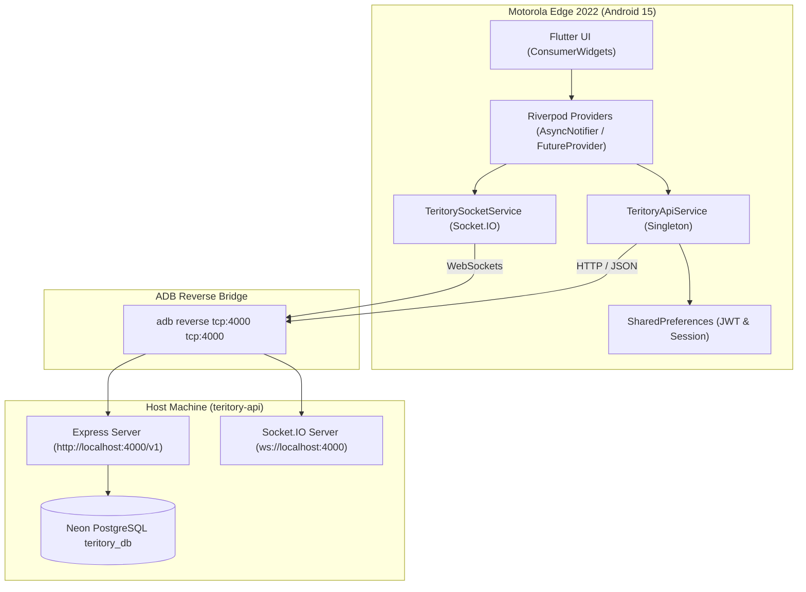
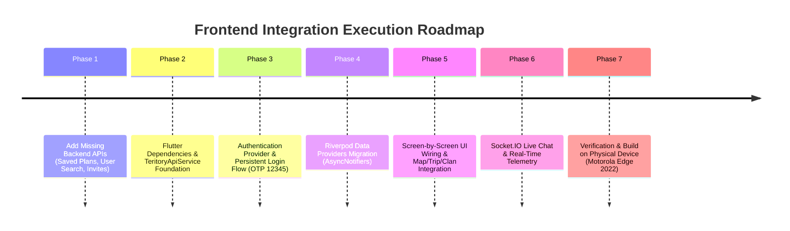

# 📱 Teritory Frontend API Integration Master Plan

> **Version**: 1.0  
> **Date**: 15 Nov 2026  
> **Frontend**: Flutter 3.x / Dart 3.x (`teritory/`)  
> **Backend**: Standalone Node.js 22 + Express 5 (`teritory-api/` on port 4000)  
> **Target Device**: Motorola Edge 2022 (`ZY22G6RXS9`) via USB ADB Reverse  
> **Status**: Ready for Execution

---

## Table of Contents

1. [Integration Architecture & Network Tier](#1-integration-architecture--network-tier)
2. [Audit: Missing Backend APIs to Add](#2-audit-missing-backend-apis-to-add)
3. [State Management Transformation (Riverpod)](#3-state-management-transformation-riverpod)
4. [Screen-by-Screen Integration Matrix](#4-screen-by-screen-integration-matrix)
5. [Real-Time WebSocket Integration (Socket.IO)](#5-real-time-websocket-integration-socketio)
6. [Offline Strategy & Error Handling](#6-offline-strategy--error-handling)
7. [Step-by-Step Execution Phases](#7-step-by-step-execution-phases)

---

## 1. Integration Architecture & Network Tier



### 1.1 Dependencies to Add to `teritory/pubspec.yaml`
```yaml
dependencies:
  http: ^1.2.2                  # High-performance HTTP client
  shared_preferences: ^2.3.3    # Persistent JWT & session storage
  socket_io_client: ^3.0.2      # Live community chat & expedition tracking
```

### 1.2 Base URL & Network Configuration (`app_config.dart`)
```dart
class AppConfig {
  // Uses ADB reverse on physical Android device (ZY22G6RXS9)
  // adb -s ZY22G6RXS9 reverse tcp:4000 tcp:4000
  static const String baseUrl = 'http://localhost:4000/v1';
  static const String socketUrl = 'http://localhost:4000';
  
  // Cloud deployment fallback
  // static const String baseUrl = 'https://api.teritory.app/v1';
}
```

### 1.3 `TeritoryApiService` Design
A centralized HTTP client singleton:
- Automatic `Authorization: Bearer <token>` injection for all authenticated routes.
- Automatic 401 handling with refresh token rotation or re-login redirect.
- Generic response parser `ApiResponse<T>` with error code unwrapping.
- Logging interceptor for debug visibility in Flutter dev tools.

---

## 2. Audit: Missing Backend APIs to Add

During this deep audit, we identified **3 missing API capabilities** in `teritory-api` that the frontend needs:

| Missing Feature | Required Endpoint | Purpose | Status |
|---|---|---|---|
| **Saved Plans** | `POST /v1/trips/plans/:id/save` | Bookmark a community trip plan to personal saved list | 🔨 *To implement in Phase 1* |
| | `GET /v1/trips/plans/saved` | Fetch user's saved trip plans | 🔨 *To implement in Phase 1* |
| **User Search** | `GET /v1/users/search?q=:query` | Search travelers by name or `@handle` in Friends screen | 🔨 *To implement in Phase 1* |
| **Friend Invites** | `POST /v1/users/invites` | Multi-select friends and invite them to Clan, Community, Trip, or Rally | 🔨 *To implement in Phase 1* |

We will implement these 3 endpoints directly in `teritory-api` before starting the Flutter UI wiring.

---

## 3. State Management Transformation (Riverpod)

Currently, `teritory/lib/core/providers/data_providers.dart` uses synchronous mock returns (`Provider<T>`). We will upgrade them to **asynchronous, reactive providers**:

### 3.1 Authentication Provider (`auth_provider.dart`)
```dart
class AuthState {
  final User? user;
  final String? token;
  final bool isLoading;
  final String? errorMessage;
}

class AuthNotifier extends StateNotifier<AuthState> {
  Future<bool> sendOtp(String phone);
  Future<bool> verifyOtp(String phone, String otp); // uses '12345'
  Future<void> logout();
  Future<void> checkSession();
}

final authProvider = StateNotifierProvider<AuthNotifier, AuthState>(...);
```

### 3.2 Data Providers Migration Pattern
Transform static mock providers into `FutureProvider` and `AsyncNotifierProvider`:

| Current Mock Provider | Transformed Live Provider | Backend Endpoint |
|---|---|---|
| `clansProvider` | `FutureProvider<List<Clan>>` | `GET /v1/clans` |
| `communitiesByClanProvider(clanId)` | `FutureProvider.family<List<Community>, String>` | `GET /v1/clans/:clanId/communities` |
| `communityByIdProvider(id)` | `FutureProvider.family<Community, String>` | `GET /v1/communities/:id` |
| `communityMessagesProvider(id)`| `AsyncNotifierProvider.family<...>` | `GET /v1/communities/:id/messages` + Socket.IO |
| `communityActivitiesProvider(id)`| `FutureProvider.family<List<CommunityActivity>, String>` | `GET /v1/communities/:id/feed` |
| `tripsHubProvider` | `FutureProvider<TripsHubData>` | `GET /v1/trips/hub` |
| `tripByIdProvider(tripId)` | `FutureProvider.family<Trip, String>` | `GET /v1/trips/:tripId` |
| `leaderboardProvider(params)` | `FutureProvider.family<List<LeaderboardEntry>, LeaderboardParams>` | `GET /v1/rankings` |
| `friendsProvider` | `FutureProvider<List<FriendRelationship>>` | `GET /v1/users/friends` |
| `nearbyServicesProvider` | `FutureProvider<List<ServiceProvider>>` | `GET /v1/services/gear` |
| `ralliesProvider` | `FutureProvider<List<LegendaryRally>>` | `GET /v1/rallies/nearby` |
| `notificationsProvider` | `AsyncNotifierProvider<List<NotificationItem>>` | `GET /v1/notifications` |

---

## 4. Screen-by-Screen Integration Matrix

### 4.1 Tab 0: Explore & Home Map Screen (`home_map_screen.dart`)
- **Flags Layer**: Calls `GET /v1/flags/explore?lat=...&lng=...&radiusKm=50`. Renders user's dropped flags and community markers on OpenStreetMap with Midnight Oceanic theme.
- **Sub-Territory View**: Calls `GET /v1/flags/sub-territories?lat=...&lng=...`. Pops up hidden viewpoints and secret scenic spots within 5km.
- **Drop Flag Modal (`drop_flag_modal.dart`)**: Form submission triggers `POST /v1/flags`. On success, refreshes map markers and animates celebratory stamp badge.

### 4.2 Tab 1: Clans Screen (`clan_browser_screen.dart` & `clan_detail_screen.dart`)
- **Browser**: Consumes `clansProvider` (`GET /v1/clans`). Search input triggers debounced query `?search=...`.
- **Detail**: Loads chieftain info, member roster, and list of sub-communities (`GET /v1/clans/:id`).
- **Join / Leave Clan**: Action buttons trigger `POST /v1/clans/:id/join` and `POST /v1/clans/:id/leave`, updating Riverpod state optimistically.

### 4.3 Community Screens (`community_detail_screen.dart`, `community_chat_screen.dart`)
- **Feed Tab**: Fetches live activities (`GET /v1/communities/:id/feed`).
- **Plans Tab**: Shows trip plans proposed in this community (`GET /v1/communities/:id/trip-plans`).
- **Chat Tab**: Loads message history (`GET /v1/communities/:id/messages`). Subscribes to Socket.IO room `community:<communityId>`. New incoming messages append to list in real-time. Sending a message emits `chat:send` and posts to `POST /v1/communities/:id/messages`.

### 4.4 Tab 2: Trips Hub & Planner (`trips_hub_screen.dart`, `trip_planner_screen.dart`)
- **Hub**: Consumes `tripsHubProvider` (`GET /v1/trips/hub`) showing the user's Active Trip card, Proposed Community Plans, and Saved Plans.
- **Planner**: Interactive route builder. User reorders waypoints, then taps "Propose Trip Plan" -> calls `POST /v1/trips/plans`.
- **Plan Voting**: Tapping Vote chip calls `POST /v1/trips/plans/:id/vote`, updating vote counter with animation.
- **Start Expedition**: Organizer taps "Flag Off Trip" -> calls `POST /v1/trips/plans/:id/start`, transitions app into **Active Trip Mode**.

### 4.5 Active Trip Execution Screen (`active_trip_screen.dart`)
- **Expedition Status**: Displays countdown timer, progress bar, and participant roster.
- **GPS Waypoint Validation (The 15km Rule)**:
  - User taps "Check-in at Waypoint".
  - App reads GPS coordinates (`lat`, `lng`).
  - Calls `POST /v1/trips/:tripId/validate-waypoint`.
  - Backend verifies if `distance ≤ 15,000m`.
  - If valid: shows green checkmark animation (`Icons.check_circle_rounded`) and unlocks waypoint.
  - If invalid: shows SnackBar: *"Too far! You are X km away. Must be within 15km."*
- **Complete Expedition**: Organizer taps Complete -> calls `POST /v1/trips/:tripId/complete`. Launches `TripCompletionCard` celebration dialog with badges (`FULL` / `PARTIAL`).

### 4.6 Tab 3: Rankings Screen (`leaderboard_screen.dart`)
- **Filter Tabs**: Global, Country, State, District, Friends.
- **Time Periods**: All-Time, Yearly, Monthly, Weekly.
- **Data Call**: `GET /v1/rankings?scope=...&period=...`.
- **Podium & List**: Top 3 render in custom Gold/Silver/Bronze podium; remaining users render in scrollable cards with avatar, score breakdown, and rank badge.
- **My Rank**: Sticky bottom banner displays current user's relative ranking and score.

### 4.7 Tab 4: Profile & Friends (`profile_screen.dart`, `friends_list_screen.dart`)
- **Profile**: Loads `GET /v1/users/me` with lifetime stats (`totalFlags`, `majorFlags`, `countriesVisited`, `completedTripsCount`, `passportStamps`).
- **Trip Mode Switch**: Switch button calls `PATCH /v1/users/me/trip-mode`.
- **Friends List**: Consumes `GET /v1/users/friends`. Filterable by `TRAVEL_BUDDIES` and `FAVORITES`.
- **Friend Requests**: Accepts or declines incoming requests (`POST /v1/users/friends/requests/:id/respond`).
- **User Search**: Real-time search bar hitting `GET /v1/users/search?q=...`.

### 4.8 Modals & Bottom Sheets
- **Legendary Rally Sheet (`legendary_rally_sheet.dart`)**:
  - Fetches nearby rallies (`GET /v1/rallies/nearby`).
  - Join rally (`POST /v1/rallies/:id/join`).
  - Arrival check-in (`POST /v1/rallies/:id/arrive`) with 500m GPS radius check.
- **Gear Services Sheet (`gear_service_sheet.dart`)**:
  - Fetches local rental equipment and camping supplies (`GET /v1/services/gear`).
- **Invite Friends Sheet (`invite_friends_sheet.dart`)**:
  - Multi-selects friends from list and calls `POST /v1/users/invites`.

---

## 5. Real-Time WebSocket Integration (Socket.IO)

We will create `TeritorySocketService` in Flutter:

```dart
class TeritorySocketService {
  late IO.Socket socket;

  void connect(String token) {
    socket = IO.io(
      AppConfig.socketUrl,
      IO.OptionBuilder()
          .setTransports(['websocket'])
          .setAuth({'token': token})
          .enableAutoConnect()
          .build(),
    );

    socket.onConnect((_) => print('🔌 Connected to Teritory Socket'));
  }

  void joinCommunity(String communityId) =>
      socket.emit('join_community', {'communityId': communityId});

  void onNewMessage(Function(dynamic) callback) =>
      socket.on('chat:message', callback);

  void streamTripLocation(String tripId, double lat, double lng) =>
      socket.emit('trip_location_update', {'tripId': tripId, 'latitude': lat, 'longitude': lng});
}
```

---

## 6. Offline Strategy & Error Handling

1. **Graceful Fallback**: If backend is temporarily unreachable, `TeritoryApiService` displays a friendly snackbar and falls back to cached data or local state.
2. **Session Resilience**: JWT tokens are securely saved in `SharedPreferences`. On cold app start, `authProvider` immediately validates session with `GET /v1/auth/me`.
3. **No Breaking UI Changes**: The response JSON structure matches the existing Flutter models' `fromJson` specifications exactly.

---

## 7. Step-by-Step Execution Phases



1. **Phase 1: Backend Completeness** — Add the 3 missing endpoints to `teritory-api` and verify with curl.
2. **Phase 2: Networking Foundation** — Add `http`, `shared_preferences`, and `socket_io_client` to `teritory/pubspec.yaml`; create `AppConfig` and `TeritoryApiService`.
3. **Phase 3: Auth & Session** — Implement `AuthNotifier` in Flutter with OTP `12345` login, session restoration, and token storage.
4. **Phase 4: Provider Migration** — Refactor `data_providers.dart` from `MockDataService` to `TeritoryApiService`.
5. **Phase 5: Screen Binding** — Wire Home Map, Flags, Clans, Communities, Trips, Leaderboards, and Profile to live API data.
6. **Phase 6: Real-time Sockets** — Implement `TeritorySocketService` for live community chat and active trip tracking.
7. **Phase 7: Build & Smoke Test** — Configure ADB reverse (`tcp:4000`), compile release APK, install on Motorola Edge 2022, and test all user flows end-to-end.
