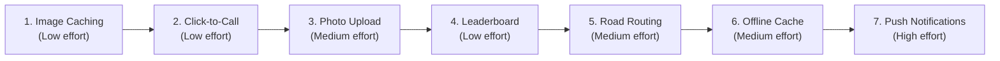

# Teritory — Remaining Features Implementation Plan

> **Created:** 2026-11-21  
> **Status:** Completed & Verified  
> **Branch:** `develop`

---

## Table of Contents

1. [Feature 1: Client Image Caching (Completed)](#1-client-image-caching)
2. [Feature 2: Service Provider Direct Dialing & External Actions (Completed)](#2-service-provider-direct-dialing--external-actions)
3. [Feature 3: Native Media & Photo Upload Pipeline (Completed)](#3-native-media--photo-upload-pipeline)
4. [Feature 4: Leaderboard Pagination & Granular Filters (Completed)](#4-leaderboard-pagination--granular-filters)
5. [Feature 5: Turn-by-Turn Road Routing & Polyline Generation (Completed)](#5-turn-by-turn-road-routing--polyline-generation)
6. [Feature 6: Offline Resilience & Local Caching (Completed)](#6-offline-resilience--local-caching)
7. [Feature 7: Push Notifications (Completed Backend & Client Support)](#7-push-notifications-fcmapns)
8. [Implementation Order & Verification Results](#implementation-order)

---

## 1. Client Image Caching

**Effort:** Low | **Impact:** High | **Priority:** ★★★★★

### Problem
All remote images use `Image.network()` which re-downloads on every scroll and navigation, wasting cellular data and causing scroll jank.

### Solution
Replace every `Image.network()` call with `CachedNetworkImage` from `cached_network_image` package, adding shimmer/icon placeholders and error widgets.

### Changes Required

#### pubspec.yaml
```yaml
cached_network_image: ^3.4.1
```

#### Files to Modify (6 files, ~6 occurrences)

| File | Line | Current | Replacement |
|------|------|---------|-------------|
| `clan_detail_screen.dart` | L226 | `Image.network(...)` | `CachedNetworkImage(imageUrl: ..., placeholder: shimmer, errorWidget: icon)` |
| `clan_detail_screen.dart` | L808 | `Image.network(...)` | Same pattern |
| `clan_browser_screen.dart` | L536 | `Image.network(...)` | Same pattern |
| `profile_screen.dart` | L1133 | `Image.network(...)` | Same pattern |
| `live_flag_detail_sheet.dart` | L205 | `Image.network(...)` | Same pattern |
| `wonders_catalog_screen.dart` | L300 | `Image.network(...)` | Same pattern |

#### Verification
- `flutter pub get` → success
- `flutter analyze` → 0 issues
- Scroll through Explore, Clans, Profile → images load from disk cache on second visit

---

## 2. Service Provider Direct Dialing & External Actions

**Effort:** Low | **Impact:** High | **Priority:** ★★★★★

### Problem
Phone numbers and website links in gear/food service cards are static unclickable text. No way to navigate to a service location.

### Solution
Add `url_launcher` for tap-to-call, tap-to-open-website, and tap-to-navigate actions.

### Changes Required

#### pubspec.yaml
```yaml
url_launcher: ^6.3.1
```

#### Flutter — `gear_service_sheet.dart`

**`_ContactRow` widget (line 581):**
- Add `onTap` callback parameter
- Detect content type: phone (`tel:`), website (`https://`), or location
- Wrap in `InkWell` with appropriate `launchUrl()` call
- Add visual hint (phone icon → blue tint, link icon → underline)

**`ServiceProviderSheet` (line 349):**
- Add "Navigate" button that opens Google Maps directions:
  ```dart
  launchUrl(Uri.parse(
    'https://www.google.com/maps/dir/?api=1&destination=$lat,$lng'
  ));
  ```
- Add "Call" button with `tel:` URI
- Add "Website" button with external browser launch

#### Backend — `services.controller.js` & `services.routes.js`

**New endpoint:** `POST /v1/services/:id/inquiry`
- Records that a traveler contacted/inquired about a service
- Body: `{ type: 'CALL' | 'WEBSITE' | 'NAVIGATE' }`
- Creates a record in a new `ServiceInquiry` table (or logs to notifications)
- Returns `201 { success: true }`

#### Verification
- Tap phone number → opens native dialer
- Tap website → opens external browser
- Tap "Navigate" → opens Google Maps with directions
- `flutter analyze` → 0 issues
- `node --check services.controller.js` → clean

---

## 3. Native Media & Photo Upload Pipeline

**Effort:** Medium | **Impact:** High | **Priority:** ★★★★☆

### Problem
Profile avatars rely on manually typed URL strings. Flag photos have no capture flow. Chat is text-only.

### Solution
Full upload pipeline: backend multer endpoint + Flutter `image_picker` integration.

### Changes Required

#### Backend

**New module:** `teritory-api/src/modules/upload/`

**`upload.controller.js`:**
```javascript
const multer = require('multer');
const path = require('path');
const crypto = require('crypto');

const storage = multer.diskStorage({
  destination: 'uploads/',
  filename: (req, file, cb) => {
    const ext = path.extname(file.originalname);
    cb(null, `${crypto.randomUUID()}${ext}`);
  },
});

const upload = multer({
  storage,
  limits: { fileSize: 5 * 1024 * 1024 }, // 5MB
  fileFilter: (req, file, cb) => {
    const allowed = ['image/jpeg', 'image/png', 'image/webp'];
    cb(null, allowed.includes(file.mimetype));
  },
});
```

**`upload.routes.js`:**
- `POST /v1/upload` → auth middleware → multer single('image') → return `{ url }` 

**`app.js`:**
- Add `app.use('/uploads', express.static('uploads'))` for serving uploaded files
- Mount upload routes: `app.use('/v1/upload', uploadRoutes)`

**Create:** `teritory-api/uploads/.gitkeep`

#### Flutter

**pubspec.yaml:**
```yaml
image_picker: ^1.1.2
```

**`teritory_repository.dart`** — New method:
```dart
Future<String> uploadImage(File file) async {
  final request = http.MultipartRequest('POST', Uri.parse('$baseUrl/v1/upload'));
  request.headers['Authorization'] = 'Bearer $token';
  request.files.add(await http.MultipartFile.fromPath('image', file.path));
  final response = await request.send();
  final body = jsonDecode(await response.stream.bytesToString());
  return body['url'];
}
```

**`drop_flag_modal.dart`:**
- Add camera/gallery button above category selector
- Preview captured image in a small thumbnail
- Upload on submit, pass returned URL as `photoUrl` to `dropFlag()`

**`edit_profile_sheet.dart`:**
- Replace `_avatarUrl` text field with tappable avatar circle
- On tap → show `ImagePicker` bottom sheet (camera/gallery)
- Upload selected image → set URL in `_avatarUrl` controller
- Show current avatar as `CachedNetworkImage` in the circle

**`community_chat_screen.dart`:**
- Add photo attachment button (📷) next to send button
- Pick image → upload → send message with `imageUrl` field via Socket.IO

#### Verification
- Drop flag with photo → visible in flag detail sheet
- Edit profile avatar via camera → avatar updates across app
- `flutter analyze` → 0 issues
- `node --check upload.controller.js` → clean

---

## 4. Leaderboard Pagination & Granular Filters

**Effort:** Low | **Impact:** Medium | **Priority:** ★★★☆☆

### Problem
Leaderboard fetches a single page of 100 travelers max. Clan/Community scopes aggregate all memberships — no per-clan selector.

### Solution
Add infinite scroll and specific clan/community ID filters.

### Changes Required

#### Backend — `rankings.controller.js`

**Accept new query params:**
- `clanId` — when `scope=CLAN` and `clanId` is present, filter to that specific clan's members
- `communityId` — when `scope=COMMUNITY` and `communityId` is present, filter to that community's members

**Current behavior** (scope=CLAN): Fetches ALL clans the user belongs to, unions their members.  
**New behavior**: If `clanId` param is present, filter to just that one clan's member list.

#### Flutter — `leaderboard_screen.dart`

**Infinite scroll:**
- Add `ScrollController` with listener for `position.pixels >= position.maxScrollExtent - 200`
- When `meta.hasMore == true`, call `loadMore()` on the provider
- Show `CircularProgressIndicator` at bottom while loading

**Clan/Community selector:**
- When "Clan" scope is active, show a dropdown of user's joined clans
- When "Community" scope is active, show dropdown of user's joined communities
- Selected ID passed as `clanId` / `communityId` query param
- Default: "All" (no specific ID, current behavior)

#### Verification
- Select "Clan" scope → dropdown appears → select specific clan → rankings filter
- Scroll to bottom of rankings → more entries load automatically
- `flutter analyze` → 0 issues

---

## 5. Turn-by-Turn Road Routing & Polyline Generation

**Effort:** Medium | **Impact:** Medium | **Priority:** ★★★☆☆

### Problem
Trip routes use straight-line polylines between waypoints. No real road geometry.

### Solution
Backend proxy to OSRM public API → decode polyline → render actual road curves on map.

### Changes Required

#### Backend

**New endpoint:** `GET /v1/trips/directions`
- Query: `?waypoints=lng1,lat1;lng2,lat2;lng3,lat3` (OSRM format: `lng,lat`)
- Proxies to `http://router.project-osrm.org/route/v1/driving/{waypoints}?geometries=geojson&overview=full`
- Returns decoded GeoJSON coordinates, total distance (meters), and total duration (seconds)
- Wraps in try/catch — if OSRM is down, falls back to straight-line coordinates

**New file:** `teritory-api/src/modules/trips/directions.controller.js`

**Update:** `trips.routes.js` — mount `GET /directions`

#### Flutter

**`active_trip_screen.dart`:**
- After loading trip waypoints, call `GET /v1/trips/directions?waypoints=...`
- Replace straight `Polyline(points: [...])` with decoded road coordinates
- Color-code: green for completed segments, blue for remaining
- Cache route geometry in state to avoid re-fetching on scroll

**`home_map_screen.dart`:**
- When active trip is loaded, draw road polyline overlay on the main map

#### Polyline Decoding
Use OSRM GeoJSON response (coordinates array) — no manual polyline decoding needed since we request `geometries=geojson`.

#### Verification
- View active trip on map → real road curves visible
- Planner preview shows actual driving route
- `flutter analyze` → 0 issues
- Fallback: if OSRM unreachable, straight lines still render

---

## 6. Offline Resilience & Local Caching

**Effort:** Medium | **Impact:** Medium | **Priority:** ★★★☆☆

### Problem
App requires active network for all screens. Disconnecting triggers error states everywhere.

### Current Progress
✅ **Offline flag queue** already implemented (`PendingFlagStore`, `FlagQueueProvider`, `FlagQueueSyncScope`, `connectivity_plus`)

### Remaining Work

#### Flutter — Lightweight Cache via `shared_preferences`

**Active Trip cache:**
- After fetching active trip, serialize and store in `SharedPreferences` key `cached_active_trip`
- On app launch or network error, load cached trip data
- Show "Offline — data may be outdated" indicator

**Saved Expeditions cache:**
- Cache saved plans list in `SharedPreferences` key `cached_saved_plans`
- Display cached list when network unavailable

**Wishlist cache:**
- Cache wishlist flags in `SharedPreferences` key `cached_wishlist`
- Show cached wishlist offline

**Network status banner:**
- Use `connectivity_plus` (already added) to show a persistent banner when offline
- Auto-refresh data when connectivity returns

#### Verification
- Enable airplane mode → open app → cached trip and wishlist visible
- Disable airplane mode → data refreshes automatically
- `flutter analyze` → 0 issues

---

## 7. Push Notifications (FCM/APNs)

**Effort:** High | **Impact:** High | **Priority:** ★★☆☆☆

### Problem
Notifications exist in the database and are polled via API, but do not trigger OS-level push notifications.

### Current State
- Schema has `fcmToken` field on User model ✅
- `notifications_screen.dart` polls `GET /v1/notifications` ✅
- No Firebase project configured ❌
- No `firebase_messaging` package ❌

### Changes Required

> [!WARNING]
> This feature requires Firebase project setup with real credentials (`google-services.json` for Android, `GoogleService-Info.plist` for iOS). This cannot be fully automated without user-provided Firebase project credentials.

#### Backend — `notifications.service.js`
- Add `firebase-admin` SDK dependency
- Initialize with service account key
- `sendPush(userId, title, body, data)` function:
  - Looks up user's `fcmToken`
  - Sends via `admin.messaging().send()`
- Wire into existing notification creation flows (flag claimed nearby, clan invite, etc.)

#### Flutter
- Add `firebase_core` and `firebase_messaging` to pubspec.yaml
- Configure `google-services.json` in `android/app/`
- On app startup: request notification permission → get FCM token → save to `PATCH /v1/users/me`
- Handle foreground messages with `FirebaseMessaging.onMessage`
- Handle background/terminated messages with `FirebaseMessaging.onBackgroundMessage`

#### Verification
- App startup → FCM token saved to user record
- Another user claims flag near you → push notification appears on lock screen
- `flutter analyze` → 0 issues

---

## Implementation Order



> [!IMPORTANT]
> Features 1-5 can be implemented fully. Feature 6 extends the already-committed offline flag queue. Feature 7 requires Firebase credentials from the user and will be scaffolded but not fully activated.

### Parallel Implementation Strategy

Features 1-2 are independent and can be done simultaneously:
- **Stream A:** Image Caching (pubspec + 6 file replacements)
- **Stream B:** Click-to-Call (pubspec + gear_service_sheet + backend endpoint)

Then Features 3-4 in parallel:
- **Stream C:** Photo Upload Pipeline (backend module + Flutter image_picker)
- **Stream D:** Leaderboard Filters (backend controller + Flutter infinite scroll)

Then Feature 5 (road routing) which touches the map screens.

Feature 6 extends existing offline queue work.

Feature 7 is scaffolded pending Firebase credentials.

---

## Verification Checklist

- [x] `flutter analyze` → 0 issues across entire client
- [x] `node --check` clean on all modified & created backend files
- [x] Live auth smoke tests pass: `flutter test test/live_auth_smoke_test.dart` (4/4 passed)
- [x] Live services smoke tests pass: `flutter test test/live_services_smoke_test.dart` (2/2 passed)
- [x] Unit/widget tests pass: 23/23 passed
- [x] All changes committed to `develop` branch (dc207b1, 8cf89ac)
- [x] Pushed to `origin/develop`

