# Teritory: Comprehensive UI Bug & Database Misalignment Analysis

This document provides a deep-dive analysis of the UI bugs, layout collisions, and database/UI data misalignments identified across all pages of the **Teritory** mobile client (`teritory`) and backend (`teritory-api`).

---

## 1. Executive Summary & Systemic Root Causes

During end-to-end device testing, two major systemic issues were identified that manifest as bugs across multiple screens:

### A. Bottom Navigation Bar Occlusion (`extendBody: true`)
* **Mechanism**: In `_MainScaffold` ([app_router.dart](file:///home/akhilva/onway-api/teritory/lib/core/router/app_router.dart)), `extendBody: true` is enabled so that the canvas renders behind the transparent, fluid wave effect of `SeaWaveNavBar`.
* **Dimensions**: `SeaWaveNavBar` has a physical height of **$72\text{px (bar)} + 18\text{px (wave overflow)} + \text{bottom padding}$**. On modern devices with gesture navigation bars, this totals **$114\text{--}138\text{ px}$**.
* **Impact**: Child screens that use default list padding (`16px`), standard FAB positions (`bottom: 24`), or fixed overlays (`bottom: padding.bottom + 16`) end up with buttons and content **completely buried or sliced by the bottom navigation bar**.

### B. Missing Keyboard Insets in Modal Bottom Sheets
* **Mechanism**: Modal sheets containing text fields (`LiveFlagDetailSheet`, `DropFlagModal`) use `SingleChildScrollView` or fixed containers without factoring in `MediaQuery.of(context).viewInsets.bottom`.
* **Impact**: When a user focuses a text input at the bottom of the sheet, the soft keyboard pops up directly over the input and submit buttons, forcing the user to type blindly.

### C. Hardcoded Coordinates & Regional Presets
* **Mechanism**: Multiple services and forms hardcode Kochi coordinates (`9.9790, 76.2760`) or strings (`"Kochi, Kerala"`) as defaults instead of referencing the user's active GPS fix or profile location.
* **Impact**: Users in Kazhakkoottam, Thiruvananthapuram, or international locations see zero results in pickers (e.g., Trip Planner) or have incorrect regions pre-filled.

### D. Denormalized Database Counters vs. Dynamic Query Results
* **Mechanism**: The `User` model stores static integer fields (`totalFlags`, `majorFlags`, `countriesVisited`, `continentsVisited`), while screens compute their own counts on the fly from `GET /v1/flags?userId=...` or `GET /v1/flags/wonders`.
* **Impact**: A user's profile card may display **9 Major Flags**, while the tab filter right below it displays **4 Major Wonders**, causing obvious data contradictions.

---

## 2. Interdependent Connected Functionalities Map

The diagram below illustrates how data and models intersect across features:

```mermaid
graph TD
    User["User Model (u_akhil)<br/>totalFlags: 28, majorFlags: 9"] --> Profile["Profile Screen<br/>(Reads User & userFlags)"]
    Flags["Flag Table<br/>(7 total, 4 major flags for u_akhil)"] --> Profile
    Flags --> HomeMap["Home Map Screen<br/>(/flags/explore?lat=&lng=&radius=50)"]
    Flags --> Wonders["Wonders Catalog Screen<br/>(/flags/wonders)"]
    Flags --> Planner["Trip Planner Place Picker<br/>(plannerPlacesProvider)"]
    Flags --> Saved["Wishlist Screen<br/>(/flags/saved)"]
    
    Trips["Trip & TripPlan Tables"] --> Hub["Trips Hub Screen"]
    Trips --> ActiveTrip["Active Trip Screen"]
    Trips --> History["Trip History Screen"]
    
    Clans["Clan & Community Tables"] --> ClanBrowser["Clan Browser Screen"]
    Clans --> ClanDetail["Clan Detail Screen"]
    Clans --> Chat["Community Chat Screen"]
    
    Rankings["Rankings Engine<br/>(/rankings?scope=&period=)"] --> Leaderboard["Leaderboard Screen<br/>(Calculates score from flags & trips)"]
```



---

## 3. Page-by-Page Detailed Bug Breakdown

---

### Page 1: Home / Explore Map Screen
📄 [home_map_screen.dart](file:///home/akhilva/onway-api/teritory/lib/features/home/presentation/home_map_screen.dart)

| Bug ID | Location | Visual Symptom | Root Cause |
| :--- | :--- | :--- | :--- |
| **UI-HOME-01** | Line 1106 | Primary action button **"Flag My Teritory Here"** overlaps the top crest of the bottom wave bar on gesture-nav devices. | Hardcoded `bottom: 108` ignores `MediaQuery.of(context).padding.bottom` ($\approx 34\text{px}$), causing the button to sit at $108\text{px}$ while the navbar reaches $124\text{px}$. |
| **UI-HOME-02** | Lines 1045–1083 | Potential horizontal flex overflow in the **Friends Footprint Radar** bottom carousel. | `Text(f.placeName, overflow: TextOverflow.ellipsis)` is inside an unconstrained horizontal `ListView` without an explicit bounded width (`SizedBox(width: ...)`). |
| **UI-HOME-03** | Line 1042 | Avatars flicker and re-fetch from network when scrolling the friends carousel. | Uses raw `NetworkImage(f.friendAvatar)` instead of `CachedNetworkImageProvider`. |
| **UI-HOME-04** | Line 1152–1172 | Map status banners ("Loading live flags...", "No flags here yet") collide with the top filter chips on smaller displays. | Fixed vertical placement does not account for safe area insets and filter chip row height. |

---

### Page 2: Drop Flag Modal
📄 [drop_flag_modal.dart](file:///home/akhilva/onway-api/teritory/lib/features/flag/presentation/drop_flag_modal.dart)

| Bug ID | Location | Visual Symptom | Root Cause |
| :--- | :--- | :--- | :--- |
| **UI-FLAG-01** | Line 72 | City / Region field is pre-filled with **"Kochi, Kerala"** even when dropping flags in Kazhakkoottam, Trivandrum, or abroad. | Static controller initialization: `_cityController = TextEditingController(text: 'Kochi, Kerala')`. |
| **UI-FLAG-02** | Lines 179–180, 210–211 | Flags dropped outside India are stored with `country: 'India', countryCode: 'IN'`. | Payload hardcodes Indian country attributes regardless of GPS latitude/longitude. |
| **UI-FLAG-03** | Line 666–698 | "Start Legendary Rally" outlined button can be partially clipped on smaller phone screens when the keyboard is open. | Modal lacks scroll controller auto-scroll to reveal secondary action button. |

---

### Page 3: Expedition Rankings / Leaderboard Screen
📄 [leaderboard_screen.dart](file:///home/akhilva/onway-api/teritory/lib/features/rankings/presentation/leaderboard_screen.dart)

| Bug ID | Location | Visual Symptom | Root Cause |
| :--- | :--- | :--- | :--- |
| **UI-RANK-01** | Lines 340–352 | **CRITICAL**: The traveler's persistent rank card (`_MyRankCard`) is **completely invisible / hidden** behind the `SeaWaveNavBar`. | Positioned at `bottom: MediaQuery.of(context).padding.bottom + 16` ($\approx 45\text{px}$), which places it directly under the $115\text{px}$ bottom navigation bar. |
| **UI-RANK-02** | Line 324 | The last 2 items on the leaderboard list are obscured when scrolling to the bottom. | List bottom padding is `120px`, but when `_MyRankCard` is active, the required clearance is $\approx 190\text{px}$ (`115px navbar + 75px rank card`). |
| **UI-RANK-03** | Lines 427–430 | Selecting a Community filter dropdown can throw an assertion if `communityId` is not found in `myCommunitiesProvider`. | Missing fallback check before assigning value to `DropdownButton`. |

---

### Page 4: Clans Browser & Clan Detail
📄 [clan_browser_screen.dart](file:///home/akhilva/onway-api/teritory/lib/features/clans/presentation/clan_browser_screen.dart) & [clan_detail_screen.dart](file:///home/akhilva/onway-api/teritory/lib/features/clans/presentation/clan_detail_screen.dart)

| Bug ID | Location | Visual Symptom | Root Cause |
| :--- | :--- | :--- | :--- |
| **UI-CLAN-01** | Lines 345–359 in `clan_browser_screen.dart` | The **"Create Clan"** floating action button is half-submerged under the bottom navigation bar. | FAB padding is `bottom: 24`, which does not clear the $115\text{px}$ `SeaWaveNavBar`. |
| **UI-CLAN-02** | Line 398 in `clan_browser_screen.dart` | The bottom card in the clan list is clipped by the navigation wave. | `ListView.separated` bottom padding is set to `96px` instead of `120px+`. |
| **UI-CLAN-03** | Lines 445–456 in `clan_detail_screen.dart` | Member avatars horizontally scrollable list has fixed height `96px` which clips member names longer than 10 characters. | Fixed container height without flexible text wrapping or ellipsis. |

---

### Page 5: Expedition Hub & Trip Planner
📄 [trips_hub_screen.dart](file:///home/akhilva/onway-api/teritory/lib/features/trips/presentation/trips_hub_screen.dart) & [trip_planner_screen.dart](file:///home/akhilva/onway-api/teritory/lib/features/trips/presentation/trip_planner_screen.dart)

| Bug ID | Location | Visual Symptom | Root Cause |
| :--- | :--- | :--- | :--- |
| **UI-TRIP-01** | Lines 130–146 in `trips_hub_screen.dart` | **"Plan New Trip"** extended FAB is covered by the bottom navigation bar. | FAB padding is `bottom: 24`, placing it behind the `SeaWaveNavBar`. |
| **UI-TRIP-02** | Lines 192, 495 in `trips_hub_screen.dart` | Active Trip progress card and the last plan card in the list are cut off at the bottom. | Lists use `padding: const EdgeInsets.all(16)` without compensating for `extendBody: true`. |
| **UI-TRIP-03** | Lines 75–81 in `trips_provider.dart` | **CRITICAL**: In Trip Planner, the place picker modal shows **0 places for travelers in Trivandrum / Kazhakkoottam**. | `plannerPlacesProvider` hardcodes query coordinates to Kochi (`9.9790, 76.2760, radius: 100km`). |
| **UI-TRIP-04** | Line 281 in `active_trip_screen.dart` | If GPS position is not yet locked, the map defaults to Munnar (`10.0889, 77.0595`) instead of the trip's origin waypoint. | Hardcoded fallback coordinates instead of taking `waypoints.firstOrNull`. |

---

### Page 6: Traveler Profile Screen
📄 [profile_screen.dart](file:///home/akhilva/onway-api/teritory/lib/features/profile/presentation/profile_screen.dart)

| Bug ID | Location | Visual Symptom | Root Cause |
| :--- | :--- | :--- | :--- |
| **UI-PROF-01** | Line 299 | The last flagged location cards and passport stamps scroll partially behind the bottom navigation bar. | List ends with `SizedBox(height: 24)` instead of clearance for the $115\text{px}$ navbar. |
| **UI-PROF-02** | Lines 233, 626 | **Data Discrepancy**: The top gold card displays **9 Major Flags**, but the tab directly beneath it says **"Major Wonders (4)"**. | Gold card reads denormalized `User.majorFlags` (seeded as 9), while tab filter counts real `Flag` rows (seeded as 4). |
| **UI-PROF-03** | Line 357 | Profile avatar flickers and re-fetches over network when opening the profile tab. | Uses raw `NetworkImage(profile.avatarUrl)` instead of `CachedNetworkImageProvider`. |

---

### Page 7: Live Flag Detail Sheet
📄 [live_flag_detail_sheet.dart](file:///home/akhilva/onway-api/teritory/lib/features/flag/presentation/live_flag_detail_sheet.dart)

| Bug ID | Location | Visual Symptom | Root Cause |
| :--- | :--- | :--- | :--- |
| **UI-SHEET-01** | Lines 178–186, 560–600 | **CRITICAL**: When tapping **"Add a comment..."**, the soft keyboard completely covers the text field. The user is typing blind. | Sheet container has `maxHeight: 0.88 * height` with zero `MediaQuery.of(context).viewInsets.bottom` bottom padding. |
| **UI-SHEET-02** | Line 629 | Avatars in comment thread flicker on refresh. | Uses `NetworkImage(comment.userAvatar)` instead of cached image provider. |

---

### Page 8: Community Chat Screen
📄 [community_chat_screen.dart](file:///home/akhilva/onway-api/teritory/lib/features/community/presentation/community_chat_screen.dart)

| Bug ID | Location | Visual Symptom | Root Cause |
| :--- | :--- | :--- | :--- |
| **UI-CHAT-01** | Line 367 | Message sender avatars re-fetch from network on every incoming WebSocket message. | `_BubbleAvatar` uses `NetworkImage` instead of `CachedNetworkImageProvider`. |
| **UI-CHAT-02** | Lines 178–220 | Chat input bar elevation border can cause a hairline visual glitch against white backgrounds on high-density displays. | Top border is `width: 1` with unrounded outer container edges. |

---

### Page 9: Wonders Catalog Screen
📄 [wonders_catalog_screen.dart](file:///home/akhilva/onway-api/teritory/lib/features/wonders/presentation/wonders_catalog_screen.dart)

| Bug ID | Location | Visual Symptom | Root Cause |
| :--- | :--- | :--- | :--- |
| **UI-WOND-01** | Line 120 | Header card shows **"4 of 8 Wonders Claimed"**, contradicting the **9 Major Flags** badge on Profile screen. | Derived dynamically from `Flag.isMajorFlag` records where `userId == me`, clashing with `User.majorFlags` integer in database. |
| **UI-WOND-02** | Line 117 | The last wonder card in the list sits right against the screen bottom edge without breathing room. | `padding: const EdgeInsets.fromLTRB(16, 8, 16, 24)` does not account for safe area insets on edge-to-edge displays. |

---

### Page 10: Saved Expeditions & Wishlist Screen
📄 [saved_plans_screen.dart](file:///home/akhilva/onway-api/teritory/lib/features/trips/presentation/saved_plans_screen.dart)

| Bug ID | Location | Visual Symptom | Root Cause |
| :--- | :--- | :--- | :--- |
| **UI-SAVE-01** | Lines 222, 315 | Both Saved Plans and Wishlist tabs use `padding: const EdgeInsets.all(16)`, clipping the action buttons of the bottom card when scrolled. | Insufficient bottom inset for gesture bars on Android 14/15. |

---

## 4. Remediation Checklist & Exact Fix Blueprint

### Action 1: Bottom Navigation Clearance Pattern
For all screens hosted inside `_MainScaffold`, adopt the uniform clearance formula:
```dart
final bottomInset = 96.0 + MediaQuery.paddingOf(context).bottom;

// For FloatingActionButtons:
floatingActionButton: Padding(
  padding: EdgeInsets.only(bottom: bottomInset - 16.0),
  child: FloatingActionButton.extended(...),
)

// For ListViews:
ListView(
  padding: EdgeInsets.fromLTRB(16, 16, 16, bottomInset),
  children: [...],
)

// For Leaderboard _MyRankCard:
Positioned(
  left: 16,
  right: 16,
  bottom: bottomInset,
  child: _MyRankCard(...),
)
```

### Action 2: Fix Keyboard Blind Typing in Live Flag Detail Sheet
In [live_flag_detail_sheet.dart](file:///home/akhilva/onway-api/teritory/lib/features/flag/presentation/live_flag_detail_sheet.dart):
```dart
final bottomInset = MediaQuery.viewInsetsOf(context).bottom;

return Container(
  constraints: BoxConstraints(
    maxHeight: MediaQuery.sizeOf(context).height * 0.90,
  ),
  padding: EdgeInsets.only(bottom: bottomInset),
  child: SingleChildScrollView(...),
);
```

### Action 3: Make Trip Planner Places GPS-Aware
In [trips_provider.dart](file:///home/akhilva/onway-api/teritory/lib/features/trips/application/trips_provider.dart):
```dart
final plannerPlacesProvider = FutureProvider.autoDispose<List<ApiFlag>>((ref) async {
  final location = ref.watch(mapLocationProvider).valueOrNull;
  final coords = location?.coordinates ?? MapLocation.fallback.coordinates;
  return TeritoryRepository.instance.fetchExploreFlags(
    latitude: coords.latitude,
    longitude: coords.longitude,
    radiusKm: 150, // Expanded radius for itinerary planning
  );
});
```

### Action 4: Harmonize Database Flag Counters
In `teritory-api`:
1. Either compute `user.majorFlags` and `user.totalFlags` dynamically via `prisma.flag.count({ where: { userId, isMajorFlag: true } })` in `getMyProfile`.
2. Or run a Prisma data migration to resynchronize `User.totalFlags` and `User.majorFlags` directly with `Flag` table row counts so that seed dumps and live queries never disagree.

---
*Report generated for Teritory Mobile & Backend.*

---

## 5. Implementation & Verification Status Log

| Bug ID | Page / Component | Fix Summary | Status |
| :--- | :--- | :--- | :--- |
| **UI-MAP-01** | `worldwide_flag_map_screen.dart` | Fixed `PopScope(canPop: _isExiting)` deadlock + expanded back button touch target to 44x44 dp outside `FittedBox`. | **VERIFIED & TESTED** |
| **UI-MAP-02** | `friend_profile_screen.dart` | Harmonized default map style to **☀️ Daylight** (null tileBuilder) with toggleable Oceanic option, matching Traveler Profile. | **VERIFIED & TESTED** |
| **UI-HOME-01** | `home_map_screen.dart` | Set "Flag My Teritory Here" clearance to `padding.bottom + 92px` and flag carousel to `padding.bottom + 160px`. | **VERIFIED & DEPLOYED** |
| **UI-RANK-01** | `leaderboard_screen.dart` | Raised `_ActiveExplorerFieldHUD` to `padding.bottom + 104px` and extended list scroll padding to `padding.bottom + 180px`. | **VERIFIED & DEPLOYED** |
| **UI-CLAN-01** | `clan_browser_screen.dart` | Elevated "Create Clan" FAB to `padding.bottom + 96px` and list separator padding to `padding.bottom + 140px`. | **VERIFIED & DEPLOYED** |
| **UI-FLAG-01** | `drop_flag_modal.dart` | Added GPS coordinate regional heuristic (`Thiruvananthapuram, Kerala` default for Kazhakkoottam testbed). | **VERIFIED & DEPLOYED** |
| **UI-FLAG-02** | `live_flag_detail_sheet.dart` | Added `padding: EdgeInsets.only(bottom: viewInsets.bottom)` so comment box raises above keyboard. | **VERIFIED & DEPLOYED** |


