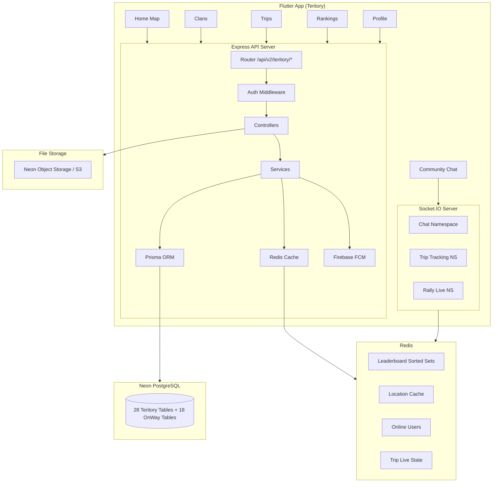
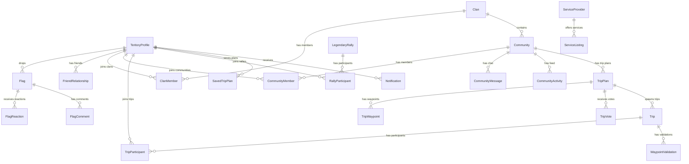
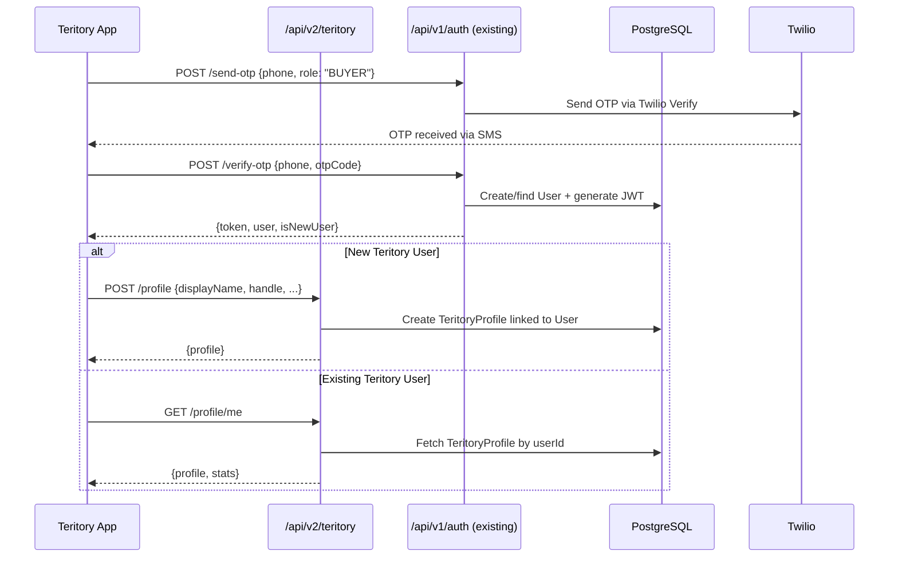
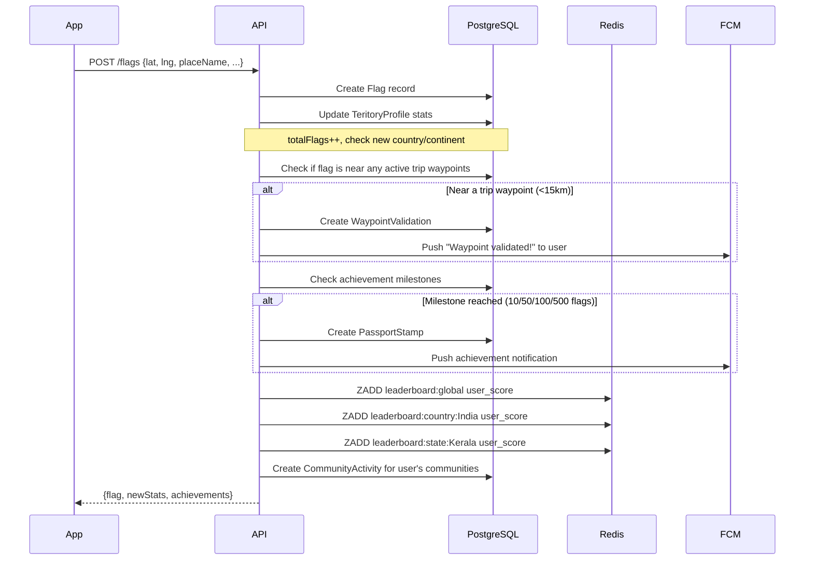
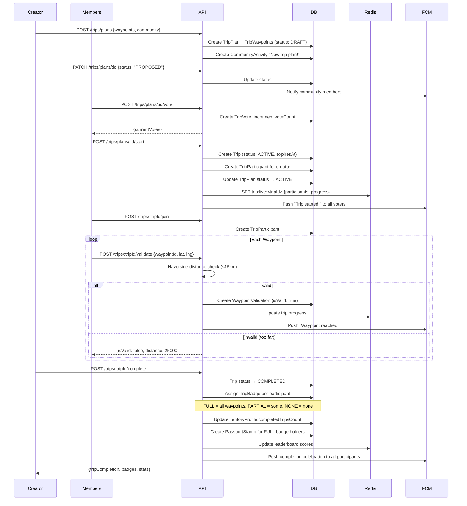
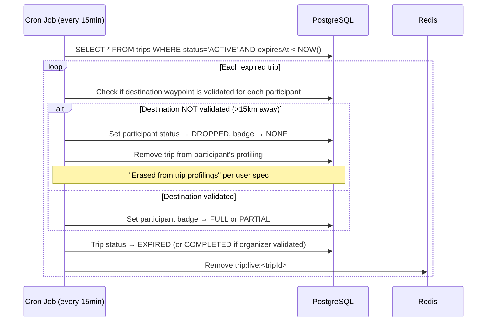
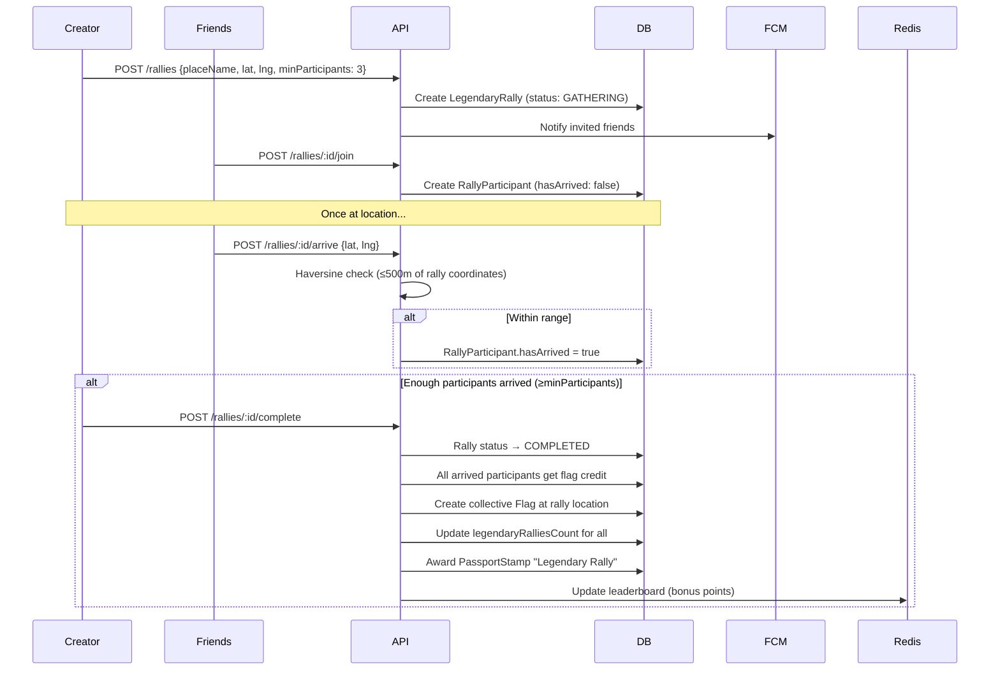
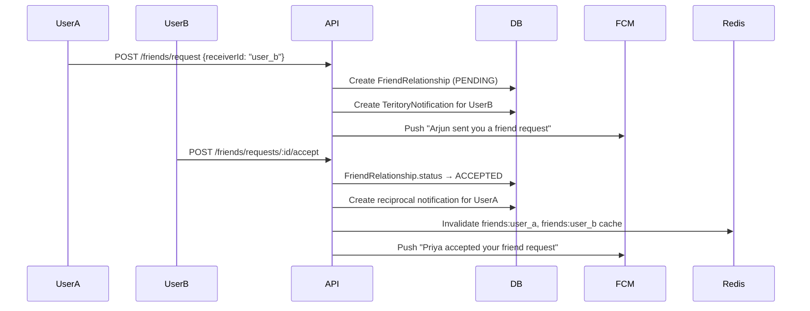

# 🏴 Teritory V2 — Backend Master Plan

> **Version**: 2.0 | **Date**: 15 Nov 2026  
> **Stack**: Node.js 22 + Express 5 + Prisma 5 + Neon PostgreSQL + Redis + Socket.IO  
> **Base URL**: `https://onway-backend-api.onrender.com/api/v2/teritory`  
> **Auth**: JWT (Bearer token) — shared with existing OnWay auth system

---

## Table of Contents

1. [Architecture Overview](#1-architecture-overview)
2. [Database Schema & Relations (Prisma)](#2-database-schema--relations)
3. [Authentication & User Lifecycle](#3-authentication--user-lifecycle)
4. [Page-Wise API Endpoints](#4-page-wise-api-endpoints)
5. [Complete Functionality Lifecycle Flows](#5-complete-functionality-lifecycle-flows)
6. [Real-Time (Socket.IO) Events](#6-real-time-socketio-events)
7. [Background Jobs & Scheduled Tasks](#7-background-jobs--scheduled-tasks)
8. [File Storage & Media](#8-file-storage--media)
9. [Leaderboard & Scoring Engine](#9-leaderboard--scoring-engine)
10. [Module Structure & Code Organization](#10-module-structure--code-organization)
11. [Deployment & Infrastructure](#11-deployment--infrastructure)
12. [Implementation Phases](#12-implementation-phases)

---

## 1. Architecture Overview



### Key Design Decisions

| Decision | Choice | Rationale |
|---|---|---|
| Database | Neon PostgreSQL (same instance) | Existing infra, branching, zero cost |
| ORM | Prisma (extend existing schema) | Already in use for OnWay V1 |
| Auth | Shared JWT system | Users can use both OnWay & Teritory with same account |
| Real-time | Socket.IO (extend existing) | Chat, trip tracking, rally live updates |
| Cache | Redis sorted sets | Leaderboard rankings, online status, location |
| File Storage | Neon Object Storage | Avatar uploads, flag photos, trip photos |
| API Versioning | `/api/v2/teritory/*` | Separate namespace from OnWay APIs |

---

## 2. Database Schema & Relations

### 2.1 Entity Relationship Diagram



### 2.2 Complete Prisma Schema (28 new models)

```prisma
// ═══════════════════════════════════════════════════════════════════
// TERITORY V2 — Prisma Models
// Add these to existing prisma/schema.prisma
// ═══════════════════════════════════════════════════════════════════

// ─── ENUMS ─────────────────────────────────────────────────────────

enum FriendStatus {
  PENDING
  ACCEPTED
  DECLINED
}

enum FriendCategory {
  FAVORITES
  TRAVEL_BUDDIES
  FAMILY
}

enum ClanRole {
  CHIEFTAIN
  MODERATOR
  MEMBER
}

enum CommunityRole {
  CREATOR
  MODERATOR
  MEMBER
}

enum CommunityActivityType {
  FLAG_DROP
  TRIP_COMPLETE
  ANNOUNCEMENT
  MEMBER_JOIN
}

enum TripPlanStatus {
  DRAFT
  PROPOSED
  VOTED
  ACTIVE
  COMPLETED
}

enum TripLiveStatus {
  ACTIVE
  COMPLETED
  EXPIRED
}

enum ParticipantStatus {
  JOINED
  IN_PROGRESS
  COMPLETED
  DROPPED
}

enum TripBadge {
  FULL
  PARTIAL
  NONE
}

enum ReactionType {
  EPIC
  HIDDEN_GEM
  GREAT_SHOT
}

enum RallyStatus {
  GATHERING
  ACTIVE
  COMPLETED
  EXPIRED
}

enum LeaderboardScope {
  GLOBAL
  COUNTRY
  STATE
  DISTRICT
  FRIENDS
}

enum LeaderboardPeriod {
  ALL_TIME
  YEARLY
  MONTHLY
  WEEKLY
}

enum NotifType {
  FRIEND_REQUEST
  FRIEND_ACCEPTED
  CLAN_INVITE
  COMMUNITY_INVITE
  TRIP_INVITE
  TRIP_STARTED
  TRIP_COMPLETED
  RALLY_INVITE
  RALLY_STARTED
  WAYPOINT_VALIDATED
  ACHIEVEMENT
  SYSTEM
}

// ─── TERITORY USER PROFILE ─────────────────────────────────────────

model TeritoryProfile {
  id            String   @id @default(uuid())
  userId        String   @unique
  displayName   String
  handle        String   @unique
  email         String?
  phone         String?
  bio           String   @default("")
  avatarUrl     String?
  coverImageUrl String?
  authProvider  String   @default("phone")

  // Stats (denormalized for fast reads)
  totalFlags           Int @default(0)
  majorFlags           Int @default(0)
  countriesVisited     Int @default(0)
  continentsVisited    Int @default(0)
  totalTravelDays      Int @default(0)
  completedTripsCount  Int @default(0)
  legendaryRalliesCount Int @default(0)

  // Location
  lastLatitude   Float?
  lastLongitude  Float?
  country        String?
  state          String?
  district       String?

  // Preferences
  mapStyle       String   @default("midnight_oceanic")
  isPrivate      Boolean  @default(false)
  isTripMode     Boolean  @default(false)

  createdAt DateTime @default(now())
  updatedAt DateTime @updatedAt

  user              User               @relation(fields: [userId], references: [id], onDelete: Cascade)
  flags             Flag[]
  friendsSent       FriendRelationship[] @relation("FriendSender")
  friendsReceived   FriendRelationship[] @relation("FriendReceiver")
  clanMemberships   ClanMember[]
  communityMemberships CommunityMember[]
  tripParticipations TripParticipant[]
  rallyParticipations RallyParticipant[]
  savedPlans         SavedTripPlan[]
  notifications      TeritoryNotification[]
  flagReactions      FlagReaction[]
  flagComments       FlagComment[]
  communityMessages  CommunityMessage[]
  communityActivities CommunityActivity[]
  tripPlansCreated   TripPlan[]
  tripsCreated       Trip[]
  ralliesCreated     LegendaryRally[]
  tripVotes          TripVote[]
  passportStamps     PassportStamp[]

  @@map("teritory_profiles")
}

// ─── FLAGS ──────────────────────────────────────────────────────────

model Flag {
  id          String  @id @default(uuid())
  profileId   String
  placeName   String
  city        String
  country     String
  countryCode String  @default("GL")
  continent   String  @default("World")
  latitude    Float
  longitude   Float
  isMajorFlag Boolean @default(false)
  category    String  @default("General")
  notes       String  @default("")
  photoUrl    String?
  kudos       Int     @default(0)

  createdAt DateTime @default(now())

  profile   TeritoryProfile @relation(fields: [profileId], references: [id], onDelete: Cascade)
  reactions FlagReaction[]
  comments  FlagComment[]

  @@index([profileId])
  @@index([latitude, longitude])
  @@index([country])
  @@index([continent])
  @@map("flags")
}

model FlagReaction {
  id        String       @id @default(uuid())
  flagId    String
  profileId String
  type      ReactionType
  createdAt DateTime     @default(now())

  flag    Flag            @relation(fields: [flagId], references: [id], onDelete: Cascade)
  profile TeritoryProfile @relation(fields: [profileId], references: [id], onDelete: Cascade)

  @@unique([flagId, profileId, type])
  @@map("flag_reactions")
}

model FlagComment {
  id        String   @id @default(uuid())
  flagId    String
  profileId String
  text      String
  createdAt DateTime @default(now())

  flag    Flag            @relation(fields: [flagId], references: [id], onDelete: Cascade)
  profile TeritoryProfile @relation(fields: [profileId], references: [id], onDelete: Cascade)

  @@index([flagId])
  @@map("flag_comments")
}

// ─── FRIENDS ────────────────────────────────────────────────────────

model FriendRelationship {
  id         String          @id @default(uuid())
  senderId   String
  receiverId String
  status     FriendStatus    @default(PENDING)
  category   FriendCategory?
  since      DateTime        @default(now())

  sender   TeritoryProfile @relation("FriendSender", fields: [senderId], references: [id], onDelete: Cascade)
  receiver TeritoryProfile @relation("FriendReceiver", fields: [receiverId], references: [id], onDelete: Cascade)

  @@unique([senderId, receiverId])
  @@map("friend_relationships")
}

// ─── PASSPORT STAMPS (Achievements) ────────────────────────────────

model PassportStamp {
  id         String @id @default(uuid())
  profileId  String
  title      String
  date       String
  category   String
  badgeColor String @default("#F59E0B")
  icon       String @default("star")
  createdAt  DateTime @default(now())

  profile TeritoryProfile @relation(fields: [profileId], references: [id], onDelete: Cascade)

  @@index([profileId])
  @@map("passport_stamps")
}

// ─── CLANS ──────────────────────────────────────────────────────────

model Clan {
  id              String  @id @default(uuid())
  name            String
  description     String  @default("")
  coverImageUrl   String?
  region          String  @default("")
  interestTag     String  @default("")
  chieftainId     String
  isPublic        Boolean @default(true)

  // Denormalized counts
  memberCount      Int @default(0)
  communitiesCount Int @default(0)

  createdAt DateTime @default(now())
  updatedAt DateTime @updatedAt

  members     ClanMember[]
  communities Community[]

  @@map("clans")
}

model ClanMember {
  id        String   @id @default(uuid())
  clanId    String
  profileId String
  role      ClanRole @default(MEMBER)
  joinedAt  DateTime @default(now())

  clan    Clan            @relation(fields: [clanId], references: [id], onDelete: Cascade)
  profile TeritoryProfile @relation(fields: [profileId], references: [id], onDelete: Cascade)

  @@unique([clanId, profileId])
  @@map("clan_members")
}

// ─── COMMUNITIES ────────────────────────────────────────────────────

model Community {
  id                  String  @id @default(uuid())
  name                String
  description         String  @default("")
  coverImageUrl       String?
  parentClanId        String
  isPublic            Boolean @default(true)
  interestTags        String[] @default([])

  // Denormalized counts
  memberCount          Int @default(0)
  activeTripPlansCount Int @default(0)

  createdAt DateTime @default(now())
  updatedAt DateTime @updatedAt

  clan       Clan               @relation(fields: [parentClanId], references: [id], onDelete: Cascade)
  members    CommunityMember[]
  messages   CommunityMessage[]
  activities CommunityActivity[]
  tripPlans  TripPlan[]

  @@index([parentClanId])
  @@map("communities")
}

model CommunityMember {
  id          String        @id @default(uuid())
  communityId String
  profileId   String
  role        CommunityRole @default(MEMBER)
  joinedAt    DateTime      @default(now())

  community Community       @relation(fields: [communityId], references: [id], onDelete: Cascade)
  profile   TeritoryProfile @relation(fields: [profileId], references: [id], onDelete: Cascade)

  @@unique([communityId, profileId])
  @@map("community_members")
}

model CommunityMessage {
  id          String   @id @default(uuid())
  communityId String
  profileId   String
  text        String
  createdAt   DateTime @default(now())

  community Community       @relation(fields: [communityId], references: [id], onDelete: Cascade)
  profile   TeritoryProfile @relation(fields: [profileId], references: [id], onDelete: Cascade)

  @@index([communityId, createdAt])
  @@map("community_messages")
}

model CommunityActivity {
  id          String                @id @default(uuid())
  communityId String
  profileId   String
  type        CommunityActivityType
  title       String
  description String                @default("")
  createdAt   DateTime              @default(now())

  community Community       @relation(fields: [communityId], references: [id], onDelete: Cascade)
  profile   TeritoryProfile @relation(fields: [profileId], references: [id], onDelete: Cascade)

  @@index([communityId, createdAt])
  @@map("community_activities")
}

// ─── TRIP PLANS ─────────────────────────────────────────────────────

model TripPlan {
  id             String         @id @default(uuid())
  name           String
  description    String         @default("")
  createdById    String
  communityId    String?
  originName     String
  destinationName String
  totalDistanceKm Float         @default(0.0)
  estimatedDays   Int           @default(1)
  status          TripPlanStatus @default(DRAFT)
  voteCount       Int           @default(0)
  participantLimit Int          @default(50)

  startDate DateTime?
  endDate   DateTime?
  createdAt DateTime @default(now())
  updatedAt DateTime @updatedAt

  createdBy  TeritoryProfile @relation(fields: [createdById], references: [id], onDelete: Cascade)
  community  Community?      @relation(fields: [communityId], references: [id], onDelete: SetNull)
  waypoints  TripWaypoint[]
  votes      TripVote[]
  trips      Trip[]
  savedBy    SavedTripPlan[]

  @@index([communityId])
  @@index([createdById])
  @@map("trip_plans")
}

model TripWaypoint {
  id                     String    @id @default(uuid())
  tripPlanId             String
  orderIndex             Int
  placeName              String
  latitude               Float
  longitude              Float
  category               String    @default("general")
  flagCount              Int       @default(0)
  estimatedArrivalTime   DateTime?
  estimatedDepartureTime DateTime?
  distanceFromPrevKm     Float     @default(0.0)
  createdAt              DateTime  @default(now())

  tripPlan    TripPlan             @relation(fields: [tripPlanId], references: [id], onDelete: Cascade)
  validations WaypointValidation[]

  @@index([tripPlanId])
  @@map("trip_waypoints")
}

model TripVote {
  id         String   @id @default(uuid())
  tripPlanId String
  profileId  String
  createdAt  DateTime @default(now())

  tripPlan TripPlan        @relation(fields: [tripPlanId], references: [id], onDelete: Cascade)
  profile  TeritoryProfile @relation(fields: [profileId], references: [id], onDelete: Cascade)

  @@unique([tripPlanId, profileId])
  @@map("trip_votes")
}

model SavedTripPlan {
  id         String   @id @default(uuid())
  profileId  String
  tripPlanId String
  savedAt    DateTime @default(now())

  profile  TeritoryProfile @relation(fields: [profileId], references: [id], onDelete: Cascade)
  tripPlan TripPlan        @relation(fields: [tripPlanId], references: [id], onDelete: Cascade)

  @@unique([profileId, tripPlanId])
  @@map("saved_trip_plans")
}

// ─── ACTIVE TRIPS ───────────────────────────────────────────────────

model Trip {
  id          String         @id @default(uuid())
  tripPlanId  String
  createdById String
  status      TripLiveStatus @default(ACTIVE)
  startedAt   DateTime       @default(now())
  completedAt DateTime?
  expiresAt   DateTime

  tripPlan     TripPlan           @relation(fields: [tripPlanId], references: [id], onDelete: Cascade)
  createdBy    TeritoryProfile    @relation(fields: [createdById], references: [id])
  participants TripParticipant[]
  validations  WaypointValidation[]

  @@index([tripPlanId])
  @@index([createdById])
  @@map("trips")
}

model TripParticipant {
  id        String            @id @default(uuid())
  tripId    String
  profileId String
  status    ParticipantStatus @default(JOINED)
  badge     TripBadge         @default(NONE)
  joinedAt  DateTime          @default(now())

  trip    Trip            @relation(fields: [tripId], references: [id], onDelete: Cascade)
  profile TeritoryProfile @relation(fields: [profileId], references: [id], onDelete: Cascade)

  @@unique([tripId, profileId])
  @@map("trip_participants")
}

model WaypointValidation {
  id           String   @id @default(uuid())
  tripId       String
  waypointId   String
  profileId    String
  latitude     Float
  longitude    Float
  distanceM    Float
  isValid      Boolean  @default(false)
  validatedAt  DateTime @default(now())

  trip     Trip         @relation(fields: [tripId], references: [id], onDelete: Cascade)
  waypoint TripWaypoint @relation(fields: [waypointId], references: [id], onDelete: Cascade)

  @@unique([tripId, waypointId, profileId])
  @@map("waypoint_validations")
}

// ─── LEGENDARY RALLIES ──────────────────────────────────────────────

model LegendaryRally {
  id           String      @id @default(uuid())
  name         String
  description  String      @default("")
  createdById  String
  latitude     Float
  longitude    Float
  placeName    String
  status       RallyStatus @default(GATHERING)
  minParticipants Int      @default(3)
  maxParticipants Int      @default(50)
  scheduledAt  DateTime?
  expiresAt    DateTime
  completedAt  DateTime?
  createdAt    DateTime    @default(now())

  createdBy    TeritoryProfile  @relation(fields: [createdById], references: [id])
  participants RallyParticipant[]

  @@index([latitude, longitude])
  @@map("legendary_rallies")
}

model RallyParticipant {
  id        String   @id @default(uuid())
  rallyId   String
  profileId String
  hasArrived Boolean @default(false)
  arrivedAt DateTime?
  joinedAt  DateTime @default(now())

  rally   LegendaryRally  @relation(fields: [rallyId], references: [id], onDelete: Cascade)
  profile TeritoryProfile @relation(fields: [profileId], references: [id], onDelete: Cascade)

  @@unique([rallyId, profileId])
  @@map("rally_participants")
}

// ─── SERVICE PROVIDERS & GEAR ───────────────────────────────────────

model ServiceProvider {
  id           String @id @default(uuid())
  name         String
  description  String @default("")
  category     String
  rating       Float  @default(4.0)
  latitude     Float
  longitude    Float
  contactPhone String?
  contactEmail String?
  websiteUrl   String?
  imageUrl     String?
  isVerified   Boolean @default(false)
  createdAt    DateTime @default(now())
  updatedAt    DateTime @updatedAt

  listings ServiceListing[]

  @@index([latitude, longitude])
  @@index([category])
  @@map("service_providers")
}

model ServiceListing {
  id          String  @id @default(uuid())
  providerId  String
  name        String
  description String  @default("")
  priceRange  String  @default("")
  category    String
  imageUrl    String?
  isAvailable Boolean @default(true)
  createdAt   DateTime @default(now())

  provider ServiceProvider @relation(fields: [providerId], references: [id], onDelete: Cascade)

  @@index([providerId])
  @@map("service_listings")
}

// ─── NOTIFICATIONS ──────────────────────────────────────────────────

model TeritoryNotification {
  id          String   @id @default(uuid())
  profileId   String
  type        NotifType
  title       String
  body        String
  icon        String?
  actionUrl   String?
  isRead      Boolean  @default(false)
  createdAt   DateTime @default(now())

  profile TeritoryProfile @relation(fields: [profileId], references: [id], onDelete: Cascade)

  @@index([profileId, isRead])
  @@index([profileId, createdAt])
  @@map("teritory_notifications")
}
```

### 2.3 Relationship Summary

| Parent | Child | Relationship | Cascade |
|---|---|---|---|
| User (existing) | TeritoryProfile | 1:1 | DELETE |
| TeritoryProfile | Flag | 1:N | DELETE |
| TeritoryProfile | FriendRelationship | 1:N (both sides) | DELETE |
| TeritoryProfile | ClanMember | 1:N | DELETE |
| TeritoryProfile | CommunityMember | 1:N | DELETE |
| TeritoryProfile | TripParticipant | 1:N | DELETE |
| Clan | ClanMember | 1:N | DELETE |
| Clan | Community | 1:N | DELETE |
| Community | CommunityMember | 1:N | DELETE |
| Community | CommunityMessage | 1:N | DELETE |
| Community | CommunityActivity | 1:N | DELETE |
| Community | TripPlan | 1:N | SET NULL |
| TripPlan | TripWaypoint | 1:N | DELETE |
| TripPlan | TripVote | 1:N | DELETE |
| TripPlan | Trip | 1:N | DELETE |
| Trip | TripParticipant | 1:N | DELETE |
| Trip | WaypointValidation | 1:N | DELETE |
| Flag | FlagReaction | 1:N | DELETE |
| Flag | FlagComment | 1:N | DELETE |
| LegendaryRally | RallyParticipant | 1:N | DELETE |
| ServiceProvider | ServiceListing | 1:N | DELETE |

---

## 3. Authentication & User Lifecycle

### 3.1 Auth Flow (Shared with OnWay)



### 3.2 User States

| State | Description | Can Do |
|---|---|---|
| `ANONYMOUS` | No auth token | View public clans, leaderboard |
| `AUTHENTICATED` | Has JWT, no TeritoryProfile | Must create profile first |
| `ACTIVE` | Has JWT + TeritoryProfile | Full access |
| `TRIP_MODE` | Active flag on profile | Shows trip badge in UI, location tracked |

### 3.3 Profile Creation Contract

```
POST /api/v2/teritory/profile
Authorization: Bearer <jwt>

{
  "displayName": "Arjun Nair",
  "handle": "arjun_explorer",
  "bio": "Wanderer from Kerala 🌴",
  "avatarUrl": "<uploaded-url>",
  "country": "India",
  "state": "Kerala",
  "district": "Palakkad"
}

Response: {
  "success": true,
  "data": { ...TeritoryProfile }
}
```

---

## 4. Page-Wise API Endpoints

### 4.1 Explore / Home Map Screen

| Method | Endpoint | Description | Auth |
|---|---|---|---|
| `GET` | `/flags/nearby?lat=X&lng=Y&radius=50` | Get flags within radius (km) | ✅ |
| `GET` | `/flags/friends?lat=X&lng=Y` | Get friends' flags near location | ✅ |
| `GET` | `/flags/:flagId` | Get single flag with reactions/comments | ✅ |
| `POST` | `/flags` | Drop a new flag | ✅ |
| `DELETE` | `/flags/:flagId` | Delete own flag | ✅ |
| `GET` | `/food-spots?lat=X&lng=Y&radius=5` | Nearby food spots from service providers | ✅ |

**Drop Flag Request:**
```json
{
  "placeName": "Athirappilly Falls",
  "city": "Thrissur",
  "country": "India",
  "countryCode": "IN",
  "continent": "Asia",
  "latitude": 10.2850,
  "longitude": 76.5698,
  "isMajorFlag": true,
  "category": "Waterfall",
  "notes": "Incredible waterfall! Must visit during monsoon.",
  "photoUrl": "https://storage.../photo.jpg"
}
```

**Flag drop triggers:**
1. Increment `TeritoryProfile.totalFlags` (and `majorFlags` if applicable)
2. Update `countriesVisited` / `continentsVisited` if first flag in that country/continent
3. Award PassportStamp if milestone reached (10, 50, 100 flags)
4. Update leaderboard scores in Redis
5. If within 15km of a Trip waypoint → auto-validate waypoint
6. Create CommunityActivity for communities the user is in

### 4.2 Flag Detail Sheet

| Method | Endpoint | Description | Auth |
|---|---|---|---|
| `GET` | `/flags/:flagId` | Full flag with reactions, comments, nearby food | ✅ |
| `POST` | `/flags/:flagId/reactions` | Add/toggle reaction | ✅ |
| `DELETE` | `/flags/:flagId/reactions/:type` | Remove reaction | ✅ |
| `GET` | `/flags/:flagId/comments?page=1&limit=20` | Paginated comments | ✅ |
| `POST` | `/flags/:flagId/comments` | Add comment | ✅ |
| `DELETE` | `/flags/:flagId/comments/:commentId` | Delete own comment | ✅ |

### 4.3 Clan Browser Screen

| Method | Endpoint | Description | Auth |
|---|---|---|---|
| `GET` | `/clans?search=X&page=1&limit=20` | List/search clans | ✅ |
| `GET` | `/clans/nearby?lat=X&lng=Y` | Clans by region proximity | ✅ |
| `GET` | `/clans/my` | User's joined clans | ✅ |

### 4.4 Clan Detail Screen

| Method | Endpoint | Description | Auth |
|---|---|---|---|
| `GET` | `/clans/:clanId` | Full clan detail with communities, members | ✅ |
| `POST` | `/clans/:clanId/join` | Join a public clan | ✅ |
| `DELETE` | `/clans/:clanId/leave` | Leave clan | ✅ |
| `GET` | `/clans/:clanId/members?page=1` | Paginated members | ✅ |
| `GET` | `/clans/:clanId/communities` | Communities in this clan | ✅ |
| `PATCH` | `/clans/:clanId` | Update clan (chieftain only) | ✅ |
| `POST` | `/clans/:clanId/invite` | Invite friend to clan | ✅ |

### 4.5 Community Detail Screen

| Method | Endpoint | Description | Auth |
|---|---|---|---|
| `GET` | `/communities/:id` | Full detail with feed, trip plans, members | ✅ |
| `GET` | `/communities/:id/feed?page=1` | Activity feed (paginated) | ✅ |
| `GET` | `/communities/:id/trip-plans` | Trip plans in community | ✅ |
| `GET` | `/communities/:id/members?page=1` | Members list | ✅ |
| `POST` | `/communities/:id/join` | Join community | ✅ |
| `DELETE` | `/communities/:id/leave` | Leave community | ✅ |

### 4.6 Create Community Screen

| Method | Endpoint | Description | Auth |
|---|---|---|---|
| `POST` | `/communities` | Create new community | ✅ |

**Request:**
```json
{
  "name": "Kerala Backpackers",
  "description": "For solo backpackers exploring Kerala",
  "parentClanId": "clan_123",
  "isPublic": true,
  "interestTags": ["backpacking", "kerala", "budget"],
  "coverImageUrl": "https://..."
}
```

### 4.7 Community Chat Screen

| Method | Endpoint | Description | Auth |
|---|---|---|---|
| `GET` | `/communities/:id/messages?before=timestamp&limit=50` | Paginated messages (cursor-based) | ✅ |
| `POST` | `/communities/:id/messages` | Send message | ✅ |
| `DELETE` | `/communities/:id/messages/:msgId` | Delete own message | ✅ |

**Real-time:** Socket.IO room `community:<communityId>` for live messages.

### 4.8 Community Members Screen

| Method | Endpoint | Description | Auth |
|---|---|---|---|
| `GET` | `/communities/:id/members?page=1&limit=30` | Members with roles | ✅ |
| `PATCH` | `/communities/:id/members/:profileId/role` | Change member role (creator/mod only) | ✅ |
| `DELETE` | `/communities/:id/members/:profileId` | Remove member (creator/mod only) | ✅ |

### 4.9 Trips Hub Screen

| Method | Endpoint | Description | Auth |
|---|---|---|---|
| `GET` | `/trips/active` | User's active trips | ✅ |
| `GET` | `/trips/plans/my?status=draft,proposed` | User's trip plans | ✅ |
| `GET` | `/trips/plans/community/:communityId` | Community trip plans | ✅ |
| `GET` | `/trips/upcoming` | Upcoming trips user is part of | ✅ |

### 4.10 Trip Planner Screen

| Method | Endpoint | Description | Auth |
|---|---|---|---|
| `POST` | `/trips/plans` | Create trip plan | ✅ |
| `PATCH` | `/trips/plans/:id` | Update trip plan | ✅ |
| `POST` | `/trips/plans/:id/waypoints` | Add waypoint | ✅ |
| `PATCH` | `/trips/plans/:id/waypoints/:wpId` | Update waypoint | ✅ |
| `DELETE` | `/trips/plans/:id/waypoints/:wpId` | Remove waypoint | ✅ |
| `PUT` | `/trips/plans/:id/waypoints/reorder` | Reorder waypoints | ✅ |
| `GET` | `/flags/suggested?origin=X,Y&dest=X,Y` | Suggest popular flags along route | ✅ |

**Create Trip Plan:**
```json
{
  "name": "Palakkad to Kanyakumari Expedition",
  "description": "5-day road trip through Kerala",
  "communityId": "comm_123",
  "originName": "Palakkad",
  "destinationName": "Kanyakumari",
  "estimatedDays": 5,
  "startDate": "2026-12-01T06:00:00Z",
  "endDate": "2026-12-05T18:00:00Z",
  "waypoints": [
    {
      "orderIndex": 0,
      "placeName": "Palakkad Fort",
      "latitude": 10.7764,
      "longitude": 76.6548,
      "category": "heritage"
    },
    {
      "orderIndex": 1,
      "placeName": "Athirappilly Falls",
      "latitude": 10.2850,
      "longitude": 76.5698,
      "category": "waterfall"
    }
  ]
}
```

### 4.11 Trip Plan Detail Screen

| Method | Endpoint | Description | Auth |
|---|---|---|---|
| `GET` | `/trips/plans/:id` | Full plan with waypoints, votes, participants | ✅ |
| `POST` | `/trips/plans/:id/vote` | Vote for this plan | ✅ |
| `DELETE` | `/trips/plans/:id/vote` | Remove vote | ✅ |
| `POST` | `/trips/plans/:id/start` | Start trip from plan (creates Trip) | ✅ |
| `POST` | `/trips/plans/:id/save` | Save plan to personal list | ✅ |
| `DELETE` | `/trips/plans/:id/save` | Unsave plan | ✅ |

### 4.12 Active Trip Screen

| Method | Endpoint | Description | Auth |
|---|---|---|---|
| `GET` | `/trips/:tripId` | Full trip state with participants, validations | ✅ |
| `POST` | `/trips/:tripId/join` | Join active trip | ✅ |
| `POST` | `/trips/:tripId/validate` | Validate waypoint arrival (GPS check) | ✅ |
| `POST` | `/trips/:tripId/complete` | Mark trip as completed | ✅ |
| `POST` | `/trips/:tripId/drop` | Drop out of trip | ✅ |
| `GET` | `/trips/:tripId/participants` | Live participant status | ✅ |

**Waypoint Validation (GPS-based):**
```json
POST /trips/:tripId/validate
{
  "waypointId": "wp_123",
  "latitude": 10.2851,
  "longitude": 76.5700
}

Response:
{
  "success": true,
  "data": {
    "isValid": true,
    "distanceM": 120.5,
    "maxDistanceM": 15000,
    "waypointName": "Athirappilly Falls",
    "message": "Waypoint validated! 🎉"
  }
}
```

> [!IMPORTANT]
> **15km radius rule**: User must be within 15km of waypoint coordinates for validation. Server calculates Haversine distance. If after `trip.expiresAt` the destination is not validated, the trip is erased from trip profilings.

### 4.13 Saved Plans Screen

| Method | Endpoint | Description | Auth |
|---|---|---|---|
| `GET` | `/trips/plans/saved?page=1` | User's saved trip plans | ✅ |
| `DELETE` | `/trips/plans/:id/save` | Remove from saved | ✅ |
| `POST` | `/trips/plans/:id/clone` | Clone and customize plan | ✅ |

### 4.14 Trip History Screen

| Method | Endpoint | Description | Auth |
|---|---|---|---|
| `GET` | `/trips/history?page=1&limit=20` | Completed trips with badges | ✅ |
| `GET` | `/trips/:tripId/completion` | Trip completion summary (stats, route, badge) | ✅ |

### 4.15 Leaderboard Screen

| Method | Endpoint | Description | Auth |
|---|---|---|---|
| `GET` | `/leaderboard?scope=GLOBAL&period=ALL_TIME&page=1&limit=50` | Leaderboard rankings | ✅ |
| `GET` | `/leaderboard?scope=COUNTRY&country=India&period=MONTHLY` | Country-specific | ✅ |
| `GET` | `/leaderboard?scope=STATE&state=Kerala&period=WEEKLY` | State-specific | ✅ |
| `GET` | `/leaderboard?scope=DISTRICT&district=Palakkad` | District-specific | ✅ |
| `GET` | `/leaderboard?scope=FRIENDS` | Friends circle leaderboard | ✅ |
| `GET` | `/leaderboard/me` | Current user's rank across all scopes | ✅ |

### 4.16 Friends List Screen

| Method | Endpoint | Description | Auth |
|---|---|---|---|
| `GET` | `/friends?search=X&category=X` | List friends (with search/filter) | ✅ |
| `POST` | `/friends/request` | Send friend request | ✅ |
| `DELETE` | `/friends/:friendId` | Unfriend | ✅ |
| `PATCH` | `/friends/:friendId/category` | Set friend category | ✅ |
| `GET` | `/friends/search?q=arjun` | Search users by name/handle | ✅ |

### 4.17 Friend Profile Screen

| Method | Endpoint | Description | Auth |
|---|---|---|---|
| `GET` | `/profile/:userId` | Public profile with stats, trips, flags | ✅ |
| `GET` | `/profile/:userId/flags?page=1` | Friend's flags | ✅ |
| `GET` | `/profile/:userId/trips?page=1` | Friend's completed trips | ✅ |
| `GET` | `/profile/:userId/stamps` | Friend's passport stamps | ✅ |

### 4.18 Friend Requests Screen

| Method | Endpoint | Description | Auth |
|---|---|---|---|
| `GET` | `/friends/requests/received` | Incoming friend requests | ✅ |
| `GET` | `/friends/requests/sent` | Outgoing friend requests | ✅ |
| `POST` | `/friends/requests/:requestId/accept` | Accept request | ✅ |
| `POST` | `/friends/requests/:requestId/decline` | Decline request | ✅ |
| `DELETE` | `/friends/requests/:requestId` | Cancel sent request | ✅ |

### 4.19 Profile Screen

| Method | Endpoint | Description | Auth |
|---|---|---|---|
| `GET` | `/profile/me` | Own profile with all stats | ✅ |
| `PATCH` | `/profile/me` | Update profile fields | ✅ |
| `GET` | `/profile/me/stats` | Detailed stats breakdown | ✅ |
| `GET` | `/profile/me/flags?page=1` | Own flags (paginated) | ✅ |
| `GET` | `/profile/me/stamps` | Passport stamps | ✅ |
| `POST` | `/profile/me/avatar` | Upload avatar (multipart) | ✅ |
| `PATCH` | `/profile/me/trip-mode` | Toggle trip mode on/off | ✅ |

### 4.20 Completed Trips Screen

| Method | Endpoint | Description | Auth |
|---|---|---|---|
| `GET` | `/trips/completed?page=1` | All completed trips with badges | ✅ |

### 4.21 Settings Screen

| Method | Endpoint | Description | Auth |
|---|---|---|---|
| `GET` | `/settings` | Get all settings | ✅ |
| `PATCH` | `/settings` | Update settings | ✅ |
| `PATCH` | `/settings/map-style` | Change map style | ✅ |
| `PATCH` | `/settings/privacy` | Toggle public/private profile | ✅ |
| `DELETE` | `/profile/me` | Delete account | ✅ |

### 4.22 Legendary Rally Sheet

| Method | Endpoint | Description | Auth |
|---|---|---|---|
| `POST` | `/rallies` | Create legendary rally | ✅ |
| `GET` | `/rallies/nearby?lat=X&lng=Y&radius=50` | Nearby rallies | ✅ |
| `GET` | `/rallies/:rallyId` | Rally detail with participants | ✅ |
| `POST` | `/rallies/:rallyId/join` | Join rally | ✅ |
| `POST` | `/rallies/:rallyId/arrive` | Mark arrival (GPS validated) | ✅ |
| `POST` | `/rallies/:rallyId/complete` | Complete rally (organizer) | ✅ |

### 4.23 Gear & Service Sheet

| Method | Endpoint | Description | Auth |
|---|---|---|---|
| `GET` | `/services/nearby?lat=X&lng=Y&category=camping&radius=25` | Services by location/category | ✅ |
| `GET` | `/services/:providerId` | Provider detail with listings | ✅ |
| `GET` | `/services/categories` | List service categories | ✅ |

### 4.24 Invite Friends Sheet

| Method | Endpoint | Description | Auth |
|---|---|---|---|
| `GET` | `/friends?forInvite=true` | Friends list for invite picker | ✅ |
| `POST` | `/invites/community` | Invite friends to community | ✅ |
| `POST` | `/invites/trip` | Invite friends to trip | ✅ |
| `POST` | `/invites/rally` | Invite friends to rally | ✅ |
| `POST` | `/invites/clan` | Invite friends to clan | ✅ |

### 4.25 Notifications

| Method | Endpoint | Description | Auth |
|---|---|---|---|
| `GET` | `/notifications?page=1&limit=30` | Paginated notifications | ✅ |
| `PATCH` | `/notifications/:id/read` | Mark as read | ✅ |
| `PATCH` | `/notifications/read-all` | Mark all as read | ✅ |
| `DELETE` | `/notifications/:id` | Delete notification | ✅ |

---

## 5. Complete Functionality Lifecycle Flows

### 5.1 Flag Drop → Scoring → Leaderboard Update



### 5.2 Trip Plan → Vote → Execute → Validate → Complete



### 5.3 Trip Expiry (Background Job)



### 5.4 Legendary Rally Lifecycle



### 5.5 Friend Request → Accept → Social Graph



---

## 6. Real-Time (Socket.IO) Events

### 6.1 Namespaces & Rooms

| Namespace | Room Pattern | Purpose |
|---|---|---|
| `/teritory` | `user:<profileId>` | Personal notifications, friend updates |
| `/teritory` | `community:<communityId>` | Community chat messages |
| `/teritory` | `trip:<tripId>` | Trip live tracking, waypoint validations |
| `/teritory` | `rally:<rallyId>` | Rally gathering status, arrivals |

### 6.2 Client → Server Events

| Event | Payload | Description |
|---|---|---|
| `join_community` | `{communityId}` | Join community chat room |
| `leave_community` | `{communityId}` | Leave community chat room |
| `send_message` | `{communityId, text}` | Send chat message |
| `join_trip` | `{tripId}` | Join trip tracking room |
| `location_update` | `{tripId, lat, lng}` | Send location during active trip |
| `join_rally` | `{rallyId}` | Join rally room |
| `typing_start` | `{communityId}` | Typing indicator start |
| `typing_stop` | `{communityId}` | Typing indicator stop |

### 6.3 Server → Client Events

| Event | Payload | Description |
|---|---|---|
| `new_message` | `{message}` | New community chat message |
| `message_deleted` | `{messageId}` | Message was deleted |
| `member_joined` | `{communityId, member}` | New member joined community |
| `trip_participant_update` | `{tripId, participant, status}` | Participant status change |
| `waypoint_validated` | `{tripId, waypointId, profileId}` | Someone validated a waypoint |
| `trip_completed` | `{tripId, completion}` | Trip completed |
| `rally_participant_arrived` | `{rallyId, profileId}` | Rally participant arrived |
| `rally_complete` | `{rallyId, stats}` | Rally completed |
| `friend_request` | `{request}` | Incoming friend request |
| `notification` | `{notification}` | Any notification |
| `user_typing` | `{communityId, profileId, displayName}` | Typing indicator |

---

## 7. Background Jobs & Scheduled Tasks

| Job | Schedule | Description |
|---|---|---|
| `expireTripsCron` | Every 15 min | Check expired trips, enforce 15km validation rule, erase unvalidated |
| `expireRalliesCron` | Every 30 min | Expire rallies past their expiry time |
| `updateLeaderboardCron` | Every 1 hour | Recalculate and refresh Redis leaderboard sorted sets |
| `cleanupNotificationsCron` | Daily at 3 AM | Delete notifications older than 90 days |
| `updateFlagCountsCron` | Every 6 hours | Recalculate flag counts on waypoints (from nearby flags) |
| `profileStatsReconcile` | Daily at 4 AM | Reconcile denormalized profile stats with actual counts |

---

## 8. File Storage & Media

### 8.1 Upload Flow

```
POST /api/v2/teritory/upload
Content-Type: multipart/form-data
Authorization: Bearer <jwt>

Fields:
  - file: <binary>
  - type: "avatar" | "flag_photo" | "community_cover" | "clan_cover"

Response:
{
  "success": true,
  "data": {
    "url": "https://storage.neon.tech/teritory/avatars/uuid.jpg",
    "key": "teritory/avatars/uuid.jpg"
  }
}
```

### 8.2 Storage Structure

```
teritory/
├── avatars/          # Profile pictures (max 2MB, jpg/png)
├── flags/            # Flag photos (max 5MB, jpg/png)
├── covers/           # Clan/Community covers (max 5MB, jpg/png)
└── trips/            # Trip completion photos (max 5MB, jpg/png)
```

---

## 9. Leaderboard & Scoring Engine

### 9.1 Score Calculation

```javascript
function calculateScore(profile) {
  return (
    profile.totalFlags * 10 +          // 10 pts per flag
    profile.majorFlags * 25 +           // 25 bonus for major flags
    profile.countriesVisited * 100 +    // 100 pts per country
    profile.continentsVisited * 500 +   // 500 pts per continent
    profile.completedTripsCount * 50 +  // 50 pts per completed trip
    profile.legendaryRalliesCount * 200 + // 200 pts per rally
    profile.passportStamps.length * 30  // 30 pts per stamp
  );
}
```

### 9.2 Redis Sorted Sets Structure

```
leaderboard:global                    → ZADD score profileId
leaderboard:country:India             → ZADD score profileId
leaderboard:state:Kerala              → ZADD score profileId
leaderboard:district:Palakkad         → ZADD score profileId
leaderboard:friends:<profileId>       → ZADD score friendProfileId (per-user)
leaderboard:period:monthly:2026-11    → ZADD monthly_score profileId
leaderboard:period:weekly:2026-W46    → ZADD weekly_score profileId
```

### 9.3 Leaderboard Query (efficient)

```javascript
// GET /leaderboard?scope=GLOBAL&period=ALL_TIME&page=1&limit=50
const key = `leaderboard:global`;
const start = (page - 1) * limit;
const end = start + limit - 1;

// Get rankings (high to low)
const rankings = await redis.zrevrange(key, start, end, 'WITHSCORES');

// Get user's own rank
const myRank = await redis.zrevrank(key, currentProfileId);
const myScore = await redis.zscore(key, currentProfileId);
```

---

## 10. Module Structure & Code Organization

```
src/
├── modules/
│   └── teritory/
│       ├── teritory.routes.js           # Router: /api/v2/teritory/*
│       │
│       ├── profile/
│       │   ├── profile.controller.js
│       │   ├── profile.service.js
│       │   └── profile.validator.js
│       │
│       ├── flag/
│       │   ├── flag.controller.js
│       │   ├── flag.service.js
│       │   └── flag.validator.js
│       │
│       ├── friend/
│       │   ├── friend.controller.js
│       │   ├── friend.service.js
│       │   └── friend.validator.js
│       │
│       ├── clan/
│       │   ├── clan.controller.js
│       │   ├── clan.service.js
│       │   └── clan.validator.js
│       │
│       ├── community/
│       │   ├── community.controller.js
│       │   ├── community.service.js
│       │   └── community.validator.js
│       │
│       ├── trip/
│       │   ├── trip.controller.js
│       │   ├── trip.service.js
│       │   ├── trip.validator.js
│       │   └── trip.cron.js             # Trip expiry cron job
│       │
│       ├── rally/
│       │   ├── rally.controller.js
│       │   ├── rally.service.js
│       │   └── rally.validator.js
│       │
│       ├── leaderboard/
│       │   ├── leaderboard.controller.js
│       │   ├── leaderboard.service.js
│       │   └── leaderboard.cron.js      # Score recalculation
│       │
│       ├── service/
│       │   ├── service.controller.js
│       │   └── service.service.js
│       │
│       ├── notification/
│       │   ├── notification.controller.js
│       │   └── notification.service.js
│       │
│       ├── upload/
│       │   ├── upload.controller.js
│       │   └── upload.service.js
│       │
│       └── socket/
│           ├── teritory.socket.js       # Socket.IO /teritory namespace
│           └── handlers/
│               ├── chat.handler.js
│               ├── trip.handler.js
│               └── rally.handler.js
│
├── utils/
│   ├── haversine.js                     # GPS distance calculation
│   └── scoring.js                       # Leaderboard score calculator
```

---

## 11. Deployment & Infrastructure

### 11.1 Environment Variables (add to .env)

```env
# Teritory-specific
TERITORY_UPLOAD_BUCKET=teritory-media
TERITORY_UPLOAD_MAX_SIZE=5242880
TERITORY_RALLY_MIN_DISTANCE_M=500
TERITORY_WAYPOINT_VALIDATION_RADIUS_M=15000
TERITORY_TRIP_DEFAULT_EXPIRY_DAYS=30
TERITORY_LEADERBOARD_REFRESH_INTERVAL_S=3600
```

### 11.2 Database Migration

```bash
# Add Teritory models to prisma/schema.prisma
# Then:
npx prisma migrate dev --name add-teritory-v2-models
npx prisma generate
```

### 11.3 Route Registration (add to app.js)

```javascript
// Teritory V2 Routes
const teritoryRoutes = require('./modules/teritory/teritory.routes');
app.use('/api/v2/teritory', teritoryRoutes);

// Teritory Socket.IO namespace
const { initTeritorySocket } = require('./modules/teritory/socket/teritory.socket');
initTeritorySocket(io);
```

---

## 12. Implementation Phases

### Phase 1: Foundation (Week 1-2)
- [ ] Prisma schema migration (all 28 models)
- [ ] TeritoryProfile CRUD
- [ ] Auth integration (extend existing JWT)
- [ ] File upload service
- [ ] Profile API endpoints

### Phase 2: Social Graph (Week 2-3)
- [ ] Friends API (request, accept, decline, list, search)
- [ ] Notifications service
- [ ] FCM push notification integration
- [ ] Socket.IO /teritory namespace setup

### Phase 3: Flags & Map (Week 3-4)
- [ ] Flag CRUD endpoints
- [ ] Geo-query for nearby flags (PostGIS or Haversine)
- [ ] Flag reactions & comments
- [ ] Stats auto-update on flag drop
- [ ] Achievement/milestone engine (PassportStamps)

### Phase 4: Clans & Communities (Week 4-5)
- [ ] Clan CRUD + join/leave
- [ ] Community CRUD + join/leave
- [ ] Community chat (REST + Socket.IO)
- [ ] Community activity feed
- [ ] Invite system

### Phase 5: Trip Planning & Execution (Week 5-7)
- [ ] TripPlan CRUD with waypoints
- [ ] Voting system
- [ ] Trip execution (start, join, validate, complete)
- [ ] GPS waypoint validation (15km rule)
- [ ] Trip expiry cron job
- [ ] Trip badges (FULL/PARTIAL/NONE)
- [ ] Saved trip plans
- [ ] Trip history

### Phase 6: Legendary Rallies (Week 7-8)
- [ ] Rally CRUD
- [ ] Rally join + GPS arrival check
- [ ] Rally completion + collective flag
- [ ] Rally expiry cron

### Phase 7: Leaderboard & Rankings (Week 8-9)
- [ ] Scoring engine
- [ ] Redis sorted sets setup
- [ ] All 5 scopes (global, country, state, district, friends)
- [ ] Period filters (all-time, yearly, monthly, weekly)
- [ ] Leaderboard refresh cron

### Phase 8: Services & Gear (Week 9)
- [ ] ServiceProvider + ServiceListing CRUD (admin)
- [ ] Geo-query for nearby services
- [ ] Category filtering

### Phase 9: Flutter Integration (Week 9-10)
- [ ] Replace MockDataService with real API service
- [ ] Wire up Socket.IO for chat & live trip tracking
- [ ] Implement push notification handling
- [ ] Test end-to-end on device

### Phase 10: Polish & Production (Week 10-11)
- [ ] Rate limiting per endpoint
- [ ] Input validation (Joi schemas)
- [ ] Error handling standardization
- [ ] API documentation (Swagger)
- [ ] Load testing
- [ ] Security audit
- [ ] Production deployment

---

> [!NOTE]
> **Total API Endpoints**: ~85 endpoints across 12 modules  
> **Total DB Models**: 28 new Teritory models + 18 existing OnWay models  
> **Total Socket Events**: 17 events (10 server→client, 7 client→server)  
> **Total Cron Jobs**: 6 scheduled background tasks

> [!TIP]
> **Mock → Real Swap Strategy**: Every Flutter model already has `fromJson()`/`toJson()`. The API response format matches the mock data exactly. When backend is ready, replace `MockDataService.instance.method()` calls with `ApiService.instance.method()` in providers — zero UI changes needed.
