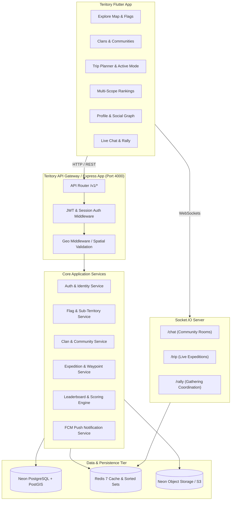
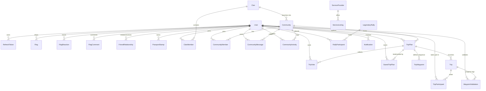
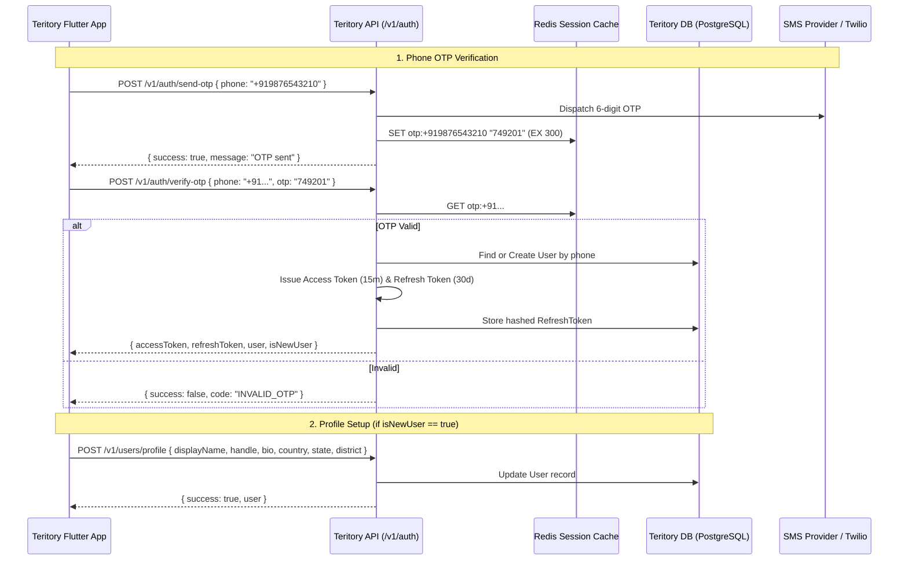
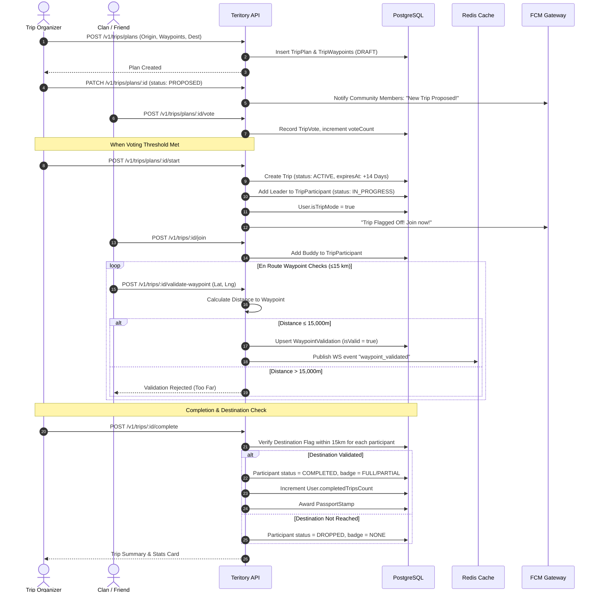
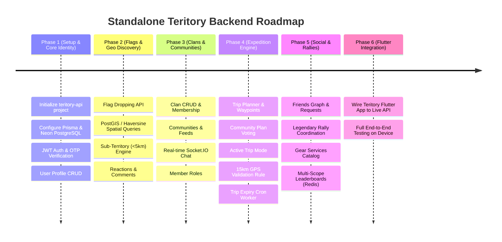

# 🏴 Teritory — Standalone Backend Master Plan (Fresh Architecture)

> **Version**: 2.1 (Fresh Independent Backend)  
> **Date**: 15 Nov 2026  
> **Project Name**: `teritory-api`  
> **Target Base URL**: `https://api.teritory.app/v1` (Dev: `http://localhost:4000/v1`)  
> **Tech Stack**: Node.js 22 (LTS) • Express 5 • Prisma 5 • Neon PostgreSQL (with PostGIS) • Redis 7 • Socket.IO 4.8  
> **Scope**: 100% standalone, independent backend dedicated entirely to the Teritory platform (zero coupling or dependencies on OnWay).

---

## Table of Contents

1. [Architecture Overview & Independence](#1-architecture-overview--independence)
2. [Database Schema & ERD (Prisma + PostGIS)](#2-database-schema--erd)
3. [Authentication, Security & Session Lifecycle](#3-authentication-security--session-lifecycle)
4. [Page-Wise API Endpoints (1:1 Screen Mapping)](#4-page-wise-api-endpoints)
5. [Complete Functionality Lifecycle Flows](#5-complete-functionality-lifecycle-flows)
6. [Real-Time Socket.IO Architecture](#6-real-time-socketio-architecture)
7. [Geo-Spatial Query Engine & Algorithms](#7-geo-spatial-query-engine--algorithms)
8. [Background Workers & Cron Tasks](#8-background-workers--cron-tasks)
9. [Media Upload & Object Storage](#9-media-upload--object-storage)
10. [Leaderboard & Scoring Calculation](#10-leaderboard--scoring-calculation)
11. [Project Structure & Code Organization](#11-project-structure--code-organization)
12. [Step-by-Step Backend Implementation Roadmap](#12-step-by-step-backend-implementation-roadmap)

---

## 1. Architecture Overview & Independence

The **Teritory Backend** is architected from scratch as a high-performance, geo-enabled microservice tailored specifically for social travel, GPS expedition validation, clan community collaboration, and real-time rally coordination.



### Key Architectural Principles
1. **Total Isolation**: Independent database, auth schemas, migration history, Redis namespace, and deployment pipelines.
2. **Native Geospatial Intelligence**: Uses PostgreSQL PostGIS (`GEOMETRY(Point, 4326)`) for spatial indexing, sub-territory discovery (<5km), route corridor buffering (10–50km), and waypoint arrival validation (≤15km radius).
3. **High-Throughput Caching**: Redis handles active trip locations, community live typing indicators, and atomic sorted sets (`ZSET`) for sub-second multi-scope leaderboard rankings.
4. **Contract Fidelity**: Backend REST responses map 1:1 to Flutter `fromJson` models (`User`, `FlagItem`, `Clan`, `Community`, `TripPlan`, `Trip`, `LegendaryRally`, etc.).

---

## 2. Database Schema & ERD

### 2.1 Entity Relationship Diagram



### 2.2 Complete Standalone Prisma Schema (`schema.prisma`)

```prisma
datasource db {
  provider = "postgresql"
  url      = env("DATABASE_URL")
}

generator client {
  provider        = "prisma-client-js"
  previewFeatures = ["postgresqlExtensions"]
}

// ─── ENUMS ─────────────────────────────────────────────────────────

enum AuthProvider {
  PHONE
  EMAIL
  GOOGLE
  APPLE
}

enum FriendStatus {
  PENDING
  ACCEPTED
  DECLINED
  BLOCKED
}

enum FriendCategory {
  FAVORITES
  TRAVEL_BUDDIES
  FAMILY
}

enum ClanRole {
  CHIEFTAIN
  MODERATOR
  MEMBER
}

enum CommunityRole {
  CREATOR
  MODERATOR
  MEMBER
}

enum CommunityActivityType {
  FLAG_DROP
  TRIP_COMPLETE
  ANNOUNCEMENT
  MEMBER_JOIN
}

enum TripPlanStatus {
  DRAFT
  PROPOSED
  VOTED
  ACTIVE
  COMPLETED
}

enum TripLiveStatus {
  ACTIVE
  COMPLETED
  EXPIRED
}

enum ParticipantStatus {
  JOINED
  IN_PROGRESS
  COMPLETED
  DROPPED
}

enum TripBadge {
  FULL
  PARTIAL
  NONE
}

enum ReactionType {
  EPIC
  HIDDEN_GEM
  GREAT_SHOT
}

enum RallyStatus {
  GATHERING
  ACTIVE
  COMPLETED
  EXPIRED
}

enum LeaderboardScope {
  GLOBAL
  COUNTRY
  STATE
  DISTRICT
  FRIENDS
}

enum LeaderboardPeriod {
  ALL_TIME
  YEARLY
  MONTHLY
  WEEKLY
}

enum NotificationType {
  FRIEND_REQUEST
  FRIEND_ACCEPTED
  CLAN_INVITE
  COMMUNITY_INVITE
  TRIP_INVITE
  TRIP_STARTED
  TRIP_COMPLETED
  RALLY_INVITE
  RALLY_STARTED
  WAYPOINT_VALIDATED
  ACHIEVEMENT
  SYSTEM
}

// ─── USER & AUTH ───────────────────────────────────────────────────

model User {
  id            String       @id @default(uuid())
  phone         String?      @unique
  email         String?      @unique
  displayName   String
  handle        String       @unique
  avatarUrl     String?
  coverImageUrl String?
  bio           String       @default("")
  authProvider  AuthProvider @default(PHONE)
  fcmToken      String?
  isActive      Boolean      @default(true)
  isVerified    Boolean      @default(false)

  // Social & Gamification Stats (Aggregated for fast profile retrieval)
  totalFlags            Int @default(0)
  majorFlags            Int @default(0)
  countriesVisited      Int @default(0)
  continentsVisited     Int @default(0)
  totalTravelDays       Int @default(0)
  completedTripsCount   Int @default(0)
  legendaryRalliesCount Int @default(0)

  // Geographical Base & Presence
  country       String?
  countryCode   String?
  state         String?
  district      String?
  lastLatitude  Float?
  lastLongitude Float?
  lastActiveAt  DateTime?

  // Profile Customization & Privacy
  mapStyle   String  @default("midnight_oceanic") // midnight_oceanic, daylight_white
  isPrivate  Boolean @default(false)
  isTripMode Boolean @default(false)

  createdAt DateTime @default(now())
  updatedAt DateTime @updatedAt

  // Relations
  refreshTokens        RefreshToken[]
  flags                Flag[]
  flagReactions        FlagReaction[]
  flagComments         FlagComment[]
  friendsSent          FriendRelationship[] @relation("SentFriends")
  friendsReceived      FriendRelationship[] @relation("ReceivedFriends")
  passportStamps       PassportStamp[]
  clanMemberships      ClanMember[]
  clansChieftained     Clan[]               @relation("ClanChieftain")
  communityMemberships CommunityMember[]
  communityMessages    CommunityMessage[]
  communityActivities  CommunityActivity[]
  tripPlansCreated     TripPlan[]           @relation("PlanCreator")
  tripVotes            TripVote[]
  savedTripPlans       SavedTripPlan[]
  tripsCreated         Trip[]               @relation("TripLeader")
  tripParticipations   TripParticipant[]
  waypointValidations  WaypointValidation[]
  ralliesCreated       LegendaryRally[]     @relation("RallyHost")
  rallyParticipations  RallyParticipant[]
  notifications        Notification[]

  @@index([handle])
  @@index([country, state, district])
  @@map("users")
}

model RefreshToken {
  id         String   @id @default(uuid())
  userId     String
  tokenHash  String   @unique
  deviceInfo String?
  isRevoked  Boolean  @default(false)
  expiresAt  DateTime
  createdAt  DateTime @default(now())

  user User @relation(fields: [userId], references: [id], onDelete: Cascade)

  @@index([userId])
  @@map("refresh_tokens")
}

// ─── SOCIAL GRAPH & FRIENDS ────────────────────────────────────────

model FriendRelationship {
  id         String          @id @default(uuid())
  senderId   String
  receiverId String
  status     FriendStatus    @default(PENDING)
  category   FriendCategory?
  since      DateTime        @default(now())
  updatedAt  DateTime        @updatedAt

  sender   User @relation("SentFriends", fields: [senderId], references: [id], onDelete: Cascade)
  receiver User @relation("ReceivedFriends", fields: [receiverId], references: [id], onDelete: Cascade)

  @@unique([senderId, receiverId])
  @@index([senderId, status])
  @@index([receiverId, status])
  @@map("friend_relationships")
}

// ─── FLAGS, SUB-TERRITORIES & INTERACTIONS ──────────────────────────

model Flag {
  id          String   @id @default(uuid())
  userId      String
  placeName   String
  city        String
  country     String
  countryCode String   @default("IN")
  continent   String   @default("Asia")
  latitude    Float
  longitude   Float
  isMajorFlag Boolean  @default(false)
  category    String   @default("General") // Scenic, Heritage, Waterfall, Camping, etc.
  notes       String   @default("")
  photoUrl    String?
  kudos       Int      @default(0)
  createdAt   DateTime @default(now())
  updatedAt   DateTime @updatedAt

  user      User           @relation(fields: [userId], references: [id], onDelete: Cascade)
  reactions FlagReaction[]
  comments  FlagComment[]

  @@index([userId])
  @@index([latitude, longitude])
  @@index([country, city])
  @@map("flags")
}

model FlagReaction {
  id        String       @id @default(uuid())
  flagId    String
  userId    String
  type      ReactionType
  createdAt DateTime     @default(now())

  flag Flag @relation(fields: [flagId], references: [id], onDelete: Cascade)
  user User @relation(fields: [userId], references: [id], onDelete: Cascade)

  @@unique([flagId, userId, type])
  @@map("flag_reactions")
}

model FlagComment {
  id        String   @id @default(uuid())
  flagId    String
  userId    String
  text      String
  createdAt DateTime @default(now())

  flag Flag @relation(fields: [flagId], references: [id], onDelete: Cascade)
  user User @relation(fields: [userId], references: [id], onDelete: Cascade)

  @@index([flagId, createdAt])
  @@map("flag_comments")
}

model PassportStamp {
  id         String   @id @default(uuid())
  userId     String
  title      String
  category   String
  date       String
  badgeColor String   @default("#F59E0B")
  icon       String   @default("star")
  createdAt  DateTime @default(now())

  user User @relation(fields: [userId], references: [id], onDelete: Cascade)

  @@index([userId])
  @@map("passport_stamps")
}

// ─── CLANS & COMMUNITIES ────────────────────────────────────────────

model Clan {
  id               String   @id @default(uuid())
  name             String
  description      String   @default("")
  coverImageUrl    String?
  region           String   @default("")
  interestTag      String   @default("")
  chieftainId      String
  isPublic         Boolean  @default(true)
  memberCount      Int      @default(1)
  communitiesCount Int      @default(0)
  createdAt        DateTime @default(now())
  updatedAt        DateTime @updatedAt

  chieftain   User          @relation("ClanChieftain", fields: [chieftainId], references: [id])
  members     ClanMember[]
  communities Community[]

  @@index([region])
  @@map("clans")
}

model ClanMember {
  id       String   @id @default(uuid())
  clanId   String
  userId   String
  role     ClanRole @default(MEMBER)
  joinedAt DateTime @default(now())

  clan Clan @relation(fields: [clanId], references: [id], onDelete: Cascade)
  user User @relation(fields: [userId], references: [id], onDelete: Cascade)

  @@unique([clanId, userId])
  @@map("clan_members")
}

model Community {
  id                   String   @id @default(uuid())
  name                 String
  description          String   @default("")
  coverImageUrl        String?
  parentClanId         String
  isPublic             Boolean  @default(true)
  interestTags         String[] @default([])
  memberCount          Int      @default(1)
  activeTripPlansCount Int      @default(0)
  createdAt            DateTime @default(now())
  updatedAt            DateTime @updatedAt

  clan       Clan                @relation(fields: [parentClanId], references: [id], onDelete: Cascade)
  members    CommunityMember[]
  messages   CommunityMessage[]
  activities CommunityActivity[]
  tripPlans  TripPlan[]

  @@index([parentClanId])
  @@map("communities")
}

model CommunityMember {
  id          String        @id @default(uuid())
  communityId String
  userId      String
  role        CommunityRole @default(MEMBER)
  joinedAt    DateTime      @default(now())

  community Community @relation(fields: [communityId], references: [id], onDelete: Cascade)
  user      User      @relation(fields: [userId], references: [id], onDelete: Cascade)

  @@unique([communityId, userId])
  @@map("community_members")
}

model CommunityMessage {
  id          String   @id @default(uuid())
  communityId String
  userId      String
  text        String
  createdAt   DateTime @default(now())

  community Community @relation(fields: [communityId], references: [id], onDelete: Cascade)
  user      User      @relation(fields: [userId], references: [id], onDelete: Cascade)

  @@index([communityId, createdAt])
  @@map("community_messages")
}

model CommunityActivity {
  id          String                @id @default(uuid())
  communityId String
  userId      String
  type        CommunityActivityType
  title       String
  description String                @default("")
  createdAt   DateTime              @default(now())

  community Community @relation(fields: [communityId], references: [id], onDelete: Cascade)
  user      User      @relation(fields: [userId], references: [id], onDelete: Cascade)

  @@index([communityId, createdAt])
  @@map("community_activities")
}

// ─── EXPEDITIONS, TRIP PLANS & VALIDATIONS ─────────────────────────

model TripPlan {
  id               String         @id @default(uuid())
  name             String
  description      String         @default("")
  createdById      String
  communityId      String?
  originName       String
  destinationName  String
  totalDistanceKm  Float          @default(0.0)
  estimatedDays    Int            @default(1)
  status           TripPlanStatus @default(DRAFT)
  voteCount        Int            @default(0)
  participantLimit Int            @default(50)
  startDate        DateTime?
  endDate          DateTime?
  createdAt        DateTime       @default(now())
  updatedAt        DateTime       @updatedAt

  createdBy User            @relation("PlanCreator", fields: [createdById], references: [id], onDelete: Cascade)
  community Community?      @relation(fields: [communityId], references: [id], onDelete: SetNull)
  waypoints TripWaypoint[]
  votes     TripVote[]
  trips     Trip[]
  savedBy   SavedTripPlan[]

  @@index([communityId])
  @@index([createdById])
  @@map("trip_plans")
}

model TripWaypoint {
  id                     String    @id @default(uuid())
  tripPlanId             String
  orderIndex             Int
  placeName              String
  latitude               Float
  longitude              Float
  category               String    @default("general")
  flagCount              Int       @default(0)
  estimatedArrivalTime   DateTime?
  estimatedDepartureTime DateTime?
  distanceFromPrevKm     Float     @default(0.0)
  createdAt              DateTime  @default(now())

  tripPlan    TripPlan             @relation(fields: [tripPlanId], references: [id], onDelete: Cascade)
  validations WaypointValidation[]

  @@index([tripPlanId, orderIndex])
  @@map("trip_waypoints")
}

model TripVote {
  id         String   @id @default(uuid())
  tripPlanId String
  userId     String
  createdAt  DateTime @default(now())

  tripPlan TripPlan @relation(fields: [tripPlanId], references: [id], onDelete: Cascade)
  user     User     @relation(fields: [userId], references: [id], onDelete: Cascade)

  @@unique([tripPlanId, userId])
  @@map("trip_votes")
}

model SavedTripPlan {
  id         String   @id @default(uuid())
  userId     String
  tripPlanId String
  savedAt    DateTime @default(now())

  user     User     @relation(fields: [userId], references: [id], onDelete: Cascade)
  tripPlan TripPlan @relation(fields: [tripPlanId], references: [id], onDelete: Cascade)

  @@unique([userId, tripPlanId])
  @@map("saved_trip_plans")
}

model Trip {
  id          String         @id @default(uuid())
  tripPlanId  String
  createdById String
  status      TripLiveStatus @default(ACTIVE)
  startedAt   DateTime       @default(now())
  completedAt DateTime?
  expiresAt   DateTime

  tripPlan     TripPlan             @relation(fields: [tripPlanId], references: [id], onDelete: Cascade)
  leader       User                 @relation("TripLeader", fields: [createdById], references: [id])
  participants TripParticipant[]
  validations  WaypointValidation[]

  @@index([tripPlanId])
  @@index([createdById, status])
  @@map("trips")
}

model TripParticipant {
  id       String            @id @default(uuid())
  tripId   String
  userId   String
  status   ParticipantStatus @default(JOINED)
  badge    TripBadge         @default(NONE)
  joinedAt DateTime          @default(now())

  trip Trip @relation(fields: [tripId], references: [id], onDelete: Cascade)
  user User @relation(fields: [userId], references: [id], onDelete: Cascade)

  @@unique([tripId, userId])
  @@map("trip_participants")
}

model WaypointValidation {
  id          String   @id @default(uuid())
  tripId      String
  waypointId  String
  userId      String
  latitude    Float
  longitude   Float
  distanceM   Float
  isValid     Boolean  @default(false)
  validatedAt DateTime @default(now())

  trip     Trip         @relation(fields: [tripId], references: [id], onDelete: Cascade)
  waypoint TripWaypoint @relation(fields: [waypointId], references: [id], onDelete: Cascade)
  user     User         @relation(fields: [userId], references: [id], onDelete: Cascade)

  @@unique([tripId, waypointId, userId])
  @@map("waypoint_validations")
}

// ─── LEGENDARY RALLIES ──────────────────────────────────────────────

model LegendaryRally {
  id              String      @id @default(uuid())
  name            String
  description     String      @default("")
  createdById     String
  latitude        Float
  longitude       Float
  placeName       String
  status          RallyStatus @default(GATHERING)
  minParticipants Int         @default(3)
  maxParticipants Int         @default(50)
  scheduledAt     DateTime?
  expiresAt       DateTime
  completedAt     DateTime?
  createdAt       DateTime    @default(now())

  host         User               @relation("RallyHost", fields: [createdById], references: [id])
  participants RallyParticipant[]

  @@index([latitude, longitude])
  @@map("legendary_rallies")
}

model RallyParticipant {
  id         String    @id @default(uuid())
  rallyId    String
  userId     String
  hasArrived Boolean   @default(false)
  arrivedAt  DateTime?
  joinedAt   DateTime  @default(now())

  rally LegendaryRally @relation(fields: [rallyId], references: [id], onDelete: Cascade)
  user  User           @relation(fields: [userId], references: [id], onDelete: Cascade)

  @@unique([rallyId, userId])
  @@map("rally_participants")
}

// ─── SERVICES & GEAR HUBS ───────────────────────────────────────────

model ServiceProvider {
  id           String   @id @default(uuid())
  name         String
  description  String   @default("")
  category     String   // Camping Gear, Trekking, Rental, Food
  rating       Float    @default(4.0)
  latitude     Float
  longitude    Float
  contactPhone String?
  contactEmail String?
  websiteUrl   String?
  imageUrl     String?
  isVerified   Boolean  @default(false)
  createdAt    DateTime @default(now())
  updatedAt    DateTime @updatedAt

  listings ServiceListing[]

  @@index([latitude, longitude])
  @@index([category])
  @@map("service_providers")
}

model ServiceListing {
  id          String   @id @default(uuid())
  providerId  String
  name        String
  description String   @default("")
  priceRange  String   @default("")
  category    String
  imageUrl    String?
  isAvailable Boolean  @default(true)
  createdAt   DateTime @default(now())

  provider ServiceProvider @relation(fields: [providerId], references: [id], onDelete: Cascade)

  @@index([providerId])
  @@map("service_listings")
}

// ─── NOTIFICATIONS ──────────────────────────────────────────────────

model Notification {
  id        String           @id @default(uuid())
  userId    String
  type      NotificationType
  title     String
  body      String
  icon      String?
  actionUrl String?
  isRead    Boolean          @default(false)
  createdAt DateTime         @default(now())

  user User @relation(fields: [userId], references: [id], onDelete: Cascade)

  @@index([userId, isRead])
  @@index([userId, createdAt])
  @@map("notifications")
}
```

---

## 3. Authentication, Security & Session Lifecycle

### 3.1 Dedicated Auth Flow



### 3.2 Token Strategy
- **Access Token**: Short-lived JWT (15 mins), payload contains `{ sub: userId, handle, phone }`.
- **Refresh Token**: Cryptographically secure random UUIDv4 hash stored in DB (`refresh_tokens`), rotation on every `/v1/auth/refresh` invocation.
- **Revocation**: Logout endpoint marks token `isRevoked = true` and invalidates Redis user session cache.

---

## 4. Page-Wise API Endpoints (1:1 Screen Mapping)

All endpoints conform to standardized JSON envelope:
```json
{
  "success": true,
  "data": { ... },
  "message": "Optional status description",
  "meta": { "page": 1, "limit": 20, "total": 100 }
}
```

---

### Tab 1: Explore & Home Map Screen (`/explore`)

| Endpoint | Method | Purpose & Description | Query / Body Params |
|---|---|---|---|
| `/v1/flags/explore` | `GET` | Fetch flags within current map viewport & radius | `lat, lng, radiusKm, category` |
| `/v1/flags/sub-territories` | `GET` | Discover hidden viewpoints & sub-territories near a famous spot (<5km) | `lat, lng, parentPlaceName` |
| `/v1/flags/friends-feed` | `GET` | Flags dropped by user's travel buddies | `page, limit` |
| `/v1/flags` | `POST` | Drop a new flag at current GPS coordinates | `{ placeName, city, country, lat, lng, isMajorFlag, category, notes, photoUrl }` |
| `/v1/services/nearby-food` | `GET` | Find nearby local food spots within 5km radius | `lat, lng` |

---

### Flag Detail Bottom Sheet

| Endpoint | Method | Purpose & Description |
|---|---|---|
| `/v1/flags/:id` | `GET` | Full flag details including author profile, kudos, comments, and reactions |
| `/v1/flags/:id/reactions` | `POST` | Toggle reaction (`EPIC`, `HIDDEN_GEM`, `GREAT_SHOT`) |
| `/v1/flags/:id/comments` | `GET` | Paginated list of comments |
| `/v1/flags/:id/comments` | `POST` | Submit comment `{ text: string }` |
| `/v1/flags/:id/kudos` | `POST` | Increment kudos count |

---

### Tab 2: Clans Screen (`/clans`)

| Endpoint | Method | Purpose & Description |
|---|---|---|
| `/v1/clans` | `GET` | Explore clans list with search and regional filters (`?search=&region=`) |
| `/v1/clans/my` | `GET` | Clans where the current user is a member |
| `/v1/clans` | `POST` | Create a new clan `{ name, description, coverImageUrl, region, interestTag }` |
| `/v1/clans/:clanId` | `GET` | Clan overview, stats, chieftain details, and member list |
| `/v1/clans/:clanId/join` | `POST` | Join an open clan |
| `/v1/clans/:clanId/leave` | `POST` | Leave clan |
| `/v1/clans/:clanId/communities` | `GET` | List all communities under this clan |

---

### Community Screens (`/clans/:clanId/communities/:communityId`)

| Endpoint | Method | Purpose & Description |
|---|---|---|
| `/v1/communities` | `POST` | Create community under clan `{ name, description, parentClanId, interestTags, isPublic }` |
| `/v1/communities/:id` | `GET` | Community details, tabs summary (Feed, Plans, Members, Chat) |
| `/v1/communities/:id/join` | `POST` | Join community (or validate clan membership) |
| `/v1/communities/:id/leave` | `POST` | Leave community |
| `/v1/communities/:id/feed` | `GET` | Activity stream (flag drops, announcements, trip completions) |
| `/v1/communities/:id/messages` | `GET` | Historical chat messages with cursor pagination (`?before=&limit=50`) |
| `/v1/communities/:id/messages` | `POST` | Send chat message `{ text }` |
| `/v1/communities/:id/members` | `GET` | List community members and roles |
| `/v1/communities/:id/trip-plans` | `GET` | Trip plans proposed within this community |

---

### Tab 3: Trips Hub & Planner (`/trips`)

| Endpoint | Method | Purpose & Description |
|---|---|---|
| `/v1/trips/hub` | `GET` | Consolidated view: Active Trip, Proposed Community Plans, Saved Plans |
| `/v1/trips/plans` | `POST` | Create a new collaborative Trip Plan `{ name, communityId, origin, destination, waypoints: [...] }` |
| `/v1/trips/plans/:id` | `GET` | Plan details with ordered waypoints, route metrics, and vote tallies |
| `/v1/trips/plans/:id/vote` | `POST` | Vote for this plan as the community's chosen expedition route |
| `/v1/trips/plans/:id/start` | `POST` | Launch an Active Trip from this plan (organizer initiates trip mode) |
| `/v1/trips/plans/:id/save` | `POST` | Save plan to personal bookmark list |
| `/v1/trips/plans/saved` | `GET` | Get current user's saved trip plans |
| `/v1/trips/suggest-waypoints` | `GET` | Suggest high-density flag spots between origin and destination |

---

### Active Trip Mode Screen (`/trips/:tripId/active`)

| Endpoint | Method | Purpose & Description |
|---|---|---|
| `/v1/trips/:tripId` | `GET` | Live expedition dashboard: participant status, current waypoint, countdown |
| `/v1/trips/:tripId/join` | `POST` | Join an ongoing community expedition (puts user in `Trip Mode`) |
| `/v1/trips/:tripId/validate-waypoint` | `POST` | GPS Check-in: Validates user location against waypoint (`{ waypointId, lat, lng }`) |
| `/v1/trips/:tripId/complete` | `POST` | Mark expedition finished, assign badges, create completion record |
| `/v1/trips/:tripId/drop` | `POST` | Abandon expedition |

#### 15 km Validation Rule Enforcement:
```javascript
// POST /v1/trips/:tripId/validate-waypoint
async function validateWaypoint(userId, tripId, waypointId, userLat, userLng) {
  const waypoint = await prisma.tripWaypoint.findUnique({ where: { id: waypointId } });
  
  // Haversine distance in meters
  const distance = haversineDistanceMeters(userLat, userLng, waypoint.latitude, waypoint.longitude);
  const MAX_RADIUS_METERS = 15000; // 15 km

  const isValid = distance <= MAX_RADIUS_METERS;

  return await prisma.waypointValidation.upsert({
    where: { tripId_waypointId_userId: { tripId, waypointId, userId } },
    create: { tripId, waypointId, userId, latitude: userLat, longitude: userLng, distanceM: distance, isValid },
    update: { latitude: userLat, longitude: userLng, distanceM: distance, isValid, validatedAt: new Date() }
  });
}
```

---

### Tab 4: Rankings & Leaderboards (`/rankings`)

| Endpoint | Method | Purpose & Description |
|---|---|---|
| `/v1/leaderboard` | `GET` | Multi-scope leaderboard rankings (`scope=GLOBAL|COUNTRY|STATE|DISTRICT|FRIENDS`) |
| `/v1/leaderboard/me` | `GET` | Current user's relative ranking and score breakdown in all scopes |

---

### Tab 5: Profile & Social Graph (`/profile`)

| Endpoint | Method | Purpose & Description |
|---|---|---|
| `/v1/users/me` | `GET` | Full user profile with stats, stamps, and preferences |
| `/v1/users/me` | `PATCH` | Update profile fields (`displayName, bio, avatarUrl, mapStyle, isPrivate`) |
| `/v1/users/me/trip-mode` | `PATCH` | Manually toggle trip mode `{ isTripMode: boolean }` |
| `/v1/users/:userId` | `GET` | Public profile of friend/user (stats, completed trips, flags) |
| `/v1/friends` | `GET` | User's friends list (filterable by category: `TRAVEL_BUDDIES, FAVORITES`) |
| `/v1/friends/request` | `POST` | Send friend request `{ targetUserId }` |
| `/v1/friends/requests` | `GET` | Pending incoming and outgoing friend requests |
| `/v1/friends/requests/:id/respond`| `POST` | Accept or decline friend request `{ action: "ACCEPT" | "DECLINE" }` |
| `/v1/friends/:friendId` | `DELETE` | Remove friend |
| `/v1/trips/history` | `GET` | Completed expeditions history with full/partial badges |

---

### Modals & Bottom Sheets

| Feature | Endpoint | Method | Description |
|---|---|---|---|
| **Legendary Rally** | `/v1/rallies` | `POST` | Initiate a group rally `{ placeName, lat, lng, minParticipants }` |
| | `/v1/rallies/nearby` | `GET` | Find active gathering rallies nearby |
| | `/v1/rallies/:id/join` | `POST` | Accept invite and join rally |
| | `/v1/rallies/:id/arrive` | `POST` | GPS check-in (≤500m of rally coordinate) |
| | `/v1/rallies/:id/complete`| `POST` | Finalize collective flag drop |
| **Gear Services** | `/v1/services/gear` | `GET` | Local gear rentals, camping supplies, emergency repairs |
| **Invite Friends** | `/v1/invites/send` | `POST` | Multi-invite friends to Community, Trip, or Rally |

---

## 5. Complete Functionality Lifecycle Flows

### 5.1 Expedition Trip Lifecycle (Plan → Vote → Execute → Validate → Complete)



---

## 6. Real-Time Socket.IO Architecture

A dedicated Socket.IO instance attached to the HTTP server with Redis pub/sub adapter for horizontal scalability.

### Namespaces & Event Definitions

```
/teritory (Default Namespace)
├── Room: user:<userId>          → Personal notifications, friend requests
├── Room: community:<commId>     → Community live chat & activities
├── Room: trip:<tripId>          → Live participant telemetry & waypoint unlocks
└── Room: rally:<rallyId>        → Rally arrivals countdown & collective flag drop
```

| Event Name | Direction | Payload | Description |
|---|---|---|---|
| `chat:send` | Client → Server | `{ communityId, text }` | Send chat message |
| `chat:message` | Server → Client | `{ id, communityId, user, text, createdAt }` | Broadcast new chat message |
| `chat:typing` | Both | `{ communityId, userId, isTyping }` | Ephemeral typing indicator |
| `trip:join_room` | Client → Server | `{ tripId }` | Subscribe to live trip updates |
| `trip:loc_update` | Client → Server | `{ tripId, lat, lng }` | Stream current location in active trip |
| `trip:waypoint_unlocked` | Server → Client | `{ tripId, waypointId, userId, placeName }`| Waypoint validated notification |
| `rally:arrival` | Server → Client | `{ rallyId, userId, currentCount, needed }` | Someone arrived at rally destination |
| `notif:incoming` | Server → Client | `{ type, title, body, actionUrl }` | In-app real-time banner |

---

## 7. Geo-Spatial Query Engine & Algorithms

### 7.1 Distance Calculation (Haversine Formula)
Implemented in `src/utils/geo.js`:
```javascript
function haversineDistanceMeters(lat1, lon1, lat2, lon2) {
  const R = 6371e3; // Earth radius in meters
  const φ1 = (lat1 * Math.PI) / 180;
  const φ2 = (lat2 * Math.PI) / 180;
  const Δφ = ((lat2 - lat1) * Math.PI) / 180;
  const Δλ = ((lon2 - lon1) * Math.PI) / 180;

  const a =
    Math.sin(Δφ / 2) * Math.sin(Δφ / 2) +
    Math.cos(φ1) * Math.cos(φ2) * Math.sin(Δλ / 2) * Math.sin(Δλ / 2);
  const c = 2 * Math.atan2(Math.sqrt(a), Math.sqrt(1 - a));

  return R * c;
}
```

### 7.2 PostGIS Sub-Territory Clustering
Discovers lesser-known viewpoint spots within 5km of a major flag cluster:
```sql
SELECT 
  f.id, f.place_name, f.latitude, f.longitude, f.category, f.photo_url,
  COUNT(r.id) FILTER (WHERE r.type = 'HIDDEN_GEM') AS gem_score
FROM flags f
LEFT JOIN flag_reactions r ON f.id = r.flag_id
WHERE ST_DWithin(
  ST_SetSRID(ST_MakePoint(f.longitude, f.latitude), 4326)::geography,
  ST_SetSRID(ST_MakePoint(:centerLng, :centerLat), 4326)::geography,
  5000
)
AND f.is_major_flag = false
GROUP BY f.id
HAVING COUNT(r.id) > 0
ORDER BY gem_score DESC
LIMIT 15;
```

---

## 8. Background Workers & Cron Tasks

Using `node-cron` or BullMQ worker queue:

| Worker Name | Frequency | Functionality |
|---|---|---|
| `TripExpiryWorker` | Every 15 mins | Scans `trips` where `status = ACTIVE` and `expiresAt < NOW()`. Checks if destination was validated within 15 km. If not validated, marks participant as `DROPPED` and **erases trip from their profile**. |
| `RallyExpiryWorker` | Every 10 mins | Checks `legendary_rallies` past `expiresAt`. If `minParticipants` not reached, sets status to `EXPIRED`. |
| `LeaderboardSyncWorker`| Hourly | Recalculates Redis sorted sets (`ZSET`) across all scopes and time periods. |
| `StatsReconciler` | Daily (3:00 AM) | Audits denormalized counts on `User` table against actual rows in `flags`, `trips`, etc. |

---

## 9. Media Upload & Object Storage

- **Storage Provider**: Neon Object Storage (S3 compatible) or AWS S3.
- **Upload Endpoint**: `POST /v1/media/upload` (multipart/form-data)
- **Bucket Hierarchy**:
  ```
  teritory-media/
  ├── avatars/             # 512x512 user profile pictures (WebP/JPEG)
  ├── flags/               # Flag drop photos (max 5MB)
  ├── covers/              # Clan and community banner covers
  └── services/            # Gear catalog thumbnails
  ```
- **Presigned URLs**: Direct upload support via `GET /v1/media/presigned-url?filename=xyz.jpg&mime=image/jpeg`.

---

## 10. Leaderboard & Scoring Calculation

A composite algorithmic formula calculates a user's prestige score:
$$\text{Score} = (F_{\text{total}} \times 10) + (F_{\text{major}} \times 25) + (C_{\text{country}} \times 100) + (T_{\text{trips}} \times 50) + (R_{\text{rally}} \times 200) + (S_{\text{stamps}} \times 30)$$

### Redis Sorted Set Keys
```
leaderboard:global
leaderboard:country:{countryCode}
leaderboard:state:{stateName}
leaderboard:district:{districtName}
leaderboard:friends:{userId}
```
Queries execute in $\mathcal{O}(\log(N) + M)$ using `ZREVRANGEBYSCORE` and `ZREVRANK`.

---

## 11. Project Structure & Code Organization

The standalone backend will reside in a dedicated folder (e.g. `/home/akhilva/onway-api/teritory-api/`):

```
teritory-api/
├── package.json
├── .env.example
├── prisma/
│   └── schema.prisma
├── src/
│   ├── app.js                   # Express application setup & middleware
│   ├── server.js                # Server entrypoint & Socket.IO initialization
│   ├── config/
│   │   ├── env.js               # Validated env variables (Joi)
│   │   ├── prisma.js            # Prisma client singleton
│   │   ├── redis.js             # IORedis client with failover
│   │   └── socket.js            # Socket.IO configuration
│   ├── middleware/
│   │   ├── authenticate.js      # JWT verification & user injection
│   │   ├── validate.js          # Joi request validation middleware
│   │   ├── errorHandler.js      # Standardized API error responses
│   │   └── rateLimiter.js       # Express rate limiter
│   ├── modules/
│   │   ├── auth/                # Auth controller, service, routes, validator
│   │   ├── users/               # Profile, stats, settings, friends
│   │   ├── flags/               # Flag drops, discovery, reactions, comments
│   │   ├── clans/               # Clan management, roles, communities
│   │   ├── communities/         # Community feed, chat messages, membership
│   │   ├── trips/               # Trip plans, waypoints, active trip GPS checks
│   │   ├── rallies/             # Legendary rally coordination
│   │   ├── rankings/            # Leaderboard retrieval & Redis ranking
│   │   ├── services/            # Gear rental & local food spot catalog
│   │   ├── notifications/       # In-app notifications & push triggers
│   │   └── media/               # File uploads & S3 storage
│   ├── sockets/
│   │   ├── chat.socket.js
│   │   ├── trip.socket.js
│   │   └── rally.socket.js
│   ├── jobs/
│   │   ├── tripExpiry.cron.js
│   │   ├── rallyExpiry.cron.js
│   │   └── leaderboardSync.cron.js
│   └── utils/
│       ├── geo.js               # Haversine distance & spatial helpers
│       ├── ApiResponse.js       # Standardized JSON response envelope
│       ├── ApiError.js          # Custom HTTP error class
│       └── scoring.js           # Teritory point calculation
```

---

## 12. Step-by-Step Backend Implementation Roadmap



### Phase Breakdown
1. **Phase 1 — Project Initialization & Auth**: Set up `teritory-api`, install dependencies, write Prisma schema, run initial migration, implement phone OTP and JWT token lifecycle.
2. **Phase 2 — Flags & Geospatial Engine**: Build flag drop APIs, implement coordinate search and sub-territory discovery algorithm.
3. **Phase 3 — Clans & Community Chat**: Implement clan hierarchy, community activity feed, and Socket.IO real-time chat.
4. **Phase 4 — Trip Planning & GPS Validation**: Implement collaborative waypoint builder, community voting, active trip state tracking, and the 15km arrival validation algorithm.
5. **Phase 5 — Legendary Rallies, Rankings & Services**: Implement gathering rallies, multi-scope leaderboard using Redis sorted sets, and gear rental listings.
6. **Phase 6 — Full Integration**: Connect the Teritory Flutter application to the standalone backend, replacing `MockDataService` with the live HTTP/WebSocket service.
